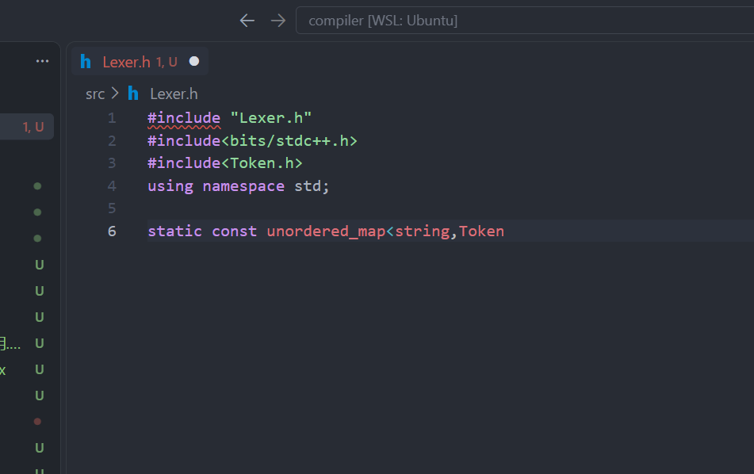
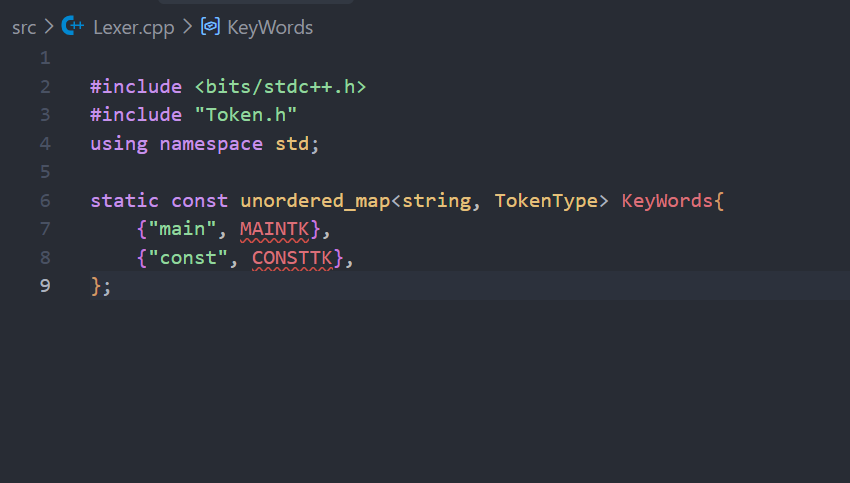
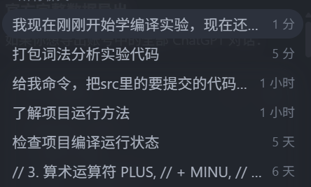

# 01-词法分析入门与骨架

- 会话时间：2026-09-20 16:31:30
- 会话编号：`01a0bdf1-1d01-77e3-868b-f48aa7b5babb`
- 导出范围：仅保留用户与助手可见消息，已排除系统提示、内部推理和工具调用。

## 1. 用户

时间：2026-09-20 16:33:48

我现在刚刚开始学编译实验，现在还什么都不知道，现在要先完成第一个词法分析作业，代码什么都没写，请你给我一个思路，词法分析到底要干什么，我第一步干什么，第二步干什么，后面干什么，如何把这个骨架搭起来

---

## 2. 用户

时间：2026-09-20 16:34:32

我现在刚刚开始学编译实验，现在还什么都不知道，现在要先完成第一个词法分析作业，代码什么都没写，请你给我一个思路，词法分析到底要干什么，我第一步干什么，第二步干什么，后面干什么，如何把这个骨架搭起来

---

## 3. 助手

时间：2026-09-20 16:34:40

我先看一下这个实验目录里有没有题目说明、样例输入输出或指定语言，避免给你一套和作业要求不匹配的骨架。然后我会按“词法分析是什么 → 实现顺序 → 最小可运行骨架 → 如何逐步测试”给你讲。

---

## 4. 助手

时间：2026-09-20 16:34:48

目录里已经有专门的《实验1词法分析要求》和整套文法 PDF。我会使用 PDF 阅读规范核对文法，因为词法分析最容易在“关键字、运算符、数字格式、注释规则”这些细节上和老师要求不一致。

---

## 5. 助手

时间：2026-09-20 16:35:02

要求已经核对清楚：这次不是做“语法是否正确”，而是把源码切成一串 Token；词法阶段唯一要求上报的错误是单独出现的 `&` 或 `|`，错误码都是 `a`。我再核对 PDF 中字符、字符串和错误表的排版原文，然后给你一条从零开始的实现路线。

---

## 6. 助手

时间：2026-09-20 16:36:08

一句话理解：**词法分析就是把源代码这串字符，切成编译器能够理解的一串“单词 Token”。**

例如：

```c
int a = 65;
```

经过词法分析后变成：

```text
INTTK int
IDENFR a
ASSIGN =
INTCON 65
SEMICN ;
```

你现在先不要考虑语法树、表达式优先级、变量是否定义。这些是后面的语法分析和语义分析要做的。

---

## 一、词法分析到底负责什么

词法分析器主要做四件事：

1. 从左到右读取源码。
2. 跳过空格、换行和注释。
3. 识别关键字、标识符、数字、字符串、运算符等 Token。
4. 记录 Token 所在行号以及词法错误。

它认识的是“单词”，不判断这些单词组成的句子是否合理。

例如：

```c
int = = main;
```

虽然语法明显不对，但词法分析仍然可以切出：

```text
INTTK int
ASSIGN =
ASSIGN =
MAINTK main
SEMICN ;
```

“这样的排列合法吗”由下一阶段判断。

---

## 二、你这次作业具体要识别什么

根据项目里的[实验1词法分析要求](</home/zzz2007-cpu/projects/compiler/docs/实验要求/实验1词法分析要求.md>)和[完整文法 PDF](</home/zzz2007-cpu/projects/compiler/docs/2026编译技术实验文法定义及相关说明.pdf>)，需要识别以下几类内容。

### 1. 标识符和关键字

标识符规则：

```text
第一个字符：字母或下划线
后续字符：字母、数字或下划线
```

例如：

```text
a
student
_value
test123
```

先读取出完整单词，再查关键字表：

```cpp
int       -> INTTK
char      -> CHARTK
main      -> MAINTK
if        -> IFTK
while     -> WHILETK
```

不在关键字表中的就是：

```text
IDENFR
```

所以：

```c
int integer;
```

结果是：

```text
INTTK int
IDENFR integer
```

不能因为 `integer` 以 `int` 开头，就把它切成 `int` 和 `eger`。

### 2. 整数常量

连续读取数字：

```text
0
12
300
```

对应：

```text
INTCON
```

注意要保留原始字符串。Token 可以同时保存：

```cpp
lexeme = "300";  // 原始文本，用于输出
value = 300;     // 真正数值，后续阶段使用
```

### 3. 字符常量

例如：

```c
'A'
'\n'
'\\'
'\''
```

对应：

```text
CHARCON
```

同样建议既保存原始文本，也保存解码后的数值：

```cpp
lexeme = "'\\n'";
value = 10;
```

### 4. 字符串常量

例如：

```c
"hello"
"value = %d\n"
```

对应：

```text
STRCON
```

作业输出中需要保留双引号：

```text
STRCON "value = %d\n"
```

### 5. 运算符和分隔符

例如：

```text
+  -  *  /  %
=  ==  !=
<  <=  >  >=
!  &&  ||
(  )  [  ]  {  }
,  ;  :
```

这里一定要使用“最长匹配”。

看到 `=` 时：

```text
下一个字符也是 =  -> EQL ==
否则              -> ASSIGN =
```

看到 `<` 时：

```text
下一个字符是 =  -> LEQ <=
否则            -> LSS <
```

### 6. 注释

注释不产生 Token，直接跳过。

```c
// 单行注释
```

跳到换行符。

```c
/* 多行
   注释 */
```

跳到第一次出现的 `*/`，同时注意更新行号。

### 7. 本次词法错误

本次作业要求处理的词法错误只有：

```text
单独出现的 &
单独出现的 |
```

它们的错误码都是：

```text
a
```

例如：

```c
if (a & b)
```

若 `&` 位于第 2 行：

```text
2 a
```

但不能直接把这个字符丢掉。要求是：

- 单独的 `&` 按 `AND` Token 继续处理，但词素保存为 `"&"`。
- 单独的 `|` 按 `OR` Token 继续处理，但词素保存为 `"|"`。
- 同时记录错误 `a`。

这样即使源程序有错误，后面的分析仍然可以继续。

---

## 三、建议使用的程序骨架

如果你没有语言偏好，我建议先用 C++17。目录可以搭成：

```text
compiler/
├── CMakeLists.txt
├── config.json
├── main.cpp
├── Token.h
├── Lexer.h
└── Lexer.cpp
```

第一版也可以把所有代码写在 `main.cpp` 中跑通，但以后还要做语法分析，尽早拆成几个文件会更省事。

### Token.h

定义 Token 类型和 Token 数据：

```cpp
enum class TokenType {
    IDENFR,
    INTCON,
    CHARCON,
    STRCON,

    CONSTTK,
    INTTK,
    CHARTK,
    VOIDTK,
    MAINTK,
    IFTK,
    ELSETK,
    WHILETK,
    BREAKTK,
    CONTINUETK,
    RETURNTK,
    PRINTFTK,
    STATICTK,
    SWITCHTK,
    CASETK,
    DEFAULTTK,

    NOT,
    AND,
    OR,
    PLUS,
    MINU,
    MULT,
    DIV,
    MOD,
    LSS,
    LEQ,
    GRE,
    GEQ,
    EQL,
    NEQ,
    ASSIGN,

    SEMICN,
    COMMA,
    COLON,
    LPARENT,
    RPARENT,
    LBRACK,
    RBRACK,
    LBRACE,
    RBRACE
};

struct Token {
    TokenType type;
    std::string lexeme;  // 源程序中的原始字符串
    int line;            // 所在行

    // 以后可以继续增加：
    // int intValue;
    // char charValue;
};
```

错误也单独定义：

```cpp
struct CompileError {
    int line;
    char code;
};
```

### Lexer.h

词法分析器维护三个核心状态：

```cpp
class Lexer {
private:
    std::string source;
    std::size_t pos = 0;
    int line = 1;

    std::vector<Token> tokens;
    std::vector<CompileError> errors;

public:
    explicit Lexer(const std::string& source);

    void scan();

    const std::vector<Token>& getTokens() const;
    const std::vector<CompileError>& getErrors() const;

private:
    bool isAtEnd() const;
    char peek() const;
    char peekNext() const;
    char advance();
    bool match(char expected);

    void scanOneToken();
    void scanIdentifier();
    void scanNumber();
    void scanCharConstant();
    void scanStringConstant();
    void skipLineComment();
    void skipBlockComment();

    void addToken(TokenType type, const std::string& lexeme, int tokenLine);
    void addError(int errorLine, char code);
};
```

这些辅助函数的含义是：

```text
peek()       看当前字符，但不移动
peekNext()   看下一个字符
advance()    取出当前字符，并向后移动
match('=')   如果当前字符是 '='，就消费它并返回 true
isAtEnd()    是否到达源码结尾
```

---

## 四、扫描器的核心流程

核心思想就是一个循环：

```cpp
void Lexer::scan() {
    while (!isAtEnd()) {
        scanOneToken();
    }
}
```

`scanOneToken()` 按下面的顺序判断：

```text
读取当前字符
    │
    ├─ 空格、Tab、回车 → 跳过
    ├─ 换行           → line++
    ├─ 字母或下划线   → 标识符/关键字
    ├─ 数字           → 整数常量
    ├─ 单引号         → 字符常量
    ├─ 双引号         → 字符串常量
    ├─ /              → 除号、//注释或/*注释
    ├─ = ! < >        → 检查是否为双字符运算符
    ├─ &              → &&，或记录错误a
    ├─ |              → ||，或记录错误a
    └─ 其他符号       → 单字符Token
```

伪代码大概是：

```cpp
void Lexer::scanOneToken() {
    int tokenLine = line;
    char ch = advance();

    if (ch == ' ' || ch == '\t' || ch == '\r') {
        return;
    }

    if (ch == '\n') {
        line++;
        return;
    }

    if (isLetter(ch) || ch == '_') {
        scanIdentifier();
        return;
    }

    if (isDigit(ch)) {
        scanNumber();
        return;
    }

    switch (ch) {
        case '\'':
            scanCharConstant();
            break;

        case '"':
            scanStringConstant();
            break;

        case '=':
            if (match('=')) {
                // EQL ==
            } else {
                // ASSIGN =
            }
            break;

        case '&':
            if (match('&')) {
                // AND &&
            } else {
                // AND &
                // error: tokenLine, 'a'
            }
            break;

        case '/':
            if (match('/')) {
                skipLineComment();
            } else if (match('*')) {
                skipBlockComment();
            } else {
                // DIV /
            }
            break;

        // 其他字符……
    }
}
```

这不是完整答案代码，而是你整个词法分析器最核心的骨架。

---

## 五、标识符怎么扫描

假设当前已经读到了第一个字母，接下来一直读取：

```text
字母、数字、下划线
```

伪代码：

```cpp
while (isLetterOrDigit(peek()) || peek() == '_') {
    advance();
}
```

得到完整字符串后查关键字表：

```cpp
std::unordered_map<std::string, TokenType> keywords = {
    {"int", TokenType::INTTK},
    {"char", TokenType::CHARTK},
    {"main", TokenType::MAINTK},
    {"if", TokenType::IFTK},
    {"else", TokenType::ELSETK}
    // 继续补齐……
};
```

判断：

```cpp
auto it = keywords.find(word);

if (it != keywords.end()) {
    addToken(it->second, word, tokenLine);
} else {
    addToken(TokenType::IDENFR, word, tokenLine);
}
```

---

## 六、字符串和字符常量怎么扫描

### 字符串

读到 `"` 后，一直扫描到下一个 `"`：

```cpp
while (!isAtEnd() && peek() != '"') {
    if (peek() == '\n') {
        line++;
    }
    advance();
}
```

最后消费右边的 `"`。

要注意：输出的 `lexeme` 必须包含左右双引号。

### 字符

读到 `'` 后，需要考虑普通字符和转义字符：

```text
'A'     普通字符
'\n'    转义字符
'\\'    反斜杠
'\''    单引号
```

可以按照这个思路：

```text
消费左单引号
如果下一个字符是反斜杠：
    消费反斜杠和转义字符
否则：
    消费一个普通字符
消费右单引号
```

第一版先保证能正确保留原始文本。解码字符真实数值可以作为第二步完成。

---

## 七、主程序负责什么

`main.cpp` 不应该自己识别 Token。它只负责：

1. 读取 `testfile.txt`。
2. 创建 Lexer。
3. 执行词法分析。
4. 输出 `lexer.txt`。
5. 输出 `error.txt`。

大概是：

```cpp
int main() {
    std::string source = readWholeFile("testfile.txt");

    Lexer lexer(source);
    lexer.scan();

    writeTokens("lexer.txt", lexer.getTokens());
    writeErrors("error.txt", lexer.getErrors());

    return 0;
}
```

建议内部始终生成完整 Token 列表和错误列表。至于是否输出 Token，通过一个开关控制：

```cpp
bool outputTokens = true;
```

因为老师特别强调：以后完整编译器不再需要输出所有 Token，但语法分析仍然要使用这些 Token。

---

## 八、你应该按照什么顺序写

不要一上来同时处理所有情况。按照下面的顺序，每完成一步就测试。

### 第一步：搭最小工程

先创建：

```text
main.cpp
Token.h
Lexer.h
Lexer.cpp
CMakeLists.txt
```

保证可以读取 `testfile.txt`，哪怕暂时什么都不识别。

### 第二步：实现位置移动

先实现：

```cpp
isAtEnd()
peek()
peekNext()
advance()
match()
```

这些是后面所有扫描操作的地基。

### 第三步：跳过空白并统计行号

测试：

```c


int
main
```

确认 `int` 和 `main` 的行号正确。

### 第四步：标识符和关键字

测试：

```c
int main apple _value value123
```

预期：

```text
INTTK int
MAINTK main
IDENFR apple
IDENFR _value
IDENFR value123
```

### 第五步：整数

测试：

```c
0 1 65 300
```

全部应为 `INTCON`。

### 第六步：单字符符号

实现：

```text
+ - * % ; , : ( ) [ ] { }
```

### 第七步：双字符运算符

实现：

```text
= == ! != < <= > >= && ||
```

必须先判断双字符，再判断单字符。

### 第八步：注释和除号

测试：

```c
a / b
a // comment
b
a /* comment
comment */ b
```

重点检查多行注释后的行号。

### 第九步：字符和字符串

测试：

```c
'A'
'\n'
"hello"
"value = %d\n"
```

### 第十步：错误 `a`

测试：

```c
if (a & b || c | d) {
}
```

应记录两个错误，但仍扫描完整个文件。

### 第十一步：运行老师样例

最后再用作业说明里的完整样例逐行对比 `lexer.txt`。

---

## 九、最容易踩的坑

- 把 `integer` 错误地识别成关键字 `int` 加标识符 `eger`。
- 先识别 `=`，导致 `==` 被切成两个赋值号。
- 看到 `/` 就直接认为是除号，没有检查注释。
- 跳过多行注释时没有更新行号。
- 字符串输出时丢掉双引号。
- 把字符串中的 `\n` 直接变成真实换行，导致输出被拆成两行。
- 只保存数值，没有保存原始文本。
- 遇到错误后立即停止，没有继续扫描剩余代码。
- 某个未知字符既不消费也不返回，造成死循环。
- 使用 `while (!file.eof())` 读取文件，容易多读一次；更适合一次性读取整个文件。

你现在真正应该做的第一件事，是先写出 `Token`、`Lexer` 两个结构，并完成 `peek/advance/match`。等这三个函数正确后，后面的工作本质上就是不断增加字符分类规则。

---

## 7. 用户

时间：2026-09-20 16:45:04

现在我建好了，告诉我Cmake和config两个文件应该里面写什么啊

---

## 8. 助手

时间：2026-09-20 16:45:11

我先看一下你刚建好的源文件名称，然后直接给你能用的 `CMakeLists.txt` 和 `config.json`，保证生成的可执行文件名符合平台要求。

---

## 9. 助手

时间：2026-09-20 16:45:25

你现在的文件名 `CmakeLists.txt` 大小写不正确，必须改成：

```text
CMakeLists.txt
```

内容如下：

```cmake
cmake_minimum_required(VERSION 3.10)

project(Compiler)

set(CMAKE_CXX_STANDARD 17)
set(CMAKE_CXX_STANDARD_REQUIRED ON)

add_executable(Compiler
    main.cpp
    Lexer.cpp
)
```

头文件 `Lexer.h` 和 `Token.h` 不需要写进 `add_executable`，只要在 `.cpp` 中正常 `#include` 即可。

`config.json` 内容如下：

```json
{
  "programmingLanguage": "CPP",
  "objectCode": "LLVM"
}
```

当前作业还没有生成目标代码，所以 `LLVM` 暂时这样填即可，不会绑定后续选择。

你的 `src` 目录最终应该是：

```text
src/
├── CMakeLists.txt
├── config.json
├── main.cpp
├── Lexer.cpp
├── Lexer.h
└── Token.h
```

在项目根目录测试编译：

```bash
cmake -S src -B build
cmake --build build
```

编译成功后运行：

```bash
./build/Compiler
```

提交时，压缩包顶层必须直接出现这些文件，不能再套一层 `src`：

```text
提交.zip
├── CMakeLists.txt
├── config.json
├── main.cpp
├── Lexer.cpp
├── Lexer.h
└── Token.h
```

也就是说，到时候应压缩 `src` 目录里面的文件，而不是把整个 `src` 文件夹压进去。

---

## 10. 用户

时间：2026-09-20 17:18:08

我现在开始写词法分析了，我所理解的其实就是给了一个文本文档，里面是一堆代码，然后我把这些代码进行分词，如果是能识别的就识别，不能识别的就报错，怎么办？

---

## 11. 助手

时间：2026-09-20 17:18:38

你的理解基本正确，但需要补充一句：

> 词法分析不是判断“这段代码写得对不对”，而是判断“当前这些字符能组成什么单词 Token”。

比如：

```c
int age = 18;
```

词法分析器会从左到右切成：

```text
INTTK int
IDENFR age
ASSIGN =
INTCON 18
SEMICN ;
```

## 词法分析器的工作方式

可以把它想象成一个带指针的扫描器：

```text
int age = 18;
^
当前位置 pos
```

识别完 `int` 后，指针向后移动：

```text
int age = 18;
    ^
```

然后继续识别 `age`，直到文件末尾。

核心状态只有这几个：

```cpp
std::string source;  // 整个源文件
int pos = 0;         // 当前扫描位置
int line = 1;        // 当前行号
```

核心循环：

```cpp
while (pos < source.size()) {
    // 根据 source[pos] 判断接下来是什么
}
```

## 每次看到一个字符应该怎么办

按照下面的顺序判断：

```text
当前字符
    │
    ├─ 空格或 Tab      → 跳过
    ├─ 换行            → line++，然后跳过
    ├─ 字母或下划线    → 读取完整标识符或关键字
    ├─ 数字            → 读取完整整数
    ├─ 单引号 '        → 读取字符常量
    ├─ 双引号 "        → 读取字符串常量
    ├─ /               → 判断是除号还是注释
    ├─ = ! < >         → 判断单字符或双字符运算符
    ├─ & 或 |          → 判断是否合法
    └─ 其他符号        → 查单字符符号表
```

例如当前字符是字母：

```c
student123
^
```

就一直读取，直到遇到“不属于字母、数字、下划线”的字符：

```cpp
while (isalnum(source[pos]) || source[pos] == '_') {
    pos++;
}
```

于是得到：

```text
student123
```

然后查询关键字表：

```cpp
if (word == "int") {
    // INTTK
} else if (word == "if") {
    // IFTK
} else {
    // IDENFR
}
```

实际编写时建议用 `unordered_map` 保存关键字，不需要写很多 `else if`。

## “能识别”和“代码正确”不是一回事

比如：

```c
int = + ;
```

这段代码语法明显错误，但每个词都可以识别：

```text
INTTK int
ASSIGN =
PLUS +
SEMICN ;
```

因此，词法分析阶段不会报错。

这些错误要留给后面的阶段：

- `int = + ;`：语法错误。
- 使用未定义变量：语义错误。
- 单独出现 `&` 或 `|`：本次作业规定的词法错误。

## 这次作业遇到不能识别的字符怎么办

根据本次实验要求，词法阶段明确要求处理的错误只有：

```text
单独出现的 &
单独出现的 |
```

正确写法应该是：

```c
a && b
a || b
```

错误写法：

```c
a & b
a | b
```

遇到单独的 `&`：

1. 记录当前行的错误 `a`。
2. 仍然生成 `AND` Token。
3. Token 原始内容保存为 `"&"`。
4. 继续扫描后面的代码，不能停止。

例如：

```c
if (1 & 2)
```

如果在第 3 行：

```text
error.txt：

3 a
```

但是词法分析器内部仍会形成：

```text
IFTK if
LPARENT (
INTCON 1
AND &
INTCON 2
RPARENT )
```

单独的 `|` 同理，按 `OR` Token 继续处理。

代码逻辑类似：

```cpp
if (current == '&') {
    if (peekNext() == '&') {
        // 识别 &&
        addToken(TokenType::AND, "&&", line);
        pos += 2;
    } else {
        // 单独的 & 是词法错误
        addError(line, 'a');
        addToken(TokenType::AND, "&", line);
        pos++;
    }
}
```

这里最重要的是：

> 报错不等于停止。记录错误以后，还要继续完成整个文件的词法分析。

## 不在要求中的奇怪字符怎么办

例如：

```c
int a = @;
```

`@` 不属于这个语言。

虽然老师的测试一般不会出现规定之外的词法错误，但为了防止程序卡死，你至少要消费掉这个字符：

```cpp
pos++;
```

否则扫描器一直停留在 `@`，会进入死循环。

你可以暂时这样处理：

```cpp
default:
    pos++;  // 暂时跳过未知字符
    break;
```

但不要擅自把它记录为错误 `a`，因为 `a` 只表示单独的 `&` 或 `|`。

## 你现在应该先写哪一部分

先不要急着把所有 Token 一次写完。第一步写下面这些基础函数：

```cpp
bool Lexer::isAtEnd() const {
    return pos >= source.size();
}

char Lexer::peek() const {
    if (isAtEnd()) {
        return '\0';
    }
    return source[pos];
}

char Lexer::peekNext() const {
    if (pos + 1 >= source.size()) {
        return '\0';
    }
    return source[pos + 1];
}

char Lexer::advance() {
    return source[pos++];
}

bool Lexer::match(char expected) {
    if (isAtEnd() || source[pos] != expected) {
        return false;
    }

    pos++;
    return true;
}
```

然后写扫描主循环：

```cpp
void Lexer::scan() {
    while (!isAtEnd()) {
        scanOneToken();
    }
}
```

第一版 `scanOneToken()` 只实现三种东西：

1. 空白和换行。
2. 标识符和关键字。
3. 整数。

用下面的输入测试：

```c
int main
abc
123
```

期望得到：

```text
INTTK int
MAINTK main
IDENFR abc
INTCON 123
```

这一步成功以后，再逐个添加运算符、注释、字符和字符串。这样调试起来最轻松。

---

## 12. 用户

时间：2026-09-20 17:20:35

首先我要在main里读取txt文件，是吗？把一整个代码字符串保存到什么数据结构里呢，Vector？

---

## 13. 助手

时间：2026-09-20 17:20:48

对，第一步就是在 `main.cpp` 中读取整个 `testfile.txt`。

但不需要保存到 `vector`，直接把整个文件保存到一个 `std::string` 最方便：

```cpp
std::string source;
```

因为源程序本质上就是一长串字符，后续可以用下标扫描：

```cpp
source[pos]
```

例如，文件内容：

```c
int main() {
    return 0;
}
```

读取后，内存中的 `source` 大致是：

```text
"int main() {\n    return 0;\n}"
```

换行符也保存在字符串中，所以可以统计行号。

## main.cpp 可以先这样写

```cpp
#include <fstream>
#include <iostream>
#include <sstream>
#include <string>

int main() {
    std::ifstream inputFile("testfile.txt");

    if (!inputFile.is_open()) {
        std::cerr << "无法打开 testfile.txt" << std::endl;
        return 1;
    }

    std::stringstream buffer;
    buffer << inputFile.rdbuf();

    std::string source = buffer.str();

    inputFile.close();

    std::cout << source << std::endl;

    return 0;
}
```

这里：

```cpp
std::ifstream inputFile("testfile.txt");
```

负责打开文件。

```cpp
std::stringstream buffer;
buffer << inputFile.rdbuf();
```

负责把整个文件读进缓冲区。

```cpp
std::string source = buffer.str();
```

将整个文件内容保存为一个字符串。

## 接下来把字符串交给 Lexer

等 `Lexer` 类搭起来以后，`main.cpp` 会变成：

```cpp
#include "Lexer.h"

#include <fstream>
#include <iostream>
#include <sstream>
#include <string>

int main() {
    std::ifstream inputFile("testfile.txt");

    if (!inputFile.is_open()) {
        std::cerr << "无法打开 testfile.txt" << std::endl;
        return 1;
    }

    std::stringstream buffer;
    buffer << inputFile.rdbuf();

    std::string source = buffer.str();

    Lexer lexer(source);
    lexer.scan();

    return 0;
}
```

Lexer 内部保存这个字符串：

```cpp
class Lexer {
private:
    std::string source;
    std::size_t pos = 0;
    int line = 1;

public:
    explicit Lexer(const std::string& source)
        : source(source) {
    }

    void scan();
};
```

为了避免复制整个字符串，也可以写成：

```cpp
explicit Lexer(std::string source)
    : source(std::move(source)) {
}
```

不过刚开始学习时，使用第一种写法更直观。

## `vector` 用在哪里

`vector` 不是用来保存源码的，而是用来保存分析后的 Token：

```cpp
std::vector<Token> tokens;
```

对应关系是：

```text
testfile.txt
      │
      ▼
std::string source        保存整份源代码
      │
      ▼
Lexer 从左到右扫描
      │
      ▼
std::vector<Token> tokens 保存识别出的单词
```

例如：

```cpp
std::string source = "int a = 10;";
```

经过扫描后：

```cpp
tokens = {
    {INTTK,  "int", 1},
    {IDENFR, "a",   1},
    {ASSIGN, "=",   1},
    {INTCON, "10",  1},
    {SEMICN, ";",   1}
};
```

所以你现在的第一步目标很简单：

1. 用 `std::string source` 读取整个文件。
2. 输出 `source`，确认内容和 `testfile.txt` 一样。
3. 然后再把 `source` 交给 `Lexer`。

---

## 14. 用户

时间：2026-09-20 22:06:24

lexer是啥啊

---

## 15. 用户

时间：2026-09-20 22:09:41

lexer是啥啊

---

## 16. 助手

时间：2026-09-20 22:09:59

`Lexer` 就是“词法分析器”的英文名字，也就是你准备自己写的那个类，不是 C++ 自带的东西。

完整关系是：

```text
testfile.txt
    ↓
读取成一个大字符串 source
    ↓
交给 Lexer（词法分析器）
    ↓
Lexer 把字符串切分成一系列 Token（单词）
```

比如源代码：

```c
int a = 10;
```

交给 `Lexer` 后，它会识别成：

```text
INTTK int
IDENFR a
ASSIGN =
INTCON 10
SEMICN ;
```

你可以先在 `Lexer.h` 中写一个最简单的框架：

```cpp
#ifndef LEXER_H
#define LEXER_H

#include <string>

class Lexer {
private:
    std::string source;  // 保存完整源代码
    std::size_t pos;     // 当前扫描位置
    int line;            // 当前行号

public:
    explicit Lexer(const std::string& code);

    void scan();
};

#endif
```

然后在 `Lexer.cpp` 中实现：

```cpp
#include "Lexer.h"

#include <iostream>

Lexer::Lexer(const std::string& code)
    : source(code), pos(0), line(1) {
}

void Lexer::scan() {
    while (pos < source.size()) {
        char current = source[pos];

        std::cout << current;

        if (current == '\n') {
            line++;
        }

        pos++;
    }
}
```

这里：

```cpp
Lexer lexer(source);
```

表示创建一个词法分析器对象，把源代码交给它。

```cpp
lexer.scan();
```

表示让它开始扫描源代码。

因此 `main.cpp` 可以这样连接：

```cpp
#include "Lexer.h"

#include <fstream>
#include <iostream>
#include <sstream>
#include <string>

int main() {
    std::ifstream inputFile("testfile.txt");

    if (!inputFile.is_open()) {
        std::cerr << "无法打开 testfile.txt\n";
        return 1;
    }

    std::stringstream buffer;
    buffer << inputFile.rdbuf();

    std::string source = buffer.str();

    Lexer lexer(source); // 创建词法分析器
    lexer.scan();        // 开始词法分析

    return 0;
}
```

现在这版 `Lexer` 只会把字符原样输出，还没有真正“分词”。这是正常的。

下一步再逐渐让 `scan()` 学会：

```text
看到字母    → 识别标识符或关键字
看到数字    → 识别整数
看到空格    → 跳过
看到换行    → 行号加一
看到运算符  → 识别对应 Token
```

所以简单来说：

```cpp
Lexer
```

就是你给“负责词法分析的代码”起的类名。你也可以叫 `LexicalAnalyzer`，但 `Lexer` 更短，也是最常见的名称。

---

## 17. 用户

时间：2026-09-20 22:11:00

我是不是需要先定义一堆常量字符，匹配的话我总应该有一些模版吧

---

## 18. 助手

时间：2026-09-20 22:12:06

对，你确实需要先定义一套“匹配模板”。不过不是把所有可能的单词都定义成常量字符，而是分成两种：

1. 固定内容：`int`、`if`、`+`、`==` 等，可以放进映射表。
2. 不固定内容：变量名、数字、字符串，要通过规则识别。

比如变量名不可能提前列出：

```c
age
student
number123
```

它们都按照同一个规则识别为 `IDENFR`。

## 第一步：定义 Token 类别

在 `Token.h` 中定义所有单词类别：

```cpp
#ifndef TOKEN_H
#define TOKEN_H

#include <string>

enum class TokenType {
    // 标识符和常量
    IDENFR,
    INTCON,
    CHARCON,
    STRCON,

    // 关键字
    MAINTK,
    CONSTTK,
    INTTK,
    CHARTK,
    VOIDTK,
    IFTK,
    ELSETK,
    WHILETK,
    BREAKTK,
    CONTINUETK,
    RETURNTK,
    PRINTFTK,
    STATICTK,
    SWITCHTK,
    CASETK,
    DEFAULTTK,

    // 运算符
    NOT,
    AND,
    OR,
    PLUS,
    MINU,
    MULT,
    DIV,
    MOD,
    LSS,
    LEQ,
    GRE,
    GEQ,
    EQL,
    NEQ,
    ASSIGN,

    // 分隔符
    SEMICN,
    COMMA,
    COLON,
    LPARENT,
    RPARENT,
    LBRACK,
    RBRACK,
    LBRACE,
    RBRACE
};

struct Token {
    TokenType type;       // 单词类别
    std::string lexeme;   // 源代码中的原始内容
    int line;             // 所在行
};

#endif
```

例如：

```c
int age = 18;
```

会产生：

```cpp
Token{TokenType::INTTK,  "int", 1}
Token{TokenType::IDENFR, "age", 1}
Token{TokenType::ASSIGN, "=",   1}
Token{TokenType::INTCON, "18",  1}
Token{TokenType::SEMICN, ";",   1}
```

## 第二步：建立关键字表

关键字是固定字符串，适合使用 `unordered_map`。

在 `Lexer.cpp` 中：

```cpp
#include "Lexer.h"

#include <unordered_map>

static const std::unordered_map<std::string, TokenType> keywords = {
    {"main",     TokenType::MAINTK},
    {"const",    TokenType::CONSTTK},
    {"int",      TokenType::INTTK},
    {"char",     TokenType::CHARTK},
    {"void",     TokenType::VOIDTK},
    {"if",       TokenType::IFTK},
    {"else",     TokenType::ELSETK},
    {"while",    TokenType::WHILETK},
    {"break",    TokenType::BREAKTK},
    {"continue", TokenType::CONTINUETK},
    {"return",   TokenType::RETURNTK},
    {"printf",   TokenType::PRINTFTK},
    {"static",   TokenType::STATICTK},
    {"switch",   TokenType::SWITCHTK},
    {"case",     TokenType::CASETK},
    {"default",  TokenType::DEFAULTTK}
};
```

扫描到一串字母后，查表：

```cpp
auto it = keywords.find(word);

if (it != keywords.end()) {
    // 找到了，是关键字
    addToken(it->second, word, line);
} else {
    // 没找到，是普通标识符
    addToken(TokenType::IDENFR, word, line);
}
```

因此：

```text
int       → INTTK
main      → MAINTK
student   → IDENFR
integer   → IDENFR
```

## 第三步：建立单字符符号表

这些符号只有一个字符：

```text
+ - * % ; , : ( ) [ ] { }
```

可以使用：

```cpp
static const std::unordered_map<char, TokenType> singleCharTokens = {
    {'+', TokenType::PLUS},
    {'-', TokenType::MINU},
    {'*', TokenType::MULT},
    {'%', TokenType::MOD},
    {';', TokenType::SEMICN},
    {',', TokenType::COMMA},
    {':', TokenType::COLON},
    {'(', TokenType::LPARENT},
    {')', TokenType::RPARENT},
    {'[', TokenType::LBRACK},
    {']', TokenType::RBRACK},
    {'{', TokenType::LBRACE},
    {'}', TokenType::RBRACE}
};
```

扫描时查询：

```cpp
auto it = singleCharTokens.find(current);

if (it != singleCharTokens.end()) {
    std::string lexeme(1, current);
    addToken(it->second, lexeme, line);
    pos++;
}
```

这一句：

```cpp
std::string lexeme(1, current);
```

表示把一个 `char` 转换成一个 `string`。

## 第四步：双字符运算符单独判断

下面这些符号不能只靠单字符表：

```text
=  ==
!  !=
<  <=
>  >=
&&
||
/  //  /*
```

因为它们需要“向后看一个字符”。

例如：

```cpp
case '=':
    if (peekNext() == '=') {
        addToken(TokenType::EQL, "==", line);
        pos += 2;
    } else {
        addToken(TokenType::ASSIGN, "=", line);
        pos++;
    }
    break;
```

也可以配合 `advance()` 和 `match()`：

```cpp
case '=':
    if (match('=')) {
        addToken(TokenType::EQL, "==", line);
    } else {
        addToken(TokenType::ASSIGN, "=", line);
    }
    break;
```

## 第五步：定义输出名称

`enum class TokenType` 不能直接输出成 `INTTK` 这样的字符串，因此还需要一个转换函数：

```cpp
std::string tokenTypeToString(TokenType type) {
    switch (type) {
        case TokenType::IDENFR: return "IDENFR";
        case TokenType::INTCON: return "INTCON";
        case TokenType::CHARCON: return "CHARCON";
        case TokenType::STRCON: return "STRCON";

        case TokenType::MAINTK: return "MAINTK";
        case TokenType::CONSTTK: return "CONSTTK";
        case TokenType::INTTK: return "INTTK";
        case TokenType::CHARTK: return "CHARTK";
        case TokenType::VOIDTK: return "VOIDTK";

        // 后面继续补齐

        default: return "UNKNOWN";
    }
}
```

输出 Token 时：

```cpp
outputFile
    << tokenTypeToString(token.type)
    << " "
    << token.lexeme
    << "\n";
```

## 总体上有三种识别方法

| 内容 | 识别方法 |
|---|---|
| `int`、`if`、`while` | 读取完整单词后查关键字表 |
| `+`、`;`、`(` | 查单字符符号表 |
| `==`、`!=`、`&&` | 查看当前字符和下一个字符 |
| `student123` | 按标识符规则连续读取 |
| `12345` | 按数字规则连续读取 |
| `"hello"` | 一直读到右双引号 |
| 注释 | 一直跳过到换行或 `*/` |

所以你要定义的是：

```text
Token 类别 enum
关键字映射表
单字符符号映射表
双字符运算符判断规则
```

而不是给每一个可能出现的变量名和数字准备模板。变量名、数字、字符和字符串都是通过规则识别的。

---

## 19. 用户

时间：2026-09-20 22:13:01

你对于这些名字的命名逻辑是什么

---

## 20. 助手

时间：2026-09-20 22:13:28

这些名字分为两类：

1. 老师规定的类别码，不能随便修改。
2. 我们自己写的变量名和函数名，可以按含义命名。

## 一、TokenType 中的名字来自实验要求

例如：

```cpp
enum class TokenType {
    IDENFR,
    INTCON,
    INTTK,
    PLUS
};
```

这些不是我随便起的，而是老师要求最终输出的“单词类别码”。

### 标识符和常量

| 类别码 | 来源 | 含义 |
|---|---|---|
| `IDENFR` | Ident | 标识符，例如变量名、函数名 |
| `INTCON` | Integer Constant | 整数常量 |
| `CHARCON` | Character Constant | 字符常量 |
| `STRCON` | String Constant | 字符串常量 |

这里：

```text
INT  = Integer
CHAR = Character
STR  = String
CON  = Constant
```

`IDENFR` 是课程文档指定的固定类别码。它不是 C++ 的标准命名，不需要自己改成 `IDENTIFIER`，否则输出可能不符合评测要求。

### 关键字

关键字通常是：

```text
关键字英文 + TK
```

其中 `TK` 可以理解为 Token。

| 源代码 | 类别码 |
|---|---|
| `int` | `INTTK` |
| `char` | `CHARTK` |
| `void` | `VOIDTK` |
| `if` | `IFTK` |
| `else` | `ELSETK` |
| `while` | `WHILETK` |
| `main` | `MAINTK` |
| `return` | `RETURNTK` |

例如：

```text
RETURN + TK = RETURNTK
```

### 运算符

运算符类别码通常是英文含义的缩写：

| 符号 | 类别码 | 英文含义 |
|---|---|---|
| `+` | `PLUS` | plus |
| `-` | `MINU` | minus |
| `*` | `MULT` | multiply |
| `/` | `DIV` | divide |
| `%` | `MOD` | modulo |
| `=` | `ASSIGN` | assignment |
| `==` | `EQL` | equal |
| `!=` | `NEQ` | not equal |
| `<` | `LSS` | less |
| `<=` | `LEQ` | less or equal |
| `>` | `GRE` | greater |
| `>=` | `GEQ` | greater or equal |
| `!` | `NOT` | logical not |
| `&&` | `AND` | logical and |
| `||` | `OR` | logical or |

例如：

```text
NEQ = Not EQual
LEQ = Less or EQual
GEQ = Greater or EQual
```

### 括号和标点

| 符号 | 类别码 | 含义 |
|---|---|---|
| `;` | `SEMICN` | semicolon |
| `,` | `COMMA` | comma |
| `:` | `COLON` | colon |
| `(` | `LPARENT` | left parenthesis |
| `)` | `RPARENT` | right parenthesis |
| `[` | `LBRACK` | left bracket |
| `]` | `RBRACK` | right bracket |
| `{` | `LBRACE` | left brace |
| `}` | `RBRACE` | right brace |

这里要区分三种括号：

```text
parenthesis  ()
bracket      []
brace        {}
```

前面的 `L` 和 `R` 分别表示：

```text
L = Left
R = Right
```

因此：

```text
LPARENT = 左圆括号
RBRACK  = 右方括号
LBRACE  = 左花括号
```

## 二、我们自己写的变量名

这些名字不是老师规定的，只是为了让代码容易理解。

### `source`

```cpp
std::string source;
```

表示源代码：

```text
source code → source
```

它里面保存整个 `testfile.txt`。

### `pos`

```cpp
std::size_t pos = 0;
```

`pos` 是 `position` 的缩写，表示当前扫描位置。

例如：

```text
int age;
    ^
    pos
```

也可以叫：

```cpp
currentPosition
```

但 `pos` 更简洁。

### `line`

```cpp
int line = 1;
```

表示当前行号，因为错误输出需要行号。

### `lexeme`

```cpp
std::string lexeme;
```

`lexeme` 是词法分析里的专业术语，中文一般叫“词素”。

例如：

```c
int age = 18;
```

其中：

```text
Token类别       lexeme
INTTK           "int"
IDENFR          "age"
ASSIGN          "="
INTCON          "18"
SEMICN          ";"
```

`TokenType` 表示这个单词属于哪一类，`lexeme` 表示源代码里实际写了什么。

比如：

```c
int age;
int number;
```

`age` 和 `number` 的类型都是：

```cpp
TokenType::IDENFR
```

但词素分别是：

```text
"age"
"number"
```

### `tokens`

```cpp
std::vector<Token> tokens;
```

复数形式表示保存了很多个 Token。

```text
token   一个Token
tokens  多个Token
```

### `current`

```cpp
char current = source[pos];
```

表示当前正在处理的字符。

### `peek`

```cpp
char peek();
```

`peek` 的意思是“偷看一眼”。它查看当前字符，但不移动位置。

### `peekNext`

```cpp
char peekNext();
```

查看下一个字符，但不移动位置。

这个函数用于判断：

```text
= 还是 ==
/ 还是 //
< 还是 <=
```

### `advance`

```cpp
char advance();
```

表示读取当前字符，同时把位置向后移动：

```cpp
char Lexer::advance() {
    return source[pos++];
}
```

### `match`

```cpp
bool match(char expected);
```

判断当前位置是不是期望的字符。如果匹配，就把它消费掉。

```cpp
if (match('=')) {
    // 当前是第二个等号，识别出 ==
}
```

### `scan`

```cpp
void scan();
```

表示扫描整个源代码。

### `scanOneToken`

```cpp
void scanOneToken();
```

表示尝试扫描一个 Token。

### `addToken`

```cpp
void addToken(...);
```

表示把识别出的 Token 放进：

```cpp
std::vector<Token> tokens;
```

## 三、整体命名规律

我采用的是：

```text
类和类型：大驼峰
变量和函数：小驼峰
枚举值：老师规定的大写类别码
```

例如：

```cpp
class Lexer;              // 类：大驼峰
struct Token;             // 结构体：大驼峰
enum class TokenType;     // 类型：大驼峰

std::string source;       // 变量：小写
int currentLine;          // 变量：小驼峰
void scanOneToken();      // 函数：小驼峰

TokenType::INTTK;         // 枚举值：规定的类别码
TokenType::IDENFR;
```

最重要的是：`INTTK`、`IDENFR`、`SEMICN` 这些名称必须和作业要求一致；`source`、`pos`、`scan()` 等内部名称则可以根据自己的习惯调整。

---

## 21. 用户

时间：2026-09-20 22:17:03

那个规定命名的文档在哪

---

## 22. 助手

时间：2026-09-20 22:17:09

我帮你定位到具体文件和行号；类别码表在“实验1词法分析要求”里，完整语言规则和错误码在另一份文法 PDF 里。

---

## 23. 助手

时间：2026-09-20 22:17:24

规定的 Token 类别码在这个文件：

[实验1词法分析要求.md](</home/zzz2007-cpu/projects/compiler/docs/实验要求/实验1词法分析要求.md:12>)

从第 12 行开始有一张表：

```text
单词名称       类别码
Ident         IDENFR
IntConst      INTCON
CharConst     CHARCON
StringConst   STRCON
while         WHILETK
...
```

你在 `TokenType` 中定义的名字，需要按照这张表来，不能自己换名称。

完整文法、字符和字符串规则，以及错误码则在：

[2026编译技术实验文法定义及相关说明.pdf](</home/zzz2007-cpu/projects/compiler/docs/2026编译技术实验文法定义及相关说明.pdf>)

重点看：

- 第 3–6 页：文法、标识符、注释、数字、字符和字符串规则。
- 第 12 页：错误类别码，其中单独的 `&` 或 `|` 是错误 `a`。

当前阶段，你先以 Markdown 文件第 12 行的类别码表为准来写 `TokenType`。

---

## 24. 用户

时间：2026-09-20 22:34:20

IDENFR,
    INTCON,
    CHARCON,
    STRCON,
    CONTINUETK,
    DEFAULTTK,
    PRINTFTK,
    RETURNTK,
    STATICTK,
    BREAKTK,
    CONSTTK,
    WHILETK,
    CASETK,
    CHARTK,
    ELSETK,
    MAINTK,
    VOIDTK,
    INTTK,
    IFTK,
    SWITCHTK,
    NEQ,
    LEQ,
    EQL,
    GEQ,
    NOT,
    MOD,
    LPARENT,
    RPARENT,
    MULT,
    PLUS,
    COMMA,
    DIV,
    COLON,
    SEMICN,
    OR,
    ASSIGN,
    GRE,
    LBRACK,
    RBRACK,
    LBRACE,
    RBRACE,
    MINU,
    AND
这些全吗，给我分好组

---

## 25. 助手

时间：2026-09-20 22:35:17

还差一个：小于号 `<` 对应的 `LSS`。

建议按下面方式分组，后面写词法分析时更容易查找：

```cpp
enum class TokenType {
    // 1. 标识符与常量
    IDENFR,    // 标识符
    INTCON,    // 整数常量
    CHARCON,   // 字符常量
    STRCON,    // 字符串常量

    // 2. 关键字
    MAINTK,       // main
    CONSTTK,      // const
    INTTK,        // int
    CHARTK,       // char
    VOIDTK,       // void
    IFTK,         // if
    ELSETK,       // else
    WHILETK,      // while
    BREAKTK,      // break
    CONTINUETK,   // continue
    RETURNTK,     // return
    PRINTFTK,     // printf
    STATICTK,     // static
    SWITCHTK,     // switch
    CASETK,       // case
    DEFAULTTK,    // default

    // 3. 算术运算符
    PLUS,      // +
    MINU,      // -
    MULT,      // *
    DIV,       // /
    MOD,       // %

    // 4. 关系运算符
    LSS,       // <
    LEQ,       // <=
    GRE,       // >
    GEQ,       // >=
    EQL,       // ==
    NEQ,       // !=

    // 5. 逻辑运算符
    NOT,       // !
    AND,       // &&
    OR,        // ||

    // 6. 赋值符号
    ASSIGN,    // =

    // 7. 分隔符
    SEMICN,    // ;
    COMMA,     // ,
    COLON,     // :

    // 8. 圆括号
    LPARENT,   // (
    RPARENT,   // )

    // 9. 方括号
    LBRACK,    // [
    RBRACK,    // ]

    // 10. 花括号
    LBRACE,    // {
    RBRACE     // }
};
```

你的原版本只有这一项遗漏：

```cpp
LSS  // <
```

除此之外是完整的。枚举里的排列顺序不会影响评测，最终输出的字符串名称正确即可。

---

## 26. 用户

时间：2026-09-20 22:41:34

为什么标红，这里搞的不对吗



---

## 27. 助手

时间：2026-09-20 22:41:53

截图里至少有三个问题：`Lexer.h` 正在包含它自己、`Token.h` 的引用方式不适合本地头文件，以及第 6 行声明还没写完整。我看一下你当前几个文件的实际内容，再按文件告诉你该放什么。

---

## 28. 助手

时间：2026-09-20 22:42:19

这里确实有问题，而且截图右上角的白点表示文件还没有保存，所以我读取到的 `Lexer.h` 目前还是空文件。先按 `Ctrl+S` 保存。

具体有四个问题：

### 1. `Lexer.h` 不能包含自己

你现在写的是：

```cpp
#include "Lexer.h"
```

但这段代码就在 `Lexer.h` 里面，相当于自己包含自己，应该删除。

### 2. 本地头文件使用双引号

把：

```cpp
#include <Token.h>
```

改为：

```cpp
#include "Token.h"
```

尖括号一般用于标准库：

```cpp
#include <string>
#include <vector>
#include <unordered_map>
```

双引号用于自己写的文件：

```cpp
#include "Token.h"
#include "Lexer.h"
```

### 3. 你定义的是 `TokenType`，不是 `Token`

你的 `Token.h` 里目前只有：

```cpp
enum class TokenType
```

所以关键字表应该是：

```cpp
std::unordered_map<std::string, TokenType>
```

不是：

```cpp
unordered_map<string, Token
```

### 4. 第六行还没有写完整

一个完整的 `unordered_map` 至少需要：

```cpp
std::unordered_map<键类型, 值类型> 变量名;
```

例如：

```cpp
std::unordered_map<std::string, TokenType> keywords;
```

建议 `Lexer.h` 暂时写成：

```cpp
#ifndef LEXER_H
#define LEXER_H

#include "Token.h"

#include <string>
#include <vector>

class Lexer {
private:
    std::string source;
    std::size_t pos;
    int line;

public:
    explicit Lexer(const std::string& source);

    void scan();
};

#endif
```

关键字表不要放进 `Lexer.h`，先放到 `Lexer.cpp`：

```cpp
#include "Lexer.h"

#include <unordered_map>

static const std::unordered_map<std::string, TokenType> keywords = {
    {"main", TokenType::MAINTK},
    {"const", TokenType::CONSTTK},
    {"int", TokenType::INTTK},
    {"char", TokenType::CHARTK},
    {"void", TokenType::VOIDTK},
    {"if", TokenType::IFTK},
    {"else", TokenType::ELSETK},
    {"while", TokenType::WHILETK},
    {"break", TokenType::BREAKTK},
    {"continue", TokenType::CONTINUETK},
    {"return", TokenType::RETURNTK},
    {"printf", TokenType::PRINTFTK},
    {"static", TokenType::STATICTK},
    {"switch", TokenType::SWITCHTK},
    {"case", TokenType::CASETK},
    {"default", TokenType::DEFAULTTK}
};

Lexer::Lexer(const std::string& source)
    : source(source), pos(0), line(1) {
}

void Lexer::scan() {
    // 后面在这里写扫描逻辑
}
```

总结一下：

```text
Lexer.h     声明词法分析器长什么样
Lexer.cpp   编写词法分析的具体实现和关键字表
Token.h     定义Token类别
main.cpp    读取文件并启动Lexer
```

你截图中最直接的正确修改就是：删除 `#include "Lexer.h"`，把 `<Token.h>` 改成 `"Token.h"`，并把 `Token` 改为 `TokenType`。

---

## 29. 用户

时间：2026-09-20 22:48:03

标红了



---

## 30. 助手

时间：2026-09-20 22:48:22

因为你定义的是：

```cpp
enum class TokenType
```

`enum class` 中的成员必须通过类型名访问，不能直接写 `MAINTK`。

把代码改成：

```cpp
#include "Lexer.h"

#include <string>
#include <unordered_map>

static const std::unordered_map<std::string, TokenType> keywords{
    {"main", TokenType::MAINTK},
    {"const", TokenType::CONSTTK},
};
```

也就是：

```cpp
MAINTK
```

需要写成：

```cpp
TokenType::MAINTK
```

`CONSTTK` 同理。

另外建议变量名使用小写开头：

```cpp
keywords
```

而不是：

```cpp
KeyWords
```

这不是语法错误，只是更符合常见 C++ 命名习惯。

你的 `Lexer.cpp` 应该包含：

```cpp
#include "Lexer.h"
```

因为它负责实现 `Lexer`。而 `Lexer.h` 已经包含了 `Token.h`，所以这里不需要再次直接包含 `Token.h`。

---

## 31. 用户

时间：2026-09-29 15:43:40

有办法提取和你对话的历史记录吗，编译实验要求提交

---

## 32. 用户

时间：2026-09-29 15:44:17

有办法提取和你对话的历史记录吗，编译实验要求提交

---

## 33. 助手

时间：2026-09-29 15:44:25

我会查一下当前 Codex/ChatGPT 官方支持的对话导出方式，再给你一个适合“实验提交”的整理方案；这里我会使用 OpenAI 官方文档技能，避免把不同客户端的功能混在一起。

---

## 34. 助手

时间：2026-09-29 15:45:06

有两种办法。

### 最适合实验提交：整理成 Markdown

我可以把这次关于词法分析的可见对话整理成：

```text
docs/词法分析实验-AI对话记录.md
```

内容只保留：

- 你的问题
- 我的回答
- 对应时间或顺序
- 必要的代码块

不会包含系统提示、内部工具记录等无关内容。之后你可以直接提交 Markdown，或者再转成 PDF。

你只要回复：

> 把当前对话整理成 Markdown，保留完整问答

我就可以在项目中生成文件。

### 官方完整数据导出

如果你想导出账号中的全部 ChatGPT 对话：

```text
头像/账户菜单
→ Settings
→ Data controls
→ Export data
→ Confirm export
```

导出完成后会收到邮件或短信，ZIP 中包含聊天历史。官方说明称处理可能需要最多 7 天，下载链接收到后 24 小时失效。[OpenAI 官方导出说明](https://help.openai.com/en/articles/7260999-exporting-your-chatgpt-history-and-data)

不过实验近期要提交的话，第一种更直接，因为官方导出的是整个账号数据，不是只导出这一次编译实验对话。

---

## 35. 用户

时间：2026-09-29 15:45:43

好，导出这些成为md，然后打包为zip



---

## 36. 助手

时间：2026-09-29 15:45:50

我会把截图中这些编译实验对话分别提取为 Markdown，再汇总打包成 ZIP。先定位本机保存的会话记录，并读取仓库里的 Codex 使用要求；如果某些会话不在本地记录中，我会明确列出缺失项，不会凭空补写。

---

## 37. 助手

时间：2026-09-29 15:46:06

本机已经找到截图中的 5 个明确会话，以及另一个以“给我命令，把 src…”开头的内容线索。接下来我会只导出用户和助手的可见消息，排除系统提示、工具调用和内部推理，并按会话标题分别生成 Markdown。

---

## 38. 助手

时间：2026-09-29 15:46:57

确认到截图中的 6 个会话都在本机：其中“给我命令，把 src…”那一条只有用户消息，没有已保存的助手回复，我也会原样导出并注明。截图附件会从会话记录中解码为图片，Markdown 内保留引用。

---
