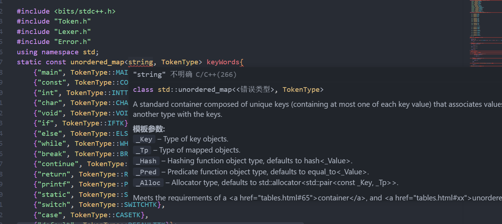
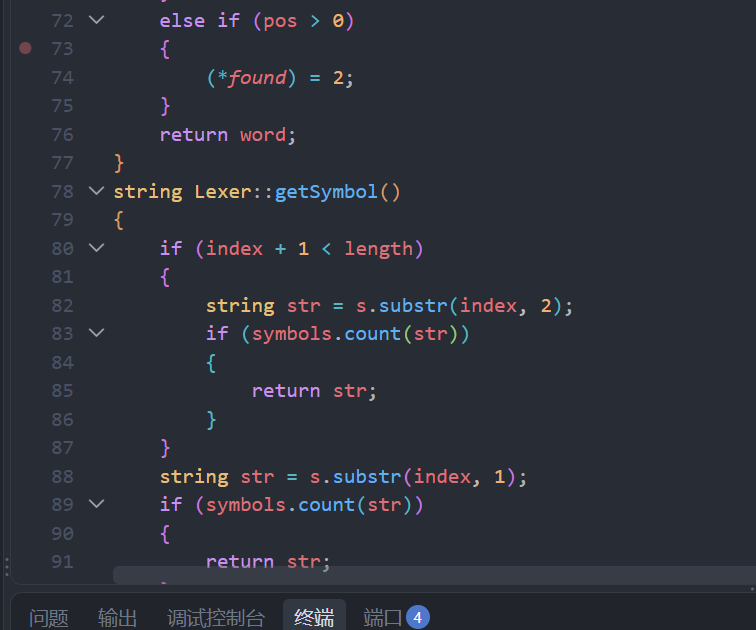
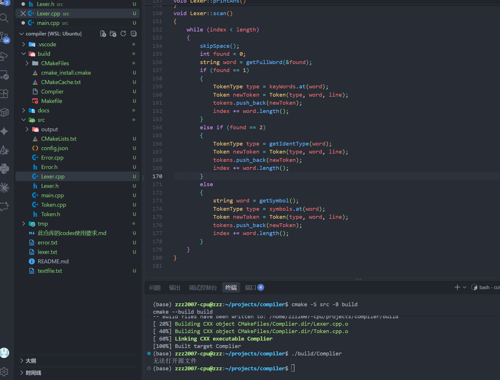
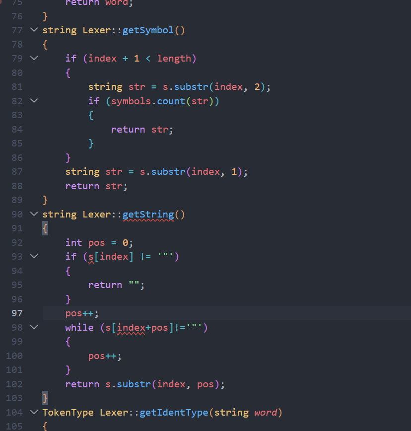

# 03-项目编译运行检查

- 会话时间：2026-09-24 10:35:27
- 会话编号：`01a0d144-94d9-7fc3-ab73-e69a8c5afff4`
- 导出范围：仅保留用户与助手可见消息，已排除系统提示、内部推理和工具调用。

## 1. 用户

时间：2026-09-24 10:35:37

当前项目是否已经可以进行编译运行了呢

---

## 2. 助手

时间：2026-09-24 10:35:39

我先按“当前工作区的实际状态”检查：项目入口、构建说明、依赖与未提交改动，然后执行一次最小编译和运行验证。

---

## 3. 助手

时间：2026-09-24 10:35:52

目前看到已有旧的 CMake 构建产物，但这不能代表现有源码可用。我会重新配置并编译；同时用一个临时 `testfile.txt` 验证程序是否真正产生词法分析结果，而不改动源码。

---

## 4. 助手

时间：2026-09-24 10:36:22

目前还不能正常编译运行。

实际执行全新构建后，编译失败，主要问题是：

- [Lexer.h](/home/zzz2007-cpu/projects/compiler/src/Lexer.h:20) 使用了 `Error`，但没有包含对应声明。
- [Lexer.cpp](/home/zzz2007-cpu/projects/compiler/src/Lexer.cpp:57) 又完整定义了一遍 `Lexer`，与 `Lexer.h` 中的定义冲突。
- [CMakeLists.txt](/home/zzz2007-cpu/projects/compiler/src/CMakeLists.txt:9) 没有加入 `Token.cpp` 和 `Error.cpp`，修复前两个问题后还可能出现链接错误。
- [main.cpp](/home/zzz2007-cpu/projects/compiler/src/main.cpp:3) 目前只读取文件，没有创建并调用词法分析器。
- 项目中还没有 `testfile.txt`，即使程序启动，也只会提示“无法打开源文件”。

验证命令是：

```bash
cmake -S src -B build-current
cmake --build build-current --clean-first
```

结论：**当前处于词法分析器开发阶段，尚未达到可完整编译运行状态。** 我没有修改源码，临时构建目录也已移出项目。

---

## 5. 用户

时间：2026-09-24 10:36:42

编译构建的命令是什么呢

---

## 6. 助手

时间：2026-09-24 10:36:46

在项目根目录执行：

```bash
cmake -S src -B build
cmake --build build
```

编译成功后运行：

```bash
./build/Complier
```

程序会从当前目录读取 `testfile.txt`，因此应把它放在项目根目录：

```text
compiler/
├── testfile.txt
├── src/
└── build/
```

需要查看详细编译过程时：

```bash
cmake --build build --verbose
```

---

## 7. 用户

时间：2026-09-24 19:14:42

我明明include了error.h为什么还是显示没定义

---

## 8. 助手

时间：2026-09-24 19:14:45

我看一下你现在的 `Lexer.cpp`、`Lexer.h` 和 `Error.h` 的实际包含顺序与声明位置，定位是“包含顺序”还是头文件里本身缺少类型声明。

---

## 9. 助手

时间：2026-09-24 19:15:03

你现在已经成功包含 `Error.h` 了；当前错误不是“未定义”，而是“重复定义”。

包含链是：

```text
Lexer.cpp
├── Lexer.h
│   └── Error.h
└── Error.h
```

因为 [Error.h](/home/zzz2007-cpu/projects/compiler/src/Error.h:1) 没有头文件保护，它在同一个编译单元中被展开了两次，所以编译器报告：

```text
multiple definition of enum class ErrorType
redefinition of struct Error
```

提示：

- 给 `Error.h` 添加头文件保护（可参考 `Token.h` 的写法），或者使用 `#pragma once`。
- `Lexer.cpp` 已经通过 `Lexer.h` 间接包含了 `Error.h`，不需要再次包含。
- 修复后还会遇到另一个独立问题：[Lexer.cpp](/home/zzz2007-cpu/projects/compiler/src/Lexer.cpp:57) 又定义了一遍 `class Lexer`，与 [Lexer.h](/home/zzz2007-cpu/projects/compiler/src/Lexer.h:15) 重复。`.cpp` 中应该实现头文件里声明的方法，而不是重新声明整个类。

---

## 10. 用户

时间：2026-09-24 19:24:10

(base) zzz2007-cpu\@zzz:\~/projects/compiler$ cmake --build build
[ 33%] Building CXX object CMakeFiles/Complier.dir/main.cpp.o
[ 66%] Building CXX object CMakeFiles/Complier.dir/Lexer.cpp.o
/home/zzz2007-cpu/projects/compiler/src/Lexer.cpp:57:7: error: redefinition of ‘class Lexer’
&#x20;  57 | class Lexer
&#x20;     \|       ^\~\~\~\~
In file included from /home/zzz2007-cpu/projects/compiler/src/Lexer.cpp:4:
/home/zzz2007-cpu/projects/compiler/src/Lexer.h:16:7: note: previous definition of ‘class Lexer’
&#x20;  16 | class Lexer
&#x20;     \|       ^\~\~\~\~
gmake[2]: \*\*\* [CMakeFiles/Complier.dir/build.make:90: CMakeFiles/Complier.dir/Lexer.cpp.o] Error 1
gmake[1]: \*\*\* [CMakeFiles/Makefile2:83: CMakeFiles/Complier.dir/all] Error 2
gmake: \*\*\* [Makefile:91: all] Error 2
(base) zzz2007-cpu\@zzz:\~/projects/compiler$&#x20;


怎么还是不行

---

## 11. 助手

时间：2026-09-24 19:24:24

因为 `Error` 的问题已经解决了；现在是新的错误：`Lexer` 被定义了两次。

- [Lexer.h](/home/zzz2007-cpu/projects/compiler/src/Lexer.h:16) 已经定义了 `class Lexer`
- [Lexer.cpp](/home/zzz2007-cpu/projects/compiler/src/Lexer.cpp:57) 又写了一次完整的 `class Lexer`

正确结构应当是：

- `.h` 文件：保存 `class Lexer` 的唯一类定义和成员函数声明。
- `.cpp` 文件：不要再写 `class Lexer { ... }`，而是使用 `Lexer::函数名` 分别实现成员函数。

例如你现在 `Lexer.cpp` 中的：

```cpp
string getSymbol()
```

需要思考如何改成“这是 `Lexer` 类的成员函数实现”的形式，即加上类作用域。

同时注意：[Lexer.h](/home/zzz2007-cpu/projects/compiler/src/Lexer.h:31) 中 `getIdentType` 的参数是 `const string &`，`.cpp` 中的实现签名也必须完全一致。

你需要改的是 `Lexer.cpp` 第 57 行开始的整体组织方式，不是 CMake。

---

## 12. 用户

时间：2026-09-24 19:25:59

也就是.h里写类，。cpp里直接写函数的具体吗，不用谢class吗，那么类里的属性呢

---

## 13. 助手

时间：2026-09-24 19:26:06

对。`.h` 里写一次完整的类定义，`.cpp` 里只写成员函数的具体实现，不再写 `class Lexer`。

结构大致如下：

```cpp
// Lexer.h
class Lexer
{
public:
    string s;
    int index;
    int length;

    Lexer(string input);
    void scan();
};
```

`.cpp` 中通过 `Lexer::` 表明函数属于这个类：

```cpp
// Lexer.cpp
Lexer::Lexer(string input)
{
    s = input;
    index = 0;
    length = s.length();
}

void Lexer::scan()
{
    // 可以直接访问 s、index、length
}
```

类的属性仍然只声明在 `.h` 中。每创建一个 `Lexer` 对象，该对象内部都会拥有自己的 `s`、`index`、`length` 等属性。

成员函数虽然写在 `.cpp` 中，但因为前面有 `Lexer::`，所以仍能直接访问这些属性：

```cpp
index++;
tokens.push_back(...);
```

你现在应当这样整理：

- `Lexer.h`：保留属性、构造函数声明、成员函数声明。
- `Lexer.cpp`：保留 `keyWords`、`symbols`，以及所有写成 `Lexer::函数名(...)` 的实现。
- 删除 `Lexer.cpp` 第 57 行开始的第二个 `class Lexer { ... }` 外壳。
- 确保 `.cpp` 中每个函数的返回类型、参数类型与 `.h` 中完全一致。

另外，`index`、`length`、`line` 最适合在构造函数中初始化；尤其要先给 `s` 赋值，再计算 `length`。

---

## 14. 用户

时间：2026-09-24 19:26:31

但是这样好麻烦啊，有必要吗

---

## 15. 助手

时间：2026-09-24 19:26:37

不是语法上绝对必要，但对你当前这个项目有必要保持一种统一方式。

你有两种合法选择：

1. 全部写在 `Lexer.h` 的类里面  
适合很短的练习代码。这样可以不写很多 `Lexer::`，但头文件会越来越长，改动后依赖它的文件都可能重新编译。

2. `.h` 声明类，`.cpp` 实现函数  
适合你现在这种会继续扩展的编译器项目。以后还会加入语法分析、错误处理等模块，分开后更容易维护和排错。

真正不能做的是：在 `.h` 和 `.cpp` 中各写一遍完整的 `class Lexer`。这会成为两个同名类定义，正是当前报错的原因。

如果你暂时只想快速完成词法分析，也可以把 `Lexer` 的完整实现全部放进 `Lexer.h`，然后让 `Lexer.cpp` 不再参与编译。但既然项目已经按 `.h + .cpp` 拆分了，我建议继续使用标准写法。`Lexer::` 看起来麻烦，但每个函数只多写一次，后续维护会轻松很多。

---

## 16. 用户

时间：2026-09-24 19:31:04

为啥string也开始报错了



---

## 17. 助手

时间：2026-09-24 19:31:10

这个很可能是前面某个头文件语法错误引发的 IntelliSense 连锁误报，`string` 本身通常没问题。我对照你当前源码和真实编译器输出找第一个错误。

---

## 18. 助手

时间：2026-09-24 19:31:26

`string` 本身没有报编译错误，这是 VS Code IntelliSense 的连锁误报。

我刚执行了真实编译，编译器能正确识别这一行：

```cpp
unordered_map<string, TokenType>
```

真正的第一个错误仍然是：

```text
redefinition of class Lexer
```

而且磁盘上的 [Lexer.cpp](/home/zzz2007-cpu/projects/compiler/src/Lexer.cpp:57) 仍然保留着：

```cpp
class Lexer
{
    ...
};
```

这说明你可能在编辑器中改了但尚未保存。先按：

```text
Ctrl + S
```

然后确认 `Lexer.cpp` 第 57 行已经不再是第二个 `class Lexer`，再重新编译：

```bash
cmake --build build
```

如果编译器不再报错，但编辑器仍给 `string` 红线，可以执行 VS Code 命令：

```text
C/C++: Reset IntelliSense Database
```

或者暂时写成 `std::string` 验证。当前无需针对 `string` 改代码，先解决并保存 `Lexer` 的重复定义。

---

## 19. 用户

时间：2026-09-24 19:32:26

Lexer Lexer::(string *s*)
{
    this->s = *s*;
}
那这个构造函数怎么写，不能写this了

---

## 20. 助手

时间：2026-09-24 19:32:37

可以继续使用 `this`。你错的是构造函数的函数头。

构造函数：

- 没有返回类型，所以前面不能写 `Lexer`
- 完整名称是 `Lexer::Lexer`

写法如下：

```cpp
Lexer::Lexer(string s)
{
    this->s = s;
}
```

其中：

- 第一个 `Lexer::` 表示属于 `Lexer` 类。
- 第二个 `Lexer` 是构造函数名。
- `this->s` 是对象的成员属性。
- 右边的 `s` 是传入参数。

更推荐使用初始化列表，并同时初始化其他属性：

```cpp
Lexer::Lexer(string input)
    : s(input), index(0), length(input.length()), line(0)
{
}
```

它应当与头文件中的声明对应：

```cpp
Lexer(string input);
```

所以不是不能写 `this`，而是不能写成：

```cpp
Lexer Lexer::(...)
```

因为构造函数没有返回值类型。

---

## 21. 用户

时间：2026-09-24 19:36:25

# Files pasted by the user:

## "/home/zzz2007-cpu/projects/compiler/src/Lexer.cpp:80:15: error: invalid operand…": /home/zzz2007-cpu/.codex/attachments/237ae9ab-42b6-4a29-8167-9901461a379c/已粘贴的文本.txt

## My request:

现在这个报错是啥意思

---

## 22. 助手

时间：2026-09-24 19:36:30

我先看你粘贴的完整报错，并对照 `Lexer.cpp` 第 80 行附近，确认是哪两个操作数类型不匹配。

---

## 23. 助手

时间：2026-09-24 19:36:46

这些报错其实都是同一个原因：除了 `getFullWord`，你其余函数前面都没有加 `Lexer::`，因此编译器把它们当成了普通的全局函数。

例如第 80 行：

```cpp
index + 1
```

这里的 `index` 没被识别为 `Lexer::index`，反而与标准库中名为 `index` 的函数发生了关联，所以才出现：

```text
<unresolved overloaded function type> 和 int 不能相加
```

你第一个函数写对了：

```cpp
string Lexer::getFullWord(int *found)
```

后面的函数也应采用相同形式：

```cpp
string Lexer::getSymbol()
TokenType Lexer::getIdentType(string word)
void Lexer::skipSpace()
Lexer::Lexer(string s)
void Lexer::printAns()
void Lexer::scan()
```

重点是构造函数写成：

```cpp
Lexer::Lexer(string s)
{
    this->s = s;
}
```

而不是：

```cpp
Lexer(string s)
```

由于后者被当作全局函数，所以其中不能使用 `this`，也访问不到 `s`、`length`、`line`、`tokens` 等对象属性。

另外，[Lexer.cpp](/home/zzz2007-cpu/projects/compiler/src/Lexer.cpp:62) 的：

```cpp
int line = 0;
```

会遮蔽类中的 `line` 属性。它不是本次编译失败的主要原因，但会导致行号统计逻辑不符合预期。

---

## 24. 用户

时间：2026-09-24 19:40:51

加了啊



---

## 25. 助手

时间：2026-09-24 19:40:59

截图里 `getSymbol` 确实已经加了，但你刚才贴出的终端报错来自修改前的代码。此前磁盘上的第 78 行仍是：

```cpp
string getSymbol()
```

这通常说明编辑器内容还没保存，或者加完后还没有重新编译。

先保存：

```text
Ctrl + S
```

再执行：

```bash
cmake --build build
```

还要注意：不是只给 `getSymbol` 加，下面每个成员函数都要加，包括：

```cpp
Lexer::getIdentType(...)
Lexer::skipSpace()
Lexer::Lexer(...)
Lexer::printAns()
Lexer::scan()
```

判断是否生效，要看重新执行构建后的最新错误，而不是终端里之前留下的输出。如果最新错误仍指向第 80 行，把重新构建后的第一条错误发出来。

---

## 26. 用户

时间：2026-09-24 19:41:35

(base) zzz2007-cpu\@zzz:\~/projects/compiler$ cmake --build build
[ 33%] Building CXX object CMakeFiles/Complier.dir/Lexer.cpp.o
[ 66%] Linking CXX executable Complier
/usr/bin/ld: CMakeFiles/Complier.dir/Lexer.cpp.o: in function `Lexer::printAns()':
Lexer.cpp:(.text+0x680): undefined reference to `TokenTypeToString[abi:cxx11](TokenType)'
collect2: error: ld returned 1 exit status
gmake[2]: \*\*\* [CMakeFiles/Complier.dir/build.make:113: Complier] Error 1
gmake[1]: \*\*\* [CMakeFiles/Makefile2:83: CMakeFiles/Complier.dir/all] Error 2
gmake: \*\*\* [Makefile:91: all] Error 2
(base) zzz2007-cpu\@zzz:\~/projects/compiler$
这到底又咋了

---

## 27. 助手

时间：2026-09-24 19:41:44

这次不是 C++ 语法错误，而是链接错误。说明 `Lexer.cpp` 已经成功编译了，进展是正常的。

错误含义：

```text
undefined reference to TokenTypeToString(TokenType)
```

编译器在 [Token.h](/home/zzz2007-cpu/projects/compiler/src/Token.h) 中看到了 `TokenTypeToString` 的声明，所以允许调用；但它的具体实现位于 [Token.cpp](/home/zzz2007-cpu/projects/compiler/src/Token.cpp)，而当前 [CMakeLists.txt](/home/zzz2007-cpu/projects/compiler/src/CMakeLists.txt:9) 只编译了：

```text
main.cpp
Lexer.cpp
```

因此链接器找不到 `TokenTypeToString` 的实现。

提示：把 `Token.cpp` 加入 `add_executable(Complier ...)` 的源文件列表。`Error.cpp` 如果以后要在里面实现函数，也应加入。

修改后重新配置和构建：

```bash
cmake -S src -B build
cmake --build build
```

简单区分：

- `error:` 多数是源代码编译失败。
- `undefined reference` 多数是声明存在，但实现没有参与链接。
- 这次前面的 `[66%] Linking CXX executable` 表明代码已经进入链接阶段。

---

## 28. 用户

时间：2026-09-24 19:42:51

(base) zzz2007-cpu\@zzz:\~/projects/compiler$ cmake -S src -B build
cmake --build build
\-- Configuring done (0.0s)
\-- Generating done (0.0s)
\-- Build files have been written to: /home/zzz2007-cpu/projects/compiler/build
[ 25%] Building CXX object CMakeFiles/Complier.dir/Error.cpp.o
[ 50%] Linking CXX executable Complier
/usr/bin/ld: CMakeFiles/Complier.dir/Lexer.cpp.o: in function `Lexer::printAns()':
Lexer.cpp:(.text+0x680): undefined reference to `TokenTypeToString[abi:cxx11](TokenType)'
collect2: error: ld returned 1 exit status
gmake[2]: \*\*\* [CMakeFiles/Complier.dir/build.make:129: Complier] Error 1
gmake[1]: \*\*\* [CMakeFiles/Makefile2:83: CMakeFiles/Complier.dir/all] Error 2
gmake: \*\*\* [Makefile:91: all] Error 2
(base) zzz2007-cpu\@zzz:\~/projects/compiler$
又咋了

---

## 29. 助手

时间：2026-09-24 19:43:03

你加错文件了。

构建输出显示新增编译的是：

```text
Building CXX object ... Error.cpp.o
```

但 `TokenTypeToString()` 的实现位于 `Token.cpp`，不是 `Error.cpp`。当前链接过程中仍然没有 `Token.cpp.o`，所以错误完全没变。

在 [CMakeLists.txt](/home/zzz2007-cpu/projects/compiler/src/CMakeLists.txt:9) 的 `add_executable` 中加入：

```cmake
Token.cpp
```

最终源文件列表应包含：

```cmake
main.cpp
Lexer.cpp
Token.cpp
Error.cpp
```

然后再次执行：

```bash
cmake -S src -B build
cmake --build build
```

成功时构建输出中应该能看到：

```text
Building CXX object ... Token.cpp.o
Linking CXX executable Complier
Built target Complier
```

---

## 30. 用户

时间：2026-09-24 19:44:59

(base) zzz2007-cpu\@zzz:\~/projects/compiler$ cmake -S src -B build
cmake --build build
\-- Configuring done (0.0s)
\-- Generating done (0.0s)
\-- Build files have been written to: /home/zzz2007-cpu/projects/compiler/build
[ 20%] Building CXX object CMakeFiles/Complier.dir/Token.cpp.o
/home/zzz2007-cpu/projects/compiler/src/Token.cpp: In function ‘std::string TokenTypeToString(TokenType)’:
/home/zzz2007-cpu/projects/compiler/src/Token.cpp:108:1: warning: control reaches end of non-void function [-Wreturn-type]
&#x20; 108 | }
&#x20;     \| ^
[ 40%] Linking CXX executable Complier
[100%] Built target Complier
(base) zzz2007-cpu\@zzz:\~/projects/compiler$

---

## 31. 助手

时间：2026-09-24 19:45:04

这次已经编译并链接成功了：

```text
[100%] Built target Complier
```

可执行文件已生成，可以运行：

```bash
./build/Complier
```

不过还有一个警告：

```text
control reaches end of non-void function
```

意思是 [Token.cpp](/home/zzz2007-cpu/projects/compiler/src/Token.cpp:108) 中的 `TokenTypeToString()` 返回类型是 `string`，但编译器认为 `switch` 结束后可能没有返回值。

提示：在 `switch` 后增加一个兜底返回值，或者增加 `default` 分支。虽然目前枚举项可能已经全部覆盖，但编译器仍要求保证所有路径都有返回值。

因此当前状态是：**构建成功，可以启动；但建议先处理这个警告。**

---

## 32. 用户

时间：2026-09-24 19:45:48

测试文件应该放到哪一个位置啊

---

## 33. 助手

时间：2026-09-24 19:45:54

按照你现在的运行方式：

```bash
./build/Complier
```

`testfile.txt` 应放在项目根目录：

```text
/home/zzz2007-cpu/projects/compiler/testfile.txt
```

目录结构如下：

```text
compiler/
├── testfile.txt
├── build/
│   └── Complier
└── src/
```

原因是 [main.cpp](/home/zzz2007-cpu/projects/compiler/src/main.cpp:7) 使用了相对路径：

```cpp
ifstream inputFile("testfile.txt");
```

相对路径以“执行命令时所在的目录”为准，而不是以可执行文件所在目录为准。

如果先进入 `build` 再运行：

```bash
cd build
./Complier
```

那么它会查找：

```text
build/testfile.txt
```

所以建议始终在项目根目录运行 `./build/Complier`，并把测试文件放在项目根目录。

---

## 34. 用户

时间：2026-09-24 19:48:14

(base) zzz2007-cpu\@zzz:\~/projects/compiler$ ./build/Complier
无法打开源文件
terminate called after throwing an instance of 'std::out\_of\_range'
&#x20; what():  basic\_string::substr: \_\_pos (which is 28) > this->size() (which is 0)
Aborted (core dumped)
(base) zzz2007-cpu\@zzz:\~/projects/compiler$&#x20;
这咋了

---

## 35. 助手

时间：2026-09-24 19:48:16

先看两个点：项目根目录是否真的存在名为 `testfile.txt` 的文件，以及打开失败后程序为什么仍继续进入词法分析。

---

## 36. 助手

时间：2026-09-24 19:48:32

这里有两个问题叠加，我检查到项目根目录目前确实没有 `testfile.txt`。

第一，文件打开失败后，程序只打印提示，但没有结束：

```cpp
if (!inputFile.is_open())
{
    cout << "无法打开源文件\n";
}
```

所以程序继续执行，读到的 `s` 是空字符串，长度为 0。应该在打开失败时直接结束程序。

第二，你的构造函数只初始化了 `s`：

```cpp
Lexer::Lexer(string s)
{
    this->s = s;
}
```

但 `index`、`length`、`line` 没有初始化，其中 `index` 恰好取得了随机值 `28`。于是程序相当于执行：

```cpp
空字符串.substr(28, ...)
```

因此报告：

```text
__pos (28) > this->size() (0)
```

你需要：

- 在项目根目录创建 `/home/zzz2007-cpu/projects/compiler/testfile.txt`
- 文件打开失败时立即结束 `main`
- 构造 `Lexer` 时初始化：
  - `index = 0`
  - `line = 0`
  - `length = s.length()`

另外还有两个边界提示：

- `skipSpace()` 访问 `s[index]` 前应先确认 `index < length`
- `getSymbol()` 成功识别符号后，`scan()` 也要推进 `index`，否则之后可能卡在同一个符号上无限循环

当前崩溃的直接原因就是：**文件不存在导致字符串为空，同时未初始化的 `index` 随机变成了 28。**

---

## 37. 用户

时间：2026-09-24 19:56:06

(base) zzz2007-cpu\@zzz:\~/projects/compiler$ ./build/Complier
无法打开源文件
terminate called after throwing an instance of 'std::out\_of\_range'
&#x20; what():  basic\_string::substr: \_\_pos (which is 28) > this->size() (which is 0)
Aborted (core dumped)
(base) zzz2007-cpu\@zzz:\~/projects/compiler$ cmake -S src -B build
cmake --build build
\-- Configuring done (0.0s)
\-- Generating done (0.0s)
\-- Build files have been written to: /home/zzz2007-cpu/projects/compiler/build
[ 20%] Building CXX object CMakeFiles/Complier.dir/Lexer.cpp.o
[ 40%] Building CXX object CMakeFiles/Complier.dir/Token.cpp.o
[ 60%] Linking CXX executable Complier
[100%] Built target Complier
(base) zzz2007-cpu\@zzz:\~/projects/compiler$ ./build/Complier
无法打开源文件
(base) zzz2007-cpu\@zzz:\~/projects/compiler$

---

## 38. 助手

时间：2026-09-24 19:56:17

现在崩溃问题已经解决了：程序没有再出现 `out_of_range`，并且正常退出。

剩下的问题只有：

```text
无法打开源文件
```

说明项目根目录仍然没有 `testfile.txt`。在当前目录创建：

```bash
touch testfile.txt
```

然后向其中写入用于测试的源程序，例如你可以用编辑器打开：

```bash
code testfile.txt
```

确认位置：

```bash
pwd
ls -l testfile.txt
```

应显示路径：

```text
/home/zzz2007-cpu/projects/compiler/testfile.txt
```

之后重新运行即可，不需要再次编译：

```bash
./build/Complier
```

只有修改 `.cpp` 或 `.h` 后才需要重新构建；修改 `testfile.txt` 不需要编译。

---

## 39. 用户

时间：2026-09-24 19:56:59

明明已经有了啊



---

## 40. 助手

时间：2026-09-24 19:57:03

文件名写错了。

程序读取的是：

```cpp
ifstream inputFile("testfile.txt");
```

但截图中的实际文件名是：

```text
textfile.txt
```

区别：

```text
程序需要：testfile.txt
实际文件：textfile.txt
              ^
```

把文件重命名即可：

```bash
mv textfile.txt testfile.txt
```

然后直接运行，无需重新编译：

```bash
./build/Complier
```

---

## 41. 用户

时间：2026-09-24 19:57:39

(base) zzz2007-cpu\@zzz:\~/projects/compiler$ ./build/Complier
terminate called after throwing an instance of 'std::out\_of\_range'
&#x20; what():  unordered\_map::at
Aborted (core dumped)
(base) zzz2007-cpu\@zzz:\~/projects/compiler$&#x20;
又发生了outofrange

---

## 42. 助手

时间：2026-09-24 19:57:43

这次不是 `string::substr`，而是 `unordered_map::at`：程序拿一个不存在的键去查 `keyWords` 或 `symbols`。我检查测试文件中触发它的字符和当前扫描位置推进逻辑。

---

## 43. 助手

时间：2026-09-24 19:58:05

这次的 `out_of_range` 不是数组越界，而是 `unordered_map::at()` 查询了不存在的键。

直接原因是你的 `testfile.txt` 中看起来像普通空格的字符，其实是“不换行空格”：

```text
\302\240
```

也就是 UTF-8 的 `C2 A0`。例如第一行实际类似：

```text
int<不换行空格>main()
```

你的 `skipSpace()` 只识别普通空格 `' '` 和换行 `'\n'`，因此这个特殊空格会进入 `getSymbol()`：

1. `getSymbol()` 在 `symbols` 中找不到它。
2. 返回空字符串 `""`。
3. 随后执行：

```cpp
symbols.at(word)
```

等价于：

```cpp
symbols.at("")
```

键不存在，于是抛出 `unordered_map::at` 异常。

先把 `testfile.txt` 中的特殊空格全部替换为普通英文空格。它们通常来自网页、Word 或聊天窗口复制的代码。可以用命令替换：

```bash
perl -CSDA -pi -e 's/\x{A0}/ /g' testfile.txt
```

然后直接运行：

```bash
./build/Complier
```

同时，你的错误处理还有一个逻辑漏洞：[Lexer.cpp](/home/zzz2007-cpu/projects/compiler/src/Lexer.cpp:93) 检测到非法字符后只是创建了 `Error`，既没有加入 `errors`，也没有安全地跳过该字符，随后仍调用 `symbols.at("")`。后续应思考：`getSymbol()` 找不到符号时，`scan()` 是否还应该无条件调用 `.at()`。

---

## 44. 用户

时间：2026-09-24 20:01:11

at是不是必须找到呢

---

## 45. 助手

时间：2026-09-24 20:01:17

是的，`unordered_map::at(key)` 要求这个键必须存在。

如果键不存在，它会抛出：

```text
std::out_of_range
```

你当前的代码：

```cpp
TokenType type = symbols.at(word);
```

只有在确定 `symbols` 中存在 `word` 时才安全。

几种查询方式的区别：

```cpp
symbols.at(word)
```

- 键必须存在。
- 不存在就抛异常。
- 不会创建新元素。

```cpp
symbols.count(word)
```

- 用于判断键是否存在。
- 返回 `0` 或 `1`。

```cpp
symbols.find(word)
```

- 用于查找并取得元素。
- 找不到时返回 `symbols.end()`。
- 不会抛出 `out_of_range`。

```cpp
symbols[word]
```

- 键不存在时会自动创建一个元素。
- 不适合这里，因为非法符号不应该被自动加入符号表。

你可以思考这样的控制流程：

```text
先 find/count
├── 找到：取得对应的 TokenType
└── 未找到：记录词法错误，并让 index 向后移动
```

特别注意：非法字符分支必须推进 `index`，否则扫描器会一直停在同一个字符上，形成死循环。

---

## 46. 用户

时间：2026-09-24 20:06:29

Lexer.cpp:(.text+0x680): undefined reference to \`TokenTypeToString[abi:cxx11](TokenType)'
collect2: error: ld returned 1 exit status
gmake[2]: \*\*\* [CMakeFiles/Complier.dir/build.make:129: Complier] Error 1
gmake[1]: \*\*\* [CMakeFiles/Makefile2:83: CMakeFiles/Complier.dir/all] Error 2
gmake: \*\*\* [Makefile:91: all] Error 2
(base) zzz2007-cpu\@zzz:\~/projects/compiler$ cmake -S src -B build
cmake --build build
\-- Configuring done (0.0s)
\-- Generating done (0.0s)
\-- Build files have been written to: /home/zzz2007-cpu/projects/compiler/build
[ 20%] Building CXX object CMakeFiles/Complier.dir/Token.cpp.o
/home/zzz2007-cpu/projects/compiler/src/Token.cpp: In function ‘std::string TokenTypeToString(TokenType)’:
/home/zzz2007-cpu/projects/compiler/src/Token.cpp:108:1: warning: control reaches end of non-void function [-Wreturn-type]
108 | }
\| ^
[ 40%] Linking CXX executable Complier
[100%] Built target Complier
(base) zzz2007-cpu\@zzz:\~/projects/compiler$ ./build/Complier
无法打开源文件
terminate called after throwing an instance of 'std::out\_of\_range'
what():  basic\_string::substr: \_\_pos (which is 28) > this->size() (which is 0)
Aborted (core dumped)
(base) zzz2007-cpu\@zzz:\~/projects/compiler$ cmake -S src -B build
cmake --build build
\-- Configuring done (0.0s)
\-- Generating done (0.0s)
\-- Build files have been written to: /home/zzz2007-cpu/projects/compiler/build
[ 20%] Building CXX object CMakeFiles/Complier.dir/Lexer.cpp.o
[ 40%] Building CXX object CMakeFiles/Complier.dir/Token.cpp.o
[ 60%] Linking CXX executable Complier
[100%] Built target Complier
(base) zzz2007-cpu\@zzz:\~/projects/compiler$ ./build/Complier
无法打开源文件
(base) zzz2007-cpu\@zzz:\~/projects/compiler$ ./build/Complier
terminate called after throwing an instance of 'std::out\_of\_range'
what():  unordered\_map::at
Aborted (core dumped)
(base) zzz2007-cpu\@zzz:\~/projects/compiler$ cmake -S src -B build
cmake --build build
\-- Configuring done (0.0s)
\-- Generating done (0.0s)
\-- Build files have been written to: /home/zzz2007-cpu/projects/compiler/build
[ 20%] Building CXX object CMakeFiles/Complier.dir/Lexer.cpp.o
[ 40%] Linking CXX executable Complier
[100%] Built target Complier
(base) zzz2007-cpu\@zzz:\~/projects/compiler$ ./build/Complier
(base) zzz2007-cpu\@zzz:\~/projects/compiler$ ./build/Complier
(base) zzz2007-cpu\@zzz:\~/projects/compiler$
现在又没有输出了

---

## 47. 助手

时间：2026-09-24 20:06:31

现在程序是正常退出，并不代表没执行；你的 `printAns()` 把结果写入文件而不是终端。我检查一下当前 `lexer.txt`、`error.txt` 是否已有内容。

---

## 48. 助手

时间：2026-09-24 20:06:42

这是正常的：程序已经成功运行，只是没有向终端输出。

你的 `printAns()` 使用的是文件输出：

```cpp
ofstream tokenOut("lexer.txt");
ofstream errorOut("error.txt");
```

因此结果写到了项目根目录：

- [lexer.txt](/home/zzz2007-cpu/projects/compiler/lexer.txt)：词法单元结果
- [error.txt](/home/zzz2007-cpu/projects/compiler/error.txt)：错误结果

可以在终端查看：

```bash
cat lexer.txt
cat error.txt
```

我确认这两个文件已经生成并且有内容。不过目前还有两个逻辑问题：

- `testfile.txt` 中的不换行空格 `C2 A0` 仍未替换，所以 `error.txt` 产生了大量 `a` 错误。
- `printf("\n")` 被拆成了 `STRCON "` 和 `IDENFR n"`，说明字符串常量扫描逻辑还不完整。

所以当前状态是：**程序成功运行并产生了文件，只是不会在终端打印，且词法分析结果还需要继续修正。**

---

## 49. 用户

时间：2026-09-24 20:10:54

我现在不知道“该如何处理怎么判断是单纯的一个”还是一个字符串

---

## 50. 助手

时间：2026-09-24 20:10:58

这个判断不应该交给“通用单词扫描”，而应在看到开头引号时切换到专门的字符串状态。我先对照项目实验要求确认字符串和字符常量的结束规则。

---

## 51. 助手

时间：2026-09-24 20:11:18

关键点是：在这份文法中，双引号 `"` 本身不是一个独立 Token，它只可能是字符串的开始或结束标记。

当扫描到 `"` 时：

```text
当前位置是 "
    ↓
进入“字符串扫描状态”
    ↓
继续向后读取，直到遇到配对的 "
    ↓
把包含首尾引号的整段记为 STRCON
```

例如：

```cpp
printf("\n");
```

扫描到第一个 `"` 后，应一次性读取：

```text
"\n"
```

得到：

```text
STRCON "\n"
```

而不是目前的：

```text
STRCON "
IDENFR n"
```

你的总体判断顺序可以设计为：

```text
字母或下划线 → 标识符/关键字
数字         → 整数常量
双引号 "     → 扫描完整字符串常量
单引号 '     → 扫描完整字符常量
其他字符     → 运算符或分隔符
```

根据项目文法：

- 字符串以 `"` 开始，以后面第一个合法的 `"` 结束。
- 字符串中只需要特别处理 `\n`，其他转义情况无需考虑。
- 输出时需要保留首尾双引号。
- 如果遇到换行或文件末尾仍没有结束双引号，则说明字符串没有闭合，应走错误处理，而不是把单独的 `"` 当成字符串。
- 单引号同理，但它对应 `CHARCON`；中间只能有一个普通字符或者一个合法转义字符。

所以你现在的 `getFullWord()` 不应该把字母、数字、`"`、`'` 混在一个循环中扫描。看到引号时，应进入单独的扫描分支。

---

## 52. 用户

时间：2026-09-24 20:12:21

那么我要新开一个程序吗

---

## 53. 助手

时间：2026-09-24 20:12:29

不用新建一个程序，也不用新建可执行文件。只需要在现有 `Lexer` 类中增加专门处理字符串的方法。

可以拆成：

```text
getFullWord()   → 标识符、关键字、整数
getString()     → 双引号包围的字符串
getChar()       → 单引号包围的字符
getSymbol()     → 运算符和分隔符
```

在 `Lexer.h` 中声明这些成员函数，在 `Lexer.cpp` 中实现。然后 `scan()` 根据当前位置的首字符决定调用谁：

```text
s[index] 是字母、数字或下划线 → getFullWord()
s[index] == '"'               → getString()
s[index] == '\''              → getChar()
其他                           → getSymbol()
```

其中 `getString()` 的思路是：

1. 记住起始位置。
2. 跳过开头的 `"`。
3. 持续向后查找结束的 `"`。
4. 遇到 `\n` 时，把反斜杠和 `n` 一起作为字符串内容跳过。
5. 找到结尾后，截取从开头到结尾的完整文本，包括两个双引号。
6. 返回后生成 `STRCON`。

所以你需要的是“新增词法分析成员函数”，不是另开一个程序。这样每种 Token 的边界规则会更清楚。

---

## 54. 用户

时间：2026-09-24 20:15:17

这一块为啥标红



---

## 55. 助手

时间：2026-09-24 20:15:29

这里有两类标红。

第一，`getString()` 很可能还没有在 `Lexer.h` 的 `class Lexer` 中声明。你在 `.cpp` 实现了：

```cpp
string Lexer::getString()
```

那么头文件中也要有对应声明：

```cpp
string getString();
```

第二，`s[index]` 的类型是单个字符 `char`，但你右边写的是字符串：

```cpp
s[index] != "\""
```

其中 `"\""` 是字符串类型。单个字符应该使用单引号表示：

```cpp
s[index] != '"'
```

记法是：

```cpp
'"'   // 一个双引号字符，类型是 char
"\""  // 一个字符串，类型类似 const char*
```

你的 `while` 还要先检查下标边界，否则字符串缺少结束引号时会越界：

```text
先判断 index + pos < length
再访问 s[index + pos]
```

另外，循环停止时 `pos` 指向结束双引号，但：

```cpp
s.substr(index, pos)
```

不会包含该位置的结束双引号。你还需要思考在截取前是否应再推进一次 `pos`，以满足实验要求输出完整的：

```text
STRCON "\n"
```

而不是缺少右侧引号。

---

## 56. 用户

时间：2026-09-24 20:23:55

void Lexer::scan()
{
    while (index < length)
    {
        skipSpace();
        int found = 0;
        string word = getFullWord(&found);
        if (found == 1)
        {
            TokenType type = keyWords.at(word);
            Token newToken = Token(type, word, line);
            tokens.push\_back(newToken);
            index += word.length();
            continue;
        }
        else if (found == 2)
        {
            TokenType type = getIdentType(word);
            Token newToken = Token(type, word, line);
            tokens.push\_back(newToken);
            index += word.length();
            continue;
        }
        string word = getChar();
        if (word != "")
        {
            Token newToken = Token(TokenType::CHARCON, word, line);
            tokens.push\_back(newToken);
            index += word.length();
            continue;
        }
        string word = getString();
        if (word != "")
        {
            Token newToken = Token(TokenType::STRCON, word, line);
            tokens.push\_back(newToken);
            index += word.length();
            continue;
        }
        string word = getSymbol();
        if (symbols.count(word))
        {
            TokenType type = symbols.at(word);
            Token newToken = Token(type, word, line);
            tokens.push\_back(newToken);
            index += word.length();
            continue;
        }
        else
        {
            Error newError = Error(ErrorType::IllegalSymbol, line);
            errors.push\_back(newError);
            index += word.length();
            continue;
        }
    }
}

这样对了吗

---

## 57. 助手

时间：2026-09-24 20:24:14

还不完全对，最先会遇到的是变量重复定义。

你在同一个 `while` 作用域里写了三次：

```cpp
string word = ...
```

即使前面的分支有 `continue`，编译器仍认为它们处于同一作用域，因此会报 `word` 重定义。第一次声明后，后面应复用变量，或者给每段增加独立的 `{}` 作用域。

逻辑上还有几个需要调整的点：

1. `skipSpace()` 后要再次判断 `index < length`  
   如果文件结尾全是空白，`skipSpace()` 会把 `index` 移到末尾，后续函数再访问 `s[index]` 就越界了。

2. 不建议依次尝试所有识别函数  
   更清晰的方式是先看 `s[index]`：

```text
是字母或下划线 → 标识符/关键字
是数字         → 整数
是单引号       → getChar()
是双引号       → getString()
其他           → getSymbol()
```

3. `getFullWord()` 不能再处理引号  
   否则引号会在到达 `getChar()` 或 `getString()` 之前被当成普通单词。

4. 非法字符必须保证前进  
   你现在使用：

```cpp
index += word.length();
```

如果非法情况下 `word == ""`，`index` 不变，就会死循环。非法字符分支至少要消耗当前字符。

5. 行号应从 1 开始  
   实验要求明确说行号从 1 开始，你当前构造函数里初始化为 0 会导致错误行号少 1。

所以整体思路是对的，但推荐把 `scan()` 改为“根据当前首字符选择唯一的扫描函数”，而不是每轮依次调用 `getFullWord → getChar → getString → getSymbol`。这样也更容易保证每一轮至少推进一次 `index`。

---
