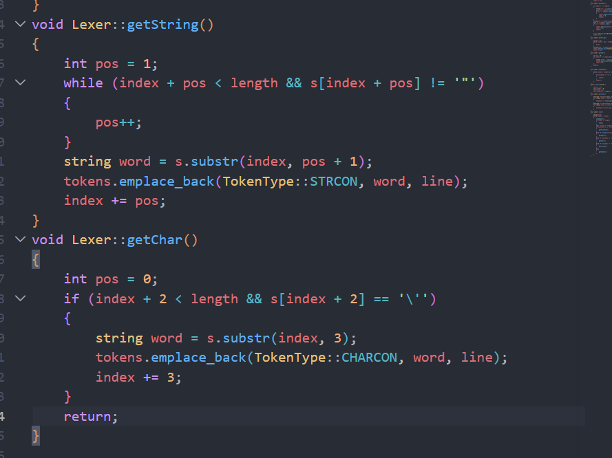

# 04-项目运行方法

- 会话时间：2026-09-29 13:49:30
- 会话编号：`01a0ebb6-080a-7641-a08b-7275a9ec7dee`
- 导出范围：仅保留用户与助手可见消息，已排除系统提示、内部推理和工具调用。

## 1. 用户

时间：2026-09-29 13:49:34

如何运行该项目

---

## 2. 助手

时间：2026-09-29 13:49:38

我先检查仓库里的 README、构建配置和入口文件，再给你一套按当前项目实际情况可直接复制的运行命令。

---

## 3. 助手

时间：2026-09-29 13:49:55

当前程序有一个关键细节：它用相对路径读取 `testfile.txt`，所以可执行文件应从项目根目录启动；另外当前可执行文件名误拼成了 `Complier`。我会在临时目录编译并用现有样例验证命令，避免改动你的源码和输出文件。

---

## 4. 助手

时间：2026-09-29 13:50:15

在项目根目录打开终端，依次执行：

```bash
cd /home/zzz2007-cpu/projects/compiler

cmake -S src -B build
cmake --build build -j2

./build/Complier
```

程序会：

- 从根目录的 `testfile.txt` 读取 SysY 源代码；
- 将词法分析结果写入 `lexer.txt`；
- 将错误信息写入 `error.txt`。

查看结果：

```bash
cat lexer.txt
cat error.txt
```

注意：当前 [CMakeLists.txt](/home/zzz2007-cpu/projects/compiler/src/CMakeLists.txt) 把名称拼成了 `Complier`，所以目前必须运行：

```bash
./build/Complier
```

课程要求的正确名称是 `Compiler`，提交前应修改。刚才已实际验证：项目目前可以成功编译和启动，但现有词法分析结果仍有明显错误，例如 `int`、`main` 被识别为 `IDENFR`，因此现在只是“能够运行”，尚未达到正确提交状态。

<oai-mem-citation>
<citation_entries>
MEMORY.md:54-60|note=[used course naming and lexer execution context]
MEMORY.md:63-66|note=[used prior build verification guidance]
</citation_entries>
<rollout_ids>
01a0bdf1-1d01-77e3-868b-f48aa7b5babb
01a0c9be-cc8b-7620-b3e7-a1bff0cb5252
</rollout_ids>
</oai-mem-citation>

---

## 5. 用户

时间：2026-09-29 13:51:58

现在代码还有哪些问题呢

---

## 6. 助手

时间：2026-09-29 13:52:01

我会按课程要求逐个检查当前的 `Token`、`Lexer`、错误处理和入口代码，并用正确样例、错误样例实际运行；先只诊断，不修改你的文件。

---

## 7. 助手

时间：2026-09-29 13:52:12

源码中已经确认了几处主逻辑错误：关键字被反向当成标识符、数字没有扫描分支、字符串/字符常量漏掉右引号、行号从 0 开始。我再用几个最小测试把每个问题的实际表现和严重程度固定下来。

---

## 8. 助手

时间：2026-09-29 13:53:23

当前代码能编译，但词法分析主流程还不能通过课程样例。用包含关键字、整数、字符、字符串和单个 `&` 的测试运行后，本应只产生 1 条错误，当前产生了 18 条错误。

主要问题按优先级如下：

1. 关键字全部被识别成普通标识符

在 [Lexer.cpp:180](/home/zzz2007-cpu/projects/compiler/src/Lexer.cpp:180)：

```cpp
if (found == 1)
{
    Token newToken = Token(TokenType::IDENFR, word, line);
}
```

`found == 1` 表示找到了关键字，但这里写死成了 `IDENFR`。

实际错误：

```text
IDENFR int
IDENFR main
IDENFR char
IDENFR printf
```

应分别为：

```text
INTTK int
MAINTK main
CHARTK char
PRINTFTK printf
```

2. 完全没有扫描整数常量

[Lexer.cpp:176](/home/zzz2007-cpu/projects/compiler/src/Lexer.cpp:176) 只处理字母、下划线、字符和字符串，没有 `isdigit()` 对应的整数扫描分支。

因此：

```c
int a = 65;
```

其中 `65` 不会生成：

```text
INTCON 65
```

反而会把 `6`、`5` 分别当成非法字符。

3. 每识别完一个单词，没有立即进入下一轮

从 [Lexer.cpp:176](/home/zzz2007-cpu/projects/compiler/src/Lexer.cpp:176) 识别完标识符、字符或字符串后，没有执行 `continue`，程序会继续运行到 [Lexer.cpp:215](/home/zzz2007-cpu/projects/compiler/src/Lexer.cpp:215)，再次尝试读取符号。

如果单词后面是空格，空格就会被错误地记录为 `a` 类错误。

正确的扫描结构应该是：每个分支只消费一个 Token，然后立即 `continue`。

4. 字符串和字符常量缺少右引号

[Lexer.cpp:102](/home/zzz2007-cpu/projects/compiler/src/Lexer.cpp:102) 和 [Lexer.cpp:117](/home/zzz2007-cpu/projects/compiler/src/Lexer.cpp:117) 截取长度时没有包含结束引号。

当前输出：

```text
CHARCON 'A
STRCON "ok\n
```

正确输出：

```text
CHARCON 'A'
STRCON "ok\n"
```

右引号随后还会被当成非法字符，产生额外错误。

5. 行号从 0 开始

[Lexer.cpp:154](/home/zzz2007-cpu/projects/compiler/src/Lexer.cpp:154)：

```cpp
this->line = 0;
```

课程规定第一行编号为 `1`，所以这里应该从 1 开始。目前第一行错误会输出成：

```text
0 a
```

6. 换行统计不可靠

[Lexer.cpp:139](/home/zzz2007-cpu/projects/compiler/src/Lexer.cpp:139) 只有在 `skipSpace()` 中处理换行。

但由于前面缺少 `continue`，单词后面的换行可能直接被“非法字符”分支消费，行号不会增加，导致后面的错误行号也不正确。

7. 空白字符处理不完整

当前只跳过：

```cpp
' '
'\n'
```

没有处理：

```cpp
'\t'
'\r'
```

Windows 换行中的 `\r` 和代码缩进中的制表符都会被错误报告为 `a`。

此外，跳过末尾空白后没有重新检查 `index < length`。

8. 错误 `a` 的判定范围过大

[Lexer.cpp:224](/home/zzz2007-cpu/projects/compiler/src/Lexer.cpp:224) 将所有无法识别的内容都报成 `a`。

课程当前要求的词法错误 `a` 是单独出现的：

```c
&
|
```

也就是本应为 `&&` 或 `||`。目前数字、空白、右引号等都会被错误地报为 `a`。

9. 当前 `testfile.txt` 含有特殊空格

[testfile.txt](/home/zzz2007-cpu/projects/compiler/testfile.txt) 中不少空格实际是 UTF-8 不间断空格 `C2 A0`，不是普通 ASCII 空格 `20`。

例如第一行实际上是：

```text
int<特殊空格>main()<特殊空格>{
```

这会进一步产生大量错误。建议重新输入普通空格，不要直接从带格式的网页或 Markdown 表格复制。

10. CMake 项目名称仍然拼错

[CMakeLists.txt:3](/home/zzz2007-cpu/projects/compiler/src/CMakeLists.txt:3) 当前为：

```cmake
project(Complier)
```

课程要求：

```cmake
project(Compiler)
```

`add_executable(Compiler ...)` 已经正确，所以重新构建后的正确启动命令是：

```bash
./build/Compiler
```

`build/Complier` 是之前遗留的旧可执行文件，容易造成混淆。

11. 次要设计问题

- [Error.h:11](/home/zzz2007-cpu/projects/compiler/src/Error.h:11) 的初始化顺序和成员声明顺序相反，编译器会产生警告。
- `Token` 目前只保存原始字符串，没有保存课程要求后续阶段使用的整数值、字符值。
- `printAns()` 始终输出 `lexer.txt`，尚未提供课程要求的方便开关。
- `main()` 打不开文件时返回 `0`，通常失败应返回非零值。
- 头文件中使用 `using namespace std;` 不推荐，但不影响当前评分。

结论：最核心的是先重写 `scan()` 的分支控制，依次修复“关键字、整数、引号、空白和行号”。在这些问题修好前，当前版本只能编译运行，不能正确完成词法分析。

<oai-mem-citation>
<citation_entries>
MEMORY.md:54-61|note=[used course lexer rules and expected token behavior]
MEMORY.md:63-68|note=[used prior compiler diagnostics as audit checklist]
</citation_entries>
<rollout_ids>
01a0c9be-cc8b-7620-b3e7-a1bff0cb5252
01a0bdf1-1d01-77e3-868b-f48aa7b5babb
</rollout_ids>
</oai-mem-citation>

---

## 9. 用户

时间：2026-09-29 13:53:45

你觉得到底scan怎么个逻辑比较好呢

---

## 10. 助手

时间：2026-09-29 13:54:13

最稳妥的 `scan()` 逻辑是：

> 每一轮循环只完成一件事：从 `index` 开始识别一个完整单词，并把 `index` 移到下一个尚未处理的字符。

不要像当前代码一样，识别完标识符后又继续执行符号识别。

整体流程：

```text
跳过空白
   ↓
是否到达文件末尾？——是→结束
   ↓
根据当前字符选择一种扫描方式
   ├─ 字母或下划线 → 标识符/关键字
   ├─ 数字         → 整数常量
   ├─ 单引号       → 字符常量
   ├─ 双引号       → 字符串常量
   ├─ 运算符/界符  → 符号
   └─ 其他字符     → 错误处理
   ↓
continue，回到循环开始
```

推荐写成这种结构：

```cpp
void Lexer::scan()
{
    while (index < length)
    {
        // 1. 跳过空格、换行、Tab
        skipSpace();

        // skipSpace 之后可能已经到达文件末尾
        if (index >= length)
        {
            break;
        }

        char current = s[index];

        // 2. 标识符或者关键字
        if (isalpha(static_cast<unsigned char>(current)) || current == '_')
        {
            scanIdentifier();
            continue;
        }

        // 3. 整数常量
        if (isdigit(static_cast<unsigned char>(current)))
        {
            scanInteger();
            continue;
        }

        // 4. 字符常量
        if (current == '\'')
        {
            scanChar();
            continue;
        }

        // 5. 字符串常量
        if (current == '"')
        {
            scanString();
            continue;
        }

        // 6. 运算符和分隔符
        scanSymbol();
    }
}
```

这里最重要的是每个分支最后都有 `continue`。

### 1. 空白字符

```cpp
void Lexer::skipSpace()
{
    while (index < length)
    {
        if (s[index] == ' ' || s[index] == '\t' || s[index] == '\r')
        {
            index++;
        }
        else if (s[index] == '\n')
        {
            line++;
            index++;
        }
        else
        {
            break;
        }
    }
}
```

并且构造函数中：

```cpp
this->line = 1;
```

### 2. 标识符和关键字

首先完整读取：

```text
字母、数字、下划线
```

然后再查关键字表：

```cpp
void Lexer::scanIdentifier()
{
    int start = index;

    while (index < length &&
           (isalnum(static_cast<unsigned char>(s[index])) ||
            s[index] == '_'))
    {
        index++;
    }

    string word = s.substr(start, index - start);

    auto it = keyWords.find(word);

    if (it != keyWords.end())
    {
        tokens.emplace_back(it->second, word, line);
    }
    else
    {
        tokens.emplace_back(TokenType::IDENFR, word, line);
    }
}
```

例如：

```text
int       → INTTK
main      → MAINTK
integer   → IDENFR
abc_123   → IDENFR
```

### 3. 整数常量

```cpp
void Lexer::scanInteger()
{
    int start = index;

    while (index < length &&
           isdigit(static_cast<unsigned char>(s[index])))
    {
        index++;
    }

    string number = s.substr(start, index - start);
    tokens.emplace_back(TokenType::INTCON, number, line);
}
```

不要立刻用 `stoi()` 替代原字符串，因为课程要求原样输出。例如 `0012` 应保存为 `"0012"`。

### 4. 字符和字符串

关键是把左右引号都包含进去：

```cpp
void Lexer::scanString()
{
    int start = index;

    index++; // 跳过左双引号

    while (index < length && s[index] != '"')
    {
        if (s[index] == '\n')
        {
            line++;
        }

        index++;
    }

    if (index < length)
    {
        index++; // 把右双引号也包含进去
    }

    string value = s.substr(start, index - start);
    tokens.emplace_back(TokenType::STRCON, value, line);
}
```

字符常量的思路相同：

```cpp
void Lexer::scanChar()
{
    int start = index;

    index++; // 左单引号

    while (index < length && s[index] != '\'')
    {
        index++;
    }

    if (index < length)
    {
        index++; // 右单引号
    }

    string value = s.substr(start, index - start);
    tokens.emplace_back(TokenType::CHARCON, value, line);
}
```

于是：

```c
'A'
"\n"
```

能够原样输出：

```text
CHARCON 'A'
STRCON "\n"
```

### 5. 运算符和分隔符

必须先尝试两个字符的符号，再尝试单字符：

```cpp
void Lexer::scanSymbol()
{
    // 优先检查两个字符
    if (index + 1 < length)
    {
        string two = s.substr(index, 2);

        auto it = symbols.find(two);
        if (it != symbols.end())
        {
            tokens.emplace_back(it->second, two, line);
            index += 2;
            return;
        }
    }

    char current = s[index];

    // 单独的 & 或 | 是 a 类错误
    if (current == '&' || current == '|')
    {
        errors.emplace_back(ErrorType::IllegalSymbol, line);
        index++;
        return;
    }

    // 再检查单字符符号
    string one(1, current);
    auto it = symbols.find(one);

    if (it != symbols.end())
    {
        tokens.emplace_back(it->second, one, line);
        index++;
        return;
    }

    // 无法识别的字符也必须向后移动，防止死循环
    index++;
}
```

先判断双字符非常重要：

```text
<= 不能拆成 < 和 =
>= 不能拆成 > 和 =
== 不能拆成 = 和 =
!= 不能拆成 ! 和 =
&& 不能拆成两个 &
|| 不能拆成两个 |
```

你现在的 `getSymbol()` 已经有“先双字符、再单字符”的雏形，可以保留；核心是重新组织 `scan()`，让每个分支只识别一种 Token。

最终建议把 `Lexer` 拆成这些小函数：

```cpp
void skipSpace();
void scanIdentifier();
void scanInteger();
void scanChar();
void scanString();
void scanSymbol();
```

这样 `scan()` 本身只负责“看当前字符，决定调用谁”，不会把所有细节混在一个大循环里。这个结构后面加入注释处理、语法分析和错误恢复也比较容易。

<oai-mem-citation>
<citation_entries>
MEMORY.md:54-61|note=[used established SysY token rules and scanner state design]
MEMORY.md:63-68|note=[used prior scanner failure guidance]
</citation_entries>
<rollout_ids>
01a0c9be-cc8b-7620-b3e7-a1bff0cb5252
01a0bdf1-1d01-77e3-868b-f48aa7b5babb
</rollout_ids>
</oai-mem-citation>

---

## 11. 用户

时间：2026-09-29 13:54:50

题目有说要识别整数常量了吗

---

## 12. 助手

时间：2026-09-29 13:54:58

有，而且题目明确要求识别整数常量。

在 [实验1词法分析要求.md:16](/home/zzz2007-cpu/projects/compiler/docs/实验要求/实验1词法分析要求.md:16) 的类别表中写着：

```text
IntConst → INTCON
```

样例中的：

```c
int a = 65;
return 0;
```

要求输出：

```text
INTCON 65
INTCON 0
```

题目还特别说明要保留整数的原始字符串，[实验1词法分析要求.md:48](/home/zzz2007-cpu/projects/compiler/docs/实验要求/实验1词法分析要求.md:48)：

> 读取的字符串要原样保留，特别是数字。

所以词法分析需要把连续数字识别为一个 `INTCON`：

```text
65   → INTCON 65
300  → INTCON 300
0    → INTCON 0
```

但现阶段不一定需要把 `"65"` 转成数值 `65`；为了输出评测，先保存原字符串即可。你当前的 [Token.h:9](/home/zzz2007-cpu/projects/compiler/src/Token.h:9) 也已经定义了 `INTCON`，只是 `scan()` 还没有真正处理数字。

---

## 13. 用户

时间：2026-09-29 14:11:22

假设有奇怪的错误呢，比如'a"

---

## 14. 助手

时间：2026-09-29 14:11:41

`'a"` 是一个不合法的字符常量：左边是单引号，右边却是双引号。

但需要区分两件事：

1. 课程要求必须处理的错误；
2. 为了程序健壮性额外处理的异常输入。

这次词法分析作业明确列出的词法错误只有：

```text
单独的 & → a
单独的 | → a
```

因此遇到 `'a"` 时，不能擅自输出：

```text
1 a
```

因为 `a` 不是“字符常量引号错误”，而是专门表示把 `&&` 或 `||` 写成单个符号。

比较合理的处理方式是：

```cpp
void Lexer::scanChar()
{
    int startLine = line;
    int start = index;

    index++; // 跳过左单引号

    // 没有字符内容
    if (index >= length || s[index] == '\n')
    {
        // 内部记录：字符常量不完整
        return;
    }

    // 读取字符内容
    if (s[index] == '\\' && index + 1 < length)
    {
        index += 2; // 转义字符，例如 '\n'
    }
    else
    {
        index++; // 普通字符，例如 'a'
    }

    // 正常情况下，现在必须是右单引号
    if (index < length && s[index] == '\'')
    {
        index++;

        string value = s.substr(start, index - start);
        tokens.emplace_back(TokenType::CHARCON, value, startLine);
        return;
    }

    // 没有找到右单引号：这是畸形字符常量
    // 不能记录为课程中的 a 类错误
    // 最重要的是保证 index 已经移动，程序不会死循环
}
```

对于输入：

```text
'a"
```

执行过程是：

```text
读取 '    → 认为字符常量开始
读取 a    → 字符内容
期待 '    → 实际遇到 "
判定为畸形字符常量
```

此时不生成 `CHARCON`，也不应该向 `error.txt` 写 `a`。

本次作业可以采取的策略是：

- 对课程规定的单独 `&`、`|`：写入 `error.txt`，错误码为 `a`；
- 对 `'a"` 这种题目没有规定错误码的输入：保证程序不越界、不死循环，但不向 `error.txt` 伪造错误码；
- 平台测试通常不会提供题目未定义如何处理的错误。

所以 `scan()` 的通用底线是：

> 无论输入多奇怪，每个分支要么成功识别一个 Token，要么至少让 `index` 向后移动，绝不能卡在同一个字符上。

---

## 15. 用户

时间：2026-09-29 14:24:17

当前写的如何，如何运行呢

---

## 16. 助手

时间：2026-09-29 14:24:19

我先重新读取你现在的源码和构建文件，因为你可能刚改过；随后会用临时目录编译并分别跑一个正常样例和单独 `&` 的错误样例，给你当前状态和准确运行命令。

---

## 17. 助手

时间：2026-09-29 14:24:25

你这次已经把“关键字查表”和“整数分支”写进去了，方向是对的；不过头文件还保留旧函数声明，当前版本预计会先在编译阶段失败。我现在跑一次干净构建，确认第一个真实报错，再判断运行逻辑。

---

## 18. 助手

时间：2026-09-29 14:25:05

当前 `scan()` 的整体分支方向已经比之前好：能够区分标识符、整数、字符、字符串和符号。但是当前源码还不能编译运行，第一处问题是 [Lexer.h](/home/zzz2007-cpu/projects/compiler/src/Lexer.h:29) 与 [Lexer.cpp](/home/zzz2007-cpu/projects/compiler/src/Lexer.cpp:59) 的函数声明不一致。

### 第一步：修改 Lexer.h

把当前这些旧声明：

```cpp
string getFullWord(int *found);
string getSymbol();
TokenType getIdentType(string word);
string getString();
string getChar();
void skipSpace();
```

改成与 `Lexer.cpp` 一致：

```cpp
void getFullWord();
void getDigit();
void getSymbol();
void getString();
void getChar();
void skipSpace();
```

### 之后仍需处理的问题

1. [Lexer.cpp:62](/home/zzz2007-cpu/projects/compiler/src/Lexer.cpp:62) 边界条件写错，而且标识符后续应该允许数字：

```cpp
while (index + pos < length &&
       (isalnum(static_cast<unsigned char>(s[index + pos])) ||
        s[index + pos] == '_'))
```

2. [Lexer.cpp:81](/home/zzz2007-cpu/projects/compiler/src/Lexer.cpp:81) 也应检查 `index + pos`：

```cpp
while (index + pos < length &&
       isdigit(static_cast<unsigned char>(s[index + pos])))
```

3. [Lexer.cpp:98](/home/zzz2007-cpu/projects/compiler/src/Lexer.cpp:98) 写成了比较：

```cpp
index == 2;
```

应该是移动下标：

```cpp
index += 2;
```

否则遇到 `<=`、`==`、`&&` 等双字符符号会死循环。

4. [Lexer.cpp:121](/home/zzz2007-cpu/projects/compiler/src/Lexer.cpp:121) 读取了字符串，却没有保存 Token：

```cpp
tokens.emplace_back(TokenType::STRCON, word, line);
index += pos + 1;
```

5. [Lexer.cpp:127](/home/zzz2007-cpu/projects/compiler/src/Lexer.cpp:127) 直接访问 `s[index + 2]` 可能越界；如果字符常量不合法，函数没有移动 `index`，也可能死循环。

6. [Lexer.cpp:138](/home/zzz2007-cpu/projects/compiler/src/Lexer.cpp:138) 的空白扫描需要先检查边界，并处理 `\t`、`\r`。

7. [Lexer.cpp:151](/home/zzz2007-cpu/projects/compiler/src/Lexer.cpp:151) 行号应从 1 开始：

```cpp
this->line = 1;
```

8. [Lexer.cpp:173](/home/zzz2007-cpu/projects/compiler/src/Lexer.cpp:173) 应该是：

```cpp
if (index >= length)
```

9. [CMakeLists.txt:3](/home/zzz2007-cpu/projects/compiler/src/CMakeLists.txt:3) 应改为：

```cmake
project(Compiler)
```

### 如何运行

上述编译错误修好后，建议使用一个全新的构建目录，避免误运行以前留下的旧程序：

```bash
cd /home/zzz2007-cpu/projects/compiler

cmake -S src -B build-current
cmake --build build-current -j2
./build-current/Compiler
```

然后查看输出：

```bash
cat lexer.txt
cat error.txt
```

程序必须从项目根目录运行，因为它从当前目录读取 `testfile.txt`。

还要注意：你当前的 [testfile.txt](/home/zzz2007-cpu/projects/compiler/testfile.txt) 含有网页复制过来的“不间断空格”，不是普通空格。建议重新手动输入一个简单测试：

```c
int main() {
    int a = 65;
    return 0;
}
```

结论：`scan()` 的大框架已经合理，但当前首先要同步 `Lexer.h` 的函数声明；之后修复下标移动和边界问题，才能安全运行。刚才的干净构建已确认当前版本会在头文件声明不匹配处编译失败。

<oai-mem-citation>
<citation_entries>
MEMORY.md:68-76|note=[used course lexer structure and input handling guidance]
MEMORY.md:78-84|note=[used prior fresh-build and boundary-check guidance]
</citation_entries>
<rollout_ids>
01a0d144-94d9-7fc3-ab73-e69a8c5afff4
01a0c9be-cc8b-7620-b3e7-a1bff0cb5252
</rollout_ids>
</oai-mem-citation>

---

## 19. 用户

时间：2026-09-29 14:31:34

为什么输出的不对

---

## 20. 助手

时间：2026-09-29 14:31:37

我先按你现在刚改过的代码重新构建并运行当前 `testfile.txt`，对照 `lexer.txt` 和 `error.txt` 找到第一个导致输出偏掉的位置。

---

## 21. 助手

时间：2026-09-29 14:31:57

结果已经能定位了：前 25 个 Token 基本正常，到了第一个字符串 `"\n"` 后中断；同时 `error.txt` 的大量 `a` 来自测试文件里的特殊空格。我再把同一输入临时转换成普通空格运行一次，分清“测试文件问题”和“扫描器问题”。

---

## 22. 助手

时间：2026-09-29 14:32:15

当前代码已经能编译。输出不对主要有两个独立原因。

1. `testfile.txt` 里是特殊空格

你的 [testfile.txt](/home/zzz2007-cpu/projects/compiler/testfile.txt) 中很多空格实际是 UTF-8 不间断空格 `C2 A0`，而 `skipSpace()` 只识别普通空格。

所以这些特殊空格全部进入 `getSymbol()`，被错误记录为：

```text
0 a
1 a
...
```

把特殊空格替换为普通空格即可。临时转换命令：

```bash
perl -CSDA -pi -e 's/\x{A0}/ /g' testfile.txt
```

2. `getString()` 没有保存字符串 Token

[Lexer.cpp:114](/home/zzz2007-cpu/projects/compiler/src/Lexer.cpp:114) 当前代码：

```cpp
string word = s.substr(index, pos + 1);
index += pos;
```

存在两个问题：

- 没有把 `word` 放入 `tokens`；
- `index += pos` 停在右双引号上，没有越过右双引号。

因此扫描到第一个：

```c
printf("\n");
```

时，输出只到：

```text
PRINTFTK printf
LPARENT (
```

接下来右双引号又被误认为另一个字符串的左双引号，后面的代码被大段吞掉。

应改为：

```cpp
void Lexer::getString()
{
    int pos = 1;

    while (index + pos < length && s[index + pos] != '"')
    {
        pos++;
    }

    if (index + pos < length)
    {
        string word = s.substr(index, pos + 1);
        tokens.emplace_back(TokenType::STRCON, word, line);
        index += pos + 1;
    }
    else
    {
        // 没有找到右双引号，也要保证继续向后移动
        index = length;
    }
}
```

还有一个马上会出现的问题

[Lexer.cpp:98](/home/zzz2007-cpu/projects/compiler/src/Lexer.cpp:98)：

```cpp
index == 2;
```

这是“比较”，没有修改 `index`。应该写成：

```cpp
index += 2;
```

否则遇到 `<=`、`>=`、`==`、`!=`、`&&`、`||` 时会一直停在原位置，形成死循环并不断添加相同 Token。

另外建议顺手修改：

```cpp
// 行号从1开始
this->line = 1;

// 到达末尾
if (index >= length)
{
    break;
}
```

修正后重新运行：

```bash
cmake -S src -B build
cmake --build build -j2
./build/Compiler

cat lexer.txt
cat error.txt
```

我实际把输入临时转换为普通空格后运行过：大量 `a` 错误消失了，但仍然只输出 25 个 Token，恰好停止在第一个字符串之前，所以现在最关键的是修复 `getString()`。

---

## 23. 用户

时间：2026-09-29 14:33:37

我明明都改了啊



---

## 24. 助手

时间：2026-09-29 14:33:41

你截图里确实已经加了 `tokens.emplace_back(...)`，这一点你改了。现在我核对磁盘上的实际文件和编辑器改动是否已经保存；同时截图中还剩一个明确问题：`index += pos` 仍会停在右双引号上，应该越过它。

---

## 25. 助手

时间：2026-09-29 14:34:08

你确实改了，我现在读到磁盘里的代码已经包含：

```cpp
tokens.emplace_back(TokenType::STRCON, word, line);
```

`getSymbol()` 的 `index += 2`、行号从 1 开始等修改也已经保存。

现在只剩一个关键的差 1 错误：

```cpp
index += pos;
```

应该改为：

```cpp
index += pos + 1;
```

原因是 `pos` 指向右双引号的位置。虽然：

```cpp
s.substr(index, pos + 1)
```

已经把右双引号放进了字符串，但 `index += pos` 仍然停留在右双引号上。

于是下次扫描又把这个右双引号当成新字符串的左双引号，最终出现这种错误输出：

```text
STRCON "\n"
STRCON ");

    char c = 'A';
    int d = (int)c;
    ...
    printf("
```

完整修正为：

```cpp
void Lexer::getString()
{
    int pos = 1;

    while (index + pos < length && s[index + pos] != '"')
    {
        pos++;
    }

    string word = s.substr(index, pos + 1);
    tokens.emplace_back(TokenType::STRCON, word, line);

    index += pos + 1;
}
```

修改后记得保存并重新编译，因为直接运行原可执行文件不会自动使用新代码：

```bash
cmake --build build -j2
./build/Compiler
```

另外，当前 `testfile.txt` 仍含特殊空格，可能造成许多错误 `a`。可以执行一次：

```bash
perl -CSDA -pi -e 's/\x{A0}/ /g' testfile.txt
```

所以你不是“没改”，而是 `getString()` 最后一行还少了一个 `+ 1`。

---

## 26. 用户

时间：2026-09-29 14:35:10

这个特殊空格肯定不是课程要求的，怎么来的

---

## 27. 助手

时间：2026-09-29 14:35:16

我对比一下 `testfile.txt` 与仓库里的课程样例文本，看这些 `C2 A0` 是否是从课程页面/Markdown 样例复制进来的。

---

## 28. 助手

时间：2026-09-29 14:35:26

对，特殊空格不是 SysY 课程语言要求，而是从课程样例复制时带进来的排版字符。

我刚对比了两个文件：

- `testfile.txt`：有 73 个不间断空格；
- `docs/实验要求/实验1词法分析要求.md`：有 225 个不间断空格。

而且两边样例的字节完全一致：

```text
int C2 A0 main() C2 A0 {
```

正常键盘空格的字节应该是：

```text
20
```

`C2 A0` 是 UTF-8 编码的“不间断空格”，通常来自网页、富文本、PDF或排版软件。它用于防止文字在此处换行，肉眼看起来与普通空格几乎相同。

因此来源基本可以确定：

```text
课程网页/富文本样例
        ↓
复制到 Markdown 文档
        ↓
再复制到 testfile.txt
        ↓
不间断空格被一起带入
```

直接把 `testfile.txt` 中的特殊空格替换成普通空格即可：

```bash
perl -CSDA -pi -e 's/\x{A0}/ /g' testfile.txt
```

也可以在 VS Code 中：

1. 打开查找替换；
2. 开启正则表达式；
3. 查找 `\u00A0`；
4. 替换为一个普通空格。

评测平台正常提供的源程序一般使用普通空格、Tab 和换行，你的词法分析器没有必要专门支持这种网页排版空格。

---

## 29. 用户

时间：2026-09-29 14:36:22

error没有输出出来

---

## 30. 助手

时间：2026-09-29 14:36:26

我检查你现在的 `testfile.txt` 是否真的包含单独的 `&` 或 `|`，再运行当前版本确认是“没有触发错误”，还是错误分支/输出文件有问题。

---

## 31. 助手

时间：2026-09-29 14:36:47

当前错误输出功能是正常的。之所以 `error.txt` 为空，是因为你现在的 `testfile.txt` 中没有单独的 `&` 或 `|`。

课程规定的 `a` 类词法错误是：

```c
1 & 2
1 | 2
```

而不是正常的：

```c
1 && 2
1 || 2
```

我用当前代码实际测试：

```c
int main() {
    if (1 & 2) {
        return 0;
    }
}
```

`error.txt` 正确输出：

```text
2 a
```

你可以把上面内容放入 `testfile.txt`，然后运行：

```bash
cmake --build build -j2
./build/Compiler
cat error.txt
```

另外，[Lexer.cpp:112](/home/zzz2007-cpu/projects/compiler/src/Lexer.cpp:112) 当前是：

```cpp
index += 2;
```

单独的 `&` 或 `|` 只有一个字符，因此建议改成：

```cpp
index += 1;
```

否则输入：

```c
1&2
```

会同时跳过 `&` 和后面的 `2`。错误仍能输出，但 `2` 不会生成 `INTCON`。

还有一点：`error.txt` 使用相对路径。如果在项目根目录执行：

```bash
./build/Compiler
```

文件就在项目根目录；如果从其他目录启动，文件会生成在那个运行目录中，而不一定是源码旁边。

---

## 32. 用户

时间：2026-09-29 14:42:08

给我命令，把src里的要提交的代码文件给我压缩一下

---

## 33. 用户

时间：2026-09-29 14:42:58

给我命令，把src里的要提交的代码文件给我压缩一下

---

## 34. 用户

时间：2026-09-29 14:43:22

给我命令，把src里的要提交的代码文件给我压缩一下

---
