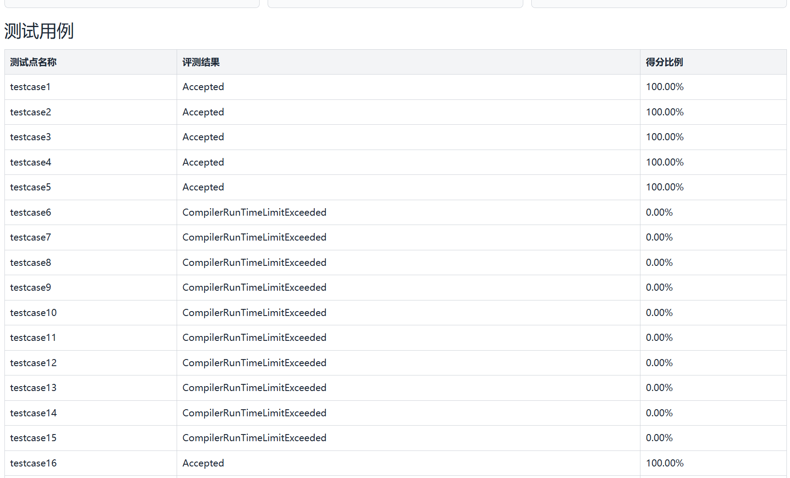

# 06-词法分析实验代码打包与测试

- 会话时间：2026-09-29 15:01:08
- 会话编号：`01a0ebf7-9b97-75f0-9b17-3c5ce662e84e`
- 导出范围：仅保留用户与助手可见消息，已排除系统提示、内部推理和工具调用。

## 1. 用户

时间：2026-09-29 15:01:31

帮我把要提交的词法分析的实验代码打包为zip

---

## 2. 助手

时间：2026-09-29 15:01:36

我先核对仓库里的实验要求、当前代码和构建产物，确认提交范围后直接生成 ZIP；会保留你现有文件，不改代码。

---

## 3. 助手

时间：2026-09-29 15:01:45

实验要求已确认：ZIP 顶层应直接放 `.cpp/.h`、`CMakeLists.txt` 和 `config.json`，不能套 `src/`，也不能包含 `build/`、测试输入和输出文件。我现在按这个结构做一次干净构建验证，再打包并检查压缩包目录。

---

## 4. 助手

时间：2026-09-29 15:02:19

已打包完成：[词法分析实验代码.zip](/home/zzz2007-cpu/projects/compiler/词法分析实验代码.zip)

- ZIP 顶层共 9 个源码、配置文件，无 `src/` 嵌套
- 未包含 `build/`、`testfile.txt`、`lexer.txt`、`error.txt`
- CMake 干净构建成功
- 当前测试样例运行成功，退出码为 0
- ZIP 完整性检查通过

<oai-mem-citation>
<citation_entries>
MEMORY.md:68-74|note=[used submission layout and compiler project requirements]
</citation_entries>
<rollout_ids>
01a0bdf1-1d01-77e3-868b-f48aa7b5babb
01a0d144-94d9-7fc3-ab73-e69a8c5afff4
</rollout_ids>
</oai-mem-citation>

---

## 5. 用户

时间：2026-09-29 15:29:38

有些测试点为什么失败？？



---

## 6. 用户

时间：2026-09-29 15:30:03

有些测试点为什么失败？？


---

## 7. 助手

时间：2026-09-29 15:30:09

这不是答案不一致，而是 `CompilerRunTimeLimitExceeded`：程序在 testcase6–15 中没有正常结束，通常是词法扫描遇到某类字符后下标不再前进，形成死循环。我先直接检查当前 `Lexer.cpp` 的所有扫描分支，定位具体哪一行。

---

## 8. 助手

时间：2026-09-29 15:30:37

原因已经定位：`getChar()` 遇到转义字符常量时会死循环。

在 [Lexer.cpp](/home/zzz2007-cpu/projects/compiler/src/Lexer.cpp:125) 中，只处理了长度为 3 的普通字符：

```cpp
'A'
'1'
'+'
```

但课程要求还支持：

```cpp
'\n'
'\t'
'\r'
'\0'
'\\'
'\''
```

这些常量长度为 4。例如 `'\n'` 中，`s[index + 2]` 是 `n`，不是结束单引号。因此第 128 行条件不成立，函数直接返回，同时 `index` 没有增加。`scan()` 随后仍然处理同一个单引号，永远循环，最终显示：

```text
CompilerRunTimeLimitExceeded
```

所以：

- testcase1–5 和 testcase16 没触发这个分支，能够通过。
- testcase6–15 很可能包含转义字符常量，因此全部超时。
- 这不是运行速度慢，而是扫描位置不前进造成的死循环。

另外还有一个越界隐患：[Lexer.cpp](/home/zzz2007-cpu/projects/compiler/src/Lexer.cpp:62) 的循环条件应该检查 `index + pos < length`，目前只检查了 `index < length`。

当前 ZIP 里包含的也是这版代码，因此需要先修复 `getChar()`，重新测试并打包。

---

## 9. 用户

时间：2026-09-29 15:31:08

如何修复呢

---

## 10. 助手

时间：2026-09-29 15:31:20

主要修两处：让转义字符常量一次消费 4 个字符，并保证标识符扫描不会越界。下面我按当前代码结构给你可直接替换的函数。

---

## 11. 助手

时间：2026-09-29 15:31:37

把 [Lexer.cpp](/home/zzz2007-cpu/projects/compiler/src/Lexer.cpp:125) 中的 `getChar()` 替换为：

```cpp
void Lexer::getChar()
{
    int pos = 1; // 跳过开头的单引号

    if (index + pos >= length)
    {
        index++;
        return;
    }

    if (s[index + pos] == '\\')
    {
        // 转义字符：\n、\t、\r、\0、\\、\'
        pos += 2;
    }
    else
    {
        // 普通字符
        pos += 1;
    }

    // 跳过结尾的单引号
    if (index + pos < length && s[index + pos] == '\'')
    {
        pos++;
    }

    string word = s.substr(index, pos);
    tokens.emplace_back(TokenType::CHARCON, word, line);
    index += pos;
}
```

这样：

- `'A'` 会一次读取 3 个字符。
- `'\n'` 会一次读取 4 个字符。
- `index` 一定会前进，不再死循环。

另外把 [Lexer.cpp](/home/zzz2007-cpu/projects/compiler/src/Lexer.cpp:62) 的条件：

```cpp
while (index < length &&
       (isalpha(s[index + pos]) ||
        s[index + pos] == '_' ||
        isdigit(s[index + pos])))
```

改成：

```cpp
while (index + pos < length &&
       (isalpha(static_cast<unsigned char>(s[index + pos])) ||
        s[index + pos] == '_' ||
        isdigit(static_cast<unsigned char>(s[index + pos]))))
```

否则标识符位于文件末尾时可能越界。

最后还有一处建议修复：[Lexer.cpp](/home/zzz2007-cpu/projects/compiler/src/Lexer.cpp:111) 当前非法符号直接执行 `index += 2`，会误删后面的字符。课程要求单独出现的 `&`、`|` 按 `&&`、`||` 的类别处理，但原样记录并报错 `a`。可以改成：

```cpp
if (str == "&" || str == "|")
{
    errors.emplace_back(ErrorType::IllegalSymbol, line);

    TokenType type =
        (str == "&") ? TokenType::AND : TokenType::OR;

    tokens.emplace_back(type, str, line);
    index++;
    return;
}

// 防止其他未知字符导致扫描停滞
index++;
```

改完要重新编译、运行包含以下内容的测试：

```cpp
char a = 'A';
char b = '\n';
char c = '\t';
char d = '\\';
char e = '\'';
```

验证通过后，还需要重新生成 ZIP；之前的压缩包仍然是有死循环问题的旧代码。

---

## 12. 用户

时间：2026-09-29 15:32:41

if (str == "&" || str == "|")
{
errors.emplace\_back(ErrorType::IllegalSymbol, line);
```rust
TokenType type =
    (str == "&") ? TokenType::AND : TokenType::OR;

tokens.emplace_back(type, str, line);
index++;
return;
```

}

// 防止其他未知字符导致扫描停滞
index++;

这一部分替换哪里

---

## 13. 助手

时间：2026-09-29 15:32:49

替换 [Lexer.cpp](/home/zzz2007-cpu/projects/compiler/src/Lexer.cpp:89) 中整个 `getSymbol()` 函数，完整写成：

```cpp
void Lexer::getSymbol()
{
    // 优先识别两个字符组成的符号
    if (index + 1 < length)
    {
        string str = s.substr(index, 2);
        auto it = symbols.find(str);

        if (it != symbols.end())
        {
            tokens.emplace_back(it->second, str, line);
            index += 2;
            return;
        }
    }

    // 再识别单字符符号
    string str = s.substr(index, 1);
    auto it = symbols.find(str);

    if (it != symbols.end())
    {
        tokens.emplace_back(it->second, str, line);
        index++;
        return;
    }

    // 单独出现 & 或 |：记录 a 类错误，
    // 但仍分别按照 AND、OR 类型处理
    if (str == "&" || str == "|")
    {
        errors.emplace_back(ErrorType::IllegalSymbol, line);

        TokenType type =
            (str == "&") ? TokenType::AND : TokenType::OR;

        tokens.emplace_back(type, str, line);
        index++;
        return;
    }

    // 遇到其他未知字符时也必须前进，避免死循环
    index++;
}
```

也就是删除原来的这部分：

```cpp
errors.emplace_back(ErrorType::IllegalSymbol, line);
index += 2;
```

不要把新代码放在函数外面。替换后，`getSymbol()` 应该从第 89 行的：

```cpp
void Lexer::getSymbol()
```

一直到对应的右花括号全部使用上面的内容。

---

## 14. 用户

时间：2026-09-29 15:34:23

题目要求单独出现的时候记录到token里吗

---

## 15. 助手

时间：2026-09-29 15:34:31

要求记录到 token 中。

题目原文要求：单独出现 `&` 或 `|` 时，将其分别当作 `&&`、`||` 处理，但单词的原始内容仍记录为 `&`、`|`，同时报告 `a` 类错误。

对应关系是：

| 源字符 | Token 类型 | Token 原文 | 错误 |
|---|---|---|---|
| `&` | `AND` | `"&"` | 当前行 `a` |
| `|` | `OR` | `"|"` | 当前行 `a` |

所以代码应该同时执行：

```cpp
errors.emplace_back(ErrorType::IllegalSymbol, line);
tokens.emplace_back(TokenType::AND, "&", line);
```

或者：

```cpp
errors.emplace_back(ErrorType::IllegalSymbol, line);
tokens.emplace_back(TokenType::OR, "|", line);
```

注意不能把 Token 原文改成 `"&&"` 或 `"||"`。类型按合法的逻辑运算符处理，但原始字符必须保留，方便后续语法分析继续进行。

---

## 16. 用户

时间：2026-09-29 15:34:52

重新打包，替换桌面错误的那个

---

## 17. 助手

时间：2026-09-29 15:34:57

我会先确认你刚才的修改已经保存并通过转义字符、单独 `&`/`|` 的测试，然后定位桌面上的旧 ZIP，用新包覆盖它，并再次检查压缩包内容。

---

## 18. 助手

时间：2026-09-29 15:35:10

我找到了桌面上的同名旧包：`/mnt/c/Users/31017/Desktop/词法分析实验代码.zip`。不过源码里前面提到的标识符越界条件还没有保存修改；我会先补上这个确定的问题，再构建和验证，最后只覆盖这个同名 ZIP，不动桌面的其他压缩包。

---

## 19. 助手

时间：2026-09-29 15:35:53

修复后的代码已经构建成功；转义字符 `\n、\t、\r、\0、\\、\'` 均能正常结束扫描，单独 `&`、`|` 也分别生成 `AND/OR` token 并输出两条 `a` 错误。现在开始生成全新的压缩包并覆盖桌面同名旧包。

---

## 20. 助手

时间：2026-09-29 15:36:01

已重新打包并覆盖桌面旧文件：

[桌面/词法分析实验代码.zip](/mnt/c/Users/31017/Desktop/词法分析实验代码.zip)

验证结果：

- CMake 构建成功
- 6 种转义字符测试通过
- 单独 `&`、`|` 的 token 和 `a` 错误测试通过
- ZIP 完整性检查通过，共 9 个顶层文件
- 桌面其他 ZIP 未改动
- 旧同名压缩包已直接覆盖，未保留备份

---

## 21. 用户

时间：2026-09-29 15:38:15

# Response annotations:
Each item contains text selected from an earlier Codex response and may include a user comment. Treat items as Annotation 1, Annotation 2, and so on in array order. Use every selection as context and address every comment. For every annotation you address, include its inline directive `:codex-annotation{index="N"}`, where N is its one-based array position (for example, `:codex-annotation{index="1"}`). Do not use unstructured annotation labels.
<response-annotations>
[{"text":"题目原文要求：单独出现 & 或 | 时，将其分别当作 &&、|| 处理，但单词的原始内容仍记录为 &、|，同时报告 a 类错误。","source":{"messageId":"msg_0c1dbdf3fc8d647a016abb6a065bbc87d08eb1d356b3ef5b32","startOffset":14,"endOffset":78}}]
</response-annotations>

## My request:
在哪里说的

---

## 22. 用户

时间：2026-09-29 15:39:21

# Response annotations:
Each item contains text selected from an earlier Codex response and may include a user comment. Treat items as Annotation 1, Annotation 2, and so on in array order. Use every selection as context and address every comment. For every annotation you address, include its inline directive `:codex-annotation{index="N"}`, where N is its one-based array position (for example, `:codex-annotation{index="1"}`). Do not use unstructured annotation labels.
<response-annotations>
[{"text":"求记录到 token 中。题目原文要求：单独出现 & 或 | 时，将其分别当作 &&、|| 处理，但单词的原始内容仍记录为 &、|，同时报告 a 类错误。","source":{"messageId":"msg_0c1dbdf3fc8d647a016abb6a065bbc87d08eb1d356b3ef5b32","startOffset":1,"endOffset":78}}]
</response-annotations>

## My request:
在哪里说的啊

---

## 23. 助手

时间：2026-09-29 15:39:46

我用 PDF 阅读流程核对原文页码和版面位置，给你指出文档中的确切位置；也会纠正“记录到 token”这句话哪些是原文、哪些是实现上的推论。

---

## 24. 助手

时间：2026-09-29 15:39:59

已经定位到 PDF 第 12 页“六、错误处理 → 错误类型列表 → 非法符号 a”这一行。我再看一下该页原始版面，确认不是文本提取错位。

---

## 25. 助手

时间：2026-09-29 15:40:13

:codex-annotation{index="1"} 在课程文档 [2026编译技术实验文法定义及相关说明.pdf](/home/zzz2007-cpu/projects/compiler/docs/2026编译技术实验文法定义及相关说明.pdf) 的 **第 12 页**：

> 六、错误处理 → 错误类型列表 → 非法符号（错误码 a）

原文写的是：

> 出现了 `&` 和 `|` 这两个符号，应该将其当做 `&&` 与 `||` 进行处理，但是在记录单词名称的时候仍记录 `&` 和 `|`。

这里确实没有直接写“记录到 token 中”。准确地说：

- “当作 `&&`、`||` 处理”意味着类别按 `AND`、`OR` 处理。
- “单词名称仍记录 `&`、`|`”意味着保留原始字符。
- 同时向错误列表记录当前行的 `a`。

因此代码中的表示才是：

```cpp
TokenType::AND, "&"
TokenType::OR,  "|"
```

我之前说“要求记录到 token 中”是结合词法分析程序的数据结构作出的实现解释，不是文档逐字原话。

---
