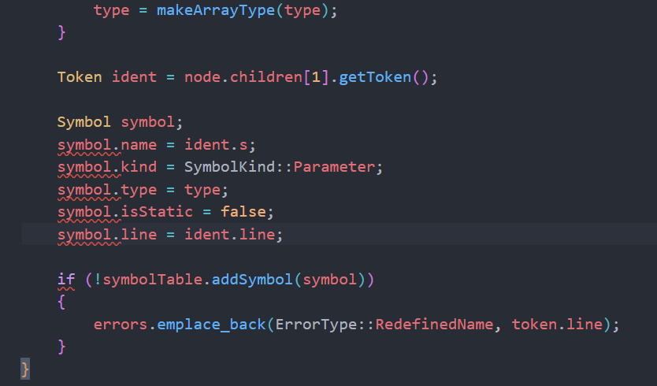

# 完善 visitVarDecl 实现

- 会话时间：2026-10-05 16:09:37
- 会话编号：`01a10b1c-78cc-7553-9b05-f00081b04d5d`
- 导出范围：仅保留用户与助手可见消息以及用户附图，已排除系统提示、开发者指令、内部推理、工具调用及工具输出。

## 1. 用户

时间：2026-10-05 16:09:41

# Context from my IDE setup:

## Active file: src/semantic/SemanticAnalyzer.cpp

## Open tabs:
- SemanticAnalyzer.cpp: src/semantic/SemanticAnalyzer.cpp
- SemanticAnalyzer.h: src/semantic/SemanticAnalyzer.h
- SyntaxType.h: src/parser/SyntaxType.h
- SyntaxNode.h: src/parser/SyntaxNode.h
- SymbolTable.cpp: src/semantic/SymbolTable.cpp

## My request:
void SA::visitVarDecl(const SN &*Node*)
{
    bool isStatic = 0;
    BaseType type = BaseType::Invalid;
    for (const SN &child : *Node*.children)
    {
        if (isTokenType(child, TokenType::STATICTK))
        {
            isStatic = true;
        }
        else if (isSyntaxType(child, ST::BType))
        {
            type = readBType(child);
        }
        else if (isSyntaxType(child, ST::VarDef))
        {
        }
    }
}
接下来如何写

---

## 2. 助手

时间：2026-10-05 16:09:44

我先按你当前仓库的实际 AST 结构和符号表接口来看，不直接凭这段代码猜。重点会确认 `VarDecl/VarDef` 的子节点形状、已有的常量声明处理方式，以及 `SymbolTable` 需要哪些字段，然后给你下一小步怎么写。

---

## 3. 助手

时间：2026-10-05 16:09:57

我刚确认到一个必须先修的前置问题：你现在 `isSyntaxType` / `isTokenType` 对 `isTerminal()` 的判断写反了。`SyntaxNode::isTerminal()` 为真表示里面装的是 `Token`，所以当前一进入 `visitVarDecl` 就可能触发 `std::bad_variant_access`；另外 `visitDecl` 的两个 `case` 也缺少 `break`。先把这两处打稳，再写 `VarDef`，否则后面的逻辑即使正确也跑不起来。

---

## 4. 助手

时间：2026-10-05 16:10:19

你接下来要做的是：对每个 `VarDef` 提取“名字、是否数组、行号”，组装成 `Symbol`，再加入当前作用域。

不过先修正两个前置错误。

```cpp
bool SA::isSyntaxType(const SyntaxNode &node, SyntaxType type)
{
    return !node.isTerminal() && node.getSyntaxType() == type;
}

bool SA::isTokenType(const SyntaxNode &node, TokenType type)
{
    return node.isTerminal() && node.getTokenType() == type;
}
```

因为 `isTerminal() == true` 表示节点中保存的是 `Token`。

`visitDecl()` 的 `switch` 也要加 `break`：

```cpp
case ST::ConstDecl:
    visitConstDecl(child);
    break;
case ST::VarDecl:
    visitVarDecl(child);
    break;
```

然后理解 `VarDef` 的实际结构：

```text
VarDef
├── IDENFR
├── [ ConstExp ]       可选，出现就表示数组
└── = InitVal         可选
```

所以 `visitVarDecl()` 遇到一个 `VarDef` 时，可以按下面的步骤写：

```cpp
else if (isSyntaxType(child, ST::VarDef))
{
    // 1. child.children[0] 一定是 IDENFR
    const Token &ident = get<Token>(child.children[0].node);

    // 2. 检查 VarDef 中是否出现 LBRACK，判断是不是数组
    bool isArray = false;
    for (const SN &part : child.children)
    {
        if (isTokenType(part, TokenType::LBRACK))
        {
            isArray = true;
        }
    }

    // 3. 构造符号
    Symbol symbol;
    symbol.name = ident.s;
    symbol.kind = SymbolKind::Variable;
    symbol.type = isArray ? makeArrayType(type) : type;
    symbol.isStatic = isStatic;
    symbol.line = ident.line;

    // 4. 加入当前作用域
    if (!symbolTable.addSymbol(symbol))
    {
        // 当前作用域中已经有同名符号，这里以后记录 b 类错误
    }
}
```

`makeArrayType()` 可以作为你现在的下一个小目标：

```cpp
BaseType SA::makeArrayType(BaseType type)
{
    if (type == BaseType::Int)
        return BaseType::IntArray;
    if (type == BaseType::Char)
        return BaseType::CharArray;
    return BaseType::Invalid;
}
```

例如：

```c
static int a, b[10];
char c = 'x';
```

应当登记为：

```text
a：Variable + Int + isStatic
b：Variable + IntArray + isStatic
c：Variable + Char + 非 static
```

这一阶段先只完成“正确程序的变量符号登记”。之后再扩展两件事：

1. `addSymbol()` 返回 `false` 时产生 `b` 类重定义错误。
2. 遍历 `InitVal` 中的表达式，检查未定义名字、函数参数等语义错误。

另外，循环最好写成引用，避免复制整棵子树：

```cpp
for (const SyntaxNode &child : Node.children)
```

你当前最合适的验证输入是：

```c
int a, b[10];
static char c, s[20];

int main() {
    int x;
    return 0;
}
```

预期符号类型应包含：

```text
1 a Int
1 b IntArray
1 c StaticChar
1 s StaticCharArray
```

局部变量 `x` 要等 `visitBlock()` 建立函数作用域之后才能得到正确的作用域编号。

<oai-mem-citation>
<citation_entries>
MEMORY.md:116-123|note=[Used current AST declaration structure and semantic pipeline context]
</citation_entries>
<rollout_ids>
01a1013f-5569-7bb1-ba98-acce3e48ead6
01a105cb-9ea9-75d3-87f7-61fda802111e
</rollout_ids>
</oai-mem-citation>

---

## 5. 用户

时间：2026-10-05 16:11:37

# Context from my IDE setup:

## Active file: src/semantic/SemanticAnalyzer.cpp

## Open tabs:
- SemanticAnalyzer.cpp: src/semantic/SemanticAnalyzer.cpp
- SemanticAnalyzer.h: src/semantic/SemanticAnalyzer.h
- SyntaxType.h: src/parser/SyntaxType.h
- SyntaxNode.h: src/parser/SyntaxNode.h
- SymbolTable.cpp: src/semantic/SymbolTable.cpp

## My request:
需不需要单独写一个visit`VarDef`

---

## 6. 助手

时间：2026-10-05 16:11:45

需要，建议单独写 `visitVarDef`。因为 `VarDecl` 负责整条声明的公共信息，而 `VarDef` 负责每个具体变量。

职责可以这样划分：

```text
VarDecl
├── 是否 static
├── BType
└── 依次调用 visitVarDef

VarDef
├── 提取变量名
├── 判断是否为数组
├── 处理初始化值
├── 添加符号
└── 检查重定义错误 b
```

在头文件中声明：

```cpp
void visitVarDef(const SyntaxNode &node,
                 BaseType baseType,
                 bool isStatic);
```

然后 `visitVarDecl()` 中只保留调度：

```cpp
else if (isSyntaxType(child, ST::VarDef))
{
    visitVarDef(child, type, isStatic);
}
```

这样设计更合理，因为 `type` 和 `isStatic` 属于整个 `VarDecl`：

```c
static int a, b[10], c = 1;
```

三个 `VarDef` 都共享 `static int`，但各自的名字、数组属性和初始化值不同。

以后也可以对称设计：

```cpp
void visitConstDef(const SyntaxNode &node, BaseType baseType);
```

我建议你现在先让 `visitVarDef()` 只完成四件事：

1. 从 `node.children[0]` 获取标识符。
2. 检查有没有 `LBRACK`，确定普通类型还是数组类型。
3. 构造 `Symbol` 并调用 `symbolTable.addSymbol()`。
4. 添加失败时记录 `b` 类重定义错误。

暂时不要急着处理 `InitVal`，等变量登记正确后，再单独加入表达式的语义检查。这样每一步都容易测试。

---

## 7. 用户

时间：2026-10-05 16:19:58

# Context from my IDE setup:

## Active file: src/semantic/SemanticAnalyzer.cpp

## Open tabs:
- SemanticAnalyzer.cpp: src/semantic/SemanticAnalyzer.cpp
- SemanticAnalyzer.h: src/semantic/SemanticAnalyzer.h
- SymbolTable.h: src/semantic/SymbolTable.h
- SyntaxNode.h: src/parser/SyntaxNode.h
- SyntaxType.h: src/parser/SyntaxType.h

## My request:
else if (isSyntaxType(child, ST::VarDef))
{
&#x20;   // 1. child.children[0] 一定是 IDENFR
&#x20;   const Token &ident = get\<Token>(child.children[0].node);

&#x20;   // 2. 检查 VarDef 中是否出现 LBRACK，判断是不是数组
&#x20;   bool isArray = false;
&#x20;   for (const SN &part : child.children)
&#x20;   {
&#x20;       if (isTokenType(part, TokenType::LBRACK))
&#x20;       {
&#x20;           isArray = true;
&#x20;       }
&#x20;   }

&#x20;   // 3. 构造符号
&#x20;   Symbol symbol;
&#x20;   symbol.name = ident.s;
&#x20;   symbol.kind = SymbolKind::Variable;
&#x20;   symbol.type = isArray ? makeArrayType(type) : type;
&#x20;   symbol.isStatic = isStatic;
&#x20;   symbol.line = ident.line;

&#x20;   // 4. 加入当前作用域
&#x20;   if (!symbolTable.addSymbol(symbol))
&#x20;   {
&#x20;       // 当前作用域中已经有同名符号，这里以后记录 b 类错误
&#x20;   }
}
这个type没定义

---

## 8. 助手

时间：2026-10-05 16:20:01

我看一下你现在把这段放在 `visitVarDecl` 里还是已经拆进 `visitVarDef` 了；这两种情况下，`type` 的作用域处理不同。

---

## 9. 助手

时间：2026-10-05 16:20:10

你已经把它拆进 `visitVarDef()` 了，所以这里不能再用 `visitVarDecl()` 的局部变量 `type`。

你已经通过参数把它传进来了：

```cpp
void SA::visitVarDef(const SyntaxNode &Node,
                     BaseType baseType,
                     bool isStatic)
```

因此在 `visitVarDef()` 中应使用 `baseType`：

```cpp
void SA::visitVarDef(const SyntaxNode &Node,
                     BaseType baseType,
                     bool isStatic)
{
    const Token &ident = get<Token>(Node.children[0].node);

    bool isArray = false;
    for (const SN &part : Node.children)
    {
        if (isTokenType(part, TokenType::LBRACK))
        {
            isArray = true;
            break;
        }
    }

    Symbol symbol;
    symbol.name = ident.s;
    symbol.kind = SymbolKind::Variable;
    symbol.type = isArray ? makeArrayType(baseType) : baseType;
    symbol.isStatic = isStatic;
    symbol.line = ident.line;

    if (!symbolTable.addSymbol(symbol))
    {
        // 以后添加 b 类重定义错误
    }
}
```

调用链是：

```cpp
// visitVarDecl 中的局部变量
BaseType type = BaseType::Invalid;

visitVarDef(child, type, isStatic);
```

然后：

```cpp
// visitVarDef 中用参数接收
BaseType baseType
```

所以不是 `type` 没有传递，而是进入新函数后它改名叫 `baseType` 了。

另外，你当前保存的数组判断中，`if` 内还是空的，需要补上：

```cpp
isArray = true;
```

否则所有数组最后都会被当作普通变量。

---

## 10. 用户

时间：2026-10-05 16:21:33

# Context from my IDE setup:

## Active file: src/semantic/SemanticAnalyzer.cpp

## Active selection of the file:
visitVarDef
## Open tabs:
- SemanticAnalyzer.cpp: src/semantic/SemanticAnalyzer.cpp
- SemanticAnalyzer.h: src/semantic/SemanticAnalyzer.h
- SymbolTable.h: src/semantic/SymbolTable.h
- SyntaxNode.h: src/parser/SyntaxNode.h
- SyntaxType.h: src/parser/SyntaxType.h

## My request:
visitVarDef已经写完，下一步呢

---

## 11. 助手

时间：2026-10-05 16:21:37

我先重新读你刚保存的 `visitVarDef`，确认它确实闭环，再根据当前缺口只安排下一小步，不提前铺开整个语义分析。

---

## 12. 助手

时间：2026-10-05 16:21:42

你这版 `visitVarDef` 的核心流程已经完整：识别数组、读取首个标识符、组装符号并加入表。现在最合理的下一步不是处理初始化表达式，而是实现与它对称的 `visitConstDecl / visitConstDef`；这样顶层两类声明都能进入符号表。先确认一下当前构建暴露的第一个缺口。

---

## 13. 助手

时间：2026-10-05 16:21:56

`visitVarDef` 的主体已经完成。当前构建失败的直接原因不是它，而是：

```text
undefined reference to SemanticAnalyzer::visitConstDecl(...)
```

所以下一步实现常量声明，结构与变量声明基本对称。

先在头文件增加：

```cpp
void visitConstDef(const SyntaxNode &node, BaseType baseType);
```

职责划分：

```text
visitConstDecl
├── 找到 BType，得到 baseType
└── 每遇到 ConstDef
    └── visitConstDef(child, baseType)

visitConstDef
├── children[0] 取得标识符
├── 查找 LBRACK 判断是否数组
├── kind = SymbolKind::Constant
├── type = 普通类型或数组类型
└── addSymbol
```

与 `visitVarDef` 的主要区别只有：

```cpp
symbol.kind = SymbolKind::Constant;
symbol.isStatic = false;
```

`visitConstDecl()` 的框架可以先写成：

```cpp
void SA::visitConstDecl(const SN &Node)
{
    BaseType baseType = BaseType::Invalid;

    for (const SN &child : Node.children)
    {
        if (isSyntaxType(child, ST::BType))
        {
            baseType = readBType(child);
        }
        else if (isSyntaxType(child, ST::ConstDef))
        {
            visitConstDef(child, baseType);
        }
    }
}
```

然后你自己仿照 `visitVarDef()` 完成 `visitConstDef()`。例如：

```c
const int a = 1, b[2] = {1, 2};
```

应该登记成：

```text
1 a ConstInt
1 b ConstIntArray
```

暂时仍然不用分析 `ConstInitVal`。完成后重新运行：

```bash
cmake --build build --parallel
```

另外，你的 `visitVarDef()` 最后有一个缩进异常，建议整理为：

```cpp
if (!symbolTable.addSymbol(symbol))
{
    // 后续处理 b 类错误
}
```

下一阶段才是补充 `ErrorType::RedefinedName = 'b'`，并处理 `addSymbol()` 失败。

---

## 14. 用户

时间：2026-10-05 16:26:54

# Context from my IDE setup:

## Active file: src/semantic/SemanticAnalyzer.cpp

## Open tabs:
- SemanticAnalyzer.cpp: src/semantic/SemanticAnalyzer.cpp
- SymbolTable.h: src/semantic/SymbolTable.h
- SemanticAnalyzer.h: src/semantic/SemanticAnalyzer.h
- SyntaxNode.h: src/parser/SyntaxNode.h
- SyntaxType.h: src/parser/SyntaxType.h

## My request:
这个也已经完成，下一步

---

## 15. 助手

时间：2026-10-05 16:26:56

我继续按最新保存内容检查：先确认常量声明是否完整、当前能否构建，再从实际第一个缺口里选下一步。

---

## 16. 助手

时间：2026-10-05 16:27:11

当前保存的版本还差一行头文件声明，所以现在不能构建。编译器实际报错是：

```text
visitConstDef was not declared in this scope
```

先在 `SemanticAnalyzer.h` 的 `visitConstDecl` 后加入：

```cpp
void visitConstDef(const SyntaxNode &node, BaseType baseType);
```

然后重新构建：

```bash
cmake --build build --parallel
```

构建通过后，下一步建议先打通语义分析入口，而不是马上写函数定义。

实现这两个已经声明的接口：

```cpp
void SA::analyze(const SyntaxNode &root)
{
    visitCompUnit(root);
}

void SA::printSymbols(ostream &output)
{
    symbolTable.printSymbols(output);
}
```

它们的调用链是：

```text
main
  → analyze(root)
    → visitCompUnit
      → visitDecl
        → visitVarDecl / visitConstDecl
          → visitVarDef / visitConstDef

main
  → printSymbols(symbolFile)
    → SymbolTable::printSymbols
```

然后在 `main.cpp` 中临时创建语义分析器：

```cpp
SemanticAnalyzer analyzer;
analyzer.analyze(root);

ofstream symbolFile("symbol.txt");
analyzer.printSymbols(symbolFile);
```

并包含：

```cpp
#include "semantic/SemanticAnalyzer.h"
```

先用只有全局声明的程序验证：

```c
const int a = 1;
const char chars[2] = {'a', 'b'};
int x;
static char buffer[10];

int main() {
    return 0;
}
```

当前阶段预期：

```text
1 a ConstInt
1 chars ConstCharArray
1 x Int
1 buffer StaticCharArray
```

验证这条链路通过后，下一步才是 `visitFuncDef()`：登记函数符号、建立函数内部作用域，然后登记形参。当前 `visitCompUnit()` 也还只处理了 `Decl`，函数部分到那一步再补。

---

## 17. 用户

时间：2026-10-05 16:30:05

# Context from my IDE setup:

## Active file: src/main.cpp

## Open tabs:
- main.cpp: src/main.cpp
- testfile.txt: testfile.txt
- SemanticAnalyzer.h: src/semantic/SemanticAnalyzer.h
- SemanticAnalyzer.cpp: src/semantic/SemanticAnalyzer.cpp
- SymbolTable.h: src/semantic/SymbolTable.h

## My request:
怎么编译不了

---

## 18. 助手

时间：2026-10-05 16:30:07

我直接按你当前保存的代码重新构建，先拿到第一条真实报错，再定位到对应文件和修改点。

---

## 19. 助手

时间：2026-10-05 16:30:16

不是语法编译错误，而是链接错误：你在 `SemanticAnalyzer.h` 声明了两个函数，并在 `main.cpp` 调用了它们，但 `SemanticAnalyzer.cpp` 中没有对应实现：

```text
undefined reference to SemanticAnalyzer::analyze(...)
undefined reference to SemanticAnalyzer::printSymbols(...)
```

在 `SemanticAnalyzer.cpp` 中补上：

```cpp
void SA::analyze(const SyntaxNode &root)
{
    visitCompUnit(root);
}

void SA::printSymbols(ostream &output)
{
    symbolTable.printSymbols(output);
}
```

放在文件中的任意全局位置都可以，例如放在两个判断辅助函数之后。

原因可以理解为：

```text
SemanticAnalyzer.h：承诺这两个函数存在
main.cpp：调用这两个函数
SemanticAnalyzer.cpp：目前没有真正定义它们
链接器：找不到函数实现
```

然后重新编译：

```bash
cmake --build build --parallel
```

刚才的构建已经成功编译了各个 `.cpp`，只是在最后链接可执行文件时失败，因此补齐这两个定义即可解决当前错误。

---

## 20. 用户

时间：2026-10-05 16:31:38

# Context from my IDE setup:

## Active file: testfile.txt

## Open tabs:
- testfile.txt: testfile.txt
- parser.txt: parser.txt
- lexer.txt: lexer.txt
- error.txt: error.txt
- SemanticAnalyzer.cpp: src/semantic/SemanticAnalyzer.cpp

## My request:
没有输出暧昧

---

## 21. 用户

时间：2026-10-05 16:31:44

# Context from my IDE setup:

## Active file: testfile.txt

## Open tabs:
- testfile.txt: testfile.txt
- parser.txt: parser.txt
- lexer.txt: lexer.txt
- error.txt: error.txt
- SemanticAnalyzer.cpp: src/semantic/SemanticAnalyzer.cpp

## My request:
没有输出

---

## 22. 助手

时间：2026-10-05 16:32:07

我检查当前 `testfile.txt`、生成的 `symbol.txt`，并实际运行一次程序，判断是没有执行到语义分析、输出文件位置不对，还是 `visitCompUnit` 没有遍历到声明。

---

## 23. 助手

时间：2026-10-05 16:32:17

实际已经输出成功了，只是程序不是输出到终端，而是写入项目根目录的 `symbol.txt`。

我刚运行：

```bash
./build/Compiler
```

生成的 [symbol.txt](/home/zzz2007-cpu/projects/compiler/symbol.txt) 内容是：

```text
1 a ConstInt
1 chars ConstCharArray
1 x Int
1 buffer StaticCharArray
```

你的 IDE 标签页里目前没有打开 `symbol.txt`，打开或刷新它即可。

注意要在项目根目录运行：

```bash
cd /home/zzz2007-cpu/projects/compiler
./build/Compiler
```

因为代码里的相对路径：

```cpp
ifstream inputFile("testfile.txt");
ofstream symbolFile("symbol.txt");
```

都是相对于程序运行时的工作目录，而不是可执行文件所在目录。若从 `build` 目录运行，程序就会寻找 `build/testfile.txt`，并把输出写进 `build/symbol.txt`。

---

## 24. 用户

时间：2026-10-05 16:33:44

# Context from my IDE setup:

## Active file: symbol.txt

## Open tabs:
- symbol.txt: symbol.txt
- main.cpp: src/main.cpp
- testfile.txt: testfile.txt
- parser.txt: parser.txt
- lexer.txt: lexer.txt

## My request:
好了，继续规划下一步，可以说多一点，我一次实现，不必一个个规划

---

## 25. 助手

时间：2026-10-05 16:33:50

接下来我会给你一段可以连续实现的路线，而不是只安排一个函数。为了把 `b–h、m、n` 的错误规则和作用域细节说准确，我会按仓库里的课程 PDF/语义要求核对一次；这会影响函数参数、表达式类型检查和错误记录的设计。

---

## 26. 助手

时间：2026-10-05 16:34:40

课程规则已经核对清楚：函数/变量的作用域从声明处开始，所以顶层应保持单遍顺序分析；函数体最外层作用域要和形参共用，不能为函数体再多建一层。这个结论会直接决定 `visitFuncDef` 和 `visitBlock(createScope)` 的写法。接下来我把完整实现路线按可连续编码的模块列出来。

---

## 27. 助手

时间：2026-10-05 16:35:43

可以。接下来可以把语义分析一次规划完整，但建议仍按“每完成一层就构建”的顺序实现，避免最后同时排查作用域、类型和错误码。

你现在已经完成：

```text
CompUnit
  → Decl
    → VarDecl / ConstDecl
      → VarDef / ConstDef
        → 加入全局符号表
```

下一阶段按下面四部分推进。

## 一、先完成函数、形参和所有作用域

这是下一步的核心。需要实现：

```cpp
visitFuncDef()
visitMainFuncDef()
visitFuncFParam()
visitBlock()
visitBlockItem()
```

### 1. 扩展 `visitCompUnit`

当前只处理了 `Decl`，需要增加：

```text
Decl        → visitDecl
FuncDef     → visitFuncDef
MainFuncDef → visitMainFuncDef
```

每个 `case` 都要有 `break`。

建议顺便把复制改为引用：

```cpp
for (const SyntaxNode &child : Node.children)
```

课程规则规定顶层名字从声明处开始生效，因此保持当前 AST 顺序单遍分析，不要预先把后面的所有函数一起注册。函数进入自身函数体之前先登记自己，就能支持递归。

### 2. 增加函数类型读取函数

`FuncType` 与 `BType` 不同，因为它还可能是 `void`：

```cpp
BaseType readFuncType(const SyntaxNode &node);
```

映射关系：

```text
INTTK  → BaseType::Int
CHARTK → BaseType::Char
VOIDTK → BaseType::Void
```

### 3. `visitFuncDef` 的正确顺序

`FuncDef` 的 AST 是：

```text
FuncDef
├── FuncType
├── IDENFR
├── LPARENT
├── FuncFParams   可选
├── RPARENT
└── Block
```

处理顺序必须是：

```text
1. 提取函数返回类型
2. 提取函数名
3. 提前收集所有形参类型
4. 把函数加入全局符号表
5. 进入函数作用域
6. 把每个形参加入函数作用域
7. 分析函数体，但不再次创建作用域
8. 离开函数作用域
```

函数符号需要填写：

```cpp
symbol.name
symbol.kind = SymbolKind::Function
symbol.type            // 返回类型
symbol.params          // 形参类型列表
symbol.line
```

为什么要先收集参数类型？因为函数符号加入全局表时，`params` 应当已经完整，后续函数调用才能检查参数。

建议增加一个纯读取辅助函数：

```cpp
vector<BaseType> collectParamTypes(const SyntaxNode &funcFParams);
```

它只读取参数类型，不修改符号表。

数组形参：

```c
int f(char text[])
```

应记录：

```text
params = { BaseType::CharArray }
```

### 4. 函数体不能重复创建作用域

形参和函数最外层局部变量属于同一个作用域，因此：

```cpp
symbolTable.enterScope();
visitFuncFParams(...);
visitBlock(blockNode, false);
symbolTable.leaveScope();
```

这里传 `false`，表示函数作用域已经由 `visitFuncDef` 创建。

普通嵌套块才使用：

```cpp
visitBlock(blockNode, true);
```

比如：

```c
int f(int a) {       // 作用域2：a、x
    int x;
    {                // 作用域3：y
        int y;
    }
}
```

### 5. `visitMainFuncDef`

`main` 不加入符号表，但它仍然需要函数作用域：

```text
设置当前函数返回类型为 Int
进入作用域
visitBlock(block, false)
离开作用域
```

课程要求明确规定 `main` 不输出到符号表。

### 6. `visitBlock` 和 `visitBlockItem`

逻辑如下：

```text
visitBlock(node, createScope)
├── createScope 为 true 时 enterScope
├── 依次 visitBlockItem
└── createScope 为 true 时 leaveScope
```

`BlockItem`：

```text
Decl → visitDecl
Stmt → visitStmt
```

完成这一部分后，先用课程样例验证作用域编号。预期类似：

```text
1 year ConstInt
1 month ConstInt
1 day Int
1 getDay IntFunc
1 fun IntFunc
2 day StaticInt
5 length Int
```

这里作用域编号不一定连续出现在输出中，因为某些作用域可能没有符号。

---

## 二、补齐语义错误类型和上下文状态

在 [Error.h](/home/zzz2007-cpu/projects/compiler/src/common/Error.h) 中补充：

```cpp
RedefinedName              = 'b',
UndefinedName              = 'c',
ParameterCountMismatch     = 'd',
TypeMismatch               = 'e',
VoidReturnValue            = 'f',
MissingReturn              = 'g',
ModifyConstant             = 'h',
PrintfArgumentCountMismatch = 'l',
InvalidBreakContinue       = 'm',
DuplicateCase              = 'n',
```

名字可以自己定，只要字符码正确。

在 `SemanticAnalyzer` 中建议保存这些上下文：

```cpp
BaseType currentFunctionType = BaseType::Invalid;
int loopDepth = 0;
int switchDepth = 0;
```

用途：

```text
currentFunctionType → 检查 return
loopDepth           → 检查 break、continue
switchDepth         → 检查 break
```

建议再提供：

```cpp
void addError(ErrorType type, int line);
```

然后变量、常量、函数、形参调用 `addSymbol()` 失败时记录：

```cpp
errors.emplace_back(ErrorType::RedefinedName, token.line);
```

注意：

- 只使用 `lookupCurrent()` 判断重定义。
- 内层作用域允许覆盖外层同名变量。
- 函数重定义后仍要继续分析函数体，不能直接 `return`。
- 全局函数、变量和常量共享同一个名字空间。

---

## 三、建立“表达式返回类型”体系

后面的 `c、d、e、h` 都依赖表达式类型，所以不要让表达式访问函数返回 `void`。建议统一返回 `BaseType`：

```cpp
BaseType visitExp(const SyntaxNode &node);
BaseType visitConstExp(const SyntaxNode &node);
BaseType visitAddExp(const SyntaxNode &node);
BaseType visitMulExp(const SyntaxNode &node);
BaseType visitUnaryExp(const SyntaxNode &node);
BaseType visitPrimaryExp(const SyntaxNode &node);
BaseType visitLVal(const SyntaxNode &node);
BaseType visitNumber(const SyntaxNode &node);
```

条件表达式再继续补：

```cpp
BaseType visitCond(...);
BaseType visitRelExp(...);
BaseType visitEqExp(...);
BaseType visitLAndExp(...);
BaseType visitLOrExp(...);
```

### 基础类型传播

```text
INTCON  → Int
CHARCON → Char
```

`PrimaryExp` 直接返回内部 `Exp/LVal/Number` 的类型。

普通一元正负号保持操作数类型：

```text
+a → a 的类型
-a → a 的类型
```

逻辑非、关系运算、相等运算、逻辑与或的结果通常为：

```text
BaseType::Int
```

显式类型转换：

```c
(int)charValue
(char)intValue
```

返回目标 `BType`。

### 算术表达式

课程要求类型必须完全一致，不能自动进行 `char → int` 转换：

```c
intValue + charValue    // e
```

检查过程：

```text
leftType == rightType
并且必须是 Int 或 Char
```

否则记录 `e`，返回 `Invalid` 防止继续产生连锁错误。

建议规则：

```cpp
if (left == BaseType::Invalid || right == BaseType::Invalid)
    return BaseType::Invalid;

if (left != right || !isScalarType(left)) {
    addError(...);
    return BaseType::Invalid;
}
```

### `visitLVal`

需要处理：

```c
a
array[index]
```

步骤：

```text
1. 提取 IDENFR
2. symbolTable.lookup(name)
3. 找不到 → c
4. 找到函数却当变量使用 → e
5. 有下标：
   - 下标表达式必须为 Int，否则 e
   - IntArray 返回 Int
   - CharArray 返回 Char
   - 普通 Int/Char 被下标访问 → e
6. 无下标：直接返回符号类型
```

数组不带下标时必须保留数组类型，因为数组可以作为数组形参传递：

```c
f(array);
```

### 函数调用

`UnaryExp` 中以：

```text
IDENFR LPARENT ...
```

开头的是函数调用。

检查：

```text
1. 查找函数名，找不到 → c
2. 找到的符号不是 Function → e
3. 收集所有实参类型
4. 参数数量不同 → d
5. 数量相同但任意参数类型不同 → e
6. 返回函数的返回类型
```

必须完全匹配：

```text
Int       ↔ Int
Char      ↔ Char
IntArray  ↔ IntArray
CharArray ↔ CharArray
```

不能自动转换。

### 运行时函数

这些函数不能加入可打印的普通符号表，但调用时必须识别：

```text
get_int()                    → Int
get_char()                   → Char
get_string(CharArray, Int)   → Void
put_int(Int)                 → Void
put_char(Char)               → Void
put_string(CharArray)        → Void
```

最简单的方式是在分析函数调用时提供一个内置函数签名查询，不把它们放入 `SymbolTable::symbols`，这样不会错误输出到 `symbol.txt`。

---

## 四、完成语句语义检查

实现 `visitStmt` 时，不要只递归所有孩子，因为不同语句需要不同上下文。

### 1. 赋值语句

结构：

```text
LVal ASSIGN Exp SEMICN
```

需要检查：

```text
LVal 未定义                  → c
LVal 对应 Constant           → h
LVal 类型与 Exp 类型不同      → e
```

仅让 `visitLVal()` 返回类型还不够判断常量。可以增加：

```cpp
struct LValInfo
{
    BaseType type;
    Symbol *symbol;
    int line;
};
```

或者另写一个查找 LVal 对应符号的辅助函数。

### 2. return

使用 `currentFunctionType`：

```text
void 函数中 return Exp; → f
int/char 函数 return;   → e
返回表达式类型不一致     → e
```

有返回值函数末尾没有 `return`，记录 `g`，行号是函数结尾 `}` 的行号。

课程保证只需检查函数 `Block` 最后一个语句是不是 `return`，不用做复杂控制流分析。建议写：

```cpp
bool blockEndsWithReturn(const SyntaxNode &block);
```

`main` 也按有返回值函数检查，且课程规定它最终返回常数 `0`。

### 3. while、break、continue

进入 `while` 身体前：

```cpp
++loopDepth;
visitStmt(body);
--loopDepth;
```

检查：

```text
break：
loopDepth > 0 或 switchDepth > 0 才合法

continue：
只有 loopDepth > 0 才合法
```

否则记录 `m`。

### 4. switch/case/default

进入 switch：

```cpp
++switchDepth;
...
--switchDepth;
```

每个 switch 单独维护：

```cpp
unordered_set<int> caseValues;
bool hasDefault = false;
```

检查：

```text
switch Exp 必须是 Int 或 Char
case Number 类型必须与 Exp 相同，否则 e
case 常量值重复 → n
第二个 default → n
```

嵌套 switch 不能共用同一个全局集合。可以把集合传给 `visitCaseStmt`，或者使用一个栈保存每层 switch 状态。

字符常量需要把：

```c
'a'
'\n'
'\0'
```

转换成实际整数值后再判断是否重复。

### 5. printf

从 `STRCON` 中统计：

```text
%d → Int
%c → Char
%s → CharArray
```

检查两层：

```text
格式符数量与 Exp 数量不同 → l
数量相同但对应类型不同    → e
```

注意不要把普通 `%` 或字符串内容误当作格式符；课程只认可 `%d/%c/%s`。

---

## 五、声明初始化也要进行类型检查

你现在的 `visitVarDef/visitConstDef` 只登记符号。后面需要继续遍历：

```text
ConstExp
InitVal
ConstInitVal
```

规则：

```text
int x = Int表达式       合法
char c = Char表达式     合法
int x = Char表达式      e
char c = Int表达式      e
```

数组初始化时比较的是元素类型：

```text
IntArray  的每个元素必须是 Int
CharArray 的每个元素必须是 Char
```

字符串初始化只能对应字符数组。

数组长度中的 `ConstExp` 必须为 `Int`。

建议先把符号加入表，再分析初始化表达式，这样当前声明之后的作用域行为保持统一。

---

## 六、修改 main 中的错误合并顺序

你当前在语义分析之前就已经输出了 `error.txt`，因此以后即使 `analyzer.errors` 有内容，也不会输出。

正确顺序应该是：

```text
词法分析
语法分析
语义分析
合并三者错误
按行号稳定排序
输出 error.txt
输出 symbol.txt
```

核心是把：

```cpp
analyzer.analyze(root);
```

放在最终组织 `allErrors` 之前，然后加入：

```cpp
allErrors.insert(allErrors.end(),
                 analyzer.errors.begin(),
                 analyzer.errors.end());
```

如果存在词法或语法错误，语义分析仍然可以继续，只要语法树保持可遍历；课程要求尽可能收集全部错误。

---

## 推荐实际编码顺序

你可以一次连续完成，但按这个顺序写和测试：

1. `readFuncType`、函数符号、参数类型收集。
2. 函数作用域、参数、Block、BlockItem。
3. `b` 类重定义。
4. Number、LVal、PrimaryExp、UnaryExp。
5. MulExp、AddExp、关系和逻辑表达式。
6. `c/d/e`。
7. 赋值和 `h`。
8. return 和 `f/g`。
9. while/switch 和 `m/n`。
10. printf 和 `l`。
11. 初始化值类型检查。
12. 在 `main.cpp` 合并语义错误。
13. 用正确样例检查 `symbol.txt`，用错误样例检查 `error.txt`。

实现过程中，最重要的三个设计点是：

```text
函数最外层 Block 不重复建作用域
表达式访问函数必须返回 BaseType
Invalid 类型用于阻止一个根错误产生多个连锁错误
```

我按课程 PDF 核对后，函数体作用域、严格类型匹配、运行时函数不输出、`break/continue` 区别以及 switch 重复规则，都是后面平台测试比较容易卡住的地方。

---

## 28. 用户

时间：2026-10-05 16:43:17

# Context from my IDE setup:

## Active file: src/semantic/SemanticAnalyzer.cpp

## Active selection of the file:
funcFParams
## Open tabs:
- SemanticAnalyzer.cpp: src/semantic/SemanticAnalyzer.cpp
- SemanticAnalyzer.h: src/semantic/SemanticAnalyzer.h
- parser.txt: parser.txt
- symbol.txt: symbol.txt
- main.cpp: src/main.cpp

## My request:
*funcFParams子节点都有什么*

---

## 29. 助手

时间：2026-10-05 16:43:25

`FuncFParams` 表示整个函数形参列表，它的直接子节点按下面的顺序排列：

```text
FuncFParams
├── FuncFParam
├── COMMA
├── FuncFParam
├── COMMA
└── FuncFParam
```

也就是对应文法：

```text
FuncFParams → FuncFParam { ',' FuncFParam }
```

例如：

```c
int fun(int a, char b[], int c)
```

对应的 AST 大致是：

```text
FuncFParams
├── FuncFParam
│   ├── BType
│   │   └── INTTK int
│   └── IDENFR a
├── COMMA ,
├── FuncFParam
│   ├── BType
│   │   └── CHARTK char
│   ├── IDENFR b
│   ├── LBRACK [
│   └── RBRACK ]
├── COMMA ,
└── FuncFParam
    ├── BType
    │   └── INTTK int
    └── IDENFR c
```

因此遍历 `FuncFParams.children` 时，只处理 `FuncFParam`：

```cpp
for (const SN &child : funcFParams.children)
{
    if (isSyntaxType(child, ST::FuncFParam))
    {
        // 读取一个形参
    }
}
```

每个 `FuncFParam` 的直接子节点是：

```text
普通参数：BType IDENFR
数组参数：BType IDENFR LBRACK RBRACK
```

可以这样提取类型：

```text
找到 BType   → readBType()
出现 LBRACK  → makeArrayType()
```

再从 `IDENFR` 得到参数名和行号。

还要注意：无参函数不会产生空的 `FuncFParams` 节点。例如：

```c
int fun()
```

它的 `FuncDef.children` 中会直接缺少 `FuncFParams`，所以查找时必须把它当作可选节点。

---

## 30. 用户

时间：2026-10-05 16:47:01

# Context from my IDE setup:

## Active file: src/semantic/SymbolTable.h

## Active selection of the file:
 vector<BaseType> params;
## Open tabs:
- SymbolTable.h: src/semantic/SymbolTable.h
- SemanticAnalyzer.h: src/semantic/SemanticAnalyzer.h
- SemanticAnalyzer.cpp: src/semantic/SemanticAnalyzer.cpp
- parser.txt: parser.txt
- symbol.txt: symbol.txt

## My request:
&#x20;vector\<BaseType> params;为啥要有这玩意

---

## 31. 助手

时间：2026-10-05 16:47:10

```cpp
vector<BaseType> params;
```

用于保存“函数的形参类型列表”，也就是函数签名的一部分。

例如：

```c
int sum(int a, char b, int arr[])
```

函数 `sum` 对应的符号大致是：

```text
name   = "sum"
kind   = Function
type   = Int
params = { Int, Char, IntArray }
```

以后遇到调用：

```c
sum(1, 'a', array);
```

语义分析器会获得实参类型：

```text
{ Int, Char, IntArray }
```

再与函数符号中的 `params` 比较。

它主要用于检查两类错误：

```text
d：函数参数个数不匹配
e：函数参数类型不匹配
```

例如：

```c
sum(1, 'a');          // 2个实参，要求3个，错误 d
sum('a', 'b', array); // 第一个要求 Int，得到 Char，错误 e
sum(1, 'a', 10);      // 第三个要求 IntArray，得到 Int，错误 e
```

注意它只保存参数的“类型和顺序”，不保存参数名：

```cpp
params = {BaseType::Int, BaseType::Char};
```

参数名 `a、b` 会作为独立的 `Parameter` 符号加入函数内部作用域：

```text
全局作用域：
sum → Function，params={Int, Char}

sum内部作用域：
a → Parameter，Int
b → Parameter，Char
```

因此两者用途不同：

- `Function.params`：检查函数调用是否正确。
- 函数作用域里的 `Parameter` 符号：分析函数体中对参数名的使用。

普通变量、常量和参数符号不需要这个字段，它们的 `params` 保持空数组即可。你也可以把它保留在统一的 `Symbol` 结构中，只在 `kind == SymbolKind::Function` 时使用。

---

## 32. 用户

时间：2026-10-05 16:47:51

# Context from my IDE setup:

## Active file: src/semantic/SemanticAnalyzer.cpp

## Open tabs:
- SemanticAnalyzer.cpp: src/semantic/SemanticAnalyzer.cpp
- SymbolTable.h: src/semantic/SymbolTable.h
- SemanticAnalyzer.h: src/semantic/SemanticAnalyzer.h
- parser.txt: parser.txt
- symbol.txt: symbol.txt

## My request:
有重复类型呢

---

## 33. 助手

时间：2026-10-05 16:47:56

可以重复，而且必须允许重复。`params` 保存的是参数的顺序和数量，不是类型集合。

例如：

```c
int add(int a, int b, int c)
```

应保存为：

```cpp
params = {
    BaseType::Int,
    BaseType::Int,
    BaseType::Int
};
```

这里三个 `Int` 分别对应第1、第2、第3个参数，不能合并。

调用时按位置比较：

```c
add(1, 2, 3);       // {Int, Int, Int}，正确
add(1, 'a', 3);     // {Int, Char, Int}，第2个不匹配，错误 e
add(1, 2);          // 只有两个实参，错误 d
```

所以这里必须使用：

```cpp
vector<BaseType>
```

不能使用：

```cpp
set<BaseType>
```

因为 `set` 会去重，也不适合表达参数顺序。

需要区分：

- 参数类型重复：合法，例如 `int a, int b`。
- 参数名字重复：非法，例如：

```c
int f(int a, char a) // a 重定义，错误 b
```

后者由形参加入函数作用域时的 `symbolTable.addSymbol()` 检查。

---

## 34. 用户

时间：2026-10-05 17:00:04

# Context from my IDE setup:

## Active file: src/semantic/SemanticAnalyzer.cpp

## Open tabs:
- SemanticAnalyzer.cpp: src/semantic/SemanticAnalyzer.cpp
- SymbolTable.h: src/semantic/SymbolTable.h
- SemanticAnalyzer.h: src/semantic/SemanticAnalyzer.h
- SyntaxNode.cpp: src/parser/SyntaxNode.cpp
- SyntaxNode.h: src/parser/SyntaxNode.h

## My request:
函数作用域怎么搞，好像之前的全局变量也没有搞作用域

---

## 35. 用户

时间：2026-10-05 17:00:39

# Context from my IDE setup:

## Active file: src/semantic/SemanticAnalyzer.cpp

## Open tabs:
- SemanticAnalyzer.cpp: src/semantic/SemanticAnalyzer.cpp
- SymbolTable.h: src/semantic/SymbolTable.h
- SemanticAnalyzer.h: src/semantic/SemanticAnalyzer.h
- SyntaxNode.cpp: src/parser/SyntaxNode.cpp
- SyntaxNode.h: src/parser/SyntaxNode.h

## My request:
函数作用域怎么搞，好像之前的全局变量也没有搞作用域

---

## 36. 助手

时间：2026-10-05 17:00:44

我先看你现在 `visitFuncDef` 写到哪里，以及 `SymbolTable::enterScope/leaveScope` 的现状。你之前的全局变量其实很可能已经在作用域 1，只是这个作用域是在 `SymbolTable` 构造时自动创建的，所以代码里没显式调用 `enterScope()`。

---

## 37. 助手

时间：2026-10-05 17:00:57

你判断得对一半：全局作用域已经有了，只是由 `SymbolTable` 构造函数隐式建立为编号 1；所有此前的 `addSymbol()` 都自动写进当前作用域，所以全局变量已经正确处理。函数需要显式“先登记函数，再进入函数内部作用域”。另外你当前 `visitFuncDef/collectParamTypes` 还有几处节点层级取错，我会一起指出，否则加完作用域也会崩。

---

## 38. 助手

时间：2026-10-05 17:01:23

全局作用域其实已经处理了。

在 `SymbolTable` 构造函数中：

```cpp
SymbolTable::SymbolTable() : currentScopeId(1), nextScopeId(2)
{
    scopes.push_back(Scope(1, 0));
}
```

创建 `SemanticAnalyzer` 时，`symbolTable` 会自动创建：

```text
作用域1
parentId = 0
currentScopeId = 1
```

所以此前的全局变量调用：

```cpp
symbolTable.addSymbol(symbol);
```

实际上都被加入了当前作用域1。你的 `symbol.txt` 已经证明了这一点：

```text
1 a ConstInt
1 x Int
```

## 函数作用域的正确结构

例如：

```c
int global;

int fun(int a) {
    int x;
    {
        int y;
    }
}
```

应该形成：

```text
作用域1：全局作用域
├── global
└── fun

作用域2：fun的函数作用域
├── a
└── x

作用域3：fun内部的嵌套块
└── y
```

注意：函数名 `fun` 属于全局作用域，参数 `a` 和函数体最外层变量 `x` 属于同一个函数作用域。

## `visitFuncDef` 的处理顺序

函数定义的 AST 是：

```text
FuncDef
├── FuncType
├── IDENFR
├── LPARENT
├── FuncFParams    可选
├── RPARENT
└── Block
```

正确流程是：

```text
1. 当前仍处于全局作用域1
2. 读取函数类型、函数名、形参类型
3. 将函数符号加入作用域1
4. enterScope()，进入函数作用域2
5. 把形参加入作用域2
6. 分析函数体，最外层 Block 不再创建作用域
7. leaveScope()，回到全局作用域1
```

整体框架：

```cpp
void SA::visitFuncDef(const SyntaxNode &node)
{
    // 1. 找到 FuncType、IDENFR、可选 FuncFParams、Block

    // 2. 构造函数符号
    // 此时 currentScopeId 还是1
    symbolTable.addSymbol(functionSymbol);

    // 3. 创建函数内部作用域
    symbolTable.enterScope();

    // 4. 把形参加入当前函数作用域
    // visitFuncFParam(...)

    // 5. 函数最外层 Block 不重复创建作用域
    visitBlock(blockNode, false);

    // 6. 返回全局作用域
    symbolTable.leaveScope();
}
```

## 为什么函数体传 `false`

如果这样写：

```cpp
symbolTable.enterScope(); // 函数作用域2
visitBlock(block, true);  // 又创建作用域3
```

那么参数和最外层局部变量会被错误分开：

```text
作用域2：参数
作用域3：局部变量
```

但正确情况应该是：

```text
作用域2：参数和函数最外层局部变量
```

因此函数定义中应该：

```cpp
symbolTable.enterScope();
visitBlock(block, false);
symbolTable.leaveScope();
```

普通嵌套块才调用：

```cpp
visitBlock(block, true);
```

## `visitBlock` 应该怎么组织

```cpp
void SA::visitBlock(const SyntaxNode &node, bool createScope)
{
    if (createScope)
    {
        symbolTable.enterScope();
    }

    for (const SN &child : node.children)
    {
        if (isSyntaxType(child, ST::BlockItem))
        {
            visitBlockItem(child);
        }
    }

    if (createScope)
    {
        symbolTable.leaveScope();
    }
}
```

`visitBlockItem` 再区分：

```text
Decl → visitDecl
Stmt → visitStmt
```

以后 `visitStmt` 遇到独立的 `{...}` 时：

```cpp
visitBlock(blockChild, true);
```

## `main` 的作用域

`main` 不加入符号表，但需要自己的函数作用域：

```cpp
void SA::visitMainFuncDef(const SyntaxNode &node)
{
    symbolTable.enterScope();

    // 找到其中的 Block
    // main最外层Block不重复创建作用域
    visitBlock(blockNode, false);

    symbolTable.leaveScope();
}
```

你当前构建失败的直接原因也是还没有实现它：

```text
undefined reference to SemanticAnalyzer::visitMainFuncDef(...)
```

## 当前 `visitFuncDef` 还有三个节点问题

### 1. `readFuncType` 参数传错了

你现在是：

```cpp
BaseType baseType = readFuncType(node);
```

但 `node` 是整个 `FuncDef`，`readFuncType()` 要接收的是其中的 `FuncType` 节点。

应该先找到：

```text
node.children[0] → FuncType
```

然后读取它。

### 2. `collectParamTypes` 参数传错了

你现在传的是：

```cpp
collectParamTypes(node.children[1])
```

但 `node.children[1]` 是函数名 `IDENFR`，不是 `FuncFParams`。

由于 `FuncFParams` 是可选的，应该遍历 `FuncDef.children`：

```cpp
for (const SN &child : node.children)
{
    if (isSyntaxType(child, ST::FuncFParams))
    {
        params = collectParamTypes(child);
    }
}
```

无参函数找不到该节点，`params` 保持空即可。

### 3. `collectParamTypes` 每个参数只能添加一次

你现在在 `FuncFParam.children` 的每个子节点上都可能 `push_back`，一个参数会被添加多次。

正确思路是：

```text
对每个 FuncFParam：
    先读取一次 BType
    再扫描有没有 LBRACK
    最后只 push_back 一次
```

大致结构：

```cpp
for (const SN &param : funcFParams.children)
{
    if (!isSyntaxType(param, ST::FuncFParam))
        continue;

    BaseType type = readBType(param.children[0]);
    bool isArray = false;

    for (const SN &part : param.children)
    {
        if (isTokenType(part, TokenType::LBRACK))
        {
            isArray = true;
            break;
        }
    }

    params.push_back(isArray ? makeArrayType(type) : type);
}
```

## 还有一个必须立刻修的地方

你的 `visitCompUnit()` 中三个 `case` 都缺少 `break`：

```cpp
case ST::Decl:
    visitDecl(child);
    break;
case ST::FuncDef:
    visitFuncDef(child);
    break;
case ST::MainFuncDef:
    visitMainFuncDef(child);
    break;
```

否则遇到 `Decl` 后会继续把同一个 `Decl` 当作 `FuncDef` 和 `MainFuncDef` 分析，导致节点访问错误。

所以你现在的实现顺序应当是：

1. 给 `visitCompUnit` 补 `break`。
2. 修正 `readFuncType` 和 `collectParamTypes` 的节点。
3. 实现 `visitFuncFParam`。
4. 实现 `visitBlock`、`visitBlockItem`。
5. 完成 `visitFuncDef` 的 `enterScope/leaveScope`。
6. 实现 `visitMainFuncDef`，解决当前链接错误。
7. 用函数、参数、嵌套块测试作用域编号。

---

## 39. 用户

时间：2026-10-05 17:10:20

# Context from my IDE setup:

## Active file: src/semantic/SemanticAnalyzer.cpp

## Open tabs:
- SemanticAnalyzer.cpp: src/semantic/SemanticAnalyzer.cpp
- SemanticAnalyzer.h: src/semantic/SemanticAnalyzer.h
- SymbolTable.h: src/semantic/SymbolTable.h
- SymbolTable.cpp: src/semantic/SymbolTable.cpp
- SyntaxNode.cpp: src/parser/SyntaxNode.cpp

## My request:
形参的结构是什么，如何加入作用域

---

## 40. 助手

时间：2026-10-05 17:10:24

我按你当前的接口来说明，重点分成两件事：`FuncFParam` 节点里每一层是什么，以及为什么必须在 `enterScope()` 之后调用 `addSymbol()`。

---

## 41. 助手

时间：2026-10-05 17:10:53

形参有两层结构：

```text
FuncFParams：整个形参列表
FuncFParam：其中一个形参
```

例如：

```c
int fun(int a, char buffer[], int count)
```

AST 大致是：

```text
FuncFParams
├── FuncFParam
│   ├── BType
│   │   └── INTTK int
│   └── IDENFR a
├── COMMA
├── FuncFParam
│   ├── BType
│   │   └── CHARTK char
│   ├── IDENFR buffer
│   ├── LBRACK
│   └── RBRACK
├── COMMA
└── FuncFParam
    ├── BType
    │   └── INTTK int
    └── IDENFR count
```

因此，一个 `FuncFParam` 的固定结构是：

```text
普通形参：BType IDENFR
数组形参：BType IDENFR LBRACK RBRACK
```

## 一、建议保留两个访问函数

在头文件中声明：

```cpp
void visitFuncFParams(const SyntaxNode &node);
void visitFuncFParam(const SyntaxNode &node);
```

你现在 `.cpp` 中写了复数形式：

```cpp
void SA::visitFuncFParams(...)
```

但头文件目前只有单数形式，需要补上复数声明。

复数函数负责遍历列表：

```cpp
void SA::visitFuncFParams(const SyntaxNode &node)
{
    for (const SN &child : node.children)
    {
        if (isSyntaxType(child, ST::FuncFParam))
        {
            visitFuncFParam(child);
        }
    }
}
```

逗号是 Token，不需要处理。

## 二、单个形参如何生成 Symbol

因为解析器保证形参节点结构固定，所以：

```cpp
node.children[0] // BType
node.children[1] // IDENFR
```

数组参数还会包含 `LBRACK`。

处理步骤：

```cpp
void SA::visitFuncFParam(const SyntaxNode &node)
{
    // 1. 读取基础类型
    BaseType type = readBType(node.children[0]);

    // 2. 判断是不是数组形参
    bool isArray = false;
    for (const SN &child : node.children)
    {
        if (isTokenType(child, TokenType::LBRACK))
        {
            isArray = true;
            break;
        }
    }

    if (isArray)
    {
        type = makeArrayType(type);
    }

    // 3. children[1] 是参数名
    Token ident = node.children[1].getToken();

    // 4. 构造形参符号
    Symbol symbol;
    symbol.name = ident.s;
    symbol.kind = SymbolKind::Parameter;
    symbol.type = type;
    symbol.isStatic = false;
    symbol.line = ident.line;

    // 5. 加入当前函数作用域
    if (!symbolTable.addSymbol(symbol))
    {
        // 参数名在当前函数作用域重复，以后记录 b 类错误
    }
}
```

例如：

```c
int fun(int a, char buffer[])
```

进入函数作用域后会加入：

```text
a      Parameter Int
buffer Parameter CharArray
```

输出时 `Parameter` 会按照普通类型输出：

```text
2 a Int
2 buffer CharArray
```

## 三、什么时候调用 `visitFuncFParams`

关键顺序是：

```cpp
// 当前还在全局作用域1
symbolTable.addSymbol(functionSymbol);

// 进入函数作用域2
symbolTable.enterScope();

if (funcFParams != nullptr)
{
    visitFuncFParams(*funcFParams);
}

// 函数最外层Block和形参共用作用域2
visitBlock(blockNode, false);

symbolTable.leaveScope();
```

一定要先 `enterScope()`，再添加形参。否则参数会被错误加入全局作用域。

## 四、FuncFParams 是可选的

例如：

```c
int fun()
```

其 `FuncDef` 中没有 `FuncFParams` 节点，所以不要直接假设某个固定下标一定是形参表，应当遍历寻找：

```cpp
const SyntaxNode *funcFParams = nullptr;
const SyntaxNode *block = nullptr;

for (const SN &child : node.children)
{
    if (isSyntaxType(child, ST::FuncFParams))
    {
        funcFParams = &child;
    }
    else if (isSyntaxType(child, ST::Block))
    {
        block = &child;
    }
}
```

之后：

```cpp
if (funcFParams != nullptr)
{
    visitFuncFParams(*funcFParams);
}
```

## 五、`collectParamTypes` 和 `visitFuncFParams` 不同

这两个操作看起来相似，但用途不同：

```text
collectParamTypes
→ 得到 {Int, CharArray, Int}
→ 保存到全局函数符号的 params 中
→ 用于检查调用参数 d/e

visitFuncFParams
→ 创建 a、buffer、count 三个 Parameter 符号
→ 加入函数内部作用域
→ 用于分析函数体中的变量使用
```

所以一个函数定义会处理形参两次：

```text
第一次：只收集类型，构造函数签名
第二次：进入函数作用域后，登记参数名字
```

## 六、你当前 `visitFuncDef` 需要修的地方

你现在写的是：

```cpp
BaseType baseType = readFuncType(node);
vector<BaseType> params = collectParamTypes(node.children[1]);
SymbolTable.enterScope();
```

这里有三个问题：

```cpp
readFuncType(node)
```

应传入 `FuncType` 子节点，而不是整个 `FuncDef`。

```cpp
collectParamTypes(node.children[1])
```

`children[1]` 是函数名 `IDENFR`，不是 `FuncFParams`，需要遍历寻找可选的 `FuncFParams`。

```cpp
SymbolTable.enterScope();
```

`SymbolTable` 是类名，你的对象名是 `symbolTable`，应该是：

```cpp
symbolTable.enterScope();
```

最终函数处理链应该是：

```text
找到 FuncType、IDENFR、FuncFParams、Block
→ 收集参数类型
→ 函数符号加入全局作用域
→ enterScope
→ visitFuncFParams，把参数加入函数作用域
→ visitBlock(block, false)
→ leaveScope
```

---

## 42. 用户

时间：2026-10-05 17:17:51

# Context from my IDE setup:

## Active file: src/semantic/SemanticAnalyzer.cpp

## Active selection of the file:
visitBlock
## Open tabs:
- SemanticAnalyzer.cpp: src/semantic/SemanticAnalyzer.cpp
- SemanticAnalyzer.h: src/semantic/SemanticAnalyzer.h
- SymbolTable.h: src/semantic/SymbolTable.h
- SymbolTable.cpp: src/semantic/SymbolTable.cpp
- SyntaxNode.cpp: src/parser/SyntaxNode.cpp

## My request:
visitBlock
怎么写呢

---

## 43. 助手

时间：2026-10-05 17:17:53

我先看你现在 `visitFuncDef / visitFuncFParams / visitBlock` 已经接到哪一步，再按现有接口说明，避免函数作用域被重复创建。

---

## 44. 助手

时间：2026-10-05 17:18:17

`Block` 节点的结构非常简单：

```text
Block
├── LBRACE {
├── BlockItem
├── BlockItem
├── ...
└── RBRACE }
```

所以 `visitBlock` 只负责三件事：

1. 根据 `createScope` 决定是否创建作用域。
2. 遍历所有 `BlockItem`。
3. 根据 `createScope` 决定是否离开作用域。

可以这样写：

```cpp
void SA::visitBlock(const SyntaxNode &node, bool createScope)
{
    if (createScope)
    {
        symbolTable.enterScope();
    }

    for (const SN &child : node.children)
    {
        if (isSyntaxType(child, ST::BlockItem))
        {
            visitBlockItem(child);
        }
    }

    if (createScope)
    {
        symbolTable.leaveScope();
    }
}
```

## `createScope` 什么时候是 true

函数体最外层：

```c
int fun(int a) {
    int x;
}
```

调用：

```cpp
symbolTable.enterScope();  // 创建函数作用域
visitFuncFParams(...);     // 参数a进入函数作用域
visitBlock(block, false);  // x也进入同一个函数作用域
symbolTable.leaveScope();
```

这里必须传 `false`，因为函数作用域已经提前创建。

普通嵌套块：

```c
int fun(int a) {
    int x;

    {
        int y;
    }
}
```

内部 `{ int y; }` 应调用：

```cpp
visitBlock(innerBlock, true);
```

这样 `y` 会进入新的子作用域。

## `visitBlockItem` 怎么写

`BlockItem` 只有两种可能：

```text
BlockItem
└── Decl

或者：

BlockItem
└── Stmt
```

因此：

```cpp
void SA::visitBlockItem(const SyntaxNode &node)
{
    for (const SN &child : node.children)
    {
        if (isSyntaxType(child, ST::Decl))
        {
            visitDecl(child);
        }
        else if (isSyntaxType(child, ST::Stmt))
        {
            visitStmt(child);
        }
    }
}
```

实际上 `BlockItem` 只有一个有效子节点，但这样遍历更直观。

## `visitStmt` 暂时怎么处理 Block

为了让嵌套块中的变量也能进入正确作用域，当前阶段至少要处理 `Stmt` 里的 `Block`：

```cpp
void SA::visitStmt(const SyntaxNode &node)
{
    for (const SN &child : node.children)
    {
        if (isSyntaxType(child, ST::Block))
        {
            visitBlock(child, true);
        }
        else if (isSyntaxType(child, ST::Stmt))
        {
            visitStmt(child);
        }
    }
}
```

第二个分支是为了处理：

```c
if (...) {
    ...
} else {
    ...
}

while (...) {
    ...
}
```

因为 `if` 和 `while` 的身体在 AST 中也是 `Stmt` 子节点。

后面处理赋值、返回、循环错误时，再扩展 `visitStmt`。目前先让它正确递归嵌套作用域。

## 函数中的调用方式

你需要先在 `visitFuncDef` 中找到 `Block` 节点：

```cpp
const SyntaxNode *block = nullptr;
const SyntaxNode *funcFParams = nullptr;

for (const SN &child : node.children)
{
    if (isSyntaxType(child, ST::FuncFParams))
    {
        funcFParams = &child;
    }
    else if (isSyntaxType(child, ST::Block))
    {
        block = &child;
    }
}
```

函数符号加入全局表后：

```cpp
symbolTable.enterScope();

if (funcFParams != nullptr)
{
    visitFuncFParams(*funcFParams);
}

if (block != nullptr)
{
    visitBlock(*block, false);
}

symbolTable.leaveScope();
```

## 当前代码还要注意四处问题

你的 `visitFuncDef()` 目前只调用了：

```cpp
symbolTable.enterScope();
```

但没有：

```cpp
visitBlock(...);
symbolTable.leaveScope();
```

如果不补 `leaveScope()`，分析完第一个函数后，后面的函数会错误地被加入第一个函数的作用域。

另外还需要修正：

```cpp
BaseType baseType = readFuncType(node);
```

应当把 `FuncType` 子节点传给 `readFuncType`。

```cpp
collectParamTypes(node.children[1]);
```

`children[1]` 是函数名，不是形参表，应使用找到的 `FuncFParams`。

头文件还需要声明：

```cpp
void visitFuncFParams(const SyntaxNode &node);
```

最后，`visitCompUnit()` 中的三个 `case` 必须补上 `break`，否则会发生贯穿执行。

作用域调用关系最终应该是：

```text
visitFuncDef
├── 函数符号加入全局作用域1
├── enterScope                  创建函数作用域2
├── visitFuncFParams            参数进入作用域2
├── visitBlock(false)
│   ├── 局部变量进入作用域2
│   └── 内部Block → visitBlock(true)
│       └── 局部变量进入作用域3
└── leaveScope                  回到作用域1
```

---

## 45. 用户

时间：2026-10-05 17:22:44

# Context from my IDE setup:

## Active file: src/semantic/SemanticAnalyzer.cpp

## Open tabs:
- SemanticAnalyzer.cpp: src/semantic/SemanticAnalyzer.cpp
- SemanticAnalyzer.h: src/semantic/SemanticAnalyzer.h
- SymbolTable.h: src/semantic/SymbolTable.h
- SymbolTable.cpp: src/semantic/SymbolTable.cpp
- SyntaxNode.cpp: src/parser/SyntaxNode.cpp

## My request:
好了，当前阶段函数应该写完了吧

---

## 46. 助手

时间：2026-10-05 17:22:49

我按“当前保存版本”做一次完整检查：先构建，再核对函数注册、形参、函数最外层作用域、嵌套块和 `main` 的调用链。不会只看某一个函数就判断完成。

---

## 47. 助手

时间：2026-10-05 17:23:17

还没有写完。当前保存版本甚至还不能通过编译，第一条错误是：

```text
visitFuncFParams was not declared in this scope
```

需要依次修正下面这些问题。

### 1. 头文件缺少复数函数声明

你实现了：

```cpp
void SA::visitFuncFParams(const SyntaxNode &node)
```

但 [SemanticAnalyzer.h](/home/zzz2007-cpu/projects/compiler/src/semantic/SemanticAnalyzer.h) 只声明了单数版本。

补上：

```cpp
void visitFuncFParams(const SyntaxNode &node);
void visitFuncFParam(const SyntaxNode &node);
```

### 2. `visitCompUnit` 仍然缺少 `break`

目前会发生 `Decl → FuncDef → MainFuncDef` 贯穿执行：

```cpp
case ST::Decl:
    visitDecl(child);
    break;
case ST::FuncDef:
    visitFuncDef(child);
    break;
case ST::MainFuncDef:
    visitMainFuncDef(child);
    break;
```

这是必须修正的运行时错误。

### 3. `readFuncType` 传错节点

现在是：

```cpp
BaseType baseType = readFuncType(node);
```

`node` 是整个 `FuncDef`，应该传 `FuncType`：

```cpp
BaseType baseType = readFuncType(node.children[0]);
```

否则 `readFuncType()` 会尝试把 `FuncType` 语法节点当作 Token 读取。

### 4. `collectParamTypes` 传错节点

现在是：

```cpp
collectParamTypes(node.children[1]);
```

`children[1]` 是函数名 `IDENFR`，不是形参表，所以得到的参数列表永远为空。

应该先找到可选的 `FuncFParams`，再收集：

```cpp
vector<BaseType> params;

if (funcFParams != nullptr)
{
    params = collectParamTypes(*funcFParams);
}
```

因此寻找 `funcFParams` 和 `block` 的代码要放在构造函数符号之前。

### 5. `collectParamTypes` 会重复添加类型

你当前对一个 `FuncFParam` 的每个子节点都执行一次 `push_back`。

例如：

```c
int a
```

子节点有 `BType` 和 `IDENFR`，可能会错误加入两个 `Int`。

应该每个 `FuncFParam` 只添加一次：

```cpp
vector<BaseType> SA::collectParamTypes(const SyntaxNode &funcFParams)
{
    vector<BaseType> params;

    for (const SN &param : funcFParams.children)
    {
        if (!isSyntaxType(param, ST::FuncFParam))
        {
            continue;
        }

        BaseType type = readBType(param.children[0]);
        bool isArray = false;

        for (const SN &part : param.children)
        {
            if (isTokenType(part, TokenType::LBRACK))
            {
                isArray = true;
                break;
            }
        }

        params.push_back(isArray ? makeArrayType(type) : type);
    }

    return params;
}
```

里面无用的：

```cpp
Symbol symbol;
```

可以删除。

### 6. `visitMainFuncDef` 还没有实现

修完前面的编译错误后，会继续出现链接错误，因为它只有声明，没有定义。

逻辑是：

```cpp
void SA::visitMainFuncDef(const SyntaxNode &node)
{
    symbolTable.enterScope();

    for (const SN &child : node.children)
    {
        if (isSyntaxType(child, ST::Block))
        {
            visitBlock(child, false);
        }
    }

    symbolTable.leaveScope();
}
```

`main` 不加入符号表，但它的局部变量需要函数作用域。

### 7. switch 中的嵌套块暂时无法访问

目前 `visitStmt()` 只处理：

```text
Block
Stmt
```

但 `switch` 的直接子节点是 `CaseStmt`。如果 case 中存在：

```c
case 1: {
    int x;
}
```

当前不会访问到 `x`。可以增加：

```cpp
void visitCaseStmt(const SyntaxNode &node);
```

其中继续遍历 `Stmt`。

如果当前只验证普通函数、if、while 和嵌套块，可以稍后补，但完整的函数体符号收集需要它。

## 当前阶段完成标准

修完后用下面的输入验证：

```c
int global;

int fun(int a, char buffer[]) {
    int x;
    {
        char y;
    }
    return a;
}

void work() {
    static int z;
    return;
}

int main() {
    int m;
    return 0;
}
```

应得到类似：

```text
1 global Int
1 fun IntFunc
1 work VoidFunc
2 a Int
2 buffer CharArray
2 x Int
3 y Char
4 z StaticInt
5 m Int
```

然后执行：

```bash
cmake --build build --parallel
./build/Compiler
```

满足以下条件，才算当前“函数与作用域阶段”完成：

- 构建通过。
- 函数名位于作用域1。
- `main` 不出现在符号表。
- 参数和函数最外层变量处于同一作用域。
- 嵌套块使用新的作用域。
- 不同函数结束后能正确回到全局作用域。
- 函数的 `params` 数量、顺序和数组类型正确。

---

## 48. 用户

时间：2026-10-05 17:29:19

# Response annotations:
Each item contains text selected from an earlier Codex response and may include a user comment. Treat items as Annotation 1, Annotation 2, and so on in array order. Use every selection as context and address every comment. For every annotation you address, include its inline directive `:codex-annotation{index="N"}`, where N is its one-based array position (for example, `:codex-annotation{index="1"}`). Do not use unstructured annotation labels.
<response-annotations>
[{"text":"7. switch 中的嵌套块暂时无法访问目前 visitStmt() 只处理：  纯文本  Block\nStmt但 switch 的直接子节点是 CaseStmt。如果 case 中存在：  C  case 1: {\n    int x;\n}当前不会访问到 x。可以增加：  C++  void visitCaseStmt(const SyntaxNode &node);其中继续遍历 Stmt。如果当前只验证普通函数、if、while 和嵌套块，可以稍后补，但完整的函数体符号收集需要它。","source":{"messageId":"msg_07ed24814e98d73e016ac36c78daf887d182a60c8aa15a2462","startOffset":2224,"endOffset":2470}}]
</response-annotations>
# Context from my IDE setup:

## Active file: src/semantic/SemanticAnalyzer.cpp

## Open tabs:
- SemanticAnalyzer.cpp: src/semantic/SemanticAnalyzer.cpp
- SemanticAnalyzer.h: src/semantic/SemanticAnalyzer.h
- SymbolTable.h: src/semantic/SymbolTable.h
- SymbolTable.cpp: src/semantic/SymbolTable.cpp
- SyntaxNode.cpp: src/parser/SyntaxNode.cpp

## My request:
到底啥意思

---

## 49. 助手

时间：2026-10-05 17:29:29

意思是：你的 `visitStmt()` 遇到普通的 `if/while` 能继续向下遍历，但遇到 `switch` 时，中间多了一层 `CaseStmt`，当前代码没有进入这一层。

:codex-annotation{index="1"}

例如：

```c
switch (a) {
case 1: {
    int x;
}
}
```

对应的 AST 路径是：

```text
Stmt                         // switch语句
└── CaseStmt                 // case 1:
    └── Stmt                 // { int x; }
        └── Block
            └── BlockItem
                └── Decl
                    └── int x
```

你当前的 `visitStmt()` 只认识：

```cpp
Block
Stmt
```

但 switch 的直接子节点是 `CaseStmt`：

```text
外层Stmt → CaseStmt
```

因此它看到 `CaseStmt` 后什么都不做，就无法继续到达里面的 `Block` 和变量 `x`。

解决办法是增加：

```cpp
void visitCaseStmt(const SyntaxNode &node);
```

头文件声明：

```cpp
void visitCaseStmt(const SyntaxNode &node);
```

在 `visitStmt()` 中增加对 `CaseStmt` 的处理：

```cpp
void SA::visitStmt(const SyntaxNode &node)
{
    for (const SN &child : node.children)
    {
        if (isSyntaxType(child, ST::Block))
        {
            visitBlock(child, true);
        }
        else if (isSyntaxType(child, ST::Stmt))
        {
            visitStmt(child);
        }
        else if (isSyntaxType(child, ST::CaseStmt))
        {
            visitCaseStmt(child);
        }
    }
}
```

`visitCaseStmt()` 继续寻找里面的 `Stmt`：

```cpp
void SA::visitCaseStmt(const SyntaxNode &node)
{
    for (const SN &child : node.children)
    {
        if (isSyntaxType(child, ST::Stmt))
        {
            visitStmt(child);
        }
    }
}
```

调用链就变成：

```text
visitStmt(switch)
→ visitCaseStmt(case)
→ visitStmt({ int x; })
→ visitBlock(true)
→ visitBlockItem
→ visitDecl
→ 把 x 加入新的作用域
```

如果 case 中只是：

```c
case 1:
    a = 10;
    break;
```

目前还没有新的变量声明，所以暂时看不出问题。

但如果 case 中有独立代码块：

```c
case 1: {
    int x;
}
```

就必须进入 `CaseStmt`，否则 `x` 永远不会被语义分析器访问到。

---

## 50. 用户

时间：2026-10-05 17:30:52

# Context from my IDE setup:

## Active file: src/semantic/SemanticAnalyzer.cpp

## Open tabs:
- SemanticAnalyzer.cpp: src/semantic/SemanticAnalyzer.cpp
- SemanticAnalyzer.h: src/semantic/SemanticAnalyzer.h
- SymbolTable.h: src/semantic/SymbolTable.h
- SymbolTable.cpp: src/semantic/SymbolTable.cpp
- SyntaxNode.cpp: src/parser/SyntaxNode.cpp

## My request:
现在应该完成了吧，接下来干什么

---

## 51. 助手

时间：2026-10-05 17:31:30

我先按最新保存版本做验收：检查之前指出的函数节点、参数列表、作用域和 `CaseStmt` 是否都修好，再实际构建。通过后我再告诉你下一阶段该进入哪一块。

---

## 52. 助手

时间：2026-10-05 17:31:51

还差两个关键问题，当前构建没有通过，所以暂时不能算完成。

### 1. 头文件缺少 `visitCaseStmt` 声明

当前报错是：

```text
visitCaseStmt was not declared in this scope
```

在 `SemanticAnalyzer.h` 中补上：

```cpp
void visitCaseStmt(const SyntaxNode &node);
```

建议放在：

```cpp
void visitStmt(const SyntaxNode &node);
void visitCaseStmt(const SyntaxNode &node);
```

### 2. 函数参数类型没有真正存进函数符号

你现在的顺序是：

```cpp
symbolTable.addSymbol(symbol);  // 此时symbol.params还是空的

// 后面才修改局部变量symbol
symbol.params = params;
```

`addSymbol()` 参数按值传递，符号表保存的是当时的副本。后面再修改局部变量 `symbol`，不会影响符号表里的函数。

而且这里仍然传错了节点：

```cpp
collectParamTypes(node.children[1])
```

`children[1]` 是函数名，不是 `FuncFParams`。

正确顺序应该是：

```text
先找到 FuncFParams 和 Block
→ 收集参数类型
→ 构造完整函数Symbol
→ addSymbol
→ 进入函数作用域
→ 登记形参
→ 访问Block
→ 离开作用域
```

你的 `visitFuncDef()` 中间部分应调整成这种结构：

```cpp
const SyntaxNode *block = nullptr;
const SyntaxNode *funcFParams = nullptr;

for (const SN &child : node.children)
{
    if (isSyntaxType(child, ST::FuncFParams))
    {
        funcFParams = &child;
    }
    else if (isSyntaxType(child, ST::Block))
    {
        block = &child;
    }
}

Symbol symbol;
symbol.name = node.children[1].getToken().s;
symbol.type = readFuncType(node.children[0]);
symbol.kind = SymbolKind::Function;
symbol.line = node.children[1].getToken().line;

if (funcFParams != nullptr)
{
    symbol.params = collectParamTypes(*funcFParams);
}

// 此时函数符号已经包含完整params
symbolTable.addSymbol(symbol);

symbolTable.enterScope();

if (funcFParams != nullptr)
{
    visitFuncFParams(*funcFParams);
}

if (block != nullptr)
{
    visitBlock(*block, false);
}

symbolTable.leaveScope();
```

修完后执行：

```bash
cmake --build build --parallel
```

然后建议用这个测试：

```c
int global;

int fun(int a, char buffer[]) {
    int x;
    {
        char y;
    }
    return a;
}

void work() {
    static int z;
    return;
}

int main() {
    int m;
    return 0;
}
```

预期：

```text
1 global Int
1 fun IntFunc
1 work VoidFunc
2 a Int
2 buffer CharArray
2 x Int
3 y Char
4 z StaticInt
5 m Int
```

如果构建通过且输出一致，“函数、形参、作用域”阶段才算完成。

之后下一阶段建议实现 `b` 类名字重定义错误：给 `ErrorType` 增加 `'b'`，并处理所有 `addSymbol()` 返回 `false` 的位置，包括变量、常量、函数和形参。再下一阶段才进入表达式类型分析和 `c/d/e`。

---

## 53. 用户

时间：2026-10-05 18:09:15

# Context from my IDE setup:

## Active file: symbol.txt

## Open tabs:
- symbol.txt: symbol.txt
- parser.txt: parser.txt
- testfile.txt: testfile.txt
- SemanticAnalyzer.cpp: src/semantic/SemanticAnalyzer.cpp
- SemanticAnalyzer.h: src/semantic/SemanticAnalyzer.h

## My request:
还有多久语义分析才能写完

---

## 54. 用户

时间：2026-10-06 00:28:58

# Context from my IDE setup:

## Active file: src/semantic/SemanticAnalyzer.cpp

## Open tabs:
- SemanticAnalyzer.cpp: src/semantic/SemanticAnalyzer.cpp

## My request:
给 `ErrorType` 增加 `'b'`，并处理所有 `addSymbol()` 返回 `false` 的位置 &#x20;
这个如何处理

---

## 55. 助手

时间：2026-10-06 00:29:02

我先核对你当前 `Error` 构造参数顺序，以及现在所有 `addSymbol()` 的位置，然后按同一种方式把 `b` 类错误接进去，避免行号和参数顺序写反。

---

## 56. 助手

时间：2026-10-06 00:29:26

分三步处理：增加错误枚举、在四类符号登记处记录错误、最后把语义错误合并到 `error.txt`。

## 1. 给 `ErrorType` 增加 b

在 `src/common/Error.h` 中加入：

```cpp
enum class ErrorType : char
{
    IllegalSymbol = 'a',
    RedefinedName = 'b',
    MissingSemicolon = 'i',
    MissingRightParenthesis = 'j',
    MissingRightBracket = 'k'
};
```

你的 `Error` 构造函数顺序是：

```cpp
Error(ErrorType type, int line)
```

所以记录错误时要写：

```cpp
errors.emplace_back(ErrorType::RedefinedName, 行号);
```

不能把行号放在前面。

## 2. 处理所有 `addSymbol()` 失败

`SymbolTable::addSymbol()` 已经会检查当前作用域：

```cpp
if (当前作用域已经存在同名符号)
    return false;
```

因此语义分析器只需要在返回 `false` 时记录 `b`。

### 变量定义

```cpp
if (!symbolTable.addSymbol(symbol))
{
    errors.emplace_back(ErrorType::RedefinedName, token.line);
}
```

### 常量定义

同样是：

```cpp
if (!symbolTable.addSymbol(symbol))
{
    errors.emplace_back(ErrorType::RedefinedName, token.line);
}
```

### 函数定义

你当前函数定义是直接调用：

```cpp
symbolTable.addSymbol(symbol);
```

改成：

```cpp
if (!symbolTable.addSymbol(symbol))
{
    errors.emplace_back(ErrorType::RedefinedName, symbol.line);
}
```

即使函数重定义，也要继续分析它的参数和函数体，不能在这里 `return`：

```cpp
if (!symbolTable.addSymbol(symbol))
{
    errors.emplace_back(ErrorType::RedefinedName, symbol.line);
}

// 仍然继续
symbolTable.enterScope();
...
```

### 函数形参

```cpp
if (!symbolTable.addSymbol(symbol))
{
    errors.emplace_back(ErrorType::RedefinedName, ident.line);
}
```

最终四个位置都应处理：

```text
visitVarDef      变量重定义
visitConstDef    常量重定义
visitFuncDef     函数重定义
visitFuncFParam  形参重定义
```

不需要手动调用 `lookupCurrent()`，因为 `addSymbol()` 内部已经做了这件事。

## 3. 修改 main 的错误合并顺序

你当前的 `main.cpp` 在语义分析前就已经输出了 `error.txt`：

```text
合并词法和语法错误
→ 输出 error.txt
→ analyzer.analyze(root)
```

这样即使成功记录了 `b`，也不会出现在文件中。

正确顺序应该是：

```cpp
Lexer lexer(s);
lexer.scan();

Parser parser(lexer.tokens);
SyntaxNode root = parser.parse();

SemanticAnalyzer analyzer;
analyzer.analyze(root);

// 所有分析完成后再合并
vector<Error> allErrors = lexer.errors;

allErrors.insert(
    allErrors.end(),
    parser.errors.begin(),
    parser.errors.end());

allErrors.insert(
    allErrors.end(),
    analyzer.errors.begin(),
    analyzer.errors.end());

stable_sort(
    allErrors.begin(),
    allErrors.end(),
    [](const Error &a, const Error &b)
    {
        return a.line < b.line;
    });

// 最后才输出error.txt
ofstream errorFile("error.txt");
for (const Error &error : allErrors)
{
    errorFile << error.line << ' '
              << static_cast<char>(error.type) << '\n';
}
```

## 为什么只检查当前作用域

下面是合法的：

```c
int a;

int main() {
    int a;
    return 0;
}
```

全局 `a` 在作用域1，局部 `a` 在函数作用域2，不算重定义。

下面才是 `b`：

```c
int main() {
    int a;
    char a;
    return 0;
}
```

两个 `a` 都在同一个函数作用域。

你的 `addSymbol()` 正是通过当前作用域的 `nameIndex` 检查，所以符合这个要求。

## 测试用例

```c
int value;
char value;

int fun(
    int a,
    char a
) {
    int local;
    char local;
    return 0;
}

int fun() {
    return 0;
}

int main() {
    int x;
    int x;
    return 0;
}
```

预期 `error.txt` 包含：

```text
2 b
6 b
9 b
13 b
```

具体行号以实际文件为准。

还可以同时检查 `symbol.txt`：重复定义的第二个符号不应加入符号表，第一次定义应该保留。

---

## 57. 用户

时间：2026-10-06 00:33:08

# Context from my IDE setup:

## Active file: src/semantic/SemanticAnalyzer.cpp

## Open tabs:
- SemanticAnalyzer.cpp: src/semantic/SemanticAnalyzer.cpp
- Error.h: src/common/Error.h

## My request:

这些为啥标红



---

## 58. 助手

时间：2026-10-06 00:33:13

截图里至少有一个明确错误：这个函数里变量名是 `ident`，但最后用了不存在的 `token.line`。不过大量连续标红通常是前面还有语法或类型错误导致的连锁提示，我按你当前保存文件实际编译一次确认第一条错误。

---

## 59. 助手

时间：2026-10-06 00:33:32

这些标红主要是前面多了两个 `}`，导致 IDE 无法正确解析后面的函数，于是出现了大量连锁标红。实际编译发现四类问题。

### 1. `visitVarDef` 后多了一个 `}`

现在是：

```cpp
void SA::visitVarDef(...)
{
    ...
}
} // 多余
void SA::visitConstDef(...)
```

删除多余的第二个 `}`。

### 2. `visitConstDef` 后也多了一个 `}`

现在是：

```cpp
void SA::visitConstDef(...)
{
    ...
}
} // 多余
void SA::visitFuncDef(...)
```

同样删除多余的第二个 `}`。

这两个多余括号会造成：

```text
expected declaration before '}' token
```

也是截图中大量内容一起标红的主要原因。

### 3. 枚举名称不一致

你的 `Error.h` 中是：

```cpp
RedefineName = 'b',
```

但部分代码写成了：

```cpp
ErrorType::RedefinedName
```

这两个名字不一样。建议统一为语义更自然的：

```cpp
RedefinedName = 'b',
```

然后四个地方全部使用：

```cpp
ErrorType::RedefinedName
```

变量名必须逐字一致。

### 4. 形参函数中没有 `token`

`visitFuncFParam()` 中定义的是：

```cpp
Token ident = node.children[1].getToken();
```

所以这里：

```cpp
errors.emplace_back(ErrorType::RedefinedName, token.line);
```

应改成：

```cpp
errors.emplace_back(ErrorType::RedefinedName, ident.line);
```

完整部分应为：

```cpp
if (!symbolTable.addSymbol(symbol))
{
    errors.emplace_back(ErrorType::RedefinedName, ident.line);
}
```

### 5. 函数的 `addSymbol` 也还没处理

现在仍然是：

```cpp
symbolTable.addSymbol(symbol);
```

改成：

```cpp
if (!symbolTable.addSymbol(symbol))
{
    errors.emplace_back(ErrorType::RedefinedName, symbol.line);
}
```

即使函数重定义，后面的函数体仍然继续分析，不要 `return`。

修改完后检查所有位置：

```bash
rg -n "Redefine|Redefined|addSymbol" src
```

最后重新构建：

```bash
cmake --build build --parallel
```

总结就是：

```text
大量连续标红：两个多余的 }
枚举标红：RedefineName/RedefinedName 拼写不一致
token 标红：该函数中变量实际叫 ident
```

把最前面的括号错误修掉后，大部分红线会立即消失。

---

## 60. 用户

时间：2026-10-06 00:36:08

# Context from my IDE setup:

## Active file: src/semantic/SemanticAnalyzer.cpp

## Open tabs:
- SemanticAnalyzer.cpp: src/semantic/SemanticAnalyzer.cpp
- Error.h: src/common/Error.h

## My request:
好了，这个做好了，接下来是不是要把函数里面的东西写好？主要有什么呢

---

## 61. 助手

时间：2026-10-06 00:36:12

我先确认 `b` 类错误和错误输出链路已经真正接通，再把“函数体内部”拆成几类：表达式、赋值、调用、return、控制流和 printf。这样你可以按依赖顺序一次实现。

---

## 62. 助手

时间：2026-10-06 00:36:50

对。当前代码已经能构建，符号登记、函数、形参和作用域框架基本完成。下一阶段就是“函数体与表达式的语义检查”，这是语义分析中工作量最大的一部分。

不过先修一个连接问题：你虽然已经把 `b` 错误放进了 `SemanticAnalyzer::errors`，但 `main.cpp` 仍然在语义分析之前输出 `error.txt`，所以目前 `b` 不会真正写入文件。

## 先把语义错误接入 main

当前顺序是：

```text
合并词法、语法错误
输出 error.txt
执行语义分析
```

应改为：

```text
词法分析
语法分析
语义分析
合并三部分错误
排序
输出 error.txt
```

也就是先执行：

```cpp
SemanticAnalyzer analyzer;
analyzer.analyze(root);
```

再合并：

```cpp
vector<Error> allErrors = lexer.errors;

allErrors.insert(
    allErrors.end(),
    parser.errors.begin(),
    parser.errors.end());

allErrors.insert(
    allErrors.end(),
    analyzer.errors.begin(),
    analyzer.errors.end());

stable_sort(
    allErrors.begin(),
    allErrors.end(),
    [](const Error &a, const Error &b)
    {
        return a.line < b.line;
    });
```

然后再创建并输出 `error.txt`。

---

## 函数体里主要有六类工作

你现在的 `visitStmt()` 只负责寻找嵌套块，尚未处理这些语义：

```text
1. 表达式类型
2. 标识符使用
3. 函数调用
4. 赋值和return
5. 控制流
6. printf
```

它们对应后续错误：

| 错误码 | 含义 |
|---|---|
| c | 使用未定义名字 |
| d | 函数实参数量不匹配 |
| e | 类型不匹配 |
| f | void 函数返回了值 |
| g | 有返回值函数末尾缺少 return |
| h | 修改常量 |
| l | printf 格式符数量不匹配 |
| m | 非法使用 break/continue |
| n | switch 中 case/default 重复 |

## 第一部分：建立表达式类型系统

这是最先要写的，因为赋值、return、函数调用和 printf 都依赖表达式类型。

建议在头文件加入：

```cpp
BaseType visitExp(const SyntaxNode &node);
BaseType visitCond(const SyntaxNode &node);
BaseType visitLVal(const SyntaxNode &node);
BaseType visitPrimaryExp(const SyntaxNode &node);
BaseType visitNumber(const SyntaxNode &node);
BaseType visitUnaryExp(const SyntaxNode &node);
BaseType visitMulExp(const SyntaxNode &node);
BaseType visitAddExp(const SyntaxNode &node);
BaseType visitRelExp(const SyntaxNode &node);
BaseType visitEqExp(const SyntaxNode &node);
BaseType visitLAndExp(const SyntaxNode &node);
BaseType visitLOrExp(const SyntaxNode &node);
```

这些函数不再返回 `void`，而是返回表达式类型。

### 从叶子节点向上实现

建议按这个顺序：

```text
Number
→ LVal
→ PrimaryExp
→ UnaryExp
→ MulExp
→ AddExp
→ RelExp
→ EqExp
→ LAndExp
→ LOrExp
→ Exp / Cond
```

### Number

```text
INTCON  → BaseType::Int
CHARCON → BaseType::Char
```

### LVal

例如：

```c
a
array[index]
```

处理步骤：

```text
读取 IDENFR
→ symbolTable.lookup(name)
→ 找不到：错误 c
→ 找到函数但当变量使用：错误 e
→ 如果有下标，检查下标类型必须为 Int
→ IntArray[index] 返回 Int
→ CharArray[index] 返回 Char
→ 普通变量被加下标：错误 e
```

没有下标的数组保持数组类型：

```text
arr      → IntArray
arr[0]   → Int
```

因为函数可以接收整个数组。

### 算术表达式

课程要求类型严格一致，不进行自动类型提升：

```c
intValue + charValue // e
```

所以左右类型必须相同，并且必须是 `Int` 或 `Char`。

如果子表达式已经是 `Invalid`，直接继续返回 `Invalid`，不要再次报错，避免一处错误产生很多连锁错误。

## 第二部分：函数调用

函数调用位于 `UnaryExp`：

```c
fun(a, b)
```

处理：

```text
1. lookup函数名
2. 找不到 → c
3. 找到的不是Function → e
4. 遍历FuncRParams，得到实参类型列表
5. 数量与Symbol.params不同 → d
6. 数量相同但类型不同 → e
7. 返回函数返回类型
```

建议增加：

```cpp
vector<BaseType> visitFuncRParams(const SyntaxNode &node);
```

需要特殊处理运行时函数，因为它们不在可输出的符号表里：

```text
get_int()                  → Int
get_char()                 → Char
get_string(CharArray, Int) → Void
put_int(Int)               → Void
put_char(Char)             → Void
put_string(CharArray)      → Void
```

不要把这些函数放进普通符号表，否则会错误输出到 `symbol.txt`。

## 第三部分：赋值语句

例如：

```c
a = expression;
```

检查：

```text
a不存在             → c
a是常量             → h
左值和右值类型不同   → e
```

为了判断 `a` 是否是常量，只返回 `BaseType` 不够。可以增加：

```cpp
struct LValInfo
{
    BaseType type = BaseType::Invalid;
    Symbol *symbol = nullptr;
    int line = 0;
};
```

或者另外写：

```cpp
Symbol *findLValSymbol(const SyntaxNode &node);
```

然后：

```cpp
if (symbol->kind == SymbolKind::Constant)
{
    // h
}
```

## 第四部分：return

在 `SemanticAnalyzer` 中增加当前函数类型：

```cpp
BaseType currentFunctionType = BaseType::Invalid;
```

进入普通函数时：

```cpp
currentFunctionType = symbol.type;
```

进入 main 时：

```cpp
currentFunctionType = BaseType::Int;
```

检查规则：

```text
void函数 return Exp;       → f
int/char函数 return;       → e
return表达式类型不匹配      → e
有返回值函数末尾没有return  → g
```

`g` 的行号是函数结尾 `}` 所在行。

课程保证只需要检查函数最外层 `Block` 的最后一句是否是 `return`，不必实现完整控制流分析。可以增加：

```cpp
bool blockEndsWithReturn(const SyntaxNode &block);
```

## 第五部分：控制流

增加上下文：

```cpp
int loopDepth = 0;
int switchDepth = 0;
```

### while

访问循环体前：

```cpp
++loopDepth;
visitStmt(body);
--loopDepth;
```

### break

合法条件：

```cpp
loopDepth > 0 || switchDepth > 0
```

否则报 `m`。

### continue

合法条件：

```cpp
loopDepth > 0
```

即使在 switch 中，`continue` 也不能因为 `switchDepth > 0` 就合法。

### switch

每个 switch 单独维护：

```cpp
unordered_set<int> caseValues;
bool hasDefault = false;
```

检查：

```text
case类型和switch表达式类型不同 → e
case值重复                     → n
第二个default                  → n
```

嵌套 switch 不能共用同一个集合。

## 第六部分：printf

例如：

```c
printf("%d %c %s", a, ch, str);
```

从字符串中提取格式符：

```text
%d → Int
%c → Char
%s → CharArray
```

然后检查：

```text
格式符数量与表达式数量不同 → l
对应表达式类型不同         → e
```

## 声明的初始化值也要分析

这部分不只发生在函数体内：

```c
int a = expression;
char c = expression;
int arr[2] = {1, 2};
```

你当前 `visitVarDef/visitConstDef` 只登记符号，没有访问：

```text
ConstExp
InitVal
ConstInitVal
```

后面需要检查：

```text
标量初始化类型是否相同
数组每个元素类型是否正确
数组长度ConstExp是否为Int
字符串只能初始化CharArray
```

## 推荐实现顺序

按依赖关系连续实现：

1. 把语义错误合并进 `main.cpp`。
2. 给 `ErrorType` 增加 `c、d、e、f、g、h、l、m、n`。
3. 实现 `Number` 和 `LVal`。
4. 实现完整表达式类型传播。
5. 实现函数调用和 `c/d/e`。
6. 实现赋值和 `h`。
7. 实现 return 和 `f/g`。
8. 实现 while、switch、break、continue 和 `m/n`。
9. 实现 printf 和 `l/e`。
10. 实现声明初始化值检查。
11. 分类别测试并防止连锁报错。

因此，下一步不要直接把大量判断都塞进 `visitStmt()`。先从 `visitNumber()` 和 `visitLVal()` 开始建立表达式类型系统；没有这一层，后面的赋值、函数调用和 return 都无法判断类型。

---

## 63. 用户

时间：2026-10-06 22:50:15

# Context from my IDE setup:

## Active file: src/main.cpp

## Open tabs:
- main.cpp: src/main.cpp

## My request:
第一部分表达式类型如何写呢

---

## 64. 助手

时间：2026-10-06 22:50:22

我先按你当前 AST 的真实形状确认各表达式节点，尤其是左递归改写后的 `AddExp/MulExp` 子节点排列；然后给你一套统一的“返回 `BaseType`”写法，从 `Number` 一直接到 `Exp`。

---

## 65. 助手

时间：2026-10-06 22:50:59

可以。表达式类型分析的核心思想是：

```text
每个 visitXXXExp() 返回 BaseType
子表达式类型向父表达式逐层传递
遇到未定义名字或类型错误时返回 Invalid
```

不过先修一个当前编译问题：你的 `main.cpp` 重复定义了两次：

```cpp
vector<Error> allErrors = lexer.errors;
```

删除其中一行，否则会报重复定义。

## 1. 先补充错误类型

表达式阶段至少需要：

```cpp
enum class ErrorType : char
{
    IllegalSymbol = 'a',
    RedefineName = 'b',
    UndefinedName = 'c',
    ParameterCountMismatch = 'd',
    TypeMismatch = 'e',

    MissingSemicolon = 'i',
    MissingRightParenthesis = 'j',
    MissingRightBracket = 'k'
};
```

## 2. 在头文件声明表达式访问函数

```cpp
BaseType visitExp(const SyntaxNode &node);
BaseType visitCond(const SyntaxNode &node);

BaseType visitLVal(const SyntaxNode &node);
BaseType visitNumber(const SyntaxNode &node);
BaseType visitPrimaryExp(const SyntaxNode &node);
BaseType visitUnaryExp(const SyntaxNode &node);
BaseType visitMulExp(const SyntaxNode &node);
BaseType visitAddExp(const SyntaxNode &node);
BaseType visitRelExp(const SyntaxNode &node);
BaseType visitEqExp(const SyntaxNode &node);
BaseType visitLAndExp(const SyntaxNode &node);
BaseType visitLOrExp(const SyntaxNode &node);
```

再加两个类型辅助函数：

```cpp
bool isScalarType(BaseType type);
BaseType getArrayElementType(BaseType type);
```

对应实现思路：

```cpp
bool SA::isScalarType(BaseType type)
{
    return type == BaseType::Int ||
           type == BaseType::Char;
}

BaseType SA::getArrayElementType(BaseType type)
{
    if (type == BaseType::IntArray)
        return BaseType::Int;

    if (type == BaseType::CharArray)
        return BaseType::Char;

    return BaseType::Invalid;
}
```

## 3. 从 `Number` 开始

`Number` 的结构只有两种：

```text
Number → INTCON
Number → CHARCON
```

所以：

```cpp
BaseType SA::visitNumber(const SyntaxNode &node)
{
    if (isTokenType(node.children[0], TokenType::INTCON))
    {
        return BaseType::Int;
    }

    if (isTokenType(node.children[0], TokenType::CHARCON))
    {
        return BaseType::Char;
    }

    return BaseType::Invalid;
}
```

例如：

```text
123 → Int
'a' → Char
```

## 4. 实现 `LVal`

结构：

```text
LVal
├── IDENFR
└── [ Exp ]    可选
```

先取名字：

```cpp
const Token &ident = get<Token>(node.children[0].node);
Symbol *symbol = symbolTable.lookup(ident.s);
```

找不到：

```cpp
if (symbol == nullptr)
{
    errors.emplace_back(ErrorType::UndefinedName, ident.line);
    return BaseType::Invalid;
}
```

如果查到的是函数，但这里把它当变量使用：

```cpp
if (symbol->kind == SymbolKind::Function)
{
    errors.emplace_back(ErrorType::TypeMismatch, ident.line);
    return BaseType::Invalid;
}
```

然后判断是否有下标：

```cpp
const SyntaxNode *indexExp = nullptr;

for (const SN &child : node.children)
{
    if (isSyntaxType(child, ST::Exp))
    {
        indexExp = &child;
        break;
    }
}
```

无下标时直接返回符号类型：

```cpp
if (indexExp == nullptr)
{
    return symbol->type;
}
```

有下标时先检查下标类型：

```cpp
BaseType indexType = visitExp(*indexExp);

if (indexType != BaseType::Invalid &&
    indexType != BaseType::Int)
{
    errors.emplace_back(ErrorType::TypeMismatch, ident.line);
}
```

然后检查被访问对象是不是数组：

```cpp
BaseType elementType = getArrayElementType(symbol->type);

if (elementType == BaseType::Invalid)
{
    errors.emplace_back(ErrorType::TypeMismatch, ident.line);
    return BaseType::Invalid;
}

return elementType;
```

因此：

```text
int a       → a类型为Int
int arr[10] → arr类型为IntArray
arr[0]      → 类型为Int
a[0]        → 错误e
arr['a']    → 下标不是Int，错误e
```

注意：如果下标表达式已经返回 `Invalid`，不要再因为它不是 `Int` 重复报错。

## 5. 实现 `PrimaryExp`

它有三种形式：

```text
PrimaryExp → '(' Exp ')'
PrimaryExp → LVal
PrimaryExp → Number
```

可以通过语法子节点判断：

```cpp
BaseType SA::visitPrimaryExp(const SyntaxNode &node)
{
    for (const SN &child : node.children)
    {
        if (isSyntaxType(child, ST::Exp))
        {
            return visitExp(child);
        }

        if (isSyntaxType(child, ST::LVal))
        {
            return visitLVal(child);
        }

        if (isSyntaxType(child, ST::Number))
        {
            return visitNumber(child);
        }
    }

    return BaseType::Invalid;
}
```

## 6. 理解 `MulExp/AddExp` 的 AST

你的解析器将左递归改写成了嵌套树。

表达式：

```c
a + b + c
```

大致是：

```text
AddExp
├── AddExp
│   ├── AddExp
│   │   └── MulExp(a)
│   ├── PLUS
│   └── MulExp(b)
├── PLUS
└── MulExp(c)
```

因此 `AddExp` 有两种形状：

```text
只有一个操作数：
AddExp
└── MulExp

有运算符：
AddExp
├── AddExp
├── PLUS/MINU
└── MulExp
```

不能简单遍历所有孩子，需要分别计算左、右类型。

## 7. 实现 `MulExp`

```cpp
BaseType SA::visitMulExp(const SyntaxNode &node)
{
    // MulExp → UnaryExp
    if (node.children.size() == 1)
    {
        return visitUnaryExp(node.children[0]);
    }

    // MulExp → MulExp op UnaryExp
    BaseType leftType = visitMulExp(node.children[0]);
    BaseType rightType = visitUnaryExp(node.children[2]);

    // 子节点已经出错，不再连锁报错
    if (leftType == BaseType::Invalid ||
        rightType == BaseType::Invalid)
    {
        return BaseType::Invalid;
    }

    if (leftType != rightType ||
        !isScalarType(leftType))
    {
        int line = node.children[1].getToken().line;
        errors.emplace_back(ErrorType::TypeMismatch, line);
        return BaseType::Invalid;
    }

    return leftType;
}
```

例如：

```text
Int * Int   → Int
Char * Char → Char
Int * Char  → e
数组 * Int  → e
```

课程要求 `int` 和 `char` 不能隐式混合运算。

## 8. `AddExp` 与它基本相同

区别只是叶子节点是 `MulExp`：

```cpp
BaseType SA::visitAddExp(const SyntaxNode &node)
{
    if (node.children.size() == 1)
    {
        return visitMulExp(node.children[0]);
    }

    BaseType leftType = visitAddExp(node.children[0]);
    BaseType rightType = visitMulExp(node.children[2]);

    if (leftType == BaseType::Invalid ||
        rightType == BaseType::Invalid)
    {
        return BaseType::Invalid;
    }

    if (leftType != rightType ||
        !isScalarType(leftType))
    {
        int line = node.children[1].getToken().line;
        errors.emplace_back(ErrorType::TypeMismatch, line);
        return BaseType::Invalid;
    }

    return leftType;
}
```

## 9. `Exp` 只是包装层

你的 AST 中：

```text
Exp
└── AddExp
```

所以：

```cpp
BaseType SA::visitExp(const SyntaxNode &node)
{
    return visitAddExp(node.children[0]);
}
```

## 10. 实现 `UnaryExp`

它有四种形式：

```text
UnaryExp → PrimaryExp
UnaryExp → UnaryOp UnaryExp
UnaryExp → IDENFR '(' [FuncRParams] ')'
UnaryExp → '(' BType ')' UnaryExp
```

建议按首个子节点判断。

### PrimaryExp

```cpp
if (isSyntaxType(node.children[0], ST::PrimaryExp))
{
    return visitPrimaryExp(node.children[0]);
}
```

### 一元运算

节点结构：

```text
UnaryExp
├── UnaryOp
└── UnaryExp
```

先得到操作数类型：

```cpp
BaseType operandType = visitUnaryExp(node.children[1]);
```

如果是 `+` 或 `-`：

```text
必须是Int或Char
结果保持原类型
```

如果是 `!`：

```text
必须是标量
结果为Int
```

### 显式类型转换

结构：

```text
LPARENT BType RPARENT UnaryExp
```

处理：

```text
先访问内部UnaryExp，确保内部错误被发现
再返回readBType(BType节点)
```

即：

```c
(int)'a' → Int
(char)1  → Char
```

### 函数调用

如果第一个孩子是 `IDENFR`，说明是：

```c
function(arguments)
```

这里需要：

1. `symbolTable.lookup()` 查函数；
2. 未找到报 `c`；
3. 找到的不是函数报 `e`；
4. 获取每个 `Exp` 的类型；
5. 与 `symbol.params` 比较；
6. 返回 `symbol.type`。

这部分可以紧接着单独实现，因为它还涉及 `d` 类参数数量错误。

## 11. 关系和逻辑表达式

结构与 `AddExp/MulExp` 相同，只是返回类型不同。

### RelExp 和 EqExp

无操作符时返回子节点类型。

有操作符时：

```text
左右必须是相同的标量类型
运算结果为Int
```

例如：

```text
Int < Int   → Int
Char < Char → Int
Int < Char  → e
```

### LAndExp 和 LOrExp

同样检查操作数是合法标量，结果返回：

```cpp
BaseType::Int
```

### Cond

```text
Cond
└── LOrExp
```

所以：

```cpp
BaseType SA::visitCond(const SyntaxNode &node)
{
    return visitLOrExp(node.children[0]);
}
```

## 12. 减少重复代码

`MulExp/AddExp/RelExp/EqExp` 都要做相似检查，可以加一个辅助函数：

```cpp
bool SA::checkSameScalarType(
    BaseType left,
    BaseType right,
    int line)
{
    if (left == BaseType::Invalid ||
        right == BaseType::Invalid)
    {
        return false;
    }

    if (left != right ||
        !isScalarType(left))
    {
        errors.emplace_back(ErrorType::TypeMismatch, line);
        return false;
    }

    return true;
}
```

但要注意：

- 算术运算成功后返回原类型。
- 关系、相等和逻辑运算成功后返回 `Int`。

## 推荐你现在先完成的范围

先不要同时写函数调用。第一轮先打通：

```text
Number
LVal
PrimaryExp
普通UnaryExp
MulExp
AddExp
Exp
```

目标是能够正确判断：

```c
int a;
char c;
int arr[10];

a + 1       // Int
c + 'a'     // Char
a + c       // e
arr[0] + 1  // Int
arr[c]      // e，下标不是Int
unknown + 1 // c
```

不过当前 `visitStmt()` 还不会主动访问普通 `Exp`。写完表达式函数后，需要在 `visitStmt()` 中调用它们，或者随后实现完整的赋值语句检查，否则这些函数虽然存在，却不会运行。

---

## 66. 用户

时间：2026-10-06 22:54:30

# Context from my IDE setup:

## Active file: src/semantic/SemanticAnalyzer.cpp

## Open tabs:
- SemanticAnalyzer.cpp: src/semantic/SemanticAnalyzer.cpp
- SemanticAnalyzer.h: src/semantic/SemanticAnalyzer.h
- SymbolTable.h: src/semantic/SymbolTable.h
- SyntaxNode.cpp: src/parser/SyntaxNode.cpp
- SyntaxType.h: src/parser/SyntaxType.h

## My request:
表达式语句也要有符号表的创建吗

---

## 67. 助手

时间：2026-10-06 22:54:37

不需要。表达式语句既不创建新作用域，也不向符号表添加符号，它只查询已有符号。

例如：

```c
a + b;
fun(a);
a = b + 1;
```

这些语句只需要：

```text
symbolTable.lookup("a")
symbolTable.lookup("b")
symbolTable.lookup("fun")
```

不会调用：

```cpp
symbolTable.enterScope();
symbolTable.addSymbol(...);
symbolTable.leaveScope();
```

符号表操作可以分成三类。

### 创建新作用域

只有代码块会创建作用域：

```c
{
    int x;
}
```

对应：

```cpp
visitBlock(block, true);
```

函数也会创建函数作用域，但函数最外层 `Block` 不重复创建：

```cpp
symbolTable.enterScope();
visitBlock(functionBlock, false);
symbolTable.leaveScope();
```

### 添加符号

只有定义或声明才添加：

```text
VarDef     → 变量
ConstDef   → 常量
FuncDef    → 函数
FuncFParam → 形参
```

即：

```cpp
symbolTable.addSymbol(symbol);
```

### 查询符号

表达式只查询：

```text
LVal       → 查询变量或常量
函数调用    → 查询函数
赋值语句    → 查询左值
```

即：

```cpp
Symbol *symbol = symbolTable.lookup(name);
```

例如：

```c
int a;

int main() {
    int b;
    a = b + 1;
}
```

执行关系是：

```text
int a
→ addSymbol(a)，作用域1

进入main
→ enterScope，作用域2

int b
→ addSymbol(b)，作用域2

a = b + 1
→ lookup(a)：先找作用域2，再找作用域1
→ lookup(b)：在作用域2找到
→ 不创建任何新作用域
```

还要区分“表达式语句”和“块语句”：

```c
a + 1;       // 表达式语句，不创建作用域

{            // Block，创建作用域
    int x;
}
```

以后生成 LLVM 中间代码时，表达式可能产生临时值，但那些临时值不是源程序符号，不应该加入当前语义符号表。

---

## 68. 用户

时间：2026-10-06 22:59:11

# Context from my IDE setup:

## Active file: src/semantic/SemanticAnalyzer.cpp

## Open tabs:
- SemanticAnalyzer.cpp: src/semantic/SemanticAnalyzer.cpp
- SemanticAnalyzer.h: src/semantic/SemanticAnalyzer.h
- SymbolTable.h: src/semantic/SymbolTable.h
- SyntaxNode.cpp: src/parser/SyntaxNode.cpp
- SyntaxType.h: src/parser/SyntaxType.h

## My request:
const SyntaxNode \*indexExp = nullptr;

for (const SN &child : node.children)
{
&#x20;   if (isSyntaxType(child, ST::Exp))
&#x20;   {
&#x20;       indexExp = &child;
&#x20;       break;
&#x20;   }
}
检查好下标啥意思

---

## 69. 助手

时间：2026-10-06 22:59:20

这段代码不是检查“下标数值是否合法”，而是在 `LVal` 节点中寻找有没有下标表达式。

`LVal` 有两种结构：

```text
LVal → IDENFR
LVal → IDENFR '[' Exp ']'
```

例如普通变量：

```c
a
```

AST：

```text
LVal
└── IDENFR a
```

数组访问：

```c
arr[i + 1]
```

AST：

```text
LVal
├── IDENFR arr
├── LBRACK [
├── Exp
│   └── i + 1
└── RBRACK ]
```

因此：

```cpp
const SyntaxNode *indexExp = nullptr;
```

表示暂时没有找到下标表达式。

循环：

```cpp
for (const SN &child : node.children)
{
    if (isSyntaxType(child, ST::Exp))
    {
        indexExp = &child;
        break;
    }
}
```

是在寻找 `LVal` 的 `Exp` 子节点。

结果有两种：

```cpp
indexExp == nullptr
```

表示没有下标：

```c
a
arr
```

而：

```cpp
indexExp != nullptr
```

表示使用了下标：

```c
arr[0]
arr[i + 1]
```

找到之后才开始真正的语义检查：

```cpp
if (indexExp == nullptr)
{
    // 没使用下标，直接返回符号本身的类型
    return symbol->type;
}

BaseType indexType = visitExp(*indexExp);
```

例如：

```c
arr[1]
```

`visitExp()` 返回 `Int`，下标类型正确。

```c
arr['a']
```

`visitExp()` 返回 `Char`，下标类型错误，应报告 `e`：

```cpp
if (indexType != BaseType::Invalid &&
    indexType != BaseType::Int)
{
    errors.emplace_back(
        ErrorType::TypeMismatch,
        ident.line);
}
```

之后还要检查被下标访问的符号本身是不是数组：

```cpp
BaseType elementType = getArrayElementType(symbol->type);

if (elementType == BaseType::Invalid)
{
    // 例如普通变量a却写成a[0]
    errors.emplace_back(
        ErrorType::TypeMismatch,
        ident.line);

    return BaseType::Invalid;
}

return elementType;
```

完整判断关系是：

```text
arr             → 没有Exp子节点，返回IntArray
arr[0]          → 有Exp，0是Int，返回Int
arr['a']        → 下标是Char，错误e
普通变量a[0]    → a不是数组，错误e
未定义的x[0]    → 错误c
```

这里一般不检查数组越界：

```c
int arr[5];
arr[100];
```

语义阶段通常只能确认下标类型为 `int`。如果下标是运行时表达式，就不一定能提前知道是否越界；课程要求的 `e` 主要检查“下标必须为 `int`”以及“非数组不能使用下标”。

---

## 70. 用户

时间：2026-10-06 23:04:16

# Context from my IDE setup:

## Active file: src/semantic/SemanticAnalyzer.cpp

## Open tabs:
- SemanticAnalyzer.cpp: src/semantic/SemanticAnalyzer.cpp
- SemanticAnalyzer.h: src/semantic/SemanticAnalyzer.h
- SymbolTable.h: src/semantic/SymbolTable.h
- SyntaxNode.cpp: src/parser/SyntaxNode.cpp
- SyntaxType.h: src/parser/SyntaxType.h

## My request:
```
LVal,exp,primaryexp
```

---

## 71. 助手

时间：2026-10-06 23:04:27

这三个节点的关系可以理解为：

```text
Exp：完整表达式入口
PrimaryExp：最基础的表达式单位
LVal：变量或数组元素
```

调用链是：

```text
Exp
→ AddExp
→ MulExp
→ UnaryExp
→ PrimaryExp
→ LVal
```

## LVal

表示可以引用变量存储位置的表达式：

```text
LVal → IDENFR ['[' Exp ']']
```

例如：

```c
a
arr[0]
arr[i + 1]
```

语义分析时负责：

- 查询变量是否定义；
- 判断它是普通变量还是数组；
- 检查数组下标类型；
- 返回变量或数组元素的类型。

例如：

```text
int a;       a      → Int
int arr[10]; arr    → IntArray
int arr[10]; arr[0] → Int
```

## PrimaryExp

表示最基础、不可继续按运算符拆分的表达式：

```text
PrimaryExp → '(' Exp ')' | LVal | Number
```

有三种情况：

```c
(a + 1) // 括号表达式
a       // LVal
123     // Number
```

所以它本身不做复杂类型计算，只把内部节点的类型向上传递：

```cpp
BaseType SA::visitPrimaryExp(const SyntaxNode &node)
{
    for (const SN &child : node.children)
    {
        if (isSyntaxType(child, ST::Exp))
        {
            return visitExp(child);
        }

        if (isSyntaxType(child, ST::LVal))
        {
            return visitLVal(child);
        }

        if (isSyntaxType(child, ST::Number))
        {
            return visitNumber(child);
        }
    }

    return BaseType::Invalid;
}
```

例如：

```text
PrimaryExp(a)       → visitLVal → Int
PrimaryExp(123)     → visitNumber → Int
PrimaryExp(('a'))   → visitExp → Char
```

## Exp

表示完整的算术表达式入口：

```text
Exp → AddExp
```

例如：

```c
a
a + 1
a * 2 + b
arr[i] + 10
```

`Exp` 自己只是一层包装：

```cpp
BaseType SA::visitExp(const SyntaxNode &node)
{
    return visitAddExp(node.children[0]);
}
```

真正的运算类型检查由下面各层完成：

```text
AddExp   → 检查 + -
MulExp   → 检查 * / %
UnaryExp → 检查单目运算、函数调用、强制转换
PrimaryExp → 括号、LVal、Number
```

## 为什么 LVal 里面又有 Exp

数组下标本身也是一个完整表达式：

```c
arr[i * 2 + 1]
```

AST 关系：

```text
LVal
├── IDENFR arr
├── LBRACK
├── Exp
│   └── i * 2 + 1
└── RBRACK
```

所以会形成递归：

```text
外层Exp
→ PrimaryExp
→ LVal
→ 下标Exp
→ PrimaryExp
→ LVal(i)
```

这是正常的递归结构。

用一个完整例子：

```c
arr[i + 1] * 2
```

大致调用链为：

```text
visitExp
→ visitAddExp
→ visitMulExp
  ├── visitUnaryExp
  │   → visitPrimaryExp
  │     → visitLVal(arr[i + 1])
  │       → visitExp(i + 1)
  │         → visitLVal(i)
  └── visitUnaryExp
      → visitPrimaryExp
        → visitNumber(2)
```

最终各层把类型逐级返回：

```text
i           → Int
i + 1       → Int
arr[i + 1]  → Int
2           → Int
arr[...] * 2 → Int
```

一句话区分：

```text
LVal       = 名字访问，例如 a、arr[i]
PrimaryExp = 最小表达式，例如 a、123、(a + 1)
Exp        = 完整算术表达式，例如 a * 2 + arr[i]
```

---

## 72. 用户

时间：2026-10-06 23:07:02

# Context from my IDE setup:

## Active file: src/semantic/SemanticAnalyzer.cpp

## Open tabs:
- SemanticAnalyzer.cpp: src/semantic/SemanticAnalyzer.cpp
- SemanticAnalyzer.h: src/semantic/SemanticAnalyzer.h
- SymbolTable.h: src/semantic/SymbolTable.h
- SyntaxNode.cpp: src/parser/SyntaxNode.cpp
- SyntaxType.h: src/parser/SyntaxType.h

## My request:
实现这些表达式的目的就是为了记录错误吗

---

## 73. 助手

时间：2026-10-06 23:07:18

不只是为了记录错误。更准确地说，表达式语义分析的主要任务是“计算表达式的语义类型”，记录错误只是其中一个结果。

例如：

```c
int a;
int b;
char c;
```

分析：

```c
a + b
```

需要得到：

```text
a      → Int
b      → Int
a + b  → Int
```

即使程序完全正确，也必须知道最终表达式是 `Int`。

主要有四个目的。

## 1. 计算表达式最终类型

每层表达式把类型向上传递：

```text
Number(1)      → Int
LVal(a)        → Int
a + 1          → Int
(a + 1) * 2    → Int
```

所以函数设计成：

```cpp
BaseType visitExp(...);
```

而不是：

```cpp
void visitExp(...);
```

返回的类型会被父节点继续使用。

## 2. 给外层语句做判断

例如赋值：

```c
a = expression;
```

需要比较：

```cpp
BaseType leftType = visitLVal(lval);
BaseType rightType = visitExp(exp);

if (leftType != rightType)
{
    // e
}
```

return 也一样：

```c
return expression;
```

需要比较：

```text
函数返回类型
和
expression类型
```

函数调用则需要得到每个实参类型：

```c
fun(a + 1, array[index])
```

最终形成：

```cpp
vector<BaseType> actualTypes;
```

再与函数符号中的：

```cpp
symbol.params
```

比较。

printf 也依赖表达式类型：

```c
printf("%d", expression);
```

需要确认 `expression` 是 `Int`。

所以表达式访问函数的返回值会被：

```text
赋值语句
return语句
函数调用
printf
switch
数组下标
初始化值
```

共同使用。

## 3. 在计算类型时发现错误

类型计算过程中自然会发现：

```c
undefined + 1 // c：名字未定义
intValue + charValue // e：类型不匹配
normalValue[0] // e：普通变量不能使用下标
array['a'] // e：下标必须是Int
functionName + 1 // e：函数不能当变量使用
```

所以错误记录是类型分析的副产品：

```text
能确定类型 → 返回具体BaseType
无法合法确定 → 记录错误并返回Invalid
```

`Invalid` 很重要，它能阻止连锁错误。

例如：

```c
undefined + 1
```

`undefined` 已经产生 `c`：

```cpp
visitLVal(undefined) → Invalid
```

父节点看到 `Invalid` 后直接返回：

```cpp
return BaseType::Invalid;
```

不要再额外报告一个 `e`。

## 4. 为后续 LLVM 生成提供信息

生成中间代码时，也必须知道表达式类型。例如：

```c
char c;
int a;
```

`char` 和 `int` 在 LLVM 中可能对应不同的类型：

```text
char → i8
int  → i32
```

数组表达式还要区分：

```text
arr     → 数组地址
arr[i]  → 单个元素值
```

显式转换：

```c
(int)c
```

需要生成类似：

```text
i8 → i32
```

的转换指令。

因此类型信息会影响：

- 使用什么 LLVM 类型；
- 使用什么加载指令；
- 数组传递地址还是元素值；
- 是否生成显式类型转换；
- 函数实参和返回值的 LLVM 类型。

你目前可以先让语义访问函数返回 `BaseType`。后面生成 LLVM 时有两种方案：

1. IR 生成器再次依据符号表查询类型；
2. 语义分析时把类型结果附加到 AST 或保存到映射中。

当前初学阶段先使用返回值完成语义检查即可，不必马上修改 AST。

此外，常量表达式以后不仅要计算类型，还可能需要计算具体值：

```c
const int size = 5;
int array[size];
```

这里除了知道 `size` 是 `Int`，还要知道它的值是 `5`。这通常会再增加一个常量求值模块，不必现在和基础类型分析混在一起。

一句话概括：

```text
表达式语义分析的核心是“得到类型和含义”；
错误检查和后续LLVM生成都依赖这个结果。
```

---
