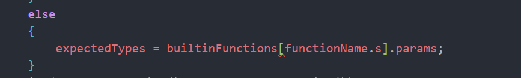

# 检查并规划语义分析实现

- 会话时间：2026-10-07 14:24:46
- 会话编号：`01a11509-3143-7f93-9068-85a8cb06ecee`
- 导出范围：仅保留用户与助手可见消息以及用户附图，已排除系统提示、开发者指令、内部推理、工具调用及工具输出。

## 1. 用户

时间：2026-10-07 14:25:21

# Context from my IDE setup:

## Active file: src/semantic/SemanticAnalyzer.cpp

## Open tabs:
- SemanticAnalyzer.cpp: src/semantic/SemanticAnalyzer.cpp
- SymbolTable.h: src/semantic/SymbolTable.h
- Token.h: src/common/Token.h
- SymbolTable.cpp: src/semantic/SymbolTable.cpp
- SemanticAnalyzer.h: src/semantic/SemanticAnalyzer.h

## My request:
### 检查现在语义分析阶段，规划下面实现

---

## 2. 助手

时间：2026-10-07 14:25:23

我先按当前仓库的实际代码复核语义分析现状，再给出按依赖顺序的下一阶段规划；这次只检查和规划，不直接改实现。先快速查一下之前记录，避免把已完成与旧状态混在一起。

---

## 3. 助手

时间：2026-10-07 14:25:25

刚才检索式里反引号被 shell 当成了语法，我换成无歧义的关键词继续；这不影响仓库。

---

## 4. 助手

时间：2026-10-07 14:25:32

历史记录只作为核对线索；下面以今天保存的源码和实际构建为准。我会重点检查：符号表不变量、遍历是否覆盖函数/作用域、错误汇总链路，以及表达式分析目前到底有没有落地。

---

## 5. 助手

时间：2026-10-07 14:25:39

从源码已经能看到一个关键结论：表达式阶段不是“完全没开始”，而是已实现到 `Exp/AddExp/MulExp/UnaryExp/PrimaryExp/LVal/Number`；但条件链、语句语义与初始化检查仍未接通。现在我会用干净的独立构建目录和针对性样例验证，避免受现有 `build/` 产物干扰，也不会覆盖你的 `testfile.txt`。

---

## 6. 助手

时间：2026-10-07 14:26:09

课程 Markdown 只在文法旁标出了错误码，完整定义在仓库 PDF。为了让后续规划严格对齐课程规则，我会按 PDF 检查流程读取其中“错误类别”部分；只做读取，不改文件。

---

## 7. 助手

时间：2026-10-07 14:27:00

验证结果已经比较清楚：当前符号表/作用域主链是可用的，官方正确样例的 `symbol.txt` 与要求一致；但同一官方样例会因 `get_int()` 被当成未定义函数而多报 `5 c`。另外，赋值左值、条件和声明初值目前没有进入表达式检查，这三条是下一步最该先打通的入口。

---

## 8. 助手

时间：2026-10-07 14:27:31

## 检查结论

当前语义分析已经完成“符号表与作用域骨架”，表达式类型分析完成了一半，但还没有贯通所有语法入口。现在适合继续补全语义分析，不需要推倒重写。

我重新进行了独立构建：

```bash
cmake -S src -B /tmp/compiler-semantic-build -DCMAKE_BUILD_TYPE=Debug
cmake --build /tmp/compiler-semantic-build --parallel
```

当前代码可以完整编译链接。没有修改源码。

### 已经完成并验证的部分

- 变量、常量、静态变量、数组的符号登记。
- 函数符号及有序参数类型保存。
- 全局作用域、函数作用域、嵌套块作用域。
- 函数参数和函数最外层局部变量处于同一作用域。
- `main` 不进入符号表。
- 同一作用域重定义错误 `b`。
- `error.txt` 已正确合并词法、语法、语义错误并按行排序。
- 表达式已经实现：
  - `Number`
  - `LVal`
  - `PrimaryExp`
  - `UnaryExp`
  - `MulExp`
  - `AddExp`
  - 函数调用参数数量 `d`
  - 部分类型错误 `e`
  - 未定义名字 `c`

现有作用域输出与课程官方正确样例一致：

```text
1 year ConstInt
1 month ConstInt
1 day Int
1 getDay IntFunc
1 fun IntFunc
2 day StaticInt
5 length Int
```

对应代码集中在 [SemanticAnalyzer.cpp](/home/zzz2007-cpu/projects/compiler/src/semantic/SemanticAnalyzer.cpp:97) 和 [SymbolTable.cpp](/home/zzz2007-cpu/projects/compiler/src/semantic/SymbolTable.cpp:4)。

## 当前主要缺口

### 1. 多个表达式入口没有接入

当前 `visitStmt()` 只处理直接子节点中的 `Exp`，见 [SemanticAnalyzer.cpp](/home/zzz2007-cpu/projects/compiler/src/semantic/SemanticAnalyzer.cpp:335)。

因此下面三种错误目前都会漏掉：

```c
y = 1;       // 左侧 y 未定义，应该报 c
if (z) ...   // 条件中的 z 未定义，应该报 c
int w = q;   // 初值中的 q 未定义，应该报 c
```

实际测试中这三行都没有产生错误。

原因分别是：

- 赋值左侧是直接的 `LVal`，当前没有访问。
- `if/while` 条件是 `Cond`，当前没有访问。
- `InitVal/ConstInitVal/ConstExp` 当前没有语义遍历。

### 2. 条件表达式只有声明，没有实现

头文件已经声明：

- `visitCond`
- `visitRelExp`
- `visitEqExp`
- `visitLAndExp`
- `visitLOrExp`

见 [SemanticAnalyzer.h](/home/zzz2007-cpu/projects/compiler/src/semantic/SemanticAnalyzer.h:33)，但 `.cpp` 中还没有对应定义。

现在能链接，是因为 `visitStmt()` 尚未调用 `visitCond()`；一旦接通条件入口，必须同时实现整条条件链。

### 3. 运行时库函数被误报为未定义

课程规定 `get_int`、`get_char`、`get_string`、`put_int`、`put_char`、`put_string` 可以直接调用，但不能出现在 `symbol.txt`。

当前：

```c
get_int();
```

会产生：

```text
2 c
```

官方正确样例也因此多报了：

```text
5 c
```

不能简单把它们作为普通符号加入当前符号表，否则会违反“不输出运行时库符号”的要求。应当建立单独的内建函数签名查询。

### 4. 语句级错误尚未实现

[Error.h](/home/zzz2007-cpu/projects/compiler/src/common/Error.h:3) 目前只有：

```text
a b c d e i j k
```

还缺：

- `f`：void 函数出现带值 `return`
- `g`：有返回值函数末尾缺少 `return`
- `h`：修改常量
- `l`：`printf` 格式字符与表达式数量不匹配
- `m`：非法位置的 `break/continue`
- `n`：重复 `case/default`

### 5. 声明只登记符号，没有分析声明内部

`visitVarDef()` 和 `visitConstDef()` 当前只判断是否为数组并登记符号，见 [SemanticAnalyzer.cpp](/home/zzz2007-cpu/projects/compiler/src/semantic/SemanticAnalyzer.cpp:134)。

尚未检查：

- 数组长度表达式必须为 `Int`。
- 数组长度必须是常量表达式。
- 初值中的未定义名字。
- 初值元素类型。
- 全局变量、常量、静态变量初值是否可在编译期求值。

## 推荐实现顺序

### 第一阶段：先贯通 `c/d/e/h` 主链

这是现在最合适的下一阶段。

1. 补全条件表达式：

```text
visitCond
  -> visitLOrExp
  -> visitLAndExp
  -> visitEqExp
  -> visitRelExp
  -> visitAddExp
```

规则：

- 左右操作数类型必须完全相同。
- 只能对基本类型 `Int/Char` 运算。
- 关系、相等和逻辑表达式的结果统一为 `Int`。
- 子表达式返回 `Invalid` 后，不要再次产生级联 `e`。

2. 重构 `visitStmt()`，根据语句种类分别处理：

```text
赋值语句：visitLVal + visitExp
if/while：visitCond
表达式语句：visitExp
return：visitExp
printf：访问全部 Exp
switch：访问控制 Exp 和 CaseStmt
```

不要继续只用“遍历所有直接子节点，遇到 `Exp` 就访问”的方式，因为不同语句需要不同上下文。

3. 赋值检查：

- 左值不存在：`c`
- 左值是常量：`h`
- 左右类型不同：`e`
- 数组整体不能作为普通赋值目标
- 如果左值本身已经 `Invalid`，不要继续补报类型错误

这里建议让赋值分支先查询左值对应的 `Symbol`，这样既能得到类型，也能判断 `SymbolKind::Constant`。暂时不需要把现有所有表达式返回值改成复杂结构。

4. 遍历声明内部：

建议增加这些职责明确的访问函数：

```text
visitConstExp
visitInitVal
visitConstInitVal
```

然后在 `visitVarDef/visitConstDef` 登记符号之后，继续访问：

- 数组长度 `ConstExp`
- 初值 `InitVal/ConstInitVal`

完成这一阶段后，之前的遗漏样例应得到三个 `c`，而不是空的 `error.txt`。

### 第二阶段：加入运行时函数签名

增加独立的内建函数查询，例如概念上保存：

```text
get_int()                 -> Int
get_char()                -> Char
get_string(CharArray,Int) -> Void
put_int(Int)              -> Void
put_char(Char)            -> Void
put_string(CharArray)     -> Void
```

函数调用时的解析顺序：

```text
先查用户符号表
  -> 没找到再查内建函数
  -> 都没找到才报 c
```

内建函数不能加入 `SymbolTable::scopes`，这样自然不会被 `printSymbols()` 输出。

完成标志：课程官方正确样例的 `error.txt` 为空，并保持当前正确的 `symbol.txt`。

### 第三阶段：返回语句 `e/f/g`

给 `SemanticAnalyzer` 增加当前函数上下文，例如：

```text
currentFunctionType
```

进入函数前设置，离开函数后恢复。

检查规则：

- `void` 函数出现 `return Exp;`：`f`
- `int/char` 函数返回表达式类型不一致：`e`
- 有返回值函数最外层 `Block` 最后一条不是带表达式的 `return`：在右花括号行报 `g`
- `main` 同样检查 `g`

课程保证只需要检查函数块末尾，不需要做完整控制流分析。

### 第四阶段：`printf` 的 `e/l`

解析 `STRCON`：

- `%d` 期待 `Int`
- `%c` 期待 `Char`
- `%s` 期待 `CharArray`

然后：

- 格式字符数量与表达式数量不同：`l`
- 数量相同但对应类型不同：`e`
- `l` 的行号取 `printf`
- 每个参数表达式仍需要先访问，以发现其中的 `c/d/e`

### 第五阶段：循环和 switch 的 `e/m/n`

增加上下文计数：

```text
whileDepth
switchDepth
```

规则：

- `break`：要求 `whileDepth > 0 || switchDepth > 0`
- `continue`：只允许 `whileDepth > 0`
- 否则报 `m`

每个 `switch` 再维护独立上下文：

```text
switch表达式类型
已经出现的case值集合
是否已有default
```

检查：

- switch 表达式只能是 `Int/Char`
- `case Number` 类型必须一致，否则 `e`
- 重复 case 值：`n`
- 第二个及后续 default：`n`
- 嵌套 switch 必须使用上下文栈，不能只有一个全局集合

## 建议的近期验收顺序

每完成一层都重新构建并单独测试：

1. `Cond`：条件中的未定义名和混合类型。
2. 赋值：`c/e/h`。
3. 声明初值、数组下标和数组长度。
4. 内建函数，确保官方正确样例无错误。
5. 函数返回：`e/f/g`。
6. `printf`：`e/l`。
7. `break/continue/switch`：`e/m/n`。
8. 最后运行带警告的完整构建。

总的来说，下一次实现应聚焦于“补全条件表达式 + 重构 `visitStmt` + 接通声明初值 + 内建函数”，完成后你的 `c/d/e/h` 检查主干才算真正闭环。课程规则依据仓库中的 [语义分析要求](/home/zzz2007-cpu/projects/compiler/docs/实验要求/实验三语义分析.md:52) 和 [完整文法 PDF](/home/zzz2007-cpu/projects/compiler/docs/2026编译技术实验文法定义及相关说明.pdf) 复核。

<oai-mem-citation>
<citation_entries>
MEMORY.md:153-162|note=[used prior dependency order and semantic type rules]
rollout_summaries/2026-10-05T08-09-37-fuSp-semantic_analyzer_symbols_scopes_expression_plan.md:71-90|note=[used prior expression visitor design and validation caveat]
</citation_entries>
<rollout_ids>
01a10b1c-78cc-7553-9b05-f00081b04d5d
</rollout_ids>
</oai-mem-citation>

---

## 9. 用户

时间：2026-10-07 14:28:12

# Context from my IDE setup:

## Open tabs:
- SemanticAnalyzer.cpp: src/semantic/SemanticAnalyzer.cpp
- SymbolTable.h: src/semantic/SymbolTable.h
- Token.h: src/common/Token.h
- SymbolTable.cpp: src/semantic/SymbolTable.cpp
- SemanticAnalyzer.h: src/semantic/SemanticAnalyzer.h

## My request:
visitCond
&#x20; -> visitLOrExp
&#x20; -> visitLAndExp
&#x20; -> visitEqExp
&#x20; -> visitRelExp
&#x20; -> visitAddExp
好，开始规划完成这一部分

---

## 10. 助手

时间：2026-10-07 14:28:16

这次只规划条件表达式这一条链，不扩展到赋值、返回或 `printf`。我先复核当前解析树结构和现有 `AddExp/MulExp` 写法，再把每个 visitor 的输入、返回值、报错位置和验收样例定下来。

---

## 11. 助手

时间：2026-10-07 14:28:52

可以。这一部分只需要修改 [SemanticAnalyzer.cpp](/home/zzz2007-cpu/projects/compiler/src/semantic/SemanticAnalyzer.cpp:496)，头文件中的声明已经齐全，不需要改 Parser、SymbolTable 或 ErrorType。

## 1. 先明确 AST 结构

Parser 对这几层都采用了左递归改写后的三子节点结构。

例如：

```c
a < b < c
```

对应近似结构：

```text
RelExp
├── RelExp
│   ├── RelExp
│   │   └── AddExp(a)
│   ├── <
│   └── AddExp(b)
├── <
└── AddExp(c)
```

因此各层结构如下：

| 节点 | 无运算符 | 有运算符 |
|---|---|---|
| `RelExp` | `[AddExp]` | `[RelExp, op, AddExp]` |
| `EqExp` | `[RelExp]` | `[EqExp, op, RelExp]` |
| `LAndExp` | `[EqExp]` | `[LAndExp, &&, EqExp]` |
| `LOrExp` | `[LAndExp]` | `[LOrExp, \|\|, LAndExp]` |
| `Cond` | `[LOrExp]` | 不会直接包含运算符 |

实现位置可参照 Parser 的 [parseRelExp](/home/zzz2007-cpu/projects/compiler/src/parser/Parser.cpp:234)。

## 2. 统一类型规则

四个二元运算层都使用同一套判断顺序：

```text
先计算左类型
再计算右类型

任意一边是 Invalid
    -> 直接返回 Invalid，不再新增 e

任意一边不是 Int/Char
    -> 在运算符行报 e，返回 Invalid

左右类型不同
    -> 在运算符行报 e，返回 Invalid

左右都是相同的基本类型
    -> 运算合法，返回 Int
```

这里需要注意：

- `int < int` 合法，结果为 `Int`
- `char < char` 合法，结果为 `Int`
- `int < char` 报 `e`
- `int == int` 合法，结果为 `Int`
- `char && char` 合法，结果为 `Int`
- `int || char` 报 `e`
- 数组、`Void` 不能参与这些运算
- 报错行取 `node.children[1]`，也就是运算符所在行

无运算符时不要强制返回 `Int`，而是原样返回下一层的类型。例如：

```c
if (c)
```

如果 `c` 是 `Char`，层层包装后仍然应该得到 `Char`，它作为非零条件是合法的。

## 3. 按从下到上的顺序实现

### 第一步：`visitRelExp`

两种情况：

```text
一个孩子：
    visitAddExp(children[0])

三个孩子：
    visitRelExp(children[0])
    visitAddExp(children[2])
    检查类型
```

合法的关系运算结果为 `Int`。

### 第二步：`visitEqExp`

结构与 `visitRelExp` 相同，只是下一层换成 `RelExp`：

```text
一个孩子：
    visitRelExp(children[0])

三个孩子：
    visitEqExp(children[0])
    visitRelExp(children[2])
    检查类型
```

合法的相等运算结果也是 `Int`。

### 第三步：`visitLAndExp`

```text
一个孩子：
    visitEqExp(children[0])

三个孩子：
    visitLAndExp(children[0])
    visitEqExp(children[2])
    检查类型
```

合法的 `&&` 结果为 `Int`。

### 第四步：`visitLOrExp`

```text
一个孩子：
    visitLAndExp(children[0])

三个孩子：
    visitLOrExp(children[0])
    visitLAndExp(children[2])
    检查类型
```

合法的 `||` 结果为 `Int`。

### 第五步：`visitCond`

`Cond` 只是包装层：

```text
Cond
└── LOrExp
```

因此只需要找到其直接子节点 `LOrExp`，调用 `visitLOrExp` 并返回结果。找不到时返回 `Invalid`。

这里可以采用和现有 `visitExp()` 相同的写法，但遍历时应使用 `const SyntaxNode&`，避免复制节点。

## 4. 最后接入 `visitStmt`

只实现 visitor 还不会产生效果，因为当前 [visitStmt](/home/zzz2007-cpu/projects/compiler/src/semantic/SemanticAnalyzer.cpp:335) 没有访问 `Cond`。

在其子节点分派中补上一种情况：

```text
遇到 Cond
    -> 调用 visitCond
```

这样 `if` 和 `while` 的条件都会被检查：

```text
Stmt(if/while)
└── Cond
    └── LOrExp
        ...
```

暂时不需要重构整个 `visitStmt()`，这一阶段只增加 `Cond` 分支即可。

## 5. 不要做的改动

这一阶段不要：

- 把 `Exp` 改成经过 `LOrExp`。
- 修改 Parser 的表达式结构。
- 给 `Cond` 无条件返回 `Int`。
- 在父节点遇到 `Invalid` 后再次报 `e`。
- 允许 `Int` 和 `Char` 隐式混合。
- 顺手实现赋值、return、printf 等其他语义。

`Exp` 和 `Cond` 的入口不同：

```text
Exp  -> AddExp
Cond -> LOrExp
```

保持这个边界。

## 6. 验收样例

### 合法样例

```c
int main() {
    int a;
    int b;
    char c;
    char d;

    if (a < b && c == d) {
        return 0;
    }

    if (c || d) {
        return 0;
    }

    return 0;
}
```

预期：

```text
error.txt 为空
```

其中：

```text
a < b    -> Int
c == d   -> Int
Int && Int -> Int
```

### 混合类型

```c
int main() {
    int a;
    char c;
    if (a < c) {
        return 0;
    }
    return 0;
}
```

预期在 `<` 所在行产生：

```text
e
```

### 未定义名字，不产生级联错误

```c
int main() {
    int a;
    if (missing < a) {
        return 0;
    }
    return 0;
}
```

预期只产生：

```text
c
```

过程应该是：

```text
visitLVal(missing) -> 报 c，返回 Invalid
visitRelExp        -> 看到 Invalid，直接返回 Invalid
上层节点           -> 继续传播 Invalid，不再报 e
```

### 逻辑运算混合类型

```c
int main() {
    int a;
    char c;
    if (a && c) {
        return 0;
    }
    return 0;
}
```

预期在 `&&` 所在行报 `e`。

## 完成标准

这一部分完成需要同时满足：

- 五个声明都有对应定义。
- `if` 和 `while` 的 `Cond` 已接入。
- 相同基本类型运算通过。
- `Int/Char` 混合报 `e`。
- 数组或 `Void` 参与运算报 `e`。
- `Invalid` 可以一直向上传播，不产生级联错误。
- 当前工程重新构建成功。

建议你现在先实现 `visitRelExp()`，因为它和现有 `visitAddExp()` 直接相连；确认后再按完全相同的骨架依次实现 `EqExp → LAndExp → LOrExp → Cond`。

<oai-mem-citation>
<citation_entries>
MEMORY.md:161-162|note=[used established visitor order and exact type propagation rules]
</citation_entries>
<rollout_ids>
01a10b1c-78cc-7553-9b05-f00081b04d5d
</rollout_ids>
</oai-mem-citation>

---

## 12. 用户

时间：2026-10-07 14:40:50

# Context from my IDE setup:

## Active file: src/semantic/SemanticAnalyzer.cpp

## Open tabs:
- SemanticAnalyzer.cpp: src/semantic/SemanticAnalyzer.cpp
- SemanticAnalyzer.h: src/semantic/SemanticAnalyzer.h
- SyntaxNode.cpp: src/parser/SyntaxNode.cpp
- SyntaxNode.h: src/parser/SyntaxNode.h
- SymbolTable.h: src/semantic/SymbolTable.h

## My request:
已经实现，请检查

---

## 13. 助手

时间：2026-10-07 14:40:52

我会按你刚实现后的最新文件检查，不沿用上一次快照。重点验证五个 visitor 的递归方向、类型传播、`Invalid` 防级联，以及 `if/while` 是否真的接入，然后用针对性样例跑一遍。

---

## 14. 助手

时间：2026-10-07 14:40:58

静态检查发现一个确定问题：四个二元 visitor 报错时都调用了 `node.getToken()`，但 `node` 本身是 `RelExp/EqExp/...` 非终结符，不含 Token。真正的运算符是 `children[1]`；当前代码只要遇到类型不匹配，就会在准备记录 `e` 时抛出异常。下面继续构建并用合法、混合类型、未定义名三组样例确认其余路径。

---

## 15. 助手

时间：2026-10-07 14:41:24

目前还不能算通过：整体递归与类型传播正确，但有一个系统性运行时错误。

### 必须修复

以下位置报错时使用了：

```cpp
node.getToken().line
```

但 `node` 是非终结符节点，因此会抛出：

```text
std::bad_variant_access
```

涉及 [SemanticAnalyzer.cpp](/home/zzz2007-cpu/projects/compiler/src/semantic/SemanticAnalyzer.cpp:654) 中四个 visitor 的全部报错分支：

- `visitRelExp`
- `visitEqExp`
- `visitLAndExp`
- `visitLOrExp`

运算符实际位于：

```text
node.children[1]
```

所以报错行应从 `children[1]` 的 Token 获取。总共有 8 处需要统一检查：非标量分支和左右类型不同分支各一处。

### 已验证正确

除上述问题外，这部分结构是合理的：

- `RelExp → AddExp`
- `EqExp → RelExp`
- `LAndExp → EqExp`
- `LOrExp → LAndExp`
- 左递归方向正确。
- 单孩子时正确保留下层类型。
- 合法二元运算返回 `Int`。
- 子节点为 `Invalid` 时直接向上传播，没有级联报 `e`。
- `Cond` 已接入 `visitStmt()`，`if` 和 `while` 都能到达。
- 工程可以完整编译链接。
- 合法样例运行成功。
- 未定义名字样例只输出 `3 c`，没有额外的 `e`。

当前失败样例：

```c
int main() {
    int a;
    char c;
    if (a < c) {
        return 0;
    }
    return 0;
}
```

当前结果是进程以 `134` 退出；修复后应输出：

```text
3 e
```

`while (a && c)` 也存在相同崩溃。

你先把这 8 处报错行获取方式修正，其他逻辑暂时不需要调整。修完后我再帮你重新跑四层运算和嵌套条件测试。

<oai-mem-citation>
<citation_entries>
MEMORY.md:161-162|note=[used visitor recursion and Invalid propagation rules for verification]
</citation_entries>
<rollout_ids>
01a10b1c-78cc-7553-9b05-f00081b04d5d
</rollout_ids>
</oai-mem-citation>

---

## 16. 用户

时间：2026-10-07 14:44:39

# Context from my IDE setup:

## Active file: src/semantic/SemanticAnalyzer.cpp

## Open tabs:
- SemanticAnalyzer.cpp: src/semantic/SemanticAnalyzer.cpp
- SemanticAnalyzer.h: src/semantic/SemanticAnalyzer.h
- SyntaxNode.cpp: src/parser/SyntaxNode.cpp
- SyntaxNode.h: src/parser/SyntaxNode.h
- SymbolTable.h: src/semantic/SymbolTable.h

## My request:
下一步如何实现

---

## 17. 助手

时间：2026-10-07 14:44:41

我先确认你是否已经修正运算符取行号的问题，并重新跑条件表达式测试；通过后再基于当前代码确定下一步，不提前跳到更后面的功能。

---

## 18. 助手

时间：2026-10-07 14:45:16

条件表达式这一阶段已经通过复查：

- 合法条件：无错误
- `int < char`：`3 e`
- `int && char`：`3 e`
- 未定义名字：只产生 `3 c`
- 全新构建成功

下一步建议实现赋值语句的 `c/e/h` 检查。

## 目标语法

```text
Stmt → LVal '=' Exp ';'
```

Parser 生成的直接子节点固定为：

```text
Stmt
├── LVal
├── ASSIGN
├── Exp
└── SEMICN
```

## 1. 增加错误类型 `h`

在 [Error.h](/home/zzz2007-cpu/projects/compiler/src/common/Error.h:3) 增加：

```text
不能改变常量的值 = 'h'
```

名称可以使用类似：

```cpp
ModifyConstant
```

只要后续引用保持一致即可。

## 2. 单独建立赋值语句 visitor

建议增加：

```text
visitAssignmentStmt(const SyntaxNode &node)
```

并在 [SemanticAnalyzer.h](/home/zzz2007-cpu/projects/compiler/src/semantic/SemanticAnalyzer.h:30) 声明。

它负责四件事：

```text
1. 找到直接子节点 LVal
2. 找到直接子节点 Exp
3. 分析左值和右值类型
4. 检查常量修改与类型匹配
```

不要让通用的 `visitStmt()` 同时处理赋值细节，否则后面加入 return、printf、switch 后会越来越混乱。

## 3. 在 `visitStmt()` 中优先识别赋值

赋值语句的判断条件可以是：

```text
children[0] 是 LVal
children[1] 是 ASSIGN
```

识别后：

```text
调用 visitAssignmentStmt(node)
立即 return
```

这个 `return` 很重要。

当前通用循环会访问赋值右侧的 `Exp`。如果专用函数分析一次后，又继续执行原来的循环，右侧表达式会被分析两次，可能重复产生错误。

整体结构应当变成：

```text
visitStmt
├── 如果是赋值语句
│   ├── visitAssignmentStmt
│   └── return
└── 否则执行当前的 Block/Stmt/CaseStmt/Exp/Cond 遍历
```

## 4. 赋值检查顺序

在 `visitAssignmentStmt()` 中：

### 第一步：左右两边都要访问

```text
leftType  = visitLVal(LVal)
rightType = visitExp(Exp)
```

即使左边已经报错，也应该继续访问右边，以发现右边独立存在的错误。

例如：

```c
missing1 = missing2;
```

左右两边都应当进入分析。

### 第二步：查询左值对应的符号

从 `LVal.children[0]` 取得标识符 Token，然后：

```text
symbolTable.lookup(identifier)
```

这次查询只用于判断符号种类，不要再次产生 `c`，因为 `visitLVal()` 已经负责未定义检查。

### 第三步：检查常量修改 `h`

如果符号存在，并且：

```text
symbol.kind == SymbolKind::Constant
```

则在左值标识符所在行报 `h`。

既包括普通常量：

```c
const int c = 1;
c = 2;
```

也包括常量数组元素：

```c
const int a[2] = {1, 2};
a[0] = 3;
```

### 第四步：检查类型 `e`

只有左右类型都不是 `Invalid` 时才继续检查，否则会产生级联错误。

合法赋值要求：

```text
左边必须是 Int 或 Char
右边类型必须与左边完全相同
```

也就是：

```text
leftType 是标量
并且 leftType == rightType
```

不能只检查相等，因为下面两个裸数组虽然类型相等，也不能整体赋值：

```c
int a[2];
int b[2];
a = b;       // 应报 e
```

而数组元素已经由 `visitLVal()` 转换为元素类型，因此下面是合法的：

```c
a[0] = 1;
```

## 5. 防止级联错误

遵循以下规则：

```text
leftType == Invalid 或 rightType == Invalid
    -> 不再补报赋值类型错误 e
```

例如：

```c
int x;
x = missing;
```

预期只有：

```text
c
```

不能再补一个 `e`。

数组下标错误也是如此：

```c
int a[2];
char index;
a[index] = 1;
```

`visitLVal()` 已经会因为下标不是 `Int` 报 `e` 并返回 `Invalid`，赋值层不要再次报 `e`。

## 6. 验收样例

### 合法标量赋值

```c
int main() {
    int x;
    char c;
    x = 1;
    c = 'a';
    return 0;
}
```

预期：无错误。

### 类型不匹配

```c
int main() {
    int x;
    char c;
    x = c;
    return 0;
}
```

预期：

```text
4 e
```

### 修改常量

```c
const int value = 1;

int main() {
    value = 2;
    return 0;
}
```

预期：

```text
4 h
```

### 左值未定义

```c
int main() {
    missing = 1;
    return 0;
}
```

预期：

```text
2 c
```

### 右值未定义且不级联

```c
int main() {
    int x;
    x = missing;
    return 0;
}
```

预期只有：

```text
3 c
```

### 数组元素赋值

```c
int main() {
    int a[2];
    a[0] = 1;
    return 0;
}
```

预期：无错误。

### 数组整体赋值

```c
int main() {
    int a[2];
    int b[2];
    a = b;
    return 0;
}
```

预期：

```text
4 e
```

完成这个阶段以后，下一步才是遍历 `VarDef/ConstDef` 内部的数组长度和初始化表达式。

<oai-mem-citation>
<citation_entries>
MEMORY.md:153-162|note=[used established semantic implementation order and type propagation rules]
</citation_entries>
<rollout_ids>
01a10b1c-78cc-7553-9b05-f00081b04d5d
</rollout_ids>
</oai-mem-citation>

---

## 19. 用户

时间：2026-10-07 14:50:19

# Context from my IDE setup:

## Active file: src/semantic/SemanticAnalyzer.cpp

## Open tabs:
- SemanticAnalyzer.cpp: src/semantic/SemanticAnalyzer.cpp
- SemanticAnalyzer.h: src/semantic/SemanticAnalyzer.h
- Parser.h: src/parser/Parser.h
- Error.h: src/common/Error.h
- SyntaxNode.cpp: src/parser/SyntaxNode.cpp

## My request:
我的赋值语句语法树里没有直接名字吗

---

## 20. 助手

时间：2026-10-07 14:50:25

对，赋值语句的 `Stmt` 节点下没有直接的名字 Token，变量名被 `LVal` 节点吸收了。

你的语法树结构是：

```text
Stmt
├── LVal
│   └── IDENFR x
├── ASSIGN =
├── Exp
└── SEMICN ;
```

如果是数组赋值：

```c
a[i] = 1;
```

结构是：

```text
Stmt
├── LVal
│   ├── IDENFR a
│   ├── LBRACK [
│   ├── Exp
│   └── RBRACK ]
├── ASSIGN =
├── Exp
└── SEMICN ;
```

因此，在 `visitAssignmentStmt()` 中：

- 从 `Stmt.children` 找到 `LVal`
- 从 `LVal.children[0]` 取得变量名 Token

概念上就是：

```text
Stmt
  -> LVal
       -> children[0]
            -> IDENFR
```

你不能直接使用：

```text
stmt.children[0].getToken()
```

因为 `stmt.children[0]` 是非终结符 `LVal`，不是 Token；这样会再次触发 `std::bad_variant_access`。

应该先取得 `LVal`，再取得它的第一个孩子：

```cpp
const SyntaxNode &lVal = node.children[0];
const Token &ident = lVal.children[0].getToken();
```

这里的分工是：

- `Stmt` 负责识别“这是赋值语句”
- `LVal` 负责保存“赋值目标是谁、有没有数组下标”
- `IDENFR` Token 才真正保存名字、行号

所以你的语法树中有名字，只是名字不归 `Stmt` 直接持有，而归它的 `LVal` 子节点持有。

---

## 21. 用户

时间：2026-10-07 15:49:10

# Context from my IDE setup:

## Active file: src/semantic/SemanticAnalyzer.cpp

## Open tabs:
- SemanticAnalyzer.cpp: src/semantic/SemanticAnalyzer.cpp
- SemanticAnalyzer.h: src/semantic/SemanticAnalyzer.h
- Error.h: src/common/Error.h
- SymbolTable.h: src/semantic/SymbolTable.h
- Parser.h: src/parser/Parser.h

## My request:
赋值语句需要返回什么吗

---

## 22. 助手

时间：2026-10-07 15:49:17

赋值语句不需要向上返回类型，`visitAssignmentStmt()` 返回 `void` 就可以。

```cpp
void visitAssignmentStmt(const SyntaxNode &node);
```

因为它的任务只是：

```text
取得左值类型
取得右值类型
检查是否修改常量
检查类型是否匹配
记录语义错误
```

数据流大致是：

```text
visitStmt
  -> visitAssignmentStmt
       -> visitLVal  返回左侧 BaseType
       -> visitExp   返回右侧 BaseType
       -> 比较类型并记录错误
  -> 返回 visitStmt
```

这里要区分两个层次：

- `visitLVal()`、`visitExp()` 是表达式分析，需要返回 `BaseType`。
- `visitAssignmentStmt()` 是语句分析，整个 `x = 1;` 不会作为另一个表达式的操作数，因此不需要返回类型。

所以接口应当类似：

```cpp
void visitStmt(const SyntaxNode &node);
void visitAssignmentStmt(const SyntaxNode &node);

BaseType visitLVal(const SyntaxNode &node);
BaseType visitExp(const SyntaxNode &node);
```

如果赋值内部发生错误，就把错误加入 `errors`，然后直接结束，不需要通过返回值告诉 `visitStmt()`。

---

## 23. 用户

时间：2026-10-07 15:51:30

# Context from my IDE setup:

## Active file: src/semantic/SemanticAnalyzer.cpp

## Open tabs:
- SemanticAnalyzer.cpp: src/semantic/SemanticAnalyzer.cpp
- SemanticAnalyzer.h: src/semantic/SemanticAnalyzer.h
- Error.h: src/common/Error.h
- SymbolTable.h: src/semantic/SymbolTable.h
- Parser.h: src/parser/Parser.h

## My request:
检查赋值是否完成

---

## 24. 助手

时间：2026-10-07 15:51:33

我会读取你刚保存的赋值实现，检查识别入口、左右值是否只访问一次、`c/e/h` 与数组赋值规则，然后全新构建并跑针对性样例。只检查，不改代码。

---

## 25. 助手

时间：2026-10-07 15:51:58

构建能通过，但源码里有两个 AST 层级取错：`visitStmt()` 把“当前 Stmt 的孩子”误当成另一个 Stmt；`visitAssignmentStmt()` 又把 `LVal` 非终结符直接当 Token。它们都是运行期问题，编译器不会发现。我正在用最小赋值样例确认具体失败路径和哪些语义分支尚未到达。

---

## 26. 助手

时间：2026-10-07 15:52:16

赋值检查还没有完成。代码能编译，但所有运行样例都发生段错误，退出码为 `139`，甚至最小的 `return 0;` 也会崩溃。

## 问题一：赋值判断放错了层级

[visitStmt](/home/zzz2007-cpu/projects/compiler/src/semantic/SemanticAnalyzer.cpp:335) 当前在循环中判断：

```cpp
for (const SN &child : node.children) {
    if (isSyntaxType(child.children[0], ST::LVal) ...)
```

这里的 `child` 已经是 `Stmt` 的直接孩子，例如：

```text
RETURNTK
Exp
SEMICN
```

终结符没有 `children[0]`，所以会越界并段错误。

赋值判断应该在循环之前，直接检查当前 `Stmt`：

```text
node.children[0] 是 LVal
node.children[1] 是 ASSIGN
```

同时先检查 `node.children.size()`，防止访问越界。

正确流程应是：

```text
visitStmt(node)
├── 检查 node 本身是不是赋值语句
│   ├── 是：visitAssignmentStmt(node)
│   └── return
└── 遍历 node.children，处理其他语句内容
```

## 问题二：读取赋值目标名字时少了一层

[visitAssignmentStmt](/home/zzz2007-cpu/projects/compiler/src/semantic/SemanticAnalyzer.cpp:764) 当前写的是：

```cpp
node.children[0].getToken()
```

但：

```text
node.children[0] = LVal 非终结符
```

名字 Token 在：

```text
node.children[0].children[0] = IDENFR
```

因此查询符号时需要先取得 `LVal`，再取得它的第一个孩子。

否则修完第一个段错误后，这里会继续抛出：

```text
std::bad_variant_access
```

## 问题三：报错行应取标识符

当前 `h` 和赋值 `e` 使用：

```cpp
node.children[1].getToken().line
```

`children[1]` 是赋值号 `=`。课程测试通常不会恶意换行，所以多数情况下行号一样，但规范上：

- `h` 应取左侧 `LVal` 标识符行号。
- 赋值类型错误也建议统一取左侧标识符行号。

也就是使用刚取得的名字 Token 的 `line`。

## 已经正确的部分

修复上述层级问题后，现有赋值函数的主体思路是正确的：

- 左侧调用 `visitLVal()`。
- 右侧调用 `visitExp()`。
- 任意一边为 `Invalid` 时不级联报 `e`。
- 常量通过 `SymbolKind::Constant` 判断。
- 裸数组因为不是标量会报 `e`。
- 左右类型不相同会报 `e`。
- `visitAssignmentStmt()` 使用 `void` 正确。
- `ModifyConstant = 'h'` 已加入。

## 修复顺序

1. 把赋值识别移到 `visitStmt()` 循环之前。
2. 用当前 `node.children[0]` 判断 `LVal`。
3. 加孩子数量检查。
4. 在 `visitAssignmentStmt()` 中通过 `LVal.children[0]` 取得名字。
5. 用名字 Token 的行号记录 `h/e`。
6. 重新测试。

修完后至少验证：

```text
int x; x = 1;             -> 无错误
missing = 1;              -> c
const int c=1; c = 2;     -> h
int x; char c; x = c;     -> e
int a[2], b[2]; a = b;    -> e
int a[2]; a[0] = 1;       -> 无错误
```

目前结论是：赋值检查的类型判断主体基本正确，但 AST 层级访问尚未修好，所以运行阶段还不可用。

<oai-mem-citation>
<citation_entries>
MEMORY.md:153-162|note=[used semantic implementation order and AST type propagation rules]
</citation_entries>
<rollout_ids>
01a10b1c-78cc-7553-9b05-f00081b04d5d
</rollout_ids>
</oai-mem-citation>

---

## 27. 用户

时间：2026-10-07 15:56:01

# Context from my IDE setup:

## Active file: src/semantic/SemanticAnalyzer.cpp

## Open tabs:
- SemanticAnalyzer.cpp: src/semantic/SemanticAnalyzer.cpp
- SemanticAnalyzer.h: src/semantic/SemanticAnalyzer.h
- Error.h: src/common/Error.h
- SymbolTable.h: src/semantic/SymbolTable.h
- Parser.h: src/parser/Parser.h

## My request:
stmt到底是什么结构

---

## 28. 助手

时间：2026-10-07 15:56:13

`visitStmt(const SyntaxNode &node)` 接收到的 `node` 本身就是一个 `Stmt` 非终结符节点。

它不是“某个语句的孩子”，而是整个语句：

```text
node
└── SyntaxType::Stmt
```

具体是哪种语句，要通过 `node.children` 判断。

## 1. 赋值语句

源代码：

```c
a = 1;
```

结构：

```text
Stmt                         ← visitStmt 收到的 node
├── LVal                     ← node.children[0]
│   └── IDENFR a             ← node.children[0].children[0]
├── ASSIGN =                 ← node.children[1]
├── Exp                      ← node.children[2]
└── SEMICN ;                 ← node.children[3]
```

所以判断赋值语句时，检查的是：

```text
node.children[0] 是 LVal
node.children[1] 是 ASSIGN
```

而不是遍历后检查 `child.children[0]`。

## 2. 数组元素赋值

```c
a[i] = 1;
```

结构：

```text
Stmt
├── LVal
│   ├── IDENFR a
│   ├── LBRACK [
│   ├── Exp
│   └── RBRACK ]
├── ASSIGN =
├── Exp
└── SEMICN ;
```

名字仍然位于：

```text
node.children[0].children[0]
```

## 3. 表达式语句

```c
foo();
```

结构：

```text
Stmt
├── Exp
└── SEMICN ;
```

空语句：

```c
;
```

结构：

```text
Stmt
└── SEMICN ;
```

## 4. return 语句

```c
return 1;
```

结构：

```text
Stmt
├── RETURNTK return
├── Exp
└── SEMICN ;
```

无返回值：

```c
return;
```

结构：

```text
Stmt
├── RETURNTK return
└── SEMICN ;
```

这里 `node.children[0]` 是终结符 `RETURNTK`。终结符没有自己的 `children`，所以访问：

```text
node.children[0].children[0]
```

就会越界。

## 5. 语句块

```c
{
    int a;
}
```

结构：

```text
Stmt
└── Block
    ├── LBRACE {
    ├── BlockItem
    │   └── Decl
    └── RBRACE }
```

## 6. if 语句

```c
if (a) {
    return 0;
}
```

结构：

```text
Stmt
├── IFTK if
├── LPARENT (
├── Cond
├── RPARENT )
└── Stmt
    └── Block
```

有 `else` 时：

```text
Stmt
├── IFTK
├── LPARENT
├── Cond
├── RPARENT
├── Stmt              ← if 分支
├── ELSETK
└── Stmt              ← else 分支
```

所以你原有的循环：

```text
遍历 node.children
遇到 Cond -> visitCond
遇到 Stmt -> visitStmt
```

适合处理 `if/while` 的内部节点。

## 7. while 语句

```c
while (a) {
    break;
}
```

结构：

```text
Stmt
├── WHILETK while
├── LPARENT (
├── Cond
├── RPARENT )
└── Stmt
    └── Block
```

## 8. break 和 continue

```c
break;
```

结构：

```text
Stmt
├── BREAKTK break
└── SEMICN ;
```

```c
continue;
```

结构：

```text
Stmt
├── CONTINUETK continue
└── SEMICN ;
```

## `visitStmt()` 应如何理解

可以把它分成两步：

```text
第一步：检查当前 node 整体属于哪种特殊语句
第二步：遍历 node.children，访问嵌套的表达式和语句
```

赋值语句判断放在循环外：

```cpp
void visitStmt(const SyntaxNode &node)
{
    // node 本身就是 Stmt
    if (node.children.size() >= 3 &&
        isSyntaxType(node.children[0], SyntaxType::LVal) &&
        isTokenType(node.children[1], TokenType::ASSIGN))
    {
        visitAssignmentStmt(node);
        return;
    }

    for (const SyntaxNode &child : node.children)
    {
        // child 可能是 Token、Block、Stmt、Exp、Cond……
    }
}
```

最关键的层级关系是：

```text
visitStmt 收到的 node = Stmt
node.children[0]       = Stmt 的第一个直接组成部分
child                  = 你遍历 node.children 时得到的一个组成部分
```

赋值语句中的名字路径是：

```text
Stmt
  -> LVal
      -> IDENFR
```

也就是：

```cpp
node.children[0].children[0].getToken()
```

---

## 29. 用户

时间：2026-10-07 15:56:39

# Context from my IDE setup:

## Active file: src/semantic/SemanticAnalyzer.cpp

## Open tabs:
- SemanticAnalyzer.cpp: src/semantic/SemanticAnalyzer.cpp
- SemanticAnalyzer.h: src/semantic/SemanticAnalyzer.h
- Error.h: src/common/Error.h
- SymbolTable.h: src/semantic/SymbolTable.h
- Parser.h: src/parser/Parser.h

## My request:
为什么赋值语句必须在循环外

---

## 30. 助手

时间：2026-10-07 15:56:51

严格来说，不是语法上“必须”放在循环外，而是赋值语句的判断需要同时观察 `Stmt` 的多个直接孩子。放在循环外最自然、最安全。

赋值语句结构是：

```text
Stmt
├── LVal
├── ASSIGN
├── Exp
└── SEMICN
```

判断“这是赋值语句”需要同时确认：

```text
第 0 个孩子是 LVal
第 1 个孩子是 ASSIGN
```

也就是说，判断对象是整个 `Stmt`：

```cpp
node.children[0]
node.children[1]
```

## 循环里拿到的是什么

当你写：

```cpp
for (const SyntaxNode &child : node.children)
```

每次只能拿到其中一个孩子：

第一次：

```text
child = LVal
```

第二次：

```text
child = ASSIGN
```

第三次：

```text
child = Exp
```

第四次：

```text
child = SEMICN
```

单独看 `LVal`，不能完全确定这是赋值语句，因为 `LVal` 也可能出现在普通表达式中：

```c
a + 1;
```

单独看 `ASSIGN` 虽然可以推断是赋值，但这时还需要回到父节点查找左侧 `LVal` 和右侧 `Exp`。既然最终还是要访问整个 `node`，就没必要在循环里判断。

## 你之前代码的问题

之前相当于：

```cpp
for (const SyntaxNode &child : node.children)
{
    if (isSyntaxType(child.children[0], SyntaxType::LVal))
}
```

但第一次循环时：

```text
child = LVal
child.children[0] = IDENFR
```

所以你检查的其实是：

```text
IDENFR 是不是 LVal
```

答案当然是否定的。

后续循环遇到：

```text
child = ASSIGN
```

`ASSIGN` 是终结符，没有 `children[0]`，于是直接越界崩溃。

## 循环外是在做“语句分类”

合理的处理流程是：

```text
先观察整个 Stmt
    ↓
判断它是哪种语句
    ↓
交给对应的专用函数
```

例如：

```cpp
if (node.children.size() >= 3 &&
    isSyntaxType(node.children[0], SyntaxType::LVal) &&
    isTokenType(node.children[1], TokenType::ASSIGN))
{
    visitAssignmentStmt(node);
    return;
}
```

这里是在判断：

```text
当前整个 node 是否符合 LVal '=' Exp ';'
```

确认是赋值语句后，专用函数可以直接按照固定位置取：

```text
node.children[0] -> LVal
node.children[1] -> =
node.children[2] -> Exp
```

## 为什么处理后要 `return`

赋值专用函数已经访问过：

```text
左侧 LVal
右侧 Exp
```

如果不返回，后面的通用循环又会遇到右侧 `Exp`：

```cpp
else if (isSyntaxType(child, SyntaxType::Exp))
{
    visitExp(child);
}
```

这样右侧表达式会被访问两次，可能重复报错。

例如：

```c
x = missing;
```

可能输出两个相同的 `c`。

因此：

```text
识别为赋值
→ 专门处理左右两边
→ return
```

## 能不能在循环里实现

技术上可以，比如使用下标循环：

```cpp
for (size_t i = 0; i < node.children.size(); ++i)
```

发现 `ASSIGN` 后再访问 `i - 1` 和 `i + 1`。但这样会：

- 增加边界判断。
- 更容易重复访问 `Exp`。
- 把“语句分类”和“递归遍历”混在一起。
- 后面加入 `return`、`printf`、`switch` 时更难维护。

所以核心原因是：

> 赋值是 `Stmt` 的一种整体结构，循环处理的是这个结构中的单个孩子。应该先分类整个语句，再遍历或处理其中的组成部分。

---

## 31. 用户

时间：2026-10-07 15:57:13

# Context from my IDE setup:

## Active file: src/semantic/SemanticAnalyzer.cpp

## Open tabs:
- SemanticAnalyzer.cpp: src/semantic/SemanticAnalyzer.cpp
- SemanticAnalyzer.h: src/semantic/SemanticAnalyzer.h
- Error.h: src/common/Error.h
- SymbolTable.h: src/semantic/SymbolTable.h
- Parser.h: src/parser/Parser.h

## My request:
直接去掉循环可以吗

---

## 32. 助手

时间：2026-10-07 15:57:23

可以去掉这个“通用循环”，但前提是把每一种 `Stmt` 都显式分派；不能直接删除而不补逻辑。

当前循环负责继续访问：

- 普通表达式语句的 `Exp`
- `return` 中的 `Exp`
- `if/while` 中的 `Cond`
- `if/while` 内嵌的 `Stmt`
- 语句块 `Block`
- `switch` 的表达式和 `CaseStmt`
- `printf` 的各个 `Exp`

直接删掉后，这些内容都不会再被分析。

## 两种可行方案

### 方案一：保留循环

当前阶段最省改动：

```text
先在循环外识别赋值语句
如果是赋值：
    visitAssignmentStmt
    return

否则：
    用原来的循环访问 Block、Stmt、CaseStmt、Exp、Cond
```

适合你现在逐步实现。

### 方案二：完全去掉循环，显式分派

从长期结构看，这种方式其实更清晰。

概念上：

```cpp
void visitStmt(const SyntaxNode &node)
{
    if (是赋值语句)
    {
        visitAssignmentStmt(node);
        return;
    }

    if (是Block语句)
    {
        visitBlock(...);
        return;
    }

    if (是if语句)
    {
        visitCond(...);
        visitStmt(if分支);

        if (存在else)
            visitStmt(else分支);

        return;
    }

    if (是while语句)
    {
        visitCond(...);
        visitStmt(循环体);
        return;
    }

    if (是return语句)
    {
        如果存在Exp
            visitExp(...);

        return;
    }

    if (是printf语句)
    {
        访问所有实参Exp;
        return;
    }

    if (是switch语句)
    {
        visitExp(...);
        访问所有CaseStmt;
        return;
    }

    if (是普通表达式语句)
    {
        visitExp(...);
        return;
    }
}
```

这样每种语句的语义责任很明确，后面实现 `f/g/l/m/n` 时更方便。

## 现在建议

现在先不要彻底去掉循环，因为你目前只单独实现了赋值，其他语句还依赖这个循环完成基础遍历。

先采用：

```text
赋值判断放循环外
赋值处理后 return
其他语句继续使用循环
```

等准备实现 `return`、`printf`、`while`、`switch` 的专属语义规则时，再把 `visitStmt()` 一次性改成显式分派结构。

一句话总结：

> 可以去掉循环，但必须用完整的语句分类分派替代；当前直接删除会让大量表达式和嵌套语句停止语义分析。

---

## 33. 用户

时间：2026-10-07 15:57:54

# Context from my IDE setup:

## Active file: src/semantic/SemanticAnalyzer.cpp

## Open tabs:
- SemanticAnalyzer.cpp: src/semantic/SemanticAnalyzer.cpp
- SemanticAnalyzer.h: src/semantic/SemanticAnalyzer.h
- Error.h: src/common/Error.h
- SymbolTable.h: src/semantic/SymbolTable.h
- Parser.h: src/parser/Parser.h

## My request:
好，检查现在阶段，接下来干什么

---

## 34. 助手

时间：2026-10-07 15:57:58

我先按最新保存内容复核赋值阶段，确认之前两个 AST 层级问题是否修好，并跑 `c/e/h`、标量/数组、条件回归测试。通过后再给你一个明确的下一实现目标。

---

## 35. 助手

时间：2026-10-07 15:58:25

主要赋值用例已经通过；刚才“合法标量”那条测试输入把两个声明/赋值挤在同一行并在 shell 字符转义中损坏了字符字面量，出现的是测试构造问题，不是当前实现结论。我补跑一个无歧义的 `char` 显式转换赋值，并检查声明初值当前是否仍未进入语义遍历，以确定下一步边界。

---

## 36. 助手

时间：2026-10-07 15:58:55

当前赋值阶段已经完成并通过主要测试，可以进入下一步。

验证结果：

| 用例 | 结果 |
|---|---|
| `int x; x = 1;` | 通过 |
| `char c; c = (char)1;` | 通过 |
| `missing = 1;` | `c` |
| `x = missing;` | 只报 `c`，没有级联 `e` |
| 修改常量 | `h` |
| `int = char` | `e` |
| `a[0] = 1` | 通过 |
| 裸数组 `a = b` | `e` |
| `char` 数组下标 | `e` |
| 条件表达式回归 | 正常 |

全新构建也成功。赋值判断的位置和名字路径已经修正，见 [SemanticAnalyzer.cpp](/home/zzz2007-cpu/projects/compiler/src/semantic/SemanticAnalyzer.cpp:335) 和 [visitAssignmentStmt](/home/zzz2007-cpu/projects/compiler/src/semantic/SemanticAnalyzer.cpp:764)。

有一个不影响正确性的冗余：`visitLVal()` 返回 `Invalid` 后已经提前结束，因此后面的 `symbol == nullptr` 分支通常到不了，可以暂时保留。

## 下一步：识别运行时库函数

这是现在最紧急的依赖。

赋值右侧已经开始进行表达式分析，因此官方正确样例：

```c
day = get_int();
```

当前会错误输出：

```text
5 c
```

符号输出虽然正确，但官方正确程序不能多报这个错误。

### 不要把运行时函数加入普通符号表

课程要求运行时库符号不能出现在 `symbol.txt`，所以不能直接调用：

```text
symbolTable.addSymbol(...)
```

应在 `SemanticAnalyzer` 中建立单独的“内建函数签名查询”。

可以设计类似的数据：

```text
函数名       返回类型       参数类型
get_int      Int            {}
get_char     Char           {}
get_string   Void           {CharArray, Int}
put_int      Void           {Int}
put_char     Void           {Char}
put_string   Void           {CharArray}
```

课程资料对 `put_string/put_str` 的名字存在表述差异，可以根据平台最终文档决定；为了兼容，也可以让查询同时识别二者，但都不要输出到符号表。

## 修改 `visitUnaryExp` 的函数调用分支

当前逻辑是：

```text
lookup(functionName)
    找不到 -> 报 c
```

应改成：

```text
先查询用户符号表
    找到：
        必须是 Function
        读取 symbol.type 和 symbol.params

    没找到：
        查询内建函数签名
        找到：
            读取内建返回类型和参数类型
        仍未找到：
            报 c
```

后面的实参分析可以继续复用现有规则：

```text
实参数量不同 -> d
实参类型不同 -> e
调用表达式返回函数返回类型
```

为了避免用户函数和内建函数分别复制一套参数检查，建议先统一得到：

```text
BaseType returnType
vector<BaseType> expectedParams
```

然后再执行一次公共检查：

```text
收集 actualTypes
比较数量
逐个比较类型
返回 returnType
```

## 这一阶段的验收样例

```c
int main() {
    int x;
    char c;

    x = get_int();
    c = get_char();
    put_int(x);
    put_char(c);

    return 0;
}
```

预期：

```text
error.txt 为空
symbol.txt 中不出现任何运行时函数
```

参数数量错误：

```c
int main() {
    get_int(1);
    return 0;
}
```

预期：

```text
2 d
```

参数类型错误：

```c
int main() {
    char c;
    put_int(c);
    return 0;
}
```

预期：

```text
3 e
```

不存在的函数：

```c
int main() {
    unknown();
    return 0;
}
```

预期：

```text
2 c
```

完成内建函数后，再进入下一阶段：

```text
ConstExp、InitVal、ConstInitVal
    -> 数组长度类型
    -> 声明初值中的未定义名字
    -> 声明初值类型
```

现在先不要直接接通初始化表达式，否则 `int x = get_int();` 会因为内建函数尚未处理而被误报。

<oai-mem-citation>
<citation_entries>
MEMORY.md:153-162|note=[used semantic dependency order and expression type rules]
</citation_entries>
<rollout_ids>
01a10b1c-78cc-7553-9b05-f00081b04d5d
</rollout_ids>
</oai-mem-citation>

---

## 37. 用户

时间：2026-10-07 15:59:53

# Context from my IDE setup:

## Active file: src/semantic/SemanticAnalyzer.cpp

## Open tabs:
- SemanticAnalyzer.cpp: src/semantic/SemanticAnalyzer.cpp
- SemanticAnalyzer.h: src/semantic/SemanticAnalyzer.h
- Error.h: src/common/Error.h
- SymbolTable.h: src/semantic/SymbolTable.h
- Parser.h: src/parser/Parser.h

## My request:
也就是必须先把内建函数都给放到一个枚举类里，内建函数和普通函数啥区别

---

## 38. 助手

时间：2026-10-07 16:00:05

不一定要放进枚举类。枚举只能表示“这是哪个内建函数”，但语义分析真正需要的是：

```text
函数名
返回类型
形参类型列表
```

所以更适合使用“内建函数签名表”，而不是只有一个枚举。

例如概念上：

```text
"get_int"    -> 返回 Int，参数 {}
"get_char"   -> 返回 Char，参数 {}
"put_int"    -> 返回 Void，参数 {Int}
"put_char"   -> 返回 Void，参数 {Char}
"get_string" -> 返回 Void，参数 {CharArray, Int}
```

## 内建函数和普通函数的区别

### 普通函数

普通函数来自源程序里的 `FuncDef`：

```c
int add(int a, int b) {
    return a + b;
}
```

语义分析需要：

- 从 AST 读取函数名、返回类型和参数。
- 加入全局符号表。
- 检查重定义 `b`。
- 创建函数作用域。
- 加入形参。
- 分析函数体。
- 输出到 `symbol.txt`。

例如：

```text
1 add IntFunc
2 a Int
2 b Int
```

### 内建函数

内建函数不是用户在源程序中定义的：

```c
int x = get_int();
```

源程序中只有调用，没有：

```c
int get_int() {
    ...
}
```

它的类型由语言和运行时库提前规定。因此：

- 没有 `FuncDef` AST。
- 没有函数体需要分析。
- 不创建函数作用域。
- 不检查它内部的 return。
- 不输出到 `symbol.txt`。
- 调用时仍然要检查参数数量和类型。
- 后续生成 LLVM 时通常声明为外部函数，或者转换成对应运行时调用。

## 调用时二者基本相同

当解析到：

```c
foo(a, b)
```

语义分析只关心先获得一个函数签名：

```text
returnType
parameterTypes
```

签名可能来自两个地方：

```text
普通函数
    -> SymbolTable 中的 Symbol

内建函数
    -> 内建函数签名表
```

得到签名后，后面的检查完全相同：

```text
实参数量不同 -> d
实参类型不同 -> e
表达式类型   -> 函数返回类型
```

所以推荐把“查找”和“检查”分开：

```text
resolveFunction(name)
    先查普通符号表
    再查内建函数表
    都没有则报 c

checkArguments(signature, actualTypes)
    检查 d/e
```

## 为什么不直接加入 SymbolTable

如果把内建函数作为普通符号加入全局作用域，当前 `printSymbols()` 会把它们输出：

```text
1 get_int IntFunc
1 get_char CharFunc
```

这违反课程要求。

当然也可以给 `Symbol` 增加：

```text
bool isBuiltin
```

然后打印时跳过，但为了当前阶段，单独维护内建函数签名更简单，也不污染普通作用域。

## 是否需要枚举

有三种设计：

### 方案一：查询函数，最适合当前项目

```text
getBuiltinSignature(name, returnType, params)
```

根据字符串判断并填充签名。

优点是改动最小，适合现在逐步实现。

### 方案二：映射表，推荐长期使用

概念上：

```text
unordered_map<string, FunctionSignature>
```

其中：

```text
FunctionSignature
├── BaseType returnType
└── vector<BaseType> params
```

调用时直接按名字查找。

### 方案三：枚举

```text
BuiltinFunction::GetInt
BuiltinFunction::GetChar
BuiltinFunction::PutInt
```

但有枚举后仍然需要另一层逻辑，把枚举映射到返回类型和参数，所以对当前项目帮助不大。

结论是：

> 不需要先建立内建函数枚举。建立“函数名到函数签名”的查询表更合适。内建函数与普通函数的主要区别在于签名来源、是否有函数体、是否进入作用域输出；调用参数检查本质相同。

---

## 39. 用户

时间：2026-10-07 16:00:53

# Context from my IDE setup:

## Active file: src/semantic/SemanticAnalyzer.cpp

## Open tabs:
- SemanticAnalyzer.cpp: src/semantic/SemanticAnalyzer.cpp
- SemanticAnalyzer.h: src/semantic/SemanticAnalyzer.h
- Error.h: src/common/Error.h
- SymbolTable.h: src/semantic/SymbolTable.h
- Parser.h: src/parser/Parser.h

## My request:
都有哪些，如何写，用映射表吧

---

## 40. 助手

时间：2026-10-07 16:00:56

我会按仓库课程文档确认运行时函数的准确名称、返回类型和参数类型，再给你适合当前 `BaseType` 的映射表结构，以及它应当接到 `visitUnaryExp` 的位置。

---

## 41. 助手

时间：2026-10-07 16:01:19

课程运行时库主要有 6 个。`printf` 不放进映射表，因为你的 Parser 已经把它解析为专用 `Stmt`，不会进入普通函数调用的 `UnaryExp`。

## 1. 内建函数列表

| 函数 | 返回类型 | 参数类型 |
|---|---|---|
| `get_int()` | `Int` | 无 |
| `get_char()` | `Char` | 无 |
| `get_string(buffer, max_len)` | `Void` | `CharArray, Int` |
| `put_int(value)` | `Void` | `Int` |
| `put_char(value)` | `Void` | `Char` |
| `put_str(str)` | `Void` | `CharArray` |

课程 PDF 前面一处写了 `put_string`，但函数原型、语义约束和 LLVM 说明使用的是 `put_str`。建议以 `put_str` 为正式名字；如果想兼容文档歧义，可以额外添加同签名的 `put_string` 别名。

## 2. 定义函数签名结构

可以在 [SemanticAnalyzer.h](/home/zzz2007-cpu/projects/compiler/src/semantic/SemanticAnalyzer.h) 的 `private` 区域增加：

```cpp
struct FunctionSignature
{
    BaseType returnType;
    vector<BaseType> params;
};
```

它只描述一次函数调用检查需要的信息：

```text
返回值类型
有序形参类型
```

## 3. 建立映射表

同样放在 `SemanticAnalyzer` 的私有成员中：

```cpp
const unordered_map<string, FunctionSignature> builtinFunctions = {
    {"get_int", {BaseType::Int, {}}},
    {"get_char", {BaseType::Char, {}}},
    {"get_string", {BaseType::Void,
                    {BaseType::CharArray, BaseType::Int}}},
    {"put_int", {BaseType::Void,
                 {BaseType::Int}}},
    {"put_char", {BaseType::Void,
                  {BaseType::Char}}},
    {"put_str", {BaseType::Void,
                 {BaseType::CharArray}}}
};
```

如果兼容 `put_string`：

```cpp
{"put_string", {BaseType::Void,
                {BaseType::CharArray}}}
```

这里不需要增加新的 `BuiltinFunction` 枚举。

## 4. 查询时使用 `find`

不要这样查询：

```cpp
builtinFunctions[functionName.s]
```

因为 `operator[]` 在找不到名字时会自动插入一个空元素。

应使用：

```cpp
auto it = builtinFunctions.find(functionName.s);

if (it != builtinFunctions.end())
{
    // 找到内建函数
}
```

## 5. 接入 `visitUnaryExp`

当前函数调用部分直接执行：

```text
symbolTable.lookup(name)
找不到 -> c
```

需要改成两级查询：

```text
先查询普通符号表
├── 找到普通函数：使用 Symbol 中的 type 和 params
├── 找到普通变量：报 e
└── 没找到：继续查询 builtinFunctions
    ├── 找到：使用 FunctionSignature
    └── 没找到：报 c
```

为了复用现有参数检查，可以先准备两个统一变量：

```cpp
BaseType returnType;
const vector<BaseType> *expectedParams = nullptr;
```

普通函数分支：

```text
returnType    = symbol->type
expectedParams = &symbol->params
```

内建函数分支：

```text
returnType    = it->second.returnType
expectedParams = &it->second.params
```

然后把你现有代码中的：

```cpp
symbol->params
symbol->type
```

分别替换成：

```cpp
*expectedParams
returnType
```

后面的规则不变：

```text
actualTypes.size() != expectedParams->size()
    -> d

actualTypes[i] != (*expectedParams)[i]
    -> e

最后返回 returnType
```

## 6. `printf` 为什么不放进去

你的 Parser 对 `printf` 的结构是：

```text
Stmt
├── PRINTFTK
├── LPARENT
├── STRCON
├── Exp...
├── RPARENT
└── SEMICN
```

而普通函数调用是：

```text
UnaryExp
├── IDENFR
├── LPARENT
├── FuncRParams
└── RPARENT
```

所以：

- `get_int()` 等由 `visitUnaryExp()` 检查。
- `printf(...)` 以后由专门的 `visitPrintfStmt()` 检查 `e/l`。
- `printf` 不需要加入内建函数映射表。

## 7. 最小验收

```c
int main() {
    int x;
    char c;
    char buffer[10];

    x = get_int();
    c = get_char();
    get_string(buffer, 10);
    put_int(x);
    put_char(c);
    put_str(buffer);

    return 0;
}
```

预期：

```text
error.txt 为空
```

而且 `symbol.txt` 中只能出现：

```text
x
c
buffer
```

不能出现 `get_int`、`put_int` 等内建函数。

<oai-mem-citation>
<citation_entries>
MEMORY.md:153-162|note=[used function resolution order and exact parameter type rules]
</citation_entries>
<rollout_ids>
01a10b1c-78cc-7553-9b05-f00081b04d5d
</rollout_ids>
</oai-mem-citation>

---

## 42. 用户

时间：2026-10-07 16:08:31

# Context from my IDE setup:

## Active file: src/semantic/SemanticAnalyzer.cpp

## Open tabs:
- SemanticAnalyzer.cpp: src/semantic/SemanticAnalyzer.cpp
- Error.h: src/common/Error.h
- SemanticAnalyzer.h: src/semantic/SemanticAnalyzer.h
- SymbolTable.h: src/semantic/SymbolTable.h
- Parser.h: src/parser/Parser.h

## My request:
如果不但找到了还在内建函数呢

---

## 43. 助手

时间：2026-10-07 16:08:50

如果普通符号表和内建函数表都找到了同一个名字，只选择一个，不能把两者都拿来检查。

按照我们前面的查询顺序：

```text
先查普通符号表
找到就使用普通符号
没找到才查内建函数
```

因此普通符号优先。

例如理论上出现：

```c
int get_int(int x) {
    return x;
}
```

那么调用：

```c
get_int(1);
```

会使用用户定义的普通函数签名，而不是内建的：

```text
普通函数：Int {Int}
内建函数：Int {}
```

## 为什么这样处理

名字解析需要得到唯一结果：

```text
当前作用域符号
    ↓ 找不到
外层作用域符号
    ↓ 找不到
内建函数
    ↓ 找不到
报 c
```

一旦普通符号表找到名字，就停止继续解析。否则下面这种情况会出问题：

```c
int get_int;

int main() {
    get_int();
}
```

普通符号表找到了 `get_int`，但它是变量，所以应该报“函数和变量误用”的 `e`，不能因为内建表也有 `get_int`，就悄悄改成调用内建函数。

正确判断是：

```text
普通符号存在
├── kind == Function：作为普通函数调用
└── kind != Function：报 e，不再查内建函数

普通符号不存在
├── 内建函数存在：作为内建函数调用
└── 内建函数不存在：报 c
```

## 课程测试中的实际情况

课程文档保证：

```text
get_int
get_char
get_string
put_int
put_char
put_str
printf
```

只作为运行时库调用出现，不会作为用户定义的变量或函数名。

所以正常测试中不会发生“两边同时找到”。不过按照上述普通符号优先的顺序实现，可以让名字解析逻辑更加完整。

核心结构是：

```cpp
Symbol *symbol = symbolTable.lookup(name);

if (symbol != nullptr)
{
    // 只处理普通符号
    // 是函数就取得签名
    // 不是函数就报 e
}
else
{
    auto builtin = builtinFunctions.find(name);

    if (builtin != builtinFunctions.end())
    {
        // 取得内建函数签名
    }
    else
    {
        // 报 c
    }
}
```

不要在普通符号已经找到以后，再无条件查询并覆盖成内建函数。

---

## 44. 用户

时间：2026-10-07 16:15:11

# Context from my IDE setup:

## Active file: src/semantic/SemanticAnalyzer.cpp

## Open tabs:
- SemanticAnalyzer.cpp: src/semantic/SemanticAnalyzer.cpp
- SemanticAnalyzer.h: src/semantic/SemanticAnalyzer.h
- Error.h: src/common/Error.h
- SymbolTable.h: src/semantic/SymbolTable.h
- Parser.h: src/parser/Parser.h

## My request:
对于内建函数如何判断参数符合

---

## 45. 助手

时间：2026-10-07 16:15:28

内建函数的参数检查与普通函数完全相同：先取得“期望参数类型”，再收集调用中的“实际参数类型”，最后比较数量和每个位置的类型。

例如：

```c
get_string(buffer, 10);
```

内建签名是：

```text
期望参数：{CharArray, Int}
实际参数：{buffer的类型, 10的类型}
```

## 1. 先取得期望参数

从映射表中找到签名：

```cpp
auto builtinIt = builtinFunctions.find(functionName.s);
```

找到后：

```cpp
const FunctionSignature &signature = builtinIt->second;
```

可以得到：

```cpp
signature.returnType
signature.params
```

例如：

```text
get_int    -> params = {}
put_int    -> params = {Int}
get_string -> params = {CharArray, Int}
```

## 2. 收集实际参数类型

你的 `UnaryExp` 中已经在做这件事：

```text
找到 FuncRParams
遍历它的直接孩子
遇到 Exp
    -> visitExp
    -> 把结果加入 actualTypes
```

概念上：

```cpp
vector<BaseType> actualTypes;

for (const SyntaxNode &child : funcRParams->children)
{
    if (isSyntaxType(child, SyntaxType::Exp))
    {
        actualTypes.push_back(visitExp(child));
    }
}
```

如果没有 `FuncRParams`：

```c
get_int();
```

那么：

```text
actualTypes = {}
```

## 3. 先比较参数数量

```text
actualTypes.size() != signature.params.size()
    -> 报 d
```

例如：

```c
get_int(1);
```

比较结果：

```text
实际参数：{Int}
期望参数：{}
```

数量不同，报 `d`。

报完 `d` 后不要继续逐项比较类型，因为形参和实参位置已经无法一一对应。

## 4. 数量相同再比较类型

逐个位置比较：

```text
actualTypes[i] == signature.params[i]
```

必须完全一致，不允许自动转换。

例如：

```c
char c;
put_int(c);
```

比较：

```text
实际：Char
期望：Int
```

因此报 `e`。

而：

```c
int x;
put_int(x);
```

比较：

```text
实际：Int
期望：Int
```

合法。

## 5. 数组参数的判断

现有 `visitLVal()` 已经区分：

```text
buffer      -> CharArray
buffer[0]   -> Char
```

所以：

```c
char buffer[10];

get_string(buffer, 10);     // 合法
get_string(buffer[0], 10);  // e
```

对应比较：

```text
buffer：
实际 CharArray
期望 CharArray

buffer[0]：
实际 Char
期望 CharArray
```

## 6. 避免级联错误

如果某个实参已经返回 `Invalid`，说明该实参内部已经报过错误，例如：

```c
put_int(missing);
```

`visitExp(missing)` 已经报 `c` 并返回 `Invalid`。

比较参数时应跳过这个位置：

```cpp
if (actualTypes[i] == BaseType::Invalid)
{
    continue;
}
```

这样不会再补报一个 `e`。

## 7. 普通函数与内建函数统一检查

不要分别复制两套参数检查。先统一得到：

```cpp
BaseType returnType;
const vector<BaseType> *expectedParams;
```

普通函数：

```cpp
returnType = symbol->type;
expectedParams = &symbol->params;
```

内建函数：

```cpp
returnType = builtinIt->second.returnType;
expectedParams = &builtinIt->second.params;
```

然后统一处理：

```text
收集 actualTypes

数量不同
    -> d
否则逐个比较
    -> 类型不同报 e
    -> Invalid 跳过

最后返回 returnType
```

完整数据流是：

```text
函数名
  ↓
解析成普通函数签名或内建函数签名
  ↓
expectedParams
  ↓
访问 FuncRParams 得到 actualTypes
  ↓
先比较数量 d
  ↓
再比较对应类型 e
  ↓
返回 returnType
```

例如 `get_string(buffer, 10)`：

```text
expectedParams = {CharArray, Int}
actualTypes     = {CharArray, Int}
结果            = 合法
returnType      = Void
```

也就是说，内建函数只在“签名从哪里获得”这一点上与普通函数不同，参数检查逻辑完全可以共用。

---

## 46. 用户

时间：2026-10-07 16:18:47

# Context from my IDE setup:

## Active file: src/semantic/SemanticAnalyzer.cpp

## Open tabs:
- SemanticAnalyzer.cpp: src/semantic/SemanticAnalyzer.cpp
- SemanticAnalyzer.h: src/semantic/SemanticAnalyzer.h
- Error.h: src/common/Error.h
- SymbolTable.h: src/semantic/SymbolTable.h
- Parser.h: src/parser/Parser.h

## My request:
这里为啥报错



---

## 47. 助手

时间：2026-10-07 16:18:50

我先看你当前 `builtinFunctions`、`expectedTypes` 和 `FunctionSignature` 的实际声明，再用编译器拿到第一条准确诊断；截图里的红线可能来自 `const` 映射使用 `operator[]`，也可能是左右类型不一致。

---

## 48. 助手

时间：2026-10-07 16:19:13

报错原因是：`builtinFunctions` 被声明为 `const unordered_map`，但你使用了 `operator[]`：

```cpp
builtinFunctions[functionName.s]
```

`unordered_map::operator[]` 在键不存在时会插入新元素，因此它可能修改映射表，不能用于 `const` 映射。

编译器诊断中的：

```text
passing ‘const unordered_map...’ as ‘this’ argument discards qualifiers
```

说的就是这个问题。

你前面已经执行过：

```cpp
auto it = builtinFunctions.find(functionName.s);
```

因此这里直接使用迭代器：

```cpp
expectedTypes = it->second.params;
```

此时进入 `else` 已经意味着：

```text
symbol == nullptr
并且 it != builtinFunctions.end()
```

所以 `it` 可以安全使用。

## 还有一个必须一起修的问题

当前函数最后是：

```cpp
return symbol->type;
```

调用内建函数时：

```text
symbol == nullptr
```

因此编译通过后，运行到这里仍然会空指针崩溃。

应当统一保存返回类型：

```cpp
BaseType returnType;

if (symbol != nullptr)
{
    expectedTypes = symbol->params;
    returnType = symbol->type;
}
else
{
    expectedTypes = it->second.params;
    returnType = it->second.returnType;
}
```

参数检查结束后：

```cpp
return returnType;
```

## 还有一个编译警告

编译器同时提示：

```text
control reaches end of non-void function
```

说明 `visitUnaryExp()` 最后缺少兜底返回。在所有分支结束后补上：

```cpp
return BaseType::Invalid;
```

所以这次需要修三处：

1. `builtinFunctions[name]` 改成 `it->second`。
2. 不再对内建函数执行 `return symbol->type`，统一使用 `returnType`。
3. `visitUnaryExp()` 函数末尾补 `return BaseType::Invalid`。

---

## 49. 用户

时间：2026-10-07 16:22:00

# Context from my IDE setup:

## Active file: src/semantic/SemanticAnalyzer.cpp

## Open tabs:
- SemanticAnalyzer.cpp: src/semantic/SemanticAnalyzer.cpp
- SemanticAnalyzer.h: src/semantic/SemanticAnalyzer.h
- Error.h: src/common/Error.h
- SymbolTable.h: src/semantic/SymbolTable.h
- Parser.h: src/parser/Parser.h

## My request:
这个const实在是容易出错，我真的想都去掉const，我不加const非法访问的出错概率远远小于const带来的坑

---

## 50. 助手

时间：2026-10-07 16:22:15

你的感受很正常，C++ 的 `const` 确实会带来不少类型错误。但“全部去掉”不会解决之前的非法访问问题，因为那些问题主要来自：

- 把非终结符当成 Token：`bad_variant_access`
- 数组下标越界：段错误
- 空指针：`symbol == nullptr`
- AST 层级取错

这些和 `const` 没有直接关系。

这次反而是 `const` 帮你提前发现了一个潜在问题：

```cpp
builtinFunctions[name]
```

`operator[]` 可能偷偷插入一个不存在的函数。去掉 `const` 后它虽然能编译，但拼错函数名时可能悄悄修改映射表。

## 建议不要“到处加 const”，只保留三类

### 1. Visitor 输入保留

```cpp
void visitStmt(const SyntaxNode &node);
BaseType visitExp(const SyntaxNode &node);
```

它表达的是：

> 语义分析读取 AST，不修改 AST。

这个 `const` 很有价值，也基本不会制造复杂问题。

### 2. 内建函数表保留

```cpp
const unordered_map<string, FunctionSignature> builtinFunctions;
```

内建函数签名在编译过程中不应改变，所以保留合理。

查询时统一使用：

```cpp
find()
```

或者在已经确认存在后使用：

```cpp
at()
```

例如：

```cpp
expectedTypes = builtinFunctions.at(functionName.s).params;
returnType = builtinFunctions.at(functionName.s).returnType;
```

`at()` 有 `const` 版本，而且不会插入新元素。

不过你已经有迭代器，最简单的是：

```cpp
expectedTypes = it->second.params;
returnType = it->second.returnType;
```

### 3. 引用只在明确只读时加

例如：

```cpp
const Token &token = ...;
const FunctionSignature &signature = it->second;
```

如果觉得引用和生命周期难理解，局部变量直接复制也可以：

```cpp
Token token = ...;
FunctionSignature signature = it->second;
```

这些对象很小，当前阶段没必要为了性能把代码写复杂。

## 可以不加 const 的地方

普通局部变量没必要强求：

```cpp
BaseType returnType;
vector<BaseType> expectedTypes;
Symbol *symbol;
```

也不要写这种几乎没有意义的返回值 `const`：

```cpp
const TokenType getTokenType() const;
```

返回的是枚举值副本，前面的 `const` 没有实际价值。真正有价值的是末尾的 `const`，表示这个成员函数不修改对象。

## 给你一个实用规则

现阶段只记住：

```text
函数读取 AST -> 参数使用 const SyntaxNode&
固定配置表   -> 使用 const
普通局部变量 -> 不必强求 const
只查询 map   -> 使用 find 或 at，不使用 []
```

所以不建议全部去掉。你可以少用 `const`，但 AST 输入和内建函数表这两处最好保留。

更重要的是：

> `const` 主要防止意外修改；它不能防止 AST 层级错误、越界和空指针。之前真正造成运行崩溃的是后三者，不是 `const`。

---

## 51. 用户

时间：2026-10-07 16:23:01

# Context from my IDE setup:

## Active file: src/semantic/SemanticAnalyzer.cpp

## Open tabs:
- SemanticAnalyzer.cpp: src/semantic/SemanticAnalyzer.cpp
- SemanticAnalyzer.h: src/semantic/SemanticAnalyzer.h
- Error.h: src/common/Error.h
- SymbolTable.h: src/semantic/SymbolTable.h
- Parser.h: src/parser/Parser.h

## My request:
刚刚不就是因为const报的错吗

---

## 52. 助手

时间：2026-10-07 16:23:09

对，刚刚那条编译错误确实是 `const` 直接触发的。你说得没错，我刚才应该区分得更准确。

具体是：

```cpp
const unordered_map<...> builtinFunctions;
```

配上：

```cpp
builtinFunctions[functionName.s]
```

因为 `operator[]` 可能修改映射表，而映射表是 `const`，所以编译器报错。

如果去掉映射表的 `const`，这行确实就能编译。

但这里有两层含义：

- 直接原因：`const` 不允许调用可能修改映射表的 `operator[]`。
- 潜在问题：`operator[]` 在名字不存在时会自动插入元素。

你前面已经用 `find()` 并确认键存在，因此在当前代码路径里，自动插入基本不会发生。所以如果你觉得 `const` 影响理解，完全可以先把 `builtinFunctions` 的 `const` 去掉。

只是即使去掉，也仍然要修复另一个独立问题：

```cpp
return symbol->type;
```

内建函数分支中 `symbol == nullptr`，这里仍然会空指针崩溃。这个问题和 `const` 无关，需要使用内建签名的 `returnType`。

比较务实的选择是：

```cpp
unordered_map<string, FunctionSignature> builtinFunctions = {
    ...
};
```

然后仍然尽量使用已经取得的迭代器：

```cpp
expectedTypes = it->second.params;
returnType = it->second.returnType;
```

结论：

> 刚刚的编译错误确实是 `const` 导致的；你可以去掉内建函数表的 `const`。但建议仍使用 `find()` 的结果，而不是依赖 `operator[]`，并且必须单独修复内建函数分支的空指针返回问题。

---

## 53. 用户

时间：2026-10-07 16:23:32

# Context from my IDE setup:

## Active file: src/semantic/SemanticAnalyzer.cpp

## Open tabs:
- SemanticAnalyzer.cpp: src/semantic/SemanticAnalyzer.cpp
- SemanticAnalyzer.h: src/semantic/SemanticAnalyzer.h
- Error.h: src/common/Error.h
- SymbolTable.h: src/semantic/SymbolTable.h
- Parser.h: src/parser/Parser.h

## My request:
现在函数调用是否完成

---

## 54. 助手

时间：2026-10-07 16:23:36

我会按最新保存代码检查普通函数和内建函数两条解析路径，重点看返回类型、参数 `d/e`、变量误用、未知函数 `c`，然后全新构建并跑回归样例。只检查，不改代码。

---

## 55. 助手

时间：2026-10-07 16:24:00

普通函数和六个内建函数的基本调用、`c/d/e`、返回类型以及“不输出内建符号”都已通过。再补两类边界：数组形参与标量形参互传，以及实参内部出错时是否抑制级联 `e`。

---

## 56. 助手

时间：2026-10-07 16:24:16

函数调用阶段已经完成，当前实现通过了普通函数和内建函数的针对性测试。

验证结果：

- 普通函数正确调用：通过。
- 普通函数参数数量错误：`d`。
- 普通函数参数类型错误：`e`。
- 六个内建函数正确调用：通过。
- 内建函数参数数量错误：`d`。
- 内建函数参数类型错误：`e`。
- 未定义函数：`c`。
- 把变量当函数调用：`e`。
- 数组传数组形参：通过。
- 数组传标量形参：`e`。
- 标量传数组形参：`e`。
- 实参内部出现未定义名字：只报 `c`，没有级联 `e`。
- 内建函数没有出现在 `symbol.txt`。
- 调用返回类型能够正确交给赋值检查。
- 全新构建成功。

主要实现位于 [SemanticAnalyzer.cpp](/home/zzz2007-cpu/projects/compiler/src/semantic/SemanticAnalyzer.cpp:595)，普通函数和内建函数已经统一成：

```text
returnType
expectedTypes
```

再共同进行 `d/e` 检查，这个设计合理。

需要区分：

- “函数调用 visitor”已经完成。
- 声明初值目前还没有遍历，所以 `int x = get_int();` 中的调用暂时不会被分析。
- `printf` 是专用语句，不属于普通函数调用阶段，之后单独实现 `e/l`。

下一步应实现声明内部遍历：

```text
ConstExp
InitVal
ConstInitVal
```

具体顺序：

1. `visitConstExp()`：把内部 `AddExp` 交给现有表达式分析。
2. 数组定义中的 `ConstExp`：检查数组长度必须是 `Int`。
3. `visitInitVal()`：访问其中的一个或多个 `Exp`。
4. `visitConstInitVal()`：访问其中的一个或多个 `ConstExp`。
5. 将初值类型与变量/常量声明类型进行匹配。
6. 最后处理字符串初值与 `CharArray`。

这样完成后，下面这些此前被漏掉的内容才能被检查：

```c
int x = missing;
int y = get_int();
int a[(char)1];
char c = 1;
```

<oai-mem-citation>
<citation_entries>
MEMORY.md:153-162|note=[used semantic dependency order and function argument type rules]
</citation_entries>
<rollout_ids>
01a10b1c-78cc-7553-9b05-f00081b04d5d
</rollout_ids>
</oai-mem-citation>

---
