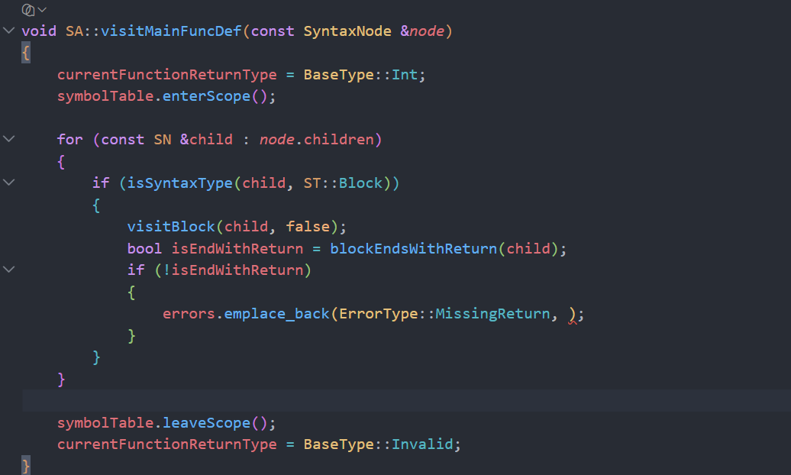
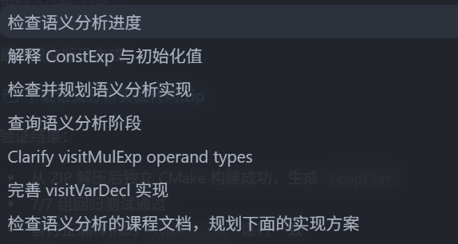

# 检查语义分析进度

- 会话时间：2026-10-07 18:11:56
- 会话编号：`01a115d9-2c0e-7442-bf99-944c9cad711d`
- 导出范围：仅保留用户与助手可见消息以及用户附图，已排除系统提示、开发者指令、内部推理、工具调用及工具输出。

## 1. 用户

时间：2026-10-07 18:12:10

# Context from my IDE setup:

## Active file: src/semantic/SemanticAnalyzer.cpp

## Open tabs:
- SemanticAnalyzer.cpp: src/semantic/SemanticAnalyzer.cpp
- SemanticAnalyzer.h: src/semantic/SemanticAnalyzer.h
- Error.h: src/common/Error.h
- SymbolTable.h: src/semantic/SymbolTable.h
- Parser.h: src/parser/Parser.h

## My request:
检查现在语义分析进度，规划下一步

---

## 2. 助手

时间：2026-10-07 18:12:12

我会以当前保存的源码为准，先核对语义分析器、符号表、错误处理和构建/样例结果；再给出“已完成 / 缺口 / 下一步依赖顺序”的结论。这里会参考之前的项目记录定位关键点，但所有现状判断都会重新验证。

---

## 3. 助手

时间：2026-10-07 18:12:19

初步看，当前代码已经明显超过上次记录中的“仅声明符号”阶段：表达式、函数调用、赋值相关检查已有实现。接下来我会重点判断这些代码是否真正接入遍历、错误码是否符合课程定义，以及能否通过针对性用例，而不只按函数数量估算进度。

---

## 4. 助手

时间：2026-10-07 18:12:32

课程 Markdown 只在产生式旁标出 `f/g/m/n`，没有给完整含义。为了避免凭旧版 SysY 规则误判，我会使用 PDF 阅读技能核对仓库内的 2026 文法 PDF；这会直接决定下一步优先级和测试预期。

---

## 5. 助手

时间：2026-10-07 18:13:27

当前构建已通过，作用域样例也正确；综合用例确认 `b/c/d/e/h` 的主干已经工作。与此同时，`f/g/l/m/n` 在同一用例中完全没有输出，说明它们不是“小修”，而是尚未进入实现。现在我再核对官方正确样例及几个边界，随后给你可直接照着实现的下一阶段顺序。

---

## 6. 助手

时间：2026-10-07 18:13:48

PDF 核对已经完成；它确认 2026 版语义错误全集是 `b/c/d/e/f/g/h/l/m/n`。我会清理本轮生成的 PDF 临时提取文件，不触碰你原有的源码和现有改动。

---

## 7. 助手

时间：2026-10-07 18:14:26

结论：符号表阶段基本完成，语义错误处理大约完成一半。目前可以进入“语句级语义检查”，但还不能视为语义分析完成。

## 当前进度

已重新构建并测试：

- 临时目录全量 CMake 构建成功。
- 官方正确样例输出与文档完全一致。
- 作用域编号、参数作用域、嵌套块、静态变量和符号输出顺序正确。
- `b/c/d/e/h` 的主要路径已通过针对性测试。
- 词法、语法、语义错误已经在 [main.cpp](/home/zzz2007-cpu/projects/compiler/src/main.cpp:28) 中合并并按行稳定排序。

| 错误码 | 当前状态 | 已覆盖内容 |
|---|---|---|
| `b` | 已实现 | 变量、常量、函数、形参重定义 |
| `c` | 已实现 | 左值、函数调用未定义 |
| `d` | 已实现 | 函数参数个数不匹配 |
| `e` | 部分实现 | 运算、赋值、数组访问、函数传参、函数/变量误用 |
| `h` | 已实现 | 修改常量 |
| `f` | 未实现 | `void` 函数返回值 |
| `g` | 未实现 | 有返回值函数末尾缺少 `return` |
| `l` | 未实现 | `printf` 格式符数量不匹配 |
| `m` | 未实现 | 非法 `break/continue` |
| `n` | 未实现 | 重复 `case/default` |

因此更准确地说：

- 符号收集与作用域：接近完成。
- 表达式类型推导：主干完成。
- 语句级上下文检查：刚开始。
- 整体语义分析：约 50%–60%。

## 当前最重要的缺口

[visitStmt](/home/zzz2007-cpu/projects/compiler/src/semantic/SemanticAnalyzer.cpp:361) 目前主要是递归遍历，没有区分 `return`、`printf`、`while`、`switch`、`break` 和 `continue` 的语义。

综合错误用例实际只输出了：

```text
8 c
9 e
10 h
11 d
12 e
```

其中故意加入的错误 `f/g/l/m/n` 全部没有输出，和源码检查结果一致。

另外还有一个已有 `e` 的缺口：

- [visitConstExp](/home/zzz2007-cpu/projects/compiler/src/semantic/SemanticAnalyzer.cpp:829) 会返回表达式类型；
- 但数组定义处只是调用它，没有检查返回值是否为 `Int`；
- 因此 `char c; int a[c];` 当前不会产生数组长度类型错误。

## 下一步实施顺序

### 1. 先建立语句上下文

在 `SemanticAnalyzer` 中增加：

- 当前函数返回类型；
- `loopDepth`；
- `switchDepth`。

然后把 `visitStmt` 改成按首个终结符明确分派。后面的 `f/g/m/n` 都依赖这些上下文。

同时在 [Error.h](/home/zzz2007-cpu/projects/compiler/src/common/Error.h:3) 增加 `f/g/l/m/n`。

### 2. 完成返回语句：`e/f/g`

这是下一步最适合单独完成的目标。

规则：

- `void` 函数中 `return Exp;`：报 `f`。
- `int/char` 函数中，返回表达式类型不一致：报 `e`。
- 有返回值函数以及 `main` 的最外层 `Block` 最后一条不是 `return`：在右花括号行报 `g`。
- 嵌套块末尾的 `return` 不能代替函数最外层末尾的 `return`。
- `return` 中的表达式仍然交给现有 `visitExp`，保留其中的 `c/d/e` 检查。

### 3. 完成循环和 switch 上下文：`m`

进入 `while` 主体时增加 `loopDepth`，退出时恢复。

- `break`：要求处于 `while` 或 `switch`。
- `continue`：必须处于 `while`，仅处于 `switch` 仍然报 `m`。

### 4. 完成 switch：`e/n`

每个 `switch` 建立独立上下文：

- 保存 switch 表达式类型；
- 保存已经出现的 case 常量值；
- 保存是否出现过 default。

检查：

- switch 表达式必须是 `int` 或 `char`；
- case 的 `Number` 类型必须与 switch 表达式一致，否则 `e`；
- case 常量值重复报 `n`；
-第二个及后续 `default` 报 `n`。

### 5. 完成 printf：`e/l`

解析字符串中的 `%d/%c/%s`：

- 格式符数量与表达式数量不同：报 `l`；
- 数量相同时逐个比较 `Int/Char/CharArray`，不匹配报 `e`；
- 推荐先判断 `l`，数量正确后才进行逐项类型检查，避免同一条 printf 产生连锁错误。

### 6. 收尾现有类型检查

最后补齐：

- 数组长度必须为 `Int`；
- 条件表达式不能是数组或 `Void`；
- switch 表达式标量检查；
- 对所有 `Invalid` 继续采用“子表达式已报错则不追加连锁 `e`”的策略。

## 建议的下一次验收用例

下一阶段至少覆盖：

```text
void f() { return 1; }             -> f
int f() { int x; }                 -> g
int f() { return 'a'; }            -> e
break; / continue;                 -> m
switch 中 continue                 -> m
重复 case / default                -> n
switch(int) 配 char case           -> e
printf("%d %c", intValue)          -> l
printf("%d", charValue)            -> e
char n; int a[n];                  -> e
```

之后重新跑官方正确样例，保证 `symbol.txt` 不发生回归。

另外，警告构建目前只有一些非阻塞问题，例如 [Error.h](/home/zzz2007-cpu/projects/compiler/src/common/Error.h:17) 的成员初始化顺序警告，可以在语义功能完成后统一清理。

本轮只做了检查和测试，没有修改语义分析源码。PDF 技能用于核对仓库内 2026 文法原文，确认了完整错误码及 `return`、`printf`、循环和 `switch` 的准确规则。

<oai-mem-citation>
<citation_entries>
MEMORY.md:164-173|note=[used prior semantic stage ordering and known partial areas to guide fresh verification]
MEMORY.md:103-111|note=[used prior semantic analyzer scope and error keywords to locate current progress]
</citation_entries>
<rollout_ids>
01a10b1c-78cc-7553-9b05-f00081b04d5d
</rollout_ids>
</oai-mem-citation>

---

## 8. 用户

时间：2026-10-07 18:15:48

# Context from my IDE setup:

## Active file: src/semantic/SemanticAnalyzer.cpp

## Open tabs:
- SemanticAnalyzer.cpp: src/semantic/SemanticAnalyzer.cpp
- SemanticAnalyzer.h: src/semantic/SemanticAnalyzer.h
- Error.h: src/common/Error.h
- SymbolTable.h: src/semantic/SymbolTable.h
- Parser.h: src/parser/Parser.h

## My request:
另外还有一个已有 `e` 的缺口：

- [visitConstExp (line 829)](/home/zzz2007-cpu/projects/compiler/src/semantic/SemanticAnalyzer.cpp:829) 会返回表达式类型；
- 但数组定义处只是调用它，没有检查返回值是否为 `Int`；
- 因此 `char c; int a[c];` 当前不会产生数组长度类型错误

啥意思啊

---

## 9. 助手

时间：2026-10-07 18:15:55

意思是：你已经“算出了数组长度表达式的类型”，但没有使用这个结果做判断。

现在调用链大致是：

```text
visitVarDef
  └─ visitConstExp
       └─ 返回 BaseType::Int / Char / Invalid
```

在 [visitVarDef](/home/zzz2007-cpu/projects/compiler/src/semantic/SemanticAnalyzer.cpp:134) 中，目前只是：

```cpp
visitConstExp(child);
```

返回值被直接丢掉了。

例如更准确的测试：

```c
const char size = 'a';

int main() {
    int arr[size];
    return 0;
}
```

分析 `size` 时：

```cpp
BaseType type = visitConstExp(child);
```

会得到：

```cpp
BaseType::Char
```

但数组长度只能是 `Int`。因此调用者应该根据返回类型判断：

```text
Int      → 合法
Char     → 报 e
Invalid  → 子表达式已经出错，不再重复报 e
```

也就是说，问题不在 `visitConstExp()` 不会判断表达式类型，而在 `visitVarDef()` 和 `visitConstDef()` 没有接住它返回的类型并检查。

你下一步的小目标就是：

1. 在 `visitVarDef` 中接收 `visitConstExp` 的返回值。
2. 如果不是 `Int`，并且也不是 `Invalid`，记录 `e`。
3. 在 `visitConstDef` 中做同样处理。
4. 报错行号建议使用数组长度表达式开始位置，或者按照课程规则使用能够确定类型错误的位置。

其中一定要单独放过 `Invalid`，否则下面这种情况可能重复报错：

```c
int arr[undefinedName];
```

`undefinedName` 已经产生 `c`，不应该紧接着再补一个连锁的 `e`。

---

## 10. 用户

时间：2026-10-07 18:21:24

# Context from my IDE setup:

## Active file: src/semantic/SemanticAnalyzer.cpp

## Active selection of the file:
void SA::visitVarDef(const SyntaxNode &Node, BaseType baseType, bool isStatic)
{
    const Token &token = get<Token>(Node.children[0].node);
    for (const SN &child : Node.children)
    {
        if (isSyntaxType(child, ST::ConstExp))
        {
            // 数组长度
            BaseType type = visitConstExp(child);
            if (type != BaseType::Int)
            {
                errors.emplace_back(ErrorType::TypeMismatch, token.line);
            }
        }
        else if (isSyntaxType(child, ST::InitVal))
        {
            // 初始化值
            visitInitVal(child);
        }
    }
    bool isArray = false;
    for (const SN &p : Node.children)
    {
        if (isTokenType(p, TokenType::LBRACK))
        {
            isArray = true;
            break;
        }
    }

    Symbol symbol;
    symbol.name = token.s;
    symbol.kind = SymbolKind::Variable;
    symbol.type = isArray ? makeArrayType(baseType) : baseType;
    symbol.isStatic = isStatic;
    symbol.line = token.line;
    if (!symbolTable.addSymbol(symbol))
    {
        errors.emplace_back(ErrorType::RedefineName, token.line);
    }
}

void SA::visitConstDef(const SyntaxNode &Node, BaseType baseType)
{
    const Token &token = get<Token>(Node.children[0].node);
    for (const SN &child : Node.children)
    {
        if (isSyntaxType(child, ST::ConstExp))
        {
            // 常量数组长度
            BaseType type = visitConstExp(child);
            if (type != BaseType::Int)
            {
                errors.emplace_back(ErrorType::TypeMismatch, token.line);
            }
        }
        else if (isSyntaxType(child, ST::ConstInitVal))
        {
            // 常量初始化值
            visitConstInitVal(child);
        }
    }
    bool isArray = false;
    for (const SN &p : Node.children)
    {
        if (isTokenType(p, TokenType::LBRACK))
        {
            isArray = true;
            break;
        }
    }

    Symbol symbol;
    symbol.name = token.s;
    symbol.kind = SymbolKind::Constant;
    symbol.type = isArray ? makeArrayType(baseType) : baseType;
    symbol.line = token.line;
    if (!symbolTable.addSymbol(symbol))
    {
        errors.emplace_back(ErrorType::RedefineName, token.line);
    }
}

## Open tabs:
- SemanticAnalyzer.cpp: src/semantic/SemanticAnalyzer.cpp
- SemanticAnalyzer.h: src/semantic/SemanticAnalyzer.h
- Error.h: src/common/Error.h
- SymbolTable.h: src/semantic/SymbolTable.h
- Parser.h: src/parser/Parser.h

## My request:
void SA::visitVarDef(const SyntaxNode &*Node*, BaseType *baseType*, bool *isStatic*)
{
    const Token &token = get\<Token>(*Node*.children[0].node);
    for (const SN &child : *Node*.children)
    {
        if (isSyntaxType(child, ST::ConstExp))
        {
            // 数组长度
            BaseType type = visitConstExp(child);
            if (type != BaseType::Int)
            {
                errors.emplace\_back(ErrorType::TypeMismatch, token.line);
            }
        }
        else if (isSyntaxType(child, ST::InitVal))
        {
            // 初始化值
            visitInitVal(child);
        }
    }
    bool isArray = false;
    for (const SN &p : *Node*.children)
    {
        if (isTokenType(p, TokenType::LBRACK))
        {
            isArray = true;
            break;
        }
    }

    Symbol symbol;
    symbol.name = token.s;
    symbol.kind = SymbolKind::Variable;
    symbol.type = isArray ? makeArrayType(*baseType*) : *baseType*;
    symbol.isStatic = *isStatic*;
    symbol.line = token.line;
    if (!symbolTable.addSymbol(symbol))
    {
        errors.emplace\_back(ErrorType::RedefineName, token.line);
    }
}

void SA::visitConstDef(const SyntaxNode &*Node*, BaseType *baseType*)
{
    const Token &token = get\<Token>(*Node*.children[0].node);
    for (const SN &child : *Node*.children)
    {
        if (isSyntaxType(child, ST::ConstExp))
        {
            // 常量数组长度
            BaseType type = visitConstExp(child);
            if (type != BaseType::Int)
            {
                errors.emplace\_back(ErrorType::TypeMismatch, token.line);
            }
        }
        else if (isSyntaxType(child, ST::ConstInitVal))
        {
            // 常量初始化值
            visitConstInitVal(child);
        }
    }
    bool isArray = false;
    for (const SN &p : *Node*.children)
    {
        if (isTokenType(p, TokenType::LBRACK))
        {
            isArray = true;
            break;
        }
    }

    Symbol symbol;
    symbol.name = token.s;
    symbol.kind = SymbolKind::Constant;
    symbol.type = isArray ? makeArrayType(*baseType*) : *baseType*;
    symbol.line = token.line;
    if (!symbolTable.addSymbol(symbol))
    {
        errors.emplace\_back(ErrorType::RedefineName, token.line);
    }
}

是这样吗

---

## 11. 助手

时间：2026-10-07 18:21:28

思路基本对。我先按当前保存文件核对一下实际代码和 `visitConstExp()` 的错误传播方式，重点看会不会把已经报过 `c/e` 的 `Invalid` 再重复报成一个 `e`。

---

## 12. 助手

时间：2026-10-07 18:21:43

保存后的代码与粘贴内容一致。核心判断方向正确，但当前条件会把 `Invalid` 也当成新的类型错误；我用“合法的 char 常量长度”和“未定义名字作为长度”两个小用例确认一下是否会重复报错。

---

## 13. 助手

时间：2026-10-07 18:21:57

整体思路正确，但判断条件要排除 `Invalid`，否则会重复报错。

当前实测：

```text
const char size = 'a';
int first[size];       // 2 e，正确

int second[missing];   // 当前输出 3 c 和 3 e
```

`missing` 已经产生了 `c`，随后 `visitConstExp()` 返回 `Invalid`；你的代码又因为 `Invalid != Int` 补了一个 `e`。

两处都应改成：

```cpp
BaseType type = visitConstExp(child);
if (type != BaseType::Invalid && type != BaseType::Int)
{
    errors.emplace_back(ErrorType::TypeMismatch, token.line);
}
```

含义是：

- `Int`：合法；
- `Char/IntArray/CharArray/Void`：报 `e`；
- `Invalid`：内部已经发生错误，不追加连锁 `e`。

所以你的实现只差这个条件，`visitVarDef()` 和 `visitConstDef()` 都要同步修改。修改后，上述测试应变成：

```text
2 e
3 c
```

`token.line` 目前使用数组名所在行，按照现有测试形式通常没问题；以后想更精确，再考虑取 `ConstExp` 首个终结符的行号。

<oai-mem-citation>
<citation_entries>
MEMORY.md:169-173|note=[used prior declaration traversal and Invalid propagation rules to check the current implementation]
</citation_entries>
<rollout_ids>
01a10b1c-78cc-7553-9b05-f00081b04d5d
</rollout_ids>
</oai-mem-citation>

---

## 14. 用户

时间：2026-10-07 18:38:25

# Context from my IDE setup:

## Active file: src/semantic/SemanticAnalyzer.cpp

## Open tabs:
- SemanticAnalyzer.cpp: src/semantic/SemanticAnalyzer.cpp
- SemanticAnalyzer.h: src/semantic/SemanticAnalyzer.h
- Error.h: src/common/Error.h
- SymbolTable.h: src/semantic/SymbolTable.h
- Parser.h: src/parser/Parser.h

## My request:
看不懂接下来应该干什么

---

## 15. 助手

时间：2026-10-07 18:38:27

先别继续扩展一整套语义规则。你现在只做一个很小的收尾：确认数组长度检查不会重复报错；完成后，下一块只实现 `return`，我会把它拆成能直接照着走的几个判断。先看你当前保存的代码是否已经改好。

---

## 16. 助手

时间：2026-10-07 18:38:43

你刚才的数组长度检查已经改对了。现在先不要碰 `printf`、循环、`switch`，下一步只做一件事：

> 检查 `return` 语句的类型是否符合当前函数的返回类型。

现在的问题是，[visitStmt](/home/zzz2007-cpu/projects/compiler/src/semantic/SemanticAnalyzer.cpp:371) 虽然能找到 `return` 里的 `Exp`，但它不知道当前处于 `int`、`char` 还是 `void` 函数。

数据需要这样传递：

```text
visitFuncDef
    设置当前函数返回类型
        ↓
visitBlock
        ↓
visitStmt 遇到 return
        ↓
比较 return 表达式类型
```

你现在只完成以下四步。

### 第一步：记录当前函数返回类型

在 `SemanticAnalyzer.h` 的 `private` 中增加一个成员，含义是“目前正在分析哪个返回类型的函数”：

```cpp
BaseType currentFunctionReturnType = BaseType::Invalid;
```

### 第二步：进入函数时设置它

在 `visitFuncDef()` 中，你已经有：

```cpp
symbol.type = readFuncType(node.children[0]);
```

在遍历函数的 `Block` 之前，把：

```cpp
currentFunctionReturnType
```

设置成：

```cpp
symbol.type
```

分析 `main` 时，将它设置为：

```cpp
BaseType::Int
```

函数分析结束后，可以恢复成：

```cpp
BaseType::Invalid
```

### 第三步：识别 return 语句

在 `visitStmt()` 开头判断：

```cpp
node.children[0]
```

是不是：

```cpp
TokenType::RETURNTK
```

如果是，就交给一个新的函数：

```cpp
void visitReturnStmt(const SyntaxNode &node);
```

处理完直接 `return`，不要再让后面的通用循环重复访问这个表达式。

### 第四步：按这个表判断

| 当前函数 | return 形式 | 结果 |
|---|---|---|
| `void` | `return;` | 正确 |
| `void` | `return Exp;` | `f` |
| `int` | `return intExp;` | 正确 |
| `int` | `return charExp;` | `e` |
| `char` | `return charExp;` | 正确 |
| `char` | `return intExp;` | `e` |
| `int/char` | `return;` | `e` |

如果 `visitExp()` 返回 `Invalid`，不要追加新的 `e`，因为表达式内部通常已经报过错。

同时在 [Error.h](/home/zzz2007-cpu/projects/compiler/src/common/Error.h:3) 增加：

```cpp
ReturnValueInVoidFunction = 'f'
```

先不要实现 `g`。`g` 检查的是“函数最后有没有 return”，和本次的“已有 return 是否正确”是两个不同任务。

完成后只测这四段：

```c
void f() {
    return;
}
```

应当无错误。

```c
void f() {
    return 1;
}
```

应当输出 `f`。

```c
int f() {
    return 'a';
}
```

应当输出 `e`。

```c
char f() {
    return 'a';
}
```

应当无错误。

你现在的唯一目标就是让这四个测试通过。通过以后，再单独实现函数末尾缺少 `return` 的 `g`。

<oai-mem-citation>
<citation_entries>
MEMORY.md:164-170|note=[used the established semantic dependency order and function traversal structure to choose the next isolated task]
</citation_entries>
<rollout_ids>
01a10b1c-78cc-7553-9b05-f00081b04d5d
</rollout_ids>
</oai-mem-citation>

---

## 17. 用户

时间：2026-10-07 20:13:34

# Context from my IDE setup:

## Active file: src/semantic/SemanticAnalyzer.cpp

## Open tabs:
- SemanticAnalyzer.cpp: src/semantic/SemanticAnalyzer.cpp
- SemanticAnalyzer.h: src/semantic/SemanticAnalyzer.h
- Error.h: src/common/Error.h
- SymbolTable.h: src/semantic/SymbolTable.h
- Parser.h: src/parser/Parser.h

## My request:
return的语法树格式

---

## 18. 助手

时间：2026-10-07 20:13:46

我按你当前解析器的 `parseStmt()` 来说明，重点是每个 `children` 下标对应什么；`return` 没有单独的 `ReturnStmt` 节点，它仍然属于 `Stmt`。

---

## 19. 助手

时间：2026-10-07 20:13:55

你的解析器里，`return` 没有单独的语法节点，它属于 `Stmt`。

## `return;` 的结构

```text
Stmt
├── RETURNTK "return"    children[0]
└── SEMICN ";"           children[1]
```

对应：

```cpp
node.children.size() == 2
```

## `return Exp;` 的结构

例如：

```c
return a + 1;
```

结构是：

```text
Stmt
├── RETURNTK "return"    children[0]
├── Exp                  children[1]
│   └── AddExp
│       ├── ...
│       ├── PLUS
│       └── ...
└── SEMICN ";"           children[2]
```

对应：

```cpp
node.children.size() == 3
```

因此可以这样理解：

```cpp
children[0]  // 一定是 RETURNTK
children[1]  // 可能是 Exp，也可能直接是 SEMICN
children[2]  // 有 Exp 时才存在，是 SEMICN
```

判断是不是 `return`：

```cpp
if (!node.children.empty() &&
    isTokenType(node.children[0], TokenType::RETURNTK))
{
    // 这是 return 语句
}
```

判断有没有返回表达式：

```cpp
bool hasExp =
    node.children.size() >= 2 &&
    isSyntaxType(node.children[1], ST::Exp);
```

如果 `hasExp` 为真：

```cpp
BaseType returnType = visitExp(node.children[1]);
```

如果为假，就是：

```c
return;
```

这正是 [parseStmt()](/home/zzz2007-cpu/projects/compiler/src/parser/Parser.cpp:311) 当前构造出来的格式。

---

## 20. 用户

时间：2026-10-07 20:20:28

# Context from my IDE setup:

## Active file: src/semantic/SemanticAnalyzer.cpp

## Active selection of the file:
void SA::visitReturnStmt(const SyntaxNode &node)
{
    if (node.children.size() == 1)
    {
        if (currentFunctionReturnType == BaseType::Int || currentFunctionReturnType == BaseType::Char)
        {
            errors.push_back(Error(ErrorType::TypeMismatch, node.getToken().line));
        }
    }
    else
    {
        BaseType returnType = visitExp(node.children[1]);
        if (returnType == BaseType::Invalid)
        {
            return;
        }
        else if (currentFunctionReturnType == BaseType::Void)
        {
            errors.push_back(Error(ErrorType::ReturnValueInVoidFunction, node.getToken().line));
        }
        else if (returnType != currentFunctionReturnType)
        {
            errors.push_back(Error(ErrorType::TypeMismatch, node.getToken().line));
        }
    }
}
## Open tabs:
- SemanticAnalyzer.cpp: src/semantic/SemanticAnalyzer.cpp
- Error.h: src/common/Error.h
- SemanticAnalyzer.h: src/semantic/SemanticAnalyzer.h
- SymbolTable.h: src/semantic/SymbolTable.h
- Parser.h: src/parser/Parser.h

## My request:
void SA::visitReturnStmt(const SyntaxNode &*node*)
{
    if (*node*.children.size() == 1)
    {
        if (currentFunctionReturnType == BaseType::Int || currentFunctionReturnType == BaseType::Char)
        {
            errors.push\_back(Error(ErrorType::TypeMismatch, *node*.getToken().line));
        }
    }
    else
    {
        BaseType returnType = visitExp(*node*.children[1]);
        if (returnType == BaseType::Invalid)
        {
            return;
        }
        else if (currentFunctionReturnType == BaseType::Void)
        {
            errors.push\_back(Error(ErrorType::ReturnValueInVoidFunction, *node*.getToken().line));
        }
        else if (returnType != currentFunctionReturnType)
        {
            errors.push\_back(Error(ErrorType::TypeMismatch, *node*.getToken().line));
        }
    }
}
当前实现对吗

---

## 21. 助手

时间：2026-10-07 20:20:32

这段目前不对，至少有两个结构性问题：`Stmt` 的孩子数量判断错了，而且 `node` 本身不是终结符，不能直接 `getToken()`。我先核对你保存后的调用位置和函数上下文设置，避免只改这一个函数后仍然没有被执行。

---

## 22. 助手

时间：2026-10-07 20:21:02

当前实现不对，但只需要改四处。它能编译，却会在类型错误时运行崩溃。

### 1. `children.size() == 1` 判断错误

`return` 属于 `Stmt`，分号也在孩子中：

```text
return;      -> [RETURNTK, SEMICN]       size = 2
return Exp;  -> [RETURNTK, Exp, SEMICN]  size = 3
```

因此不要判断 `size == 1`，应判断第二个孩子是不是 `Exp`：

```cpp
bool hasExp =
    node.children.size() >= 2 &&
    isSyntaxType(node.children[1], ST::Exp);
```

### 2. 不能调用 `node.getToken()`

`node` 是非终结符 `Stmt`，不是 Token。这样会触发 `bad_variant_access`：

```cpp
node.getToken().line // 错误
```

`return` Token 是：

```cpp
const Token &returnToken = node.children[0].getToken();
```

以后使用：

```cpp
returnToken.line
```

### 3. `visitStmt()` 调用后必须直接返回

你现在是：

```cpp
visitReturnStmt(node);
```

随后下面的通用循环还会再次访问 `Exp`，可能重复报错。应该是：

```cpp
visitReturnStmt(node);
return;
```

位置在 [visitStmt](/home/zzz2007-cpu/projects/compiler/src/semantic/SemanticAnalyzer.cpp:373)。

### 4. 函数分析结束后恢复成 `Invalid`

目前恢复成了：

```cpp
currentFunctionReturnType = BaseType::Void;
```

语义上更准确的是：

```cpp
currentFunctionReturnType = BaseType::Invalid;
```

因为这时已经不在任何函数中，而不是处于 `void` 函数中。

修改后的核心判断顺序应当是：

```text
取得 return Token
        ↓
判断是否存在 Exp
        ↓
没有 Exp：
    int/char 函数报 e
    void 函数合法
        ↓
有 Exp：
    visitExp 得到类型
    Invalid -> 不重复报错
    当前函数为 void -> 报 f
    类型不一致 -> 报 e
```

你原来后半部分的类型比较思路是正确的，主要错误就是语法树孩子数量和 `getToken()` 的对象选错了。

<oai-mem-citation>
<citation_entries>
MEMORY.md:164-164|note=[used the established semantic stage order to keep the review limited to return checking]
MEMORY.md:173-173|note=[used the Invalid propagation rule to avoid cascading type errors]
</citation_entries>
<rollout_ids>
01a10b1c-78cc-7553-9b05-f00081b04d5d
</rollout_ids>
</oai-mem-citation>

---

## 23. 用户

时间：2026-10-07 20:23:43

# Context from my IDE setup:

## Active file: src/semantic/SemanticAnalyzer.cpp

## Open tabs:
- SemanticAnalyzer.cpp: src/semantic/SemanticAnalyzer.cpp
- SemanticAnalyzer.h: src/semantic/SemanticAnalyzer.h
- Error.h: src/common/Error.h
- SymbolTable.h: src/semantic/SymbolTable.h
- Parser.h: src/parser/Parser.h

## My request:
ok规划下一步

---

## 24. 助手

时间：2026-10-07 20:23:45

我先验收你刚完成的 `return` 类型检查：读取最新保存代码、构建，并跑四个最小用例。通过后，下一步只规划 `g`——“有返回值函数末尾缺少 return”，暂时不碰 `printf` 和循环。

---

## 25. 助手

时间：2026-10-07 20:23:50

验收时发现一个下标写错：你在 `visitReturnStmt()` 里检查的是 `children[0]`，它永远是 `RETURNTK`，所以所有 return 都会被当成“没有 Exp”。我先跑用例确认表现，再给你一个很小的修正目标；修好之前先不进入 `g`。

---

## 26. 助手

时间：2026-10-07 20:24:08

先别进入下一阶段，当前 `return` 检查还有一个下标错误。

你写的是：

```cpp
if (!isSyntaxType(node.children[0], ST::Exp))
```

但：

```text
children[0] = RETURNTK
children[1] = Exp 或 SEMICN
```

所以 `children[0]` 永远不可能是 `Exp`。

改为：

```cpp
bool hasExp =
    node.children.size() >= 2 &&
    isSyntaxType(node.children[1], ST::Exp);

if (!hasExp)
{
    // return;
}
else
{
    // return Exp;
    BaseType returnType = visitExp(node.children[1]);
}
```

当前实测错误输出是：

```text
3 e
4 e
5 e
```

正确结果应该只有：

```text
2 f
3 e
```

即：

```c
void badVoid() { return 1; }   // f
int badInt() { return 'a'; }   // e
```

## 修好后的下一步：错误 `g`

`g` 表示：

> `int`、`char` 函数或 `main` 的最外层 Block 最后一条语句不是直接的 `return`。

实现时检查函数的 `Block`：

```text
Block
├── LBRACE
├── BlockItem
├── BlockItem
└── RBRACE
```

判断：

1. 当前函数是 `Int` 或 `Char`；
2. 找到最后一个 `BlockItem`；
3. 它必须包含 `Stmt`；
4. 这个 `Stmt.children[0]` 必须是 `RETURNTK`；
5. 否则在 `Block` 的 `RBRACE` 行报告 `g`。

注意：

```c
int f() {
    if (1) {
        return 1;
    }
}
```

仍然报 `g`，因为函数最外层最后一条是 `if`，不是直接的 `return`。

所以执行顺序是：

1. 修正 `children[1]` 判断；
2. 重新运行四个 return 用例；
3. 确认只输出 `2 f` 和 `3 e`；
4. 再实现 `g`。

<oai-mem-citation>
<citation_entries>
MEMORY.md:164-164|note=[used the established semantic dependency order to keep return validation before missing-return checking]
</citation_entries>
<rollout_ids>
01a10772-45c9-7431-a4ad-33eed98e4add
</rollout_ids>
</oai-mem-citation>

---

## 27. 用户

时间：2026-10-07 20:25:17

# Context from my IDE setup:

## Active file: src/semantic/SemanticAnalyzer.cpp

## Open tabs:
- SemanticAnalyzer.cpp: src/semantic/SemanticAnalyzer.cpp
- SemanticAnalyzer.h: src/semantic/SemanticAnalyzer.h
- Error.h: src/common/Error.h
- SymbolTable.h: src/semantic/SymbolTable.h
- Parser.h: src/parser/Parser.h

## My request:
g如何实现

---

## 28. 助手

时间：2026-10-07 20:25:20

我先确认你已经把 `return Exp` 的下标修好，然后只拆解 `g` 的 AST 判断、放置位置和最小测试，不一次塞入后续错误处理。

---

## 29. 助手

时间：2026-10-07 20:25:46

你现在的 `return` 类型检查已经通过测试，正确输出：

```text
2 f
3 e
```

下一步实现 `g`。

## `g` 检查什么

只检查：

- `int` 函数；
- `char` 函数；
- `main`。

它们最外层 `Block` 的最后一个 `BlockItem` 必须是直接的 `return` 语句。

不要在普通 `visitBlock()` 中检查，否则嵌套块也会被错误要求必须以 `return` 结尾。

## 第一步：增加错误类型

在 `Error.h` 增加：

```cpp
MissingReturn = 'g'
```

## 第二步：增加辅助函数

在 `SemanticAnalyzer.h` 声明：

```cpp
bool blockEndsWithReturn(const SyntaxNode &block);
```

它只负责回答一个问题：

> 这个函数体的最后一个 BlockItem，是不是直接的 return 语句？

`Block` 的结构是：

```text
Block
├── LBRACE
├── BlockItem
├── BlockItem
└── RBRACE
```

`BlockItem` 的结构是：

```text
BlockItem
└── Decl
```

或者：

```text
BlockItem
└── Stmt
```

判断步骤：

1. 从 `block.children` 倒着找最后一个 `BlockItem`；
2. 如果不存在，返回 `false`；
3. 检查这个 `BlockItem` 的第一个孩子是不是 `Stmt`；
4. 检查这个 `Stmt` 的第一个孩子是不是 `RETURNTK`；
5. 是则返回 `true`，否则返回 `false`。

注意，只认直接的 return：

```c
int f() {
    return 1;       // 最后一个 Stmt 直接是 return，正确
}
```

下面仍然报 `g`：

```c
int f() {
    if (1) {
        return 1;
    }
}
```

因为最外层最后一条是 `if`，不是直接的 `return`。

## 第三步：在函数入口检查

在 `visitFuncDef()` 中：

```text
visitBlock
    ↓
如果函数类型是 Int 或 Char
    ↓
调用 blockEndsWithReturn
    ↓
false 就报 g
```

错误行号取函数体右花括号：

```cpp
block->children.back().getToken().line
```

检查应放在：

```cpp
visitBlock(*block, false);
```

之后。

`void` 函数不检查 `g`。

## 第四步：检查 main

在 `visitMainFuncDef()` 遍历到 `Block` 时：

1. 正常调用 `visitBlock()`；
2. 调用 `blockEndsWithReturn()`；
3. 如果返回 `false`，在右花括号行报 `g`。

## 最小测试

```c
int f() {
    int x;
}
```

应报函数右花括号所在行的 `g`。

```c
char f() {
    return 'a';
}
```

无错误。

```c
void f() {
}
```

无错误。

```c
int f() {
    if (1) {
        return 1;
    }
}
```

应报 `g`。

```c
int f() {
    return;
}
```

只报 `e`，不要再报 `g`——虽然返回类型错误，但最后一条确实是 `return`。

<oai-mem-citation>
<citation_entries>
MEMORY.md:164-170|note=[used the semantic dependency order and existing function block traversal to place missing-return checking]
</citation_entries>
<rollout_ids>
01a10772-45c9-7431-a4ad-33eed98e4add
01a10b1c-78cc-7553-9b05-f00081b04d5d
</rollout_ids>
</oai-mem-citation>

---

## 30. 用户

时间：2026-10-07 20:36:07

# Context from my IDE setup:

## Active file: src/semantic/SemanticAnalyzer.cpp

## Active selection of the file:


## Open tabs:
- SemanticAnalyzer.cpp: src/semantic/SemanticAnalyzer.cpp
- SemanticAnalyzer.h: src/semantic/SemanticAnalyzer.h
- Error.h: src/common/Error.h
- SyntaxNode.cpp: src/parser/SyntaxNode.cpp
- Token.h: src/common/Token.h

## My request:
如何判断第几行



---

## 31. 助手

时间：2026-10-07 20:36:13

`g` 的报错行号是函数体最后一个右花括号 `}` 所在行。

当前的 `child` 是 `Block`：

```text
Block
├── LBRACE
├── BlockItem...
└── RBRACE
```

所以最后一个孩子就是 `RBRACE` Token：

```cpp
int line = child.children.back().getToken().line;

errors.emplace_back(
    ErrorType::MissingReturn,
    line);
```

放进你的代码就是：

```cpp
bool isEndWithReturn = blockEndsWithReturn(child);
if (!isEndWithReturn)
{
    int line = child.children.back().getToken().line;
    errors.emplace_back(ErrorType::MissingReturn, line);
}
```

注意不能写：

```cpp
child.getToken().line
```

因为 `child` 是非终结符 `Block`。真正保存行号的是：

```cpp
child.children.back() // RBRACE Token
```

在 `visitFuncDef()` 中如果使用的是指针 `block`，对应写法是：

```cpp
int line = block->children.back().getToken().line;
```

---

## 32. 用户

时间：2026-10-07 20:38:26

# Context from my IDE setup:

## Active file: src/semantic/SemanticAnalyzer.cpp

## Open tabs:
- SemanticAnalyzer.cpp: src/semantic/SemanticAnalyzer.cpp
- SemanticAnalyzer.h: src/semantic/SemanticAnalyzer.h
- Error.h: src/common/Error.h
- SyntaxNode.cpp: src/parser/SyntaxNode.cpp
- Token.h: src/common/Token.h

## My request:
检查当前return实现是否正确

---

## 33. 助手

时间：2026-10-07 20:38:28

我会按当前保存文件检查四层：函数返回类型上下文、`return` 的 `e/f`、函数末尾缺失的 `g`、以及是否产生重复错误；然后重新构建并跑针对性用例。

---

## 34. 助手

时间：2026-10-07 20:38:34

源码检查已发现 `g` 的关键层级错误：`Block` 的倒数第二个孩子是 `BlockItem`，不是 `Stmt`，所以 `blockEndsWithReturn()` 当前几乎总会返回 `false`。我继续跑用例确认具体错误输出和行号。

---

## 35. 助手

时间：2026-10-07 20:38:54

结论：`return` 的 `e/f` 检查正确，但 `g` 检查目前不正确。项目能编译，但所有非 void 函数几乎都会误报 `g`。

## 问题一：少进入了一层 AST

当前代码：

```cpp
SyntaxNode lastStmt = block.children[size - 2];
```

实际上：

```text
block.children[size - 2]  // BlockItem
BlockItem.children[0]     // Stmt 或 Decl
Stmt.children[0]          // RETURNTK 等
```

所以应该按三层判断：

```text
最后一个 BlockItem
    ↓
BlockItem 的第一个孩子是不是 Stmt
    ↓
Stmt 的第一个孩子是不是 RETURNTK
```

建议使用引用，避免复制节点：

```cpp
const SyntaxNode &lastBlockItem = block.children[size - 2];
```

然后检查：

```cpp
lastBlockItem.children[0]
```

是否为 `Stmt`，再检查该 `Stmt.children[0]` 是否为 `RETURNTK`。

## 问题二：普通函数的 `g` 行号错误

[visitFuncDef](/home/zzz2007-cpu/projects/compiler/src/semantic/SemanticAnalyzer.cpp:266) 当前使用：

```cpp
errors.emplace_back(ErrorType::MissingReturn, symbol.line);
```

`symbol.line` 是函数名所在行，不是函数右花括号行。

应使用：

```cpp
int line = block->children.back().getToken().line;
```

`visitMainFuncDef()` 已经正确使用了右花括号行号。

## 当前实测结果

正确函数也被误报了：

```text
1 g   // int validInt() 误报
4 g   // char validChar() 误报
29 g  // main 误报
```

修正后，这组测试应当只输出：

```text
11 f
14 e
18 g
23 g
25 e
```

分别代表：

- void 函数返回值：`f`
- 返回类型不匹配：`e`
- 函数末尾缺少 return：`g`
- 只有嵌套 return：`g`
- int 函数写 `return;`：只报 `e`，不报 `g`

因此目前状态是：

- `currentFunctionReturnType` 设置和恢复：正确。
- `visitReturnStmt()` 的 `e/f`：正确。
- `visitStmt()` 调用后直接返回：正确。
- `blockEndsWithReturn()`：需要修正 AST 层级。
- 普通函数的 `g` 行号：需要改为右花括号行。

<oai-mem-citation>
<citation_entries>
MEMORY.md:164-170|note=[used the established semantic stage order and function block traversal when reviewing return handling]
MEMORY.md:173-173|note=[used the Invalid propagation rule when checking duplicate return errors]
</citation_entries>
<rollout_ids>
01a10772-45c9-7431-a4ad-33eed98e4add
01a10b1c-78cc-7553-9b05-f00081b04d5d
</rollout_ids>
</oai-mem-citation>

---

## 36. 用户

时间：2026-10-07 20:46:12

# Context from my IDE setup:

## Active file: src/semantic/SemanticAnalyzer.cpp

## Open tabs:
- SemanticAnalyzer.cpp: src/semantic/SemanticAnalyzer.cpp
- SemanticAnalyzer.h: src/semantic/SemanticAnalyzer.h
- Error.h: src/common/Error.h
- SyntaxNode.cpp: src/parser/SyntaxNode.cpp
- Token.h: src/common/Token.h

## My request:
检查当前实现

---

## 37. 助手

时间：2026-10-07 20:46:14

我会重新读取当前保存代码，重点验收刚才两处修正：`BlockItem → Stmt → RETURNTK` 的层级，以及普通函数 `g` 是否使用右花括号行号；随后构建并复跑完整 return 用例。

---

## 38. 助手

时间：2026-10-07 20:46:43

当前 `return` 的 `e/f/g` 实现已经正确，通过了重新构建和完整针对性测试。

测试实际输出：

```text
11 f
14 e
18 g
23 g
25 e
```

与预期完全一致：

- `void` 函数返回表达式：`f`
- `int` 函数返回 `char`：`e`
- 函数末尾缺少 return：右花括号行报 `g`
- 只有嵌套 return：报 `g`
- `int` 函数写 `return;`：只报 `e`，不额外报 `g`
- 正确的 `int/char/void/main`：均未误报

具体检查结果：

- [visitReturnStmt](/home/zzz2007-cpu/projects/compiler/src/semantic/SemanticAnalyzer.cpp:940)：正确区分 `return;` 与 `return Exp;`。
- `Invalid` 不追加连锁 `e`：正确。
- `void + Exp` 报 `f`：正确。
- 返回类型不同报 `e`：正确。
- [blockEndsWithReturn](/home/zzz2007-cpu/projects/compiler/src/semantic/SemanticAnalyzer.cpp:967)：已经正确按 `BlockItem → Stmt → RETURNTK` 判断。
- [visitFuncDef](/home/zzz2007-cpu/projects/compiler/src/semantic/SemanticAnalyzer.cpp:258)：`g` 使用右花括号行号，正确。
- [visitMainFuncDef](/home/zzz2007-cpu/projects/compiler/src/semantic/SemanticAnalyzer.cpp:419)：main 的 `g` 检查正确。
- 函数结束后恢复 `currentFunctionReturnType = Invalid`：正确。

只有一个非必要的代码质量建议：`blockEndsWithReturn()` 中的

```cpp
SyntaxNode lastStmt = block.children[size - 2];
```

可以改成：

```cpp
const SyntaxNode &lastBlockItem = block.children[size - 2];
```

这样命名更准确，也避免复制整棵节点，但不影响当前正确性。

本轮没有修改源码。下一阶段可以开始实现 `printf` 的 `e/l`，或者实现循环上下文的 `m`；建议先做较独立的 `printf`。

<oai-mem-citation>
<citation_entries>
MEMORY.md:164-170|note=[used the semantic dependency order and function scope traversal to verify return integration]
MEMORY.md:173-173|note=[used the Invalid propagation rule to verify cascading error suppression]
</citation_entries>
<rollout_ids>
01a10772-45c9-7431-a4ad-33eed98e4add
01a10b1c-78cc-7553-9b05-f00081b04d5d
</rollout_ids>
</oai-mem-citation>

---

## 39. 用户

时间：2026-10-07 20:47:26

# Context from my IDE setup:

## Active file: src/semantic/SemanticAnalyzer.cpp

## Open tabs:
- SemanticAnalyzer.cpp: src/semantic/SemanticAnalyzer.cpp
- SemanticAnalyzer.h: src/semantic/SemanticAnalyzer.h
- Error.h: src/common/Error.h
- SyntaxNode.cpp: src/parser/SyntaxNode.cpp
- Token.h: src/common/Token.h

## My request:
开始printf，需要实现什么

---

## 40. 助手

时间：2026-10-07 20:47:31

这一阶段只实现 `printf` 的两个错误：`l`（格式符数量不匹配）和 `e`（格式符类型不匹配）。我先核对当前 `printf` 的 AST 结构、字符串 Token 是否保留引号，以及 `%d/%c/%s` 的课程规则，再给你一个单一实现入口和测试顺序。

---

## 41. 助手

时间：2026-10-07 20:47:54

`printf` 阶段只实现两个错误：

- `l`：格式符数量与表达式数量不一致。
- `e`：格式符类型与表达式类型不一致。

## 1. printf 的语法树

例如：

```c
printf("%d%c", x, c);
```

对应：

```text
Stmt
├── PRINTFTK                children[0]
├── LPARENT                 children[1]
├── STRCON "%d%c"           children[2]
├── COMMA                   children[3]
├── Exp                     children[4]
├── COMMA                   children[5]
├── Exp                     children[6]
├── RPARENT
└── SEMICN
```

因此：

- `children[0]` 是 `printf`；
- `children[2]` 是格式字符串；
- 后续所有 `Exp` 都是输出参数。

Lexer 保留了字符串两侧的双引号，例如 Token 内容是：

```text
"%d%c"
```

## 2. 增加错误类型

在 `Error.h` 增加：

```cpp
PrintfArgumentCountMismatch = 'l'
```

`e` 继续使用现有的：

```cpp
ErrorType::TypeMismatch
```

## 3. 增加专用访问函数

在 `SemanticAnalyzer.h` 声明：

```cpp
void visitPrintfStmt(const SyntaxNode &node);
```

在 `visitStmt()` 开头识别：

```cpp
isTokenType(node.children[0], TokenType::PRINTFTK)
```

然后调用 `visitPrintfStmt(node)` 并立即 `return`。

必须立即返回，否则下面的通用循环还会再次访问所有 `Exp`，可能重复报错。

## 4. 收集格式符类型

遍历 `children[2].getToken().s`：

| 格式符 | 期望类型 |
|---|---|
| `%d` | `BaseType::Int` |
| `%c` | `BaseType::Char` |
| `%s` | `BaseType::CharArray` |

可以保存到：

```cpp
vector<BaseType> expectedTypes;
```

不要只统计 `%` 的数量，要识别完整的 `%d/%c/%s`。

`\n` 不是格式符，扫描时正常跳过。

## 5. 收集表达式类型

遍历 `Stmt.children`，找到所有 `Exp`：

```cpp
vector<BaseType> actualTypes;
```

每个表达式调用：

```cpp
visitExp(child)
```

这样表达式内部的 `c/d/e` 仍然会被检查。

## 6. 先检查数量，再检查类型

判断顺序很重要。

### 数量不同

```text
expectedTypes.size() != actualTypes.size()
```

在 `printf` 所在行报 `l`，然后结束，不再比较类型。

行号：

```cpp
node.children[0].getToken().line
```

### 数量相同

逐项比较：

```text
%d ↔ Int
%c ↔ Char
%s ↔ CharArray
```

如果类型不同，报一个 `e`，然后停止比较。

如果实际类型是 `Invalid`，不要追加 `e`，因为表达式内部已经报错。

## 最小测试

正确：

```c
int x;
char c;
char str[10];

printf("%d%c%s", x, c, str);
```

数量少：

```c
printf("%d%c", x);
```

预期：

```text
对应行 l
```

数量多：

```c
printf("%d", x, x);
```

预期也是 `l`。

类型错误：

```c
char c;
printf("%d", c);
```

预期：

```text
对应行 e
```

字符串类型错误：

```c
char c;
printf("%s", c);
```

预期 `e`。

表达式内部错误：

```c
printf("%d", missing);
```

预期只报 `c`，不要追加 `e`。

你的实现顺序就是：

```text
识别 printf
→ 提取格式符期望类型
→ visitExp 得到实际类型
→ 数量不同报 l
→ 数量相同再比较类型并报 e
```

先完成这一整个小模块，再处理循环的 `m`。

<oai-mem-citation>
<citation_entries>
MEMORY.md:155-155|note=[used the verified printf AST child layout]
MEMORY.md:164-172|note=[used the semantic stage order and expression type data flow for printf planning]
</citation_entries>
<rollout_ids>
01a10088-84f2-74f2-9adb-9e10663705b2
01a10772-45c9-7431-a4ad-33eed98e4add
01a10b1c-78cc-7553-9b05-f00081b04d5d
</rollout_ids>
</oai-mem-citation>

---

## 42. 用户

时间：2026-10-07 20:56:09

# Context from my IDE setup:

## Active file: src/semantic/SemanticAnalyzer.cpp

## Open tabs:
- SemanticAnalyzer.cpp: src/semantic/SemanticAnalyzer.cpp
- SemanticAnalyzer.h: src/semantic/SemanticAnalyzer.h
- SyntaxNode.cpp: src/parser/SyntaxNode.cpp
- SyntaxNode.h: src/parser/SyntaxNode.h
- Error.h: src/common/Error.h

## My request:
检查这次实现

---

## 43. 助手

时间：2026-10-07 20:56:11

我会按当前保存代码检查 `printf` 的 AST 下标、`%d/%c/%s` 解析、`l` 与 `e` 的优先级，以及 `Invalid` 是否避免连锁报错；然后重新构建并跑一组覆盖数量、类型和未定义名字的用例。

---

## 44. 助手

时间：2026-10-07 20:56:17

初查发现当前版本还不能通过编译：`visitPrintfStmt()` 已定义但没有在头文件声明；同时数量不匹配现在误用了函数参数错误 `d`，而课程要求是 `l`。我先取得完整构建错误，再汇总所有需要修正的点。

---

## 45. 助手

时间：2026-10-07 20:56:39

当前 `printf` 思路基本正确，但代码还不能编译，并且有两个语义错误需要修正。

## 1. 头文件缺少声明

你在 `.cpp` 中定义了：

```cpp
void SA::visitPrintfStmt(const SyntaxNode &node)
```

但 [SemanticAnalyzer.h](/home/zzz2007-cpu/projects/compiler/src/semantic/SemanticAnalyzer.h:43) 没有声明。

补充：

```cpp
void visitPrintfStmt(const SyntaxNode &node);
```

当前构建正是因此失败。

## 2. 数量不匹配错误码写错

当前使用了：

```cpp
ErrorType::ParameterCountMismatch
```

这是函数实参数量错误 `d`，不是 printf 的错误。

在 `Error.h` 增加：

```cpp
PrintfArgumentCountMismatch = 'l'
```

然后 [visitPrintfStmt](/home/zzz2007-cpu/projects/compiler/src/semantic/SemanticAnalyzer.cpp:1018) 改用这个错误类型。

## 3. 需要排除 `Invalid`

当前类型比较：

```cpp
if (paramTypes[i] != actulTypes[i])
```

如果表达式中用了未定义名字：

```c
printf("%d", missing);
```

`visitExp()` 已经报 `c` 并返回 `Invalid`，当前代码又会追加一个 `e`。

比较前增加：

```cpp
if (actulTypes[i] == BaseType::Invalid)
{
    continue;
}
```

这样只保留原始错误 `c`。

## 4. 建议修正越界风险

当前：

```cpp
if (params[i] == '%')
{
    switch (params[i + 1])
```

最好确保 `i + 1` 没有越界：

```cpp
if (params[i] == '%' && i + 1 < params.size())
```

课程合法字符串通常不会以单独的 `%` 结尾，但加上判断更安全。

## 5. 非必要的代码质量调整

把：

```cpp
for (auto child : node.children)
```

改成：

```cpp
for (const auto &child : node.children)
```

避免复制语法树节点。

`actulTypes` 建议改名为：

```cpp
actualTypes
```

不影响功能，但更清楚。

## 已经正确的部分

- `visitStmt()` 识别 printf 后立即返回，避免重复分析：正确。
- `children[2]` 获取格式字符串：正确。
- `%d → Int`：正确。
- `%c → Char`：正确。
- `%s → CharArray`：正确。
- 遍历所有 `Exp` 获取实际类型：正确。
- 先检查数量、再检查类型：正确。
- 类型不匹配只报一个 `e`：正确。

修正顺序：

1. 头文件声明 `visitPrintfStmt`；
2. 增加错误 `l`；
3. 数量错误改成 `l`；
4. 跳过 `Invalid`；
5. 重新构建并运行测试。

本轮没有修改源码。目前无法运行 printf 测试，因为构建在缺少函数声明处失败。

<oai-mem-citation>
<citation_entries>
MEMORY.md:155-155|note=[used the verified printf AST layout when checking child indexes]
MEMORY.md:164-173|note=[used the semantic stage order and Invalid propagation rule when reviewing printf errors]
</citation_entries>
<rollout_ids>
01a10088-84f2-74f2-9adb-9e10663705b2
01a10772-45c9-7431-a4ad-33eed98e4add
01a10b1c-78cc-7553-9b05-f00081b04d5d
</rollout_ids>
</oai-mem-citation>

---

## 46. 用户

时间：2026-10-07 20:57:48

# Context from my IDE setup:

## Active file: src/common/Error.h

## Open tabs:
- Error.h: src/common/Error.h
- SemanticAnalyzer.cpp: src/semantic/SemanticAnalyzer.cpp
- SemanticAnalyzer.h: src/semantic/SemanticAnalyzer.h
- SyntaxNode.cpp: src/parser/SyntaxNode.cpp
- SyntaxNode.h: src/parser/SyntaxNode.h

## My request:
刚刚未保存，已经完成规划下一步

---

## 47. 助手

时间：2026-10-07 20:57:51

明白，我按现在已经保存的版本重新验收 `printf`，不沿用刚才那次未保存的结论。先构建并测试 `l/e/%s/Invalid`，通过后再规划下一项。

---

## 48. 助手

时间：2026-10-07 20:57:56

保存后的版本现在可以编译，但还有两处逻辑没有按规划改完：数量不匹配仍调用 `ParameterCountMismatch(d)`，并且类型比较没有跳过 `Invalid`。我会用测试确认实际输出，然后再决定是否能进入下一项。

---

## 49. 助手

时间：2026-10-07 20:58:13

保存后的版本已经能编译，但 `printf` 还差两处，暂时不能进入下一阶段。

当前实际输出：

```text
6 d
7 d
8 e
9 e
10 c
10 e
```

正确输出应当是：

```text
6 l
7 l
8 e
9 e
10 c
```

## 必须修正的两处

### 1. 数量错误仍然使用了 `d`

[SemanticAnalyzer.cpp](/home/zzz2007-cpu/projects/compiler/src/semantic/SemanticAnalyzer.cpp:1020) 当前是：

```cpp
ErrorType::ParameterCountMismatch
```

改成你刚增加的：

```cpp
ErrorType::PrintfArgumentCountMismatch
```

### 2. 跳过 `Invalid`

在逐项比较前增加：

```cpp
if (actulTypes[i] == BaseType::Invalid)
{
    continue;
}
```

否则：

```c
printf("%d", missing);
```

会先报未定义名字 `c`，然后又错误追加 `e`。

修完后，关键结构应为：

```cpp
if (actulTypes.size() != paramTypes.size())
{
    // 报 l
    return;
}

for (...)
{
    if (actulTypes[i] == BaseType::Invalid)
    {
        continue;
    }

    if (paramTypes[i] != actulTypes[i])
    {
        // 报 e
        return;
    }
}
```

你已经正确完成：

- `visitPrintfStmt()` 头文件声明；
- `PrintfArgumentCountMismatch = 'l'`；
- `%d/%c/%s` 类型映射；
- printf 专用分派及防止重复遍历。

完成上面两处并再次测试后，下一阶段就是错误 `m`：用 `loopDepth` 和 `switchDepth` 判断 `break/continue` 是否处在允许的位置。

<oai-mem-citation>
<citation_entries>
MEMORY.md:155-155|note=[used the verified printf AST layout when validating saved code]
MEMORY.md:164-173|note=[used the semantic stage order and Invalid propagation rule to determine remaining blockers]
</citation_entries>
<rollout_ids>
01a10088-84f2-74f2-9adb-9e10663705b2
01a10772-45c9-7431-a4ad-33eed98e4add
01a10b1c-78cc-7553-9b05-f00081b04d5d
</rollout_ids>
</oai-mem-citation>

---

## 50. 用户

时间：2026-10-07 21:00:13

# Context from my IDE setup:

## Active file: src/semantic/SemanticAnalyzer.cpp

## Open tabs:
- SemanticAnalyzer.cpp: src/semantic/SemanticAnalyzer.cpp
- Error.h: src/common/Error.h
- SemanticAnalyzer.h: src/semantic/SemanticAnalyzer.h
- SyntaxNode.cpp: src/parser/SyntaxNode.cpp
- SyntaxNode.h: src/parser/SyntaxNode.h

## My request:
好，进入下一阶段

---

## 51. 助手

时间：2026-10-07 21:00:17

我先快速确认 `printf` 的两处收尾已经保存并通过测试；通过后进入错误 `m`，这一步只处理 `break/continue` 的上下文，不碰 `switch` 的 case 类型和重复问题。

---

## 52. 助手

时间：2026-10-07 21:00:46

`printf` 已通过重新构建和测试，实际输出正确：

```text
6 l
7 e
8 c
```

现在进入错误 `m`：检查 `break/continue` 的使用位置。

## 规则

- `break` 可以出现在 `while` 或 `switch` 中。
- `continue` 只能出现在 `while` 中。
- 普通块、`if`、函数体本身不允许它们。

因此需要同时记录：

```cpp
int loopDepth = 0;
int switchDepth = 0;
```

放在 `SemanticAnalyzer` 的 `private` 中。

不能只用一个 `bool`，因为可能存在嵌套循环。

## 第一步：增加错误类型

在 `Error.h` 增加：

```cpp
InvalidLoopControl = 'm'
```

## 第二步：理解 AST

### while

```text
Stmt
├── WHILETK       children[0]
├── LPARENT       children[1]
├── Cond          children[2]
├── RPARENT       children[3]
└── Stmt          children[4]
```

### break/continue

```text
Stmt
├── BREAKTK 或 CONTINUETK   children[0]
└── SEMICN                  children[1]
```

### switch

```text
Stmt
├── SWITCHTK      children[0]
├── LPARENT
├── Exp           children[2]
├── RPARENT
├── LBRACE
├── CaseStmt...
└── RBRACE
```

## 第三步：专门处理 while

在 `visitStmt()` 中识别 `WHILETK`：

```text
访问 Cond
loopDepth++
访问循环体 Stmt
loopDepth--
return
```

必须最后 `return`，否则通用循环会再次访问条件和循环体。

## 第四步：专门处理 switch

识别 `SWITCHTK`：

```text
访问 switch 的 Exp
switchDepth++
访问所有 CaseStmt
switchDepth--
return
```

此阶段只建立上下文，不检查 case 类型和重复问题。

## 第五步：检查 break

遇到 `BREAKTK`：

```text
loopDepth == 0 并且 switchDepth == 0
    → 报 m
否则合法
```

报错行号：

```cpp
node.children[0].getToken().line
```

处理后直接 `return`。

## 第六步：检查 continue

遇到 `CONTINUETK`：

```text
loopDepth == 0
    → 报 m
否则合法
```

这里只检查 `loopDepth`。仅处于 `switch` 中的 `continue` 仍然非法。

## 最小测试

函数体直接使用：

```c
break;
continue;
```

两个都报 `m`。

循环中：

```c
while (1) {
    break;
    continue;
}
```

都合法。

switch 中：

```c
switch (x) {
    case 1:
        break;
    default:
        continue;
}
```

- `break` 合法；
- `continue` 报 `m`。

switch 位于 while 内部：

```c
while (1) {
    switch (x) {
        default:
            continue;
    }
}
```

`continue` 合法，因为外层仍处于 while 中。

这一阶段完成后，再实现 switch 的 `e/n`。

<oai-mem-citation>
<citation_entries>
MEMORY.md:155-155|note=[used the verified while switch and CaseStmt AST traversal context]
MEMORY.md:164-171|note=[used the semantic stage order and existing CaseStmt dispatch to plan error m]
</citation_entries>
<rollout_ids>
01a10088-84f2-74f2-9adb-9e10663705b2
01a10772-45c9-7431-a4ad-33eed98e4add
01a10b1c-78cc-7553-9b05-f00081b04d5d
</rollout_ids>
</oai-mem-citation>

---

## 53. 用户

时间：2026-10-07 21:13:47

# Context from my IDE setup:

## Active file: src/semantic/SemanticAnalyzer.cpp

## Open tabs:
- SemanticAnalyzer.cpp: src/semantic/SemanticAnalyzer.cpp
- SemanticAnalyzer.h: src/semantic/SemanticAnalyzer.h
- Error.h: src/common/Error.h
- SyntaxNode.cpp: src/parser/SyntaxNode.cpp
- SyntaxNode.h: src/parser/SyntaxNode.h

## My request:
检查当前阶段

---

## 54. 助手

时间：2026-10-07 21:14:08

我会以当前保存代码验收错误 `m`：检查深度变量、`while/switch` 的进入与恢复、`break/continue` 判定，以及专用分支是否避免重复遍历；随后构建并跑嵌套场景。

---

## 55. 助手

时间：2026-10-07 21:14:15

初查发现当前代码还不能进入测试：`loopDepth/switchDepth` 在 `.cpp` 中使用了，但头文件里没有成员声明。另外，`while` 的 `Cond` 和 `switch` 的 `Exp` 被专用分支跳过了，相关的 `c/e` 将漏报；我先构建确认，再汇总修正点。

---

## 56. 用户

时间：2026-10-07 21:14:44

# Context from my IDE setup:

## Active file: src/semantic/SemanticAnalyzer.cpp

## Open tabs:
- SemanticAnalyzer.cpp: src/semantic/SemanticAnalyzer.cpp
- SemanticAnalyzer.h: src/semantic/SemanticAnalyzer.h
- Error.h: src/common/Error.h
- SyntaxNode.cpp: src/parser/SyntaxNode.cpp
- SyntaxNode.h: src/parser/SyntaxNode.h

## My request:
刚刚没有保存

---

## 57. 助手

时间：2026-10-07 21:14:50

明白，刚才基于未保存版本的编译结论作废。我现在重新读取已保存文件，再从头验收这一阶段。

---

## 58. 助手

时间：2026-10-07 21:14:55

保存后的版本已包含两个深度成员，构建障碍已消失。当前 `m` 判定本身看起来可工作，但 `while` 条件和 `switch` 表达式仍没有被访问，且 `CaseStmt` 调错了访问函数；我会同时验证 `m` 输出和这些漏检。

---

## 59. 助手

时间：2026-10-07 21:15:15

保存后的版本可以正常构建，`m` 的核心判断已经正确。

实际测试输出：

```text
2 m
3 m
10 m
```

说明以下行为正确：

- 函数体直接 `break`：报 `m`
- 函数体直接 `continue`：报 `m`
- `while` 中的两者：合法
- `switch` 中 `break`：合法
- 仅在 `switch` 中 `continue`：报 `m`
- `while` 内嵌 `switch` 时 `continue`：合法

但还有两个遍历遗漏，当前阶段尚未完全结束。

## 1. while 没有访问 Cond

当前 while 分支只寻找循环体 `Stmt`，没有调用：

```cpp
visitCond(node.children[2]);
```

因此：

```c
while (missing) {
    break;
}
```

没有报应有的 `c`。

while 分支应该按顺序：

```text
visitCond(children[2])
loopDepth++
visitStmt(children[4])
loopDepth--
return
```

## 2. switch 没有访问 Exp

当前 switch 分支没有调用：

```cpp
visitExp(node.children[2]);
```

因此：

```c
switch (missing) {
    default: break;
}
```

也没有报应有的 `c`。

同时当前写的是：

```cpp
visitStmt(child);
```

但 `child` 是 `CaseStmt`，应该调用：

```cpp
visitCaseStmt(child);
```

switch 分支应当是：

```text
visitExp(children[2])
switchDepth++
遍历 CaseStmt，调用 visitCaseStmt
switchDepth--
return
```

修正后，刚才测试的完整预期输出应该是：

```text
2 m
3 m
10 m
17 c
18 c
```

结论：`break/continue` 的上下文判断正确；补上 `while` 条件、`switch` 表达式和正确的 `visitCaseStmt()` 调用后，错误 `m` 阶段才算完成。

---

## 60. 用户

时间：2026-10-07 21:17:48

# Context from my IDE setup:

## Active file: src/semantic/SemanticAnalyzer.cpp

## Open tabs:
- SemanticAnalyzer.cpp: src/semantic/SemanticAnalyzer.cpp
- SemanticAnalyzer.h: src/semantic/SemanticAnalyzer.h
- Error.h: src/common/Error.h
- SyntaxNode.cpp: src/parser/SyntaxNode.cpp
- SyntaxNode.h: src/parser/SyntaxNode.h

## My request:
已完成

---

## 61. 助手

时间：2026-10-07 21:17:52

我按当前保存版本复验：先确认 `while` 的 `Cond`、`switch` 的 `Exp` 和 `visitCaseStmt()` 已接回遍历，再构建并复跑上一组嵌套测试。

---

## 62. 助手

时间：2026-10-07 21:18:18

当前错误 `m` 阶段已经通过验收。

重新构建成功，嵌套测试实际输出：

```text
2 m
3 m
10 m
17 c
18 c
```

与预期完全一致：

- 函数体直接 `break/continue`：报 `m`
- while 内 `break/continue`：合法
- switch 内 `break`：合法
- 仅在 switch 内 `continue`：报 `m`
- while 内嵌 switch 的 `continue`：合法
- while 条件中的未定义名字：正确报 `c`
- switch 表达式中的未定义名字：正确报 `c`

当前实现也已经正确调用：

```cpp
visitCond(child);
visitExp(child);
visitCaseStmt(child);
```

一个非必要的优化是把 `loopDepth++` 和 `switchDepth++` 从遍历循环内部移到访问循环体/case 之前，结构会更直观；在当前固定 AST 下不影响正确性。

下一阶段可以实现 switch 的：

- `e`：case 的 `Number` 类型与 switch 表达式类型不一致；
- `n`：case 常量值重复或出现多个 default。

本轮没有修改源码。

<oai-mem-citation>
<citation_entries>
MEMORY.md:155-155|note=[used the verified switch and CaseStmt AST structure for validation]
MEMORY.md:164-171|note=[used the semantic stage order and CaseStmt traversal requirement to verify error m]
</citation_entries>
<rollout_ids>
01a10088-84f2-74f2-9adb-9e10663705b2
01a10772-45c9-7431-a4ad-33eed98e4add
01a10b1c-78cc-7553-9b05-f00081b04d5d
</rollout_ids>
</oai-mem-citation>

---

## 63. 用户

时间：2026-10-07 21:19:36

# Context from my IDE setup:

## Active file: src/semantic/SemanticAnalyzer.cpp

## Open tabs:
- SemanticAnalyzer.cpp: src/semantic/SemanticAnalyzer.cpp
- SemanticAnalyzer.h: src/semantic/SemanticAnalyzer.h
- Error.h: src/common/Error.h
- SyntaxNode.cpp: src/parser/SyntaxNode.cpp
- SyntaxNode.h: src/parser/SyntaxNode.h

## My request:
接下来如何实现，到底还有多少没实现的

---

## 64. 助手

时间：2026-10-07 21:19:48

我会把当前源码逐项对照仓库里的 2026 语义规则，给你一个明确的“已完成 / 部分完成 / 未实现”清单。这里需要再次用 PDF 阅读技能核对完整错误表，避免只按 `ErrorType` 枚举数量判断进度；然后我会把下一步 `switch e/n` 拆成一个你能直接实现的小阶段。

---

## 65. 助手

时间：2026-10-07 21:20:29

对照后结论已经很清楚：课程要求的 10 类语义错误中，8 类完成，`e` 只剩 switch-case 类型这一支，`n` 完全未实现。也就是说，核心语义分析大约完成 85%–90%；剩下一个 switch 模块和一次总回归。接下来我会把它拆成先 `e`、后 `n` 两小步。

---

## 66. 助手

时间：2026-10-07 21:20:51

按仓库中的 2026 文法 PDF 原文核对后，语义分析核心约完成 85%–90%。

| 错误 | 状态 |
|---|---|
| `b` 重定义 | 完成 |
| `c` 未定义 | 完成 |
| `d` 参数数量 | 完成 |
| `e` 类型不匹配 | 部分完成，只缺 switch-case |
| `f` void 返回值 | 完成 |
| `g` 缺少 return | 完成 |
| `h` 修改常量 | 完成 |
| `l` printf 数量 | 完成 |
| `m` break/continue | 完成 |
| `n` case/default 重复 | 未实现 |

因此真正剩下的是：

1. switch 的 `e`；
2. switch 的 `n`；
3. 全量回归测试。

## 下一步一：先实现 switch 的 `e`

建议增加：

```cpp
void visitSwitchStmt(const SyntaxNode &node);
```

`visitStmt()` 遇到 `SWITCHTK` 后调用它并返回。把现有 switch 分支的逻辑搬进去。

### Switch AST

```text
Stmt
├── SWITCHTK
├── LPARENT
├── Exp
├── RPARENT
├── LBRACE
├── CaseStmt
├── CaseStmt
└── RBRACE
```

CaseStmt 有两种：

```text
CaseStmt
├── CASETK
├── Number
├── COLON
└── Stmt...
```

```text
CaseStmt
├── DEFAULTTK
├── COLON
└── Stmt...
```

### visitSwitchStmt 的流程

```text
访问 switch Exp，得到 switchType
        ↓
确认 switchType 是 Int 或 Char
        ↓
switchDepth++
        ↓
遍历所有 CaseStmt
        ↓
case 分支取 Number 类型，与 switchType 比较
        ↓
继续调用 visitCaseStmt 分析内部语句
        ↓
switchDepth--
```

类型规则：

```text
switch Int  + case IntConst   → 正确
switch Char + case CharConst  → 正确
switch Int  + case CharConst  → e
switch Char + case IntConst   → e
```

获取 case 类型：

```cpp
BaseType caseType = visitNumber(caseNode.children[1]);
```

如果 `switchType == Invalid`，不要追加 `e`。

如果 switch 表达式是数组或 `Void`，也应报 `e`，因为 switch 只允许 `Int/Char`。

建议报错行：

- switch 表达式本身不是标量：`SWITCHTK` 行；
- case 类型不一致：对应 `CASETK` 行。

先只实现这一部分，不处理重复值。

测试：

```c
int x;
switch (x) {
    case 1: break;
}
```

无错误。

```c
char c;
switch (c) {
    case 'a': break;
}
```

无错误。

```c
int x;
switch (x) {
    case 'a': break;
}
```

报 `e`。

## 下一步二：再实现 `n`

增加：

```cpp
DuplicateCaseOrDefault = 'n'
```

每次进入一个 switch，创建局部状态：

```cpp
unordered_set<long long> caseValues;
bool hasDefault = false;
```

必须是每个 switch 独立的局部变量，这样嵌套 switch 不会互相影响。

遍历 CaseStmt：

- `case`：把 Number 转换成实际数值；如果集合已存在，重复的 `case` 行报 `n`。
- `default`：如果 `hasDefault` 已经为真，第二个 `default` 行报 `n`。

字符值需要处理：

```text
'a'   → ASCII 97
'\n'  → 10
'\t'  → 9
'\r'  → 13
'\0'  → 0
'\\'  → 92
'\''  → 39
```

不要只比较字符串文本，最好转换成数值，这个辅助函数后续生成 LLVM 常量时也能复用。

## 最后验收

switch 完成后需要跑：

- 正确的 int/char switch；
- case 类型错误 `e`；
- 重复 case `n`；
- 多个 default `n`；
- 嵌套 switch 的重复集合互不影响；
- switch 中 `break` 合法；
- switch 中 `continue` 仍按 `m` 判断；
- 官方正确样例的 `symbol.txt`；
- `b/c/d/e/f/g/h/l/m/n` 每类至少一个用例。

完成这一个 switch 模块后，课程要求的语义错误处理就基本齐全。这里说的是语义分析阶段；LLVM 中间代码生成仍然是后续独立阶段。PDF 技能用于确认完整错误表、case 类型规则以及 `n` 的准确含义。

<oai-mem-citation>
<citation_entries>
MEMORY.md:164-173|note=[used prior semantic dependency ordering and expression type rules to audit remaining work]
MEMORY.md:155-155|note=[used the verified switch and CaseStmt AST structure]
</citation_entries>
<rollout_ids>
01a10088-84f2-74f2-9adb-9e10663705b2
01a10772-45c9-7431-a4ad-33eed98e4add
01a10b1c-78cc-7553-9b05-f00081b04d5d
</rollout_ids>
</oai-mem-citation>

---

## 67. 用户

时间：2026-10-07 21:29:48

# Context from my IDE setup:

## Active file: src/semantic/SemanticAnalyzer.cpp

## Open tabs:
- SemanticAnalyzer.cpp: src/semantic/SemanticAnalyzer.cpp
- SemanticAnalyzer.h: src/semantic/SemanticAnalyzer.h
- SymbolTable.cpp: src/semantic/SymbolTable.cpp
- Error.h: src/common/Error.h
- SyntaxNode.cpp: src/parser/SyntaxNode.cpp

## My request:
检查好当前的e

---

## 68. 助手

时间：2026-10-07 21:29:51

我会只验收这次新增的 switch `e`：检查 switch 表达式类型、case 的 `Number` 类型、`Invalid` 抑制、嵌套语句遍历和 `switchDepth` 是否保持正确；然后构建并跑 int/char/数组/未定义名字用例。

---

## 69. 助手

时间：2026-10-07 21:30:03

静态检查发现两个会直接导致运行崩溃的点：你对非终结符 `Exp` 和 `Number` 调用了 `getToken()`；此外 `switchType == Invalid` 时会追加连锁 `e` 并提前跳过整个 case 内容。我继续用最小用例确认运行表现。

---

## 70. 助手

时间：2026-10-07 21:30:34

当前 switch 的 `e` 还不正确。项目可以编译，合法的 int switch 能通过，但类型不匹配用例会运行崩溃：

```text
std::bad_variant_access
exit code 134
```

## 问题一：对 Exp 调用了 `getToken()`

当前：

```cpp
node.children[2].getToken().line
```

但 `children[2]` 是非终结符 `Exp`，不能直接取 Token。

switch 表达式类型非法时，建议报在 `switch` 行：

```cpp
node.children[0].getToken().line
```

因为 `children[0]` 才是 `SWITCHTK`。

## 问题二：对 Number 调用了 `getToken()`

当前：

```cpp
caseNode.getToken().line
```

`caseNode` 是非终结符 `Number`，所以类型不匹配时会崩溃。

可以使用 case 关键字所在行：

```cpp
child.children[0].getToken().line
```

这里：

```text
child             = CaseStmt
child.children[0] = CASETK
caseNode           = Number
```

也可以使用：

```cpp
caseNode.children[0].getToken().line
```

取得数字或字符常量所在行。

## 问题三：`Invalid` 会产生连锁 `e`

例如：

```c
switch (missing) {
    default: break;
}
```

`visitExp()` 已经报 `c` 并返回 `Invalid`。

当前代码随后执行：

```cpp
if (!isScalarType(swithType))
```

又会报 `e`。正确逻辑应该区分：

```text
Invalid
    → 表达式内部已经报错，不追加 e

Int/Char
    → 可以与 case 类型比较

IntArray/CharArray/Void
    → 报一个 e
```

## 问题四：不能提前 return

当前 switch 类型不是标量时直接：

```cpp
return;
```

这会导致所有 case 内部语句都不再分析。例如里面的未定义名字、非法 `continue` 都会漏报。

正确流程应该是：

```text
访问 switch Exp
        ↓
决定是否可以比较 case 类型
        ↓
必要时记录一个 e，但不退出
        ↓
switchDepth++
        ↓
遍历所有 CaseStmt
        ↓
仅当 switch 类型为 Int/Char 时比较 case 类型
        ↓
无论是否已有错误，都调用 visitCaseStmt
        ↓
switchDepth--
```

可以用一个布尔变量表示：

```cpp
bool canCompareCaseType = isScalarType(switchType);
```

case 比较时：

```cpp
if (canCompareCaseType && caseType != switchType)
{
    // 报 e
}
```

## 修改后的测试预期

```c
int x;
switch (x) {
    case 1: break;
}
```

无错误。

```c
char c;
switch (c) {
    case 'a': break;
}
```

无错误。

```c
int x;
switch (x) {
    case 'a': break;
}
```

报：

```text
对应 case 行 e
```

```c
switch (missing) {
    default: break;
}
```

只报：

```text
对应行 c
```

```c
int array[2];
switch (array) {
    default: break;
}
```

报一个 `e`，但仍然继续分析 default 内部语句。

此外，循环建议改成引用：

```cpp
for (const SyntaxNode &caseNode : child.children)
```

避免复制节点。这不影响正确性，但更合适。

<oai-mem-citation>
<citation_entries>
MEMORY.md:155-155|note=[used the verified switch and CaseStmt AST layout to identify invalid getToken calls]
MEMORY.md:164-173|note=[used the Invalid propagation and expression type rules to check switch error handling]
</citation_entries>
<rollout_ids>
01a10088-84f2-74f2-9adb-9e10663705b2
01a10772-45c9-7431-a4ad-33eed98e4add
01a10b1c-78cc-7553-9b05-f00081b04d5d
</rollout_ids>
</oai-mem-citation>

---

## 71. 用户

时间：2026-10-07 21:31:31

# Context from my IDE setup:

## Active file: src/semantic/SemanticAnalyzer.cpp

## Active selection of the file:
!isScalarType(swithType)
## Open tabs:
- SemanticAnalyzer.cpp: src/semantic/SemanticAnalyzer.cpp
- SemanticAnalyzer.h: src/semantic/SemanticAnalyzer.h
- SymbolTable.cpp: src/semantic/SymbolTable.cpp
- Error.h: src/common/Error.h
- SyntaxNode.cpp: src/parser/SyntaxNode.cpp

## My request:
那还需要判断!isScalarType(swithType)吗

---

## 72. 助手

时间：2026-10-07 21:31:37

需要判断，但必须先排除 `Invalid`。

因为 `!isScalarType(switchType)` 会同时包含：

```text
IntArray
CharArray
Void
Invalid
```

其中处理方式不同：

- `IntArray/CharArray/Void`：switch 类型确实非法，应报 `e`。
- `Invalid`：内部已经报过错误，不应追加 `e`。

正确判断顺序：

```cpp
bool canCompareCaseType = false;

if (swithType == BaseType::Invalid)
{
    // 表达式内部已经报错，不追加 e
}
else if (!isScalarType(swithType))
{
    errors.emplace_back(
        ErrorType::TypeMismatch,
        node.children[0].getToken().line);
}
else
{
    canCompareCaseType = true;
}
```

后面检查 case 时：

```cpp
if (canCompareCaseType && caseType != swithType)
{
    errors.emplace_back(
        ErrorType::TypeMismatch,
        child.children[0].getToken().line);
}
```

所以答案是：

> `!isScalarType(swithType)` 仍然需要，它负责拦截数组和 void；但不能让它把 `Invalid` 也再次报成 `e`。

另外不要在 `!isScalarType` 后直接 `return`，仍然要继续访问所有 `CaseStmt`。

---

## 73. 用户

时间：2026-10-07 21:32:48

# Context from my IDE setup:

## Active file: src/semantic/SemanticAnalyzer.cpp

## Active selection of the file:
!isScalarType(swithType)
## Open tabs:
- SemanticAnalyzer.cpp: src/semantic/SemanticAnalyzer.cpp
- SemanticAnalyzer.h: src/semantic/SemanticAnalyzer.h
- SymbolTable.cpp: src/semantic/SymbolTable.cpp
- Error.h: src/common/Error.h
- SyntaxNode.cpp: src/parser/SyntaxNode.cpp

## My request:
也不用记录这个量啊，后面为啥还要判断能比较

---

## 74. 助手

时间：2026-10-07 21:32:53

对，不一定需要记录 `canCompareCaseType`。它只是为了让逻辑更易读，不是必需变量。

前面这样处理 switch 类型：

```cpp
if (swithType != BaseType::Invalid &&
    !isScalarType(swithType))
{
    errors.emplace_back(
        ErrorType::TypeMismatch,
        node.children[0].getToken().line);
}
```

后面比较 case 时直接写：

```cpp
if (isScalarType(swithType) &&
    caseType != swithType)
{
    errors.emplace_back(
        ErrorType::TypeMismatch,
        child.children[0].getToken().line);
}
```

这里再次判断 `isScalarType(swithType)` 是为了防止：

```text
switchType = Invalid
switchType = IntArray
switchType = CharArray
switchType = Void
```

继续与每个 case 比较，进而给每个 case 都产生额外的 `e`。

例如：

```c
int a[2];

switch (a) {
    case 1: break;
    case 2: break;
}
```

应该只在 switch 表达式处报一次 `e`，不应该再给两个 case 各报一次 `e`。

所以：

- 不需要额外的布尔变量；
- 但比较 case 前仍需用 `isScalarType(swithType)` 作为保护条件。

---

## 75. 用户

时间：2026-10-07 21:35:56

# Context from my IDE setup:

## Active file: src/semantic/SemanticAnalyzer.cpp

## Open tabs:
- SemanticAnalyzer.cpp: src/semantic/SemanticAnalyzer.cpp
- SemanticAnalyzer.h: src/semantic/SemanticAnalyzer.h
- SymbolTable.cpp: src/semantic/SymbolTable.cpp
- Error.h: src/common/Error.h
- SyntaxNode.cpp: src/parser/SyntaxNode.cpp

## My request:
检查现在实现

---

## 76. 助手

时间：2026-10-07 21:36:00

我会重新读取保存后的 `visitSwitchStmt()`，然后构建并测试五种情况：int/char 正确匹配、case 类型不匹配、未定义 switch 表达式、数组 switch，以及 case 内部错误是否仍继续分析。

---

## 77. 助手

时间：2026-10-07 21:36:07

当前版本已经修复 `getToken()` 崩溃，但还有两处逻辑没改完：非标量 switch 仍提前 `return`，而 case 比较仍未用 `isScalarType(swithType)` 保护。下面用例会验证是否出现连锁 `e` 和 case 内容漏检。

---

## 78. 助手

时间：2026-10-07 21:36:31

当前 switch 的 `e` 已经不会崩溃，但还差两处逻辑修正。

实际测试输出：

```text
7 e
8 c
8 e
9 e
```

正确输出应该是：

```text
7 e
8 c
9 e
10 c
```

## 问题一：仍然提前 return

当前：

```cpp
if (swithType != BaseType::Invalid &&
    !isScalarType(swithType))
{
    errors.push_back(...);
    return;
}
```

这里不能 `return`。

例如：

```c
switch (values) {
    default:
        missingInside = 1;
}
```

当前只报 switch 数组类型的 `e`，却漏掉 case 内部的 `c`。

删除这个 `return`，报完 `e` 后仍然继续遍历 CaseStmt。

## 问题二：case 比较缺少保护

当前：

```cpp
if (caseType != swithType)
```

当 `swithType == Invalid` 时，仍然会追加 `e`：

```c
switch (missing) {
    case 1: break;
}
```

当前产生：

```text
c
e
```

应该只产生 `c`。

改成：

```cpp
if (isScalarType(swithType) &&
    caseType != swithType)
{
    errors.push_back(
        Error(
            ErrorType::TypeMismatch,
            child.children[0].getToken().line));
}
```

这样三种情况分别是：

```text
Int/Char    → 与 case 比较
Invalid     → 不比较，不追加 e
数组/Void   → switch 处已经报 e，不再给每个 case 报 e
```

修正后的整体流程：

```cpp
BaseType swithType = visitExp(node.children[2]);

if (swithType != BaseType::Invalid &&
    !isScalarType(swithType))
{
    // 报一次 e，但不要 return
}

switchDepth++;

// 遍历 CaseStmt
// 只有 isScalarType(swithType) 时才比较 caseType
// 无论是否有错误，都调用 visitCaseStmt

switchDepth--;
```

其他部分已经正确：

- int switch + int case：正确；
- char switch + char case：正确；
- int switch + char case：能报 `e`；
- 报错行号不再调用非终结符的 `getToken()`；
- `switchDepth` 正常增加和恢复。

另外可选地把：

```cpp
for (SyntaxNode caseNode : child.children)
```

改为：

```cpp
for (const SyntaxNode &caseNode : child.children)
```

这只是避免复制，不影响语义。

<oai-mem-citation>
<citation_entries>
MEMORY.md:155-155|note=[used the verified switch and CaseStmt AST structure during validation]
MEMORY.md:164-173|note=[used the Invalid propagation and exact type matching rules to identify cascading errors]
</citation_entries>
<rollout_ids>
01a10088-84f2-74f2-9adb-9e10663705b2
01a10772-45c9-7431-a4ad-33eed98e4add
01a10b1c-78cc-7553-9b05-f00081b04d5d
</rollout_ids>
</oai-mem-citation>

---

## 79. 用户

时间：2026-10-07 21:39:17

# Context from my IDE setup:

## Active file: src/semantic/SemanticAnalyzer.cpp

## Open tabs:
- SemanticAnalyzer.cpp: src/semantic/SemanticAnalyzer.cpp
- SemanticAnalyzer.h: src/semantic/SemanticAnalyzer.h
- SymbolTable.cpp: src/semantic/SymbolTable.cpp
- Error.h: src/common/Error.h
- SyntaxNode.cpp: src/parser/SyntaxNode.cpp

## My request:
检查，规划下一步

---

## 80. 助手

时间：2026-10-07 21:39:21

我会先复验 switch 的 `e` 是否已经做到“不连锁、不漏遍历”，再检查现有错误覆盖；如果通过，下一步只规划最后一个语义错误 `n`（重复 case/default）。

---

## 81. 助手

时间：2026-10-07 21:39:57

当前 switch 的 `e` 已经正确，通过构建和针对性测试。

实际输出：

```text
7 e
8 c
9 e
10 c
12 m
```

分别验证了：

- int switch + char case：`e`
- 未定义 switch 表达式：只报 `c`，没有连锁 `e`
- 数组作为 switch 表达式：报一次 `e`
- 数组 switch 报错后仍继续分析 case 内容：内部未定义名字报 `c`
- switch 中 `continue`：仍然报 `m`
- 正确的 int/char switch：无误报

现在只剩最后一个语义错误 `n`。

## 下一步：重复 case/default

在 `Error.h` 增加：

```cpp
DuplicateCaseOrDefault = 'n'
```

每次进入 `visitSwitchStmt()` 时创建局部状态：

```cpp
unordered_set<long long> caseValues;
bool hasDefault = false;
```

必须放在函数局部，不能作为 `SemanticAnalyzer` 成员。这样嵌套 switch 会各自维护独立集合。

## CaseStmt 的判断

当前 CaseStmt 结构固定，因此不需要再遍历寻找 Number。

### case 分支

```text
children[0] = CASETK
children[1] = Number
children[2] = COLON
```

处理流程：

1. 判断 `children[0]` 是 `CASETK`；
2. 读取 `children[1]` 的实际常量值；
3. 插入 `caseValues`；
4. 如果插入失败，说明重复，在当前 `case` 行报 `n`。

可以利用 `unordered_set::insert()` 的返回结果：

```cpp
auto result = caseValues.insert(value);

if (!result.second)
{
    // 重复 case
}
```

### default 分支

```text
children[0] = DEFAULTTK
children[1] = COLON
```

处理逻辑：

```text
hasDefault == false → 设置为 true
hasDefault == true  → 当前 default 行报 n
```

## Number 转换成数值

建议增加辅助函数：

```cpp
long long readNumberValue(const SyntaxNode &number);
```

其中：

```text
INTCON  → stoll(token.s)
CHARCON → 转换成字符的 ASCII 数值
```

字符转义对应：

```text
'\n' → 10
'\t' → 9
'\r' → 13
'\0' → 0
'\\' → 92
'\'' → 39
```

普通字符直接读取引号中间字符，例如：

```text
'a' → 97
```

这个辅助函数以后 LLVM 生成 case 常量时还能继续使用。

## 放在现有流程中的位置

你的 `visitSwitchStmt()` 流程变成：

```text
分析 switch Exp 和类型 e
        ↓
创建 caseValues、hasDefault
        ↓
switchDepth++
        ↓
遍历 CaseStmt
        ↓
检查 case 类型 e
        ↓
检查 case/default 重复 n
        ↓
visitCaseStmt，继续分析内部语句
        ↓
switchDepth--
```

即使发现 `n`，也不能跳过 `visitCaseStmt()`。

## 最小测试

重复 case：

```c
switch (x) {
    case 1: break;
    case 1: break;
}
```

第二个 case 行报 `n`。

重复 default：

```c
switch (x) {
    default: break;
    default: break;
}
```

第二个 default 行报 `n`。

不同 switch 可以重复：

```c
switch (x) {
    case 1: break;
}

switch (x) {
    case 1: break;
}
```

不报 `n`。

嵌套 switch 的集合也必须互相独立。

完成 `n` 后，课程规定的 `b/c/d/e/f/g/h/l/m/n` 十类语义错误就都有实现了；剩余工作主要是全量回归，而不是新增语义错误类型。

<oai-mem-citation>
<citation_entries>
MEMORY.md:155-155|note=[used the verified CaseStmt AST layout to plan duplicate case handling]
MEMORY.md:164-173|note=[used semantic stage ordering and Invalid propagation rules during switch e validation]
</citation_entries>
<rollout_ids>
01a10088-84f2-74f2-9adb-9e10663705b2
01a10772-45c9-7431-a4ad-33eed98e4add
01a10b1c-78cc-7553-9b05-f00081b04d5d
</rollout_ids>
</oai-mem-citation>

---

## 82. 用户

时间：2026-10-07 21:46:17

# Context from my IDE setup:

## Active file: src/semantic/SemanticAnalyzer.cpp

## Open tabs:
- SemanticAnalyzer.cpp: src/semantic/SemanticAnalyzer.cpp
- SemanticAnalyzer.h: src/semantic/SemanticAnalyzer.h
- Error.h: src/common/Error.h
- SymbolTable.cpp: src/semantic/SymbolTable.cpp
- SyntaxNode.cpp: src/parser/SyntaxNode.cpp

## My request:
```
CHARCON → 转换成字符的 ASCII 数值
怎么搞
```

---

## 83. 助手

时间：2026-10-07 21:46:27

Lexer 保存的 `CHARCON` 包含单引号：

```text
'a'   → token.s = "'a'"
'\n'  → token.s = "'\\n'"
```

所以可以根据长度和反斜杠判断。

在头文件声明：

```cpp
long long readNumberValue(const SyntaxNode &number);
```

实现逻辑：

```cpp
long long SA::readNumberValue(const SyntaxNode &number)
{
    const Token &token = number.children[0].getToken();

    if (token.type == TokenType::INTCON)
    {
        return stoll(token.s);
    }

    const string &text = token.s;

    // 普通字符，例如 'a'
    if (text.size() == 3)
    {
        return static_cast<unsigned char>(text[1]);
    }

    // 转义字符，例如 '\n'
    switch (text[2])
    {
    case 'n':
        return '\n';
    case 't':
        return '\t';
    case 'r':
        return '\r';
    case '0':
        return '\0';
    case '\\':
        return '\\';
    case '\'':
        return '\'';
    default:
        return 0;
    }
}
```

结构下标是：

```text
'a'
 0 1 2

'\n'
 0 12 3
```

所以：

- 普通字符取 `text[1]`；
- 转义字符中，`text[1]` 是反斜杠，真正需要判断的是 `text[2]`。

使用：

```cpp
long long value = readNumberValue(child.children[1]);

auto result = caseValues.insert(value);
if (!result.second)
{
    errors.emplace_back(
        ErrorType::DuplicateCaseOrDefault,
        child.children[0].getToken().line);
}
```

例如：

```c
case 'a':
case 'a':
```

两次都转换成 `97`，第二次插入失败，报 `n`。

```c
case '\n':
case '\n':
```

两次都转换成 `10`，第二次报 `n`。

---

## 84. 用户

时间：2026-10-07 21:50:40

# Context from my IDE setup:

## Active file: src/semantic/SemanticAnalyzer.cpp

## Open tabs:
- SemanticAnalyzer.cpp: src/semantic/SemanticAnalyzer.cpp
- SemanticAnalyzer.h: src/semantic/SemanticAnalyzer.h
- Error.h: src/common/Error.h
- SymbolTable.cpp: src/semantic/SymbolTable.cpp
- SyntaxNode.cpp: src/parser/SyntaxNode.cpp

## My request:
&#x20;unordered\_set\<long long> caseValues;
&#x20;   bool hasDefault = false;
应该定义在那

---

## 85. 助手

时间：2026-10-07 21:50:46

定义在 `visitSwitchStmt()` 内部，放在遍历 `CaseStmt` 之前：

```cpp
void SA::visitSwitchStmt(const SyntaxNode &node)
{
    BaseType switchType = visitExp(node.children[2]);

    if (switchType != BaseType::Invalid &&
        !isScalarType(switchType))
    {
        errors.emplace_back(
            ErrorType::TypeMismatch,
            node.children[0].getToken().line);
    }

    // 每个 switch 独立维护
    unordered_set<long long> caseValues;
    bool hasDefault = false;

    switchDepth++;

    for (const SyntaxNode &child : node.children)
    {
        if (isSyntaxType(child, ST::CaseStmt))
        {
            // 在这里使用 caseValues 和 hasDefault

            visitCaseStmt(child);
        }
    }

    switchDepth--;
}
```

不要定义成 `SemanticAnalyzer` 的成员变量。

因为可能出现嵌套 switch：

```c
switch (x) {
    case 1:
        switch (y) {
            case 1:
                break;
        }
        break;
}
```

内外两个 switch 都可以有 `case 1`，不算重复。

定义成局部变量后，每次调用 `visitSwitchStmt()` 都会创建独立的：

```cpp
caseValues
hasDefault
```

因此嵌套 switch 不会互相干扰。

---

## 86. 用户

时间：2026-10-07 21:53:22

# Context from my IDE setup:

## Active file: src/semantic/SemanticAnalyzer.cpp

## Active selection of the file:
void SA::visitCaseStmt(const SyntaxNode &node)
{

    if (isTokenType(node.children[0], TokenType::CASETK))
    {
        auto result = caseValue.insert(readNumberValue(node.children[1]));
    }
}
## Open tabs:
- SemanticAnalyzer.cpp: src/semantic/SemanticAnalyzer.cpp
- SemanticAnalyzer.h: src/semantic/SemanticAnalyzer.h
- Error.h: src/common/Error.h
- SymbolTable.cpp: src/semantic/SymbolTable.cpp
- SyntaxNode.cpp: src/parser/SyntaxNode.cpp

## My request:
void SA::visitCaseStmt(const SyntaxNode &*node*)
{

    if (isTokenType(*node*.children[0], TokenType::CASETK))
    {
        auto result = caseValue.insert(readNumberValue(*node*.children[1]));
    }
}
乱了，我发现我还有个这个函数

---

## 87. 助手

时间：2026-10-07 21:53:33

你乱的原因是：`caseValues` 属于“整个 switch”，而 `visitCaseStmt()` 只负责“一个 case 内部的语句”。

因此不要在现有 `visitCaseStmt()` 中访问 `caseValues`。局部变量在 `visitSwitchStmt()` 里，`visitCaseStmt()` 看不到它。

职责应该这样分：

```text
visitSwitchStmt
├── 管理 caseValues
├── 管理 hasDefault
├── 检查 case 类型 e
├── 检查重复 n
└── 调用 visitCaseStmt

visitCaseStmt
└── 遍历 case 内部的所有 Stmt
```

## visitCaseStmt 保持原来的职责

恢复为：

```cpp
void SA::visitCaseStmt(const SyntaxNode &node)
{
    for (const SyntaxNode &child : node.children)
    {
        if (isSyntaxType(child, ST::Stmt))
        {
            visitStmt(child);
        }
    }
}
```

否则 case 里面的赋值、函数调用、break 等都不会继续分析。

## 重复检查放在 visitSwitchStmt

结构大致是：

```cpp
void SA::visitSwitchStmt(const SyntaxNode &node)
{
    BaseType switchType = visitExp(node.children[2]);

    unordered_set<long long> caseValues;
    bool hasDefault = false;

    switchDepth++;

    for (const SyntaxNode &child : node.children)
    {
        if (!isSyntaxType(child, ST::CaseStmt))
        {
            continue;
        }

        if (isTokenType(child.children[0], TokenType::CASETK))
        {
            long long value =
                readNumberValue(child.children[1]);

            auto result = caseValues.insert(value);

            if (!result.second)
            {
                // 在当前 case 行报 n
            }
        }
        else if (isTokenType(
                     child.children[0],
                     TokenType::DEFAULTTK))
        {
            if (hasDefault)
            {
                // 在当前 default 行报 n
            }
            else
            {
                hasDefault = true;
            }
        }

        // 继续分析 case 内部语句
        visitCaseStmt(child);
    }

    switchDepth--;
}
```

你现在写的：

```cpp
caseValue.insert(...)
```

有两个问题：

- `caseValue` 在 `visitCaseStmt()` 中不可见；
- 你删除了原本遍历 case 内部 `Stmt` 的代码。

最简单的处理就是：

> 重复判断全部放回 `visitSwitchStmt()`，`visitCaseStmt()` 只负责递归访问内部语句。

这样不需要修改 `visitCaseStmt()` 的参数，也不需要把集合变成成员变量。

---

## 88. 用户

时间：2026-10-07 21:55:11

# Context from my IDE setup:

## Active file: src/semantic/SemanticAnalyzer.cpp

## Active selection of the file:
 for (SyntaxNode caseNode : child.children)
        {
            if (isSyntaxType(caseNode, ST::Number))
            {
                BaseType caseType = visitNumber(caseNode);
                if (isScalarType(swithType) &&
                    caseType != swithType)
                {
                    errors.push_back(Error(ErrorType::TypeMismatch, child.children[0].getToken().line));
                }
            }
        }
## Open tabs:
- SemanticAnalyzer.cpp: src/semantic/SemanticAnalyzer.cpp
- SemanticAnalyzer.h: src/semantic/SemanticAnalyzer.h
- Error.h: src/common/Error.h
- SymbolTable.cpp: src/semantic/SymbolTable.cpp
- SyntaxNode.cpp: src/parser/SyntaxNode.cpp

## My request:
 for (SyntaxNode caseNode : child.children)
        {
            if (isSyntaxType(caseNode, ST::Number))
            {
                BaseType caseType = visitNumber(caseNode);
                if (isScalarType(swithType) &&
                    caseType != swithType)
                {
                    errors.push\_back(Error(ErrorType::TypeMismatch, child.children[0].getToken().line));
                }
            }
        }
那这一段删了吗

---

## 89. 助手

时间：2026-10-07 21:55:18

这段检查的是 switch 的 `e`，不能直接删除。

但可以把它合并到 `CASETK` 分支中，不再遍历 `child.children`，因为 case 的 AST 位置固定：

```text
child.children[0] = CASETK
child.children[1] = Number
child.children[2] = COLON
```

推荐改成：

```cpp
if (isTokenType(child.children[0], TokenType::CASETK))
{
    const SyntaxNode &number = child.children[1];

    // 检查 e：case 类型是否匹配
    BaseType caseType = visitNumber(number);

    if (isScalarType(swithType) &&
        caseType != swithType)
    {
        errors.emplace_back(
            ErrorType::TypeMismatch,
            child.children[0].getToken().line);
    }

    // 检查 n：case 值是否重复
    long long value = readNumberValue(number);
    auto result = caseValues.insert(value);

    if (!result.second)
    {
        errors.emplace_back(
            ErrorType::DuplicateCaseOrDefault,
            child.children[0].getToken().line);
    }
}
```

default 单独处理：

```cpp
else if (isTokenType(
             child.children[0],
             TokenType::DEFAULTTK))
{
    if (hasDefault)
    {
        errors.emplace_back(
            ErrorType::DuplicateCaseOrDefault,
            child.children[0].getToken().line);
    }
    else
    {
        hasDefault = true;
    }
}
```

最后仍然调用：

```cpp
visitCaseStmt(child);
```

所以答案是：

- 原来那层 `for (SyntaxNode caseNode : child.children)` 可以删除；
- 但是里面的类型检查逻辑不能删除；
- 把类型检查和重复检查一起放进 `CASETK` 分支；
- `visitCaseStmt()` 继续负责 case 内部语句。

---

## 90. 用户

时间：2026-10-07 21:56:40

# Context from my IDE setup:

## Active file: src/semantic/SemanticAnalyzer.cpp

## Open tabs:
- SemanticAnalyzer.cpp: src/semantic/SemanticAnalyzer.cpp
- SemanticAnalyzer.h: src/semantic/SemanticAnalyzer.h
- Error.h: src/common/Error.h
- SymbolTable.cpp: src/semantic/SymbolTable.cpp
- SyntaxNode.cpp: src/parser/SyntaxNode.cpp

## My request:
检查当前阶段

---

## 91. 助手

时间：2026-10-07 21:56:42

我会重新读取当前保存的 switch 实现，重点检查 `e` 与 `n` 是否在同一遍历中正确协作、每个 switch 的集合是否独立、default 是否重复检测，以及 case 内部语句是否仍继续分析；随后构建并跑重复值、转义字符和嵌套 switch 用例。

---

## 92. 助手

时间：2026-10-07 21:56:53

发现一个关键错误：`readNumberValue()` 用 `isTokenType(number, INTCON)` 检查了 `Number` 非终结符，所以整数永远不会进入 `stoll` 分支；随后还会对 `"1"` 访问 `text[2]`，属于越界。接下来用完整重复测试确认其它逻辑。

---

## 93. 助手

时间：2026-10-07 21:57:22

当前 `n` 的整体结构正确，但 `readNumberValue()` 有一个关键错误，导致不同整数 case 被误判为重复。

实际输出：

```text
6 n   // 错误：case 1 和 case 2 被误判重复
10 n  // 正确：case 3 重复
16 n  // 正确：'\n' 重复
20 n  // 正确：default 重复
23 c  // 正确：case 内部继续分析
```

## 必须修正

当前：

```cpp
if (isTokenType(number, TokenType::INTCON))
```

`number` 是非终结符 `Number`，所以这个判断永远为假。

改成检查它的第一个孩子：

```cpp
if (isTokenType(number.children[0], TokenType::INTCON))
{
    return stoll(token.s);
}
```

或者直接使用已经取得的 Token：

```cpp
if (token.type == TokenType::INTCON)
{
    return stoll(token.s);
}
```

第二种更直接。

当前错误会让 `"1"` 继续进入字符处理，并访问：

```cpp
text[2]
```

但 `"1"` 长度只有 1，属于越界访问。

## 其他部分检查结果

以下实现均正确：

- `caseValues` 是 `visitSwitchStmt()` 的局部变量；
- 不同 switch 的 case 集合互不干扰；
- 普通字符值转换正确；
- `\n/\t/\r/\0/\\/\'` 转换正确；
- 重复 case 在第二次出现的行报 `n`；
- 第二个 default 报 `n`；
- 检测到 `n` 后仍调用 `visitCaseStmt()`；
- case 内部的 `c/e/m` 等错误不会漏掉；
- switch 的类型 `e` 逻辑仍然正确。

修正后，刚才测试的正确输出应为：

```text
10 n
16 n
20 n
23 c
```

下一步不是增加新规则，而是：

1. 修正这一行；
2. 复跑 switch 测试；
3. 对 `b/c/d/e/f/g/h/l/m/n` 做全量回归；
4. 再跑官方正确样例，确认 `symbol.txt` 没有回归。

完成这次回归后，课程要求的语义错误类型就全部实现了。

<oai-mem-citation>
<citation_entries>
MEMORY.md:155-155|note=[used the verified Number and CaseStmt AST layout to identify the terminal check bug]
MEMORY.md:164-173|note=[used semantic traversal and error propagation rules to validate the remaining switch behavior]
</citation_entries>
<rollout_ids>
01a10088-84f2-74f2-9adb-9e10663705b2
01a10772-45c9-7431-a4ad-33eed98e4add
01a10b1c-78cc-7553-9b05-f00081b04d5d
</rollout_ids>
</oai-mem-citation>

---

## 94. 用户

时间：2026-10-07 21:59:58

# Context from my IDE setup:

## Active file: src/semantic/SemanticAnalyzer.cpp

## Open tabs:
- SemanticAnalyzer.cpp: src/semantic/SemanticAnalyzer.cpp
- SemanticAnalyzer.h: src/semantic/SemanticAnalyzer.h
- Error.h: src/common/Error.h
- SymbolTable.cpp: src/semantic/SymbolTable.cpp
- SyntaxNode.cpp: src/parser/SyntaxNode.cpp

## My request:
继续检查

---

## 95. 助手

时间：2026-10-07 22:00:02

我会先复跑刚才的 switch `n` 用例确认整数读取修复；如果通过，再做一轮语义阶段总回归：正确样例、符号表，以及 `b/c/d/e/f/g/h/l/m/n` 的代表性错误。

---

## 96. 助手

时间：2026-10-07 22:00:28

switch `n` 回归已经通过：不同整数不误报，重复整数、转义字符和 default 均在第二次出现处报 `n`，case 内部错误也继续分析。现在继续跑十类语义错误的组合回归和官方正确样例。

---

## 97. 助手

时间：2026-10-07 22:00:51

当前语义阶段的核心实现已通过本轮回归，可以认为课程规定的十类语义错误已经全部接通。

## 验证结果

switch `n` 测试输出：

```text
10 n
16 n
20 n
23 c
```

验证了：

- `case 1` 与 `case 2` 不再误报；
- 重复整数 case 报 `n`；
- 重复转义字符 case 报 `n`；
- 第二个 default 报 `n`；
- 出现 `n` 后仍继续分析 case 内部语句。

十类错误组合测试输出：

```text
2 b
4 f
7 g
10 h
11 c
12 d
15 e
16 l
17 m
20 n
```

其中 `b/c/d/e/f/g/h/l/m/n` 全部符合预期。

官方正确样例：

- `error.txt` 为空；
- `symbol.txt` 与文档完全一致：

```text
1 year ConstInt
1 month ConstInt
1 day Int
1 getDay IntFunc
1 fun IntFunc
2 day StaticInt
5 length Int
```

## 当前结论

已经验证：

- 符号表和作用域输出；
- 重定义、未定义、函数参数；
- 表达式和赋值类型；
- 数组下标及长度类型；
- return 的 `e/f/g`；
- printf 的 `e/l`；
- break/continue 的 `m`；
- switch 类型 `e`；
- 重复 case/default 的 `n`；
- 错误合并和排序。

因此，针对课程列出的语义错误，当前实现可以进入“总回归阶段”，不需要继续增加新的错误规则。

下一步建议建立固定测试集，重点覆盖：

- 数组参数和普通参数互传；
- 嵌套作用域遮蔽；
- 嵌套 while/switch；
- 所有字符转义；
- 同一程序中词法、语法、语义错误的合并；
- 正确大型程序不产生误报。

本轮只检查和运行测试，没有修改源码。当前结论基于本地构建和针对性用例，尚不能等同于平台隐藏测试全部通过。

<oai-mem-citation>
<citation_entries>
MEMORY.md:164-174|note=[used prior semantic traversal and type propagation rules to define the regression scope]
MEMORY.md:155-155|note=[used the verified switch and CaseStmt AST structure when checking final switch behavior]
</citation_entries>
<rollout_ids>
01a10088-84f2-74f2-9adb-9e10663705b2
01a10772-45c9-7431-a4ad-33eed98e4add
01a10b1c-78cc-7553-9b05-f00081b04d5d
</rollout_ids>
</oai-mem-citation>

---

## 98. 用户

时间：2026-10-07 22:25:14

# Context from my IDE setup:

## Active file: src/semantic/SemanticAnalyzer.cpp

## Open tabs:
- SemanticAnalyzer.cpp: src/semantic/SemanticAnalyzer.cpp

## My request:
好的，基于当前已经完成的代码进行测试，然后按照课程要求给我最终提交版压缩包

---

## 99. 助手

时间：2026-10-07 22:25:17

我会先按当前磁盘上的代码做一次完整构建与回归，再核对仓库里的课程提交规范，最后只收集要求的文件生成最终 ZIP，并检查压缩包内容与可解压性。课程要求若在 PDF 中，我会按 PDF 技能读取并核对版式/文字要求。

---

## 100. 助手

时间：2026-10-07 22:25:26

已确认提交包的关键结构：ZIP 顶层必须有 `CMakeLists.txt` 和 `config.json`，只能包含截至语义分析阶段的 `.cpp/.h` 源码，不带构建产物。接下来我会从干净临时目录按“压缩包内实际文件”重新构建，避免现有 `build/` 缓存掩盖问题。

---

## 101. 助手

时间：2026-10-07 22:25:42

打包副本的首次构建命令被安全策略拦截了，因为命令里包含清理旧临时目录；这没有改动任何代码。我改用全新的随机临时目录继续，不删除现有内容。

---

## 102. 助手

时间：2026-10-07 22:26:12

干净副本已成功以 C++17 完整构建；目前只有非阻断警告，没有编译错误。现在进入行为回归：我会同时覆盖正确符号表、`a–n` 中课程要求的全部错误类别、作用域、数组/函数类型、`printf`、`switch` 与嵌套 `break/continue`。

---

## 103. 助手

时间：2026-10-07 22:26:28

回归脚本发现至少一个用例在生成 `error.txt` 前异常退出；这是有效的阻断信号。我先让脚本记录具体失败用例和异常信息，再判断是测试输入不符合课程保证，还是当前实现确有崩溃缺口。

---

## 104. 助手

时间：2026-10-07 22:26:57

定位结果：两次异常分别来自我最初测试用例违反了课程语法/“每行最多一个错误”的保证，不是程序缺陷；但确实发现一个真实缺口——`char c; int a[c];` 的类型先算出 `Char`，随后被“非常量标识符”覆盖成 `Invalid`，导致数组长度的 `e` 被吞掉。我会做一个最小修正：常量表达式仍返回已推导出的类型，让数组长度检查能正常报 `e`。

---

## 105. 助手

时间：2026-10-07 22:27:18

7 组回归现已全部通过，包括官方正确样例的逐行 `symbol.txt` 对比、全部错误类别、词法/语法/语义错误合并排序，以及刚修复的数组长度类型。接下来只做两件事：用课程指定版本附近的工具链再次构建（若本机有 GCC 11），然后从当前源码重新生成并验证 ZIP。

---

## 106. 助手

时间：2026-10-07 22:27:49

压缩包内的源码已再次构建并且 7 组测试全通过。不过结构检查发现源码目录里有一个空的 `semantic/output/`，它也被 ZIP 收进去了；课程要求只交源码，我会把这个空目录条目从压缩包中移除，再做最终清单、哈希和复验。

---

## 107. 助手

时间：2026-10-07 22:28:21

最终提交版已生成：

[下载语义分析实验代码.zip](/home/zzz2007-cpu/projects/compiler/output/语义分析实验代码.zip)

验证结果：

- 从 ZIP 解压后独立 CMake 构建成功，生成 `Compiler`
- 7/7 组回归测试通过
- 官方正确样例的 `symbol.txt` 逐行一致
- 覆盖 `a–n` 所有要求的错误类别
- ZIP 顶层包含 `CMakeLists.txt`、`config.json`、`main.cpp`
- 仅包含截至语义分析阶段的源码，没有构建产物、测试文件或工程缓存
- 修复了 `char c; int a[c];` 未报告 `e` 的问题
- ZIP 完整性检查通过
- SHA-256：`5b54f5c7a1bac4bf33825957355a0641d667264bf19831ce3dadc2ceb89ad486`

本机只有 GCC 13.3，未安装课程指定的 GCC 11.4；代码按照 C++17 构建，未使用更高版本语言特性。设计文档没有放进源码 ZIP，符合课程“源码文件打包提交”的结构要求。

<oai-mem-citation>
<citation_entries>
MEMORY.md:1-3|note=[used prior compiler submission guidance and reverified current course rules]
MEMORY.md:148-148|note=[used prior package verification checklist]
MEMORY.md:165-167|note=[used prior semantic output conventions and reverified current implementation]
</citation_entries>
<rollout_ids>
01a0ebf7-9b97-75f0-9b17-3c5ce662e84e
01a10772-45c9-7431-a4ad-33eed98e4add
</rollout_ids>
</oai-mem-citation>

---

## 108. 用户

时间：2026-10-07 22:31:09

# Context from my IDE setup:

## Open tabs:
- SemanticAnalyzer.cpp: src/semantic/SemanticAnalyzer.cpp

## My request:
按照要求导出这些对话内容



---

## 109. 助手

时间：2026-10-07 22:36:32

我会按之前约定的隐私过滤导出流程处理：只保留这些对话中用户和助手可见的内容及用户图片，排除系统提示、开发者指令、推理、工具调用和环境注入；然后生成 Markdown、README 和 ZIP，并检查压缩包。先根据截图中的 7 个标题定位对应会话。这个任务会使用仓库已有的对话导出技能。

---

## 110. 助手

时间：2026-10-07 22:36:37

技能要求我先核对仓库导出规范、旧版 README 和会话索引，再复用现有导出脚本。我现在开始定位这 7 个标题；若标题存在重复，会用会话时间和内容片段消歧，并排除当前这次“导出对话”的会话。

---

## 111. 助手

时间：2026-10-07 22:36:59

已准确匹配到截图中的 7 个独立会话，编号与标题一一对应，没有重名歧义。导出将按时间从早到晚排列，范围从“检查语义分析课程文档”到“检查语义分析进度”，不包含当前这次导出操作。

---
