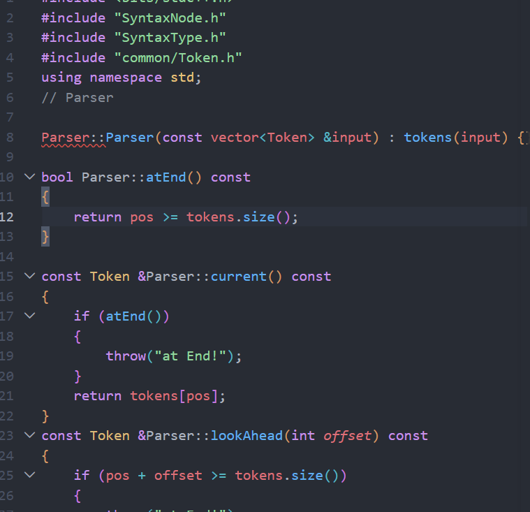

# 规划语法分析实现

- 会话时间：2026-10-02 15:51:20
- 会话编号：`01a0fb98-a7f0-7c30-a0eb-1cc58825c394`
- 导出范围：仅保留用户与助手可见消息，已排除系统提示、开发者指令、内部推理和工具调用。

## 1. 用户

时间：2026-10-02 15:54:40

<external_codex_apps_open_page>{"page_id":null}</external_codex_apps_open_page>

---

## 2. 用户

时间：2026-10-02 15:54:40

好，开始写语法分析，帮我规划一下，接下来如何做

---

## 3. 助手

时间：2026-10-02 15:55:02

我先看一下当前的语法分析代码、词法分析接口和课程文法，再按你现有的结构安排实现顺序。

---

## 4. 用户

时间：2026-10-02 23:40:52

# Context from my IDE setup:

## Active file: /home/zzz2007-cpu/.codex/auth.json

## Open tabs:
- auth.json: /home/zzz2007-cpu/.codex/auth.json

## My request:
好，开始写语法分析，帮我规划一下，接下来如何做

---

## 5. 用户

时间：2026-10-02 23:42:08

# Context from my IDE setup:

## Active file: /home/zzz2007-cpu/.codex/auth.json

## Open tabs:
- auth.json: /home/zzz2007-cpu/.codex/auth.json

## My request:
好，开始写语法分析，帮我规划一下，接下来如何做

---

## 6. 助手

时间：2026-10-02 23:42:16

你现在的词法分析已经能产出 `vector<Token>`，语法分析就从这组 Token 开始，不再重新读源代码。我会按“先搭数据结构，再跑通最小文法，最后补全与错误恢复”的顺序规划，保证每一步都能单独验证。

---

## 7. 助手

时间：2026-10-02 23:43:22

目前基础已经具备：词法分析器把结果保存在 [`Lexer::tokens`](/home/zzz2007-cpu/projects/compiler/src/lexer/Lexer.h:13)，33 种语法成分也已经定义在 [`SyntaxType.h`](/home/zzz2007-cpu/projects/compiler/src/parser/SyntaxType.h:4)。接下来让 Parser 消费 Token，生成语法树，并把遍历结果写入 `parser.txt`。

整体数据流是：

```text
源代码
  ↓ Lexer
vector<Token>
  ↓ Parser（递归下降）
SyntaxNode 语法树
  ↓ 后序遍历
parser.txt
```

建议按下面顺序做。

1. 先建立语法树节点

新增：

```text
src/parser/SyntaxNode.h
src/parser/SyntaxNode.cpp
```

一个节点需要表达两种东西：

- 终结符：一个具体的 `Token`，例如 `INTTK int`
- 非终结符：一个 `SyntaxType`，例如 `<MainFuncDef>`
- `children`：保存子节点，而且顺序必须与源程序一致

这里适合使用 `unique_ptr<SyntaxNode>` 管理子节点。先不要给每种语法成分分别建立一个类，一个通用 `SyntaxNode` 就足够了。

2. 建立 Parser 骨架

新增：

```text
src/parser/Parser.h
src/parser/Parser.cpp
```

Parser 最基本的状态是：

```cpp
vector<Token> tokens;
size_t pos;
vector<Error> errors;
```

第一批辅助操作建议设计成：

```cpp
current()       // 查看当前 Token
lookAhead(n)    // 向后看第 n 个 Token
check(type)     // 当前是不是某种类型
consume(type)   // 匹配并消耗 Token
atEnd()         // 是否读完
```

每个文法成分对应一个函数：

```text
parseCompUnit()
parseMainFuncDef()
parseBlock()
parseStmt()
parseExp()
...
```

这些函数返回对应的语法树节点。

3. 先跑通最小程序

不要一开始同时写完全部文法。第一条测试程序只用：

```c
int main() {
}
```

此时只实现：

```text
parseCompUnit
  └── parseMainFuncDef
        └── parseBlock
```

正确结果应能依次输出 Token，最后输出：

```text
<Block>
<MainFuncDef>
<CompUnit>
```

课程要求 `<Decl>`、`<BType>` 和 `<BlockItem>` 参与分析但不输出，这一点在[实验要求](/home/zzz2007-cpu/projects/compiler/docs/实验要求/实验二语法分析.md:7)中已经明确。

4. 第二阶段实现表达式

按照从底层到上层的顺序写：

```text
Number / LVal
      ↓
PrimaryExp
      ↓
UnaryExp
      ↓
MulExp
      ↓
AddExp
      ↓
RelExp
      ↓
EqExp
      ↓
LAndExp
      ↓
LOrExp
```

其中最需要注意的是文法中的左递归，例如：

```text
AddExp → AddExp ('+' | '-') MulExp
```

递归下降不能直接照抄，否则 `parseAddExp()` 一进入就再次调用自己，会无限递归。

实现思路是：

```text
先分析一个 MulExp
只要后面还有 + 或 -
    读取运算符
    再分析一个 MulExp
```

建树时要做成“左折叠”结构。例如 `1 + 2 + 3` 应逐层生成新的 `AddExp` 父节点。这样后序遍历时才能按评测要求多次输出 `<AddExp>`，不能只建立一个扁平节点。

这一阶段用下面的程序测试：

```c
int main() {
    return 1 + 2 * 3;
}
```

5. 第三阶段实现声明

顺序建议是：

```text
BType
ConstExp
ConstInitVal / InitVal
ConstDef / VarDef
ConstDecl / VarDecl
Decl
```

测试内容逐渐增加：

```c
int main() {
    int a;
    int b = 1;
    int c[2] = {1, 2};
    const int d = 3;
}
```

6. 第四阶段实现普通函数

实现：

```text
FuncType
FuncFParam
FuncFParams
FuncRParams
FuncDef
```

在 `CompUnit` 中需要向后看 Token 来区分：

- `int main (`：主函数
- `int f (`：普通函数
- `int a`：变量声明
- `const`、`static`：声明
- `void`：普通函数

7. 第五阶段补齐所有语句

建议依次完成：

```text
空语句、表达式语句
赋值语句
return / break / continue
语句块
if / else
while
printf
switch / case / default
```

这里最麻烦的是以 `IDENFR` 开头时，要区分：

```c
a = 1;       // 赋值语句
a + 1;       // 表达式语句
f(a);        // 表达式语句
```

可以写一个判断函数查看本条语句中是否存在属于 `LVal` 后面的赋值号，也可以保存 `pos` 后试探分析，再恢复位置。

8. 最后加入错误恢复

语法阶段当前主要处理三种缺失符号：

- `i`：缺少 `;`
- `j`：缺少 `)`
- `k`：缺少 `]`

遇到这些错误时记录错误，但不要随意吃掉当前 Token。例如期望 `;`，当前却是下一条语句的开头，就记录上一 Token 的行号，然后继续分析当前 Token。这样才能满足“错误程序也要完成全部分析”的要求。

9. 接入主程序

最后把 [`main.cpp`](/home/zzz2007-cpu/projects/compiler/src/main.cpp:18)的流程改成：

```text
Lexer.scan()
Parser(lexer.tokens)
Parser.parse()
输出 parser.txt 或 error.txt
```

同时在 [`CMakeLists.txt`](/home/zzz2007-cpu/projects/compiler/src/CMakeLists.txt)加入三个 parser 源文件。

你现在最适合完成的第一小步是：

1. 写 `SyntaxNode.h/.cpp`
2. 写只有游标辅助函数的 `Parser.h/.cpp`
3. 只实现 `int main(){}` 所需的三个分析函数
4. 用这一条最小程序检查输出

当前工作区里的 `src/parser/` 还是未跟踪目录，`build/` 下也有构建产生的改动；我没有修改这些文件。你 IDE 中打开的 `auth.json` 与编译器项目无关，也不需要动它。

<oai-mem-citation>
<citation_entries>
MEMORY.md:88-96|note=[used prior parser architecture and source layout context]
MEMORY.md:121-128|note=[used token input output exclusions and left recursion guidance]
</citation_entries>
<rollout_ids>
01a0f08c-aa3c-79f3-9985-555c780fa103
</rollout_ids>
</oai-mem-citation>

---

## 8. 用户

时间：2026-10-03 09:44:26

# Context from my IDE setup:

## Active file: src/parser/SyntaxNode.h

## Open tabs:
- SyntaxNode.h: src/parser/SyntaxNode.h
- Token.h: src/common/Token.h
- Lexer.h: src/lexer/Lexer.h
- Lexer.cpp: src/lexer/Lexer.cpp
- SyntaxType.h: src/parser/SyntaxType.h

## My request:
如何一键导入common的所有.h？不用一个个include

---

## 9. 助手

时间：2026-10-03 09:44:36

C++ 本身不支持“按文件夹一次性导入所有 `.h`”。`#include` 只能指定具体文件。

如果确实想一键导入，可以在 `common` 下建立一个汇总头文件，例如：

```text
src/common/Common.h
```

里面集中写：

```cpp
#ifndef COMMON_H
#define COMMON_H

#include "common/Token.h"
#include "common/Error.h"

#endif
```

其他文件只需要：

```cpp
#include "common/Common.h"
```

不过在你当前的 [`SyntaxNode.h`](/home/zzz2007-cpu/projects/compiler/src/parser/SyntaxNode.h) 中，更建议只包含实际使用的头文件：

```cpp
#include "common/Token.h"
#include "parser/SyntaxType.h"
```

这样依赖关系更清楚，编译也更快。以后 `common` 里文件很多，而且大部分地方都需要全部使用时，再考虑汇总头文件。

`#include <bits/stdc++.h>` 只能批量包含标准库头文件，不能包含你自己 `common` 文件夹里的头文件。

---

## 10. 用户

时间：2026-10-03 09:46:06

# Context from my IDE setup:

## Active file: src/parser/SyntaxNode.h

## Active selection of the file:
struct SyntaxNode{
    Token token;
    SyntaxType stype;
    vector<SyntaxNode>clildren;
};
## Open tabs:
- SyntaxNode.h: src/parser/SyntaxNode.h
- Token.h: src/common/Token.h
- Lexer.h: src/lexer/Lexer.h
- Lexer.cpp: src/lexer/Lexer.cpp
- SyntaxType.h: src/parser/SyntaxType.h

## My request:
struct SyntaxNode{
&#x20;   Token token;
&#x20;   SyntaxType stype;
&#x20;   vector\<SyntaxNode>clildren;
};
这样为啥报错

---

## 11. 助手

时间：2026-10-03 09:46:08

我先看一下 `SyntaxNode.h` 的完整内容和编译器实际报错，确认是缺少头文件、构造问题，还是代码里混入了转义字符。

---

## 12. 助手

时间：2026-10-03 09:46:24

这里有两个主要问题。

第一，`vector` 没有被引入。`Token.h` 只包含了 `<string>`，没有包含 `<vector>`。所以 `SyntaxNode.h` 需要自己包含：

```cpp
#include <vector>
#include "common/Token.h"
#include "parser/SyntaxType.h"
```

并写成：

```cpp
std::vector<SyntaxNode> children;
```

你写的 `clildren` 拼错了，应为 `children`，不过拼写错误本身不会导致编译失败。

第二，`Token` 没有无参构造函数。你现在的 [`Token`](/home/zzz2007-cpu/projects/compiler/src/common/Token.h:73)只能这样创建：

```cpp
Token(TokenType type, string s, int line);
```

因此下面这种写法会报错：

```cpp
SyntaxNode node;
```

因为创建 `SyntaxNode` 时，编译器不知道该如何创建里面的 `token`。

还有一个设计问题：语法树节点分为两类：

- 终结符节点保存 `Token`
- 非终结符节点保存 `SyntaxType`

一个节点通常不需要同时拥有有效的 `token` 和 `stype`。你接下来可以考虑给 `SyntaxNode` 分别设计两个构造函数：一个接收 `Token`，另一个接收 `SyntaxType`。

另外，我检查到磁盘中的 `src/parser/SyntaxNode.h` 目前还是空文件，说明 IDE 里的代码可能尚未保存；而且它还没有加入 CMake，所以刚才项目整体构建成功并不能证明这个头文件没有错误。先保存文件，第一步重点处理 `#include <vector>` 和 `Token` 无法默认构造这两个问题。

---

## 13. 用户

时间：2026-10-03 09:47:17

# Context from my IDE setup:

## Active file: src/parser/SyntaxNode.h

## Open tabs:
- SyntaxNode.h: src/parser/SyntaxNode.h
- Token.h: src/common/Token.h
- Lexer.h: src/lexer/Lexer.h
- Lexer.cpp: src/lexer/Lexer.cpp
- SyntaxType.h: src/parser/SyntaxType.h

## My request:
那么到底该如何写

---

## 14. 助手

时间：2026-10-03 09:47:22

我先读取你刚保存的 `SyntaxNode.h`，然后针对当前内容告诉你每个成员应怎样设计。

---

## 15. 助手

时间：2026-10-03 09:47:41

你现在直接报错的首要原因是头文件保护宏写成了 `SyntaxNode`：

```cpp
#define SyntaxNode
```

预处理器会把后面的类型名 `SyntaxNode` 也替换掉。把 [`SyntaxNode.h`](/home/zzz2007-cpu/projects/compiler/src/parser/SyntaxNode.h:1) 改成下面这样：

```cpp
#ifndef SYNTAX_NODE_H
#define SYNTAX_NODE_H

#include <optional>
#include <vector>

#include "common/Token.h"
#include "parser/SyntaxType.h"

struct SyntaxNode
{
    // 终结符节点使用 token
    std::optional<Token> token;

    // 非终结符节点使用 syntaxType
    std::optional<SyntaxType> syntaxType;

    // 按源代码顺序保存子节点
    std::vector<SyntaxNode> children;

    // 创建终结符节点
    explicit SyntaxNode(const Token &value)
        : token(value)
    {
    }

    // 创建非终结符节点
    explicit SyntaxNode(SyntaxType value)
        : syntaxType(value)
    {
    }
};

#endif
```

使用方式：

```cpp
Token token(TokenType::INTTK, "int", 1);

// 终结符节点
SyntaxNode tokenNode(token);

// 非终结符节点
SyntaxNode mainNode(SyntaxType::MainFuncDef);

// 把终结符加入非终结符
mainNode.children.push_back(tokenNode);
```

这里使用 `optional` 是因为一个节点只属于下面一种情况：

- `token` 有值：代表 `INTTK int` 这样的终结符。
- `syntaxType` 有值：代表 `<MainFuncDef>` 这样的非终结符。

两个构造函数确保创建节点时必须明确它是哪一种。这个结构暂时不需要 `SyntaxNode.cpp`。

---

## 16. 用户

时间：2026-10-03 09:53:23

# Context from my IDE setup:

## Active file: src/parser/SyntaxNode.h

## Active selection of the file:
struct SyntaxNode
{
    optional<Token> node;
    optional<SyntaxType> node;

    vector<SyntaxNode> children;

    explicit SyntaxNode(const Token &value) : node(value)
    {
    }
    explicit SyntaxNode(const SyntaxType &value) : node(value)
    {
    }
};
## Open tabs:
- SyntaxNode.h: src/parser/SyntaxNode.h
- Token.h: src/common/Token.h
- Lexer.h: src/lexer/Lexer.h
- Lexer.cpp: src/lexer/Lexer.cpp
- SyntaxType.h: src/parser/SyntaxType.h

## My request:
struct SyntaxNode
{
    optional\<Token> node;
    optional\<SyntaxType> node;

    vector\<SyntaxNode> children;

    explicit SyntaxNode(const Token &*value*) : node(*value*)
    {
    }
    explicit SyntaxNode(const SyntaxType &*value*) : node(*value*)
    {
    }
};
用同一个变量名node更好吧

---

## 17. 助手

时间：2026-10-03 09:53:35

“统一叫 `node`”这个想法是对的，但一个结构体里不能声明两个同名成员：

```cpp
optional<Token> node;
optional<SyntaxType> node; // 重名，编译器无法区分
```

这种“一个变量可能是两种类型之一”的情况，更适合使用 `std::variant`：

```cpp
#ifndef SYNTAX_NODE_H
#define SYNTAX_NODE_H

#include <variant>
#include <vector>

#include "common/Token.h"
#include "parser/SyntaxType.h"

struct SyntaxNode
{
    std::variant<Token, SyntaxType> node;
    std::vector<SyntaxNode> children;

    explicit SyntaxNode(const Token &value)
        : node(value)
    {
    }

    explicit SyntaxNode(SyntaxType value)
        : node(value)
    {
    }
};

#endif
```

`variant<Token, SyntaxType>` 表示：`node` 中只能保存 `Token` 或 `SyntaxType` 中的一种。

判断节点类型：

```cpp
if (std::holds_alternative<Token>(syntaxNode.node))
{
    // 这是终结符节点
}
else
{
    // 这是非终结符节点
}
```

取出其中的数据：

```cpp
Token token = std::get<Token>(syntaxNode.node);

SyntaxType type = std::get<SyntaxType>(syntaxNode.node);
```

这比两个 `optional` 更严谨，因为两个 `optional` 可能同时为空或同时有值；`variant` 能保证任何时候恰好保存一种类型。

另外，`SyntaxType` 是枚举，体积很小，构造函数直接按值传递即可：

```cpp
SyntaxNode(SyntaxType value)
```

不需要写成 `const SyntaxType &value`。

---

## 18. 用户

时间：2026-10-03 09:54:34

# Context from my IDE setup:

## Active file: src/parser/SyntaxNode.h

## Open tabs:
- SyntaxNode.h: src/parser/SyntaxNode.h
- Token.h: src/common/Token.h
- Lexer.h: src/lexer/Lexer.h
- Lexer.cpp: src/lexer/Lexer.cpp
- SyntaxType.h: src/parser/SyntaxType.h

## My request:
好的，写完这个，接下来做什么，写工具函数吗

---

## 19. 助手

时间：2026-10-03 09:54:55

对，下一步先写 `Parser` 的游标工具函数。它们负责在 `vector<Token>` 中查看、判断和消耗 Token，后面的所有 `parseXXX()` 都依赖它们。

新建：

```text
src/parser/Parser.h
src/parser/Parser.cpp
```

`Parser.h` 先规划成这样：

```cpp
#ifndef PARSER_H
#define PARSER_H

#include <cstddef>
#include <vector>

#include "common/Token.h"
#include "parser/SyntaxNode.h"

class Parser
{
private:
    const std::vector<Token> &tokens;
    std::size_t pos = 0;

    bool atEnd() const;
    const Token &current() const;
    const Token &lookAhead(std::size_t offset) const;
    bool check(TokenType type) const;
    Token consume(TokenType expected);

    SyntaxNode parseCompUnit();
    SyntaxNode parseMainFuncDef();
    SyntaxNode parseBlock();

public:
    explicit Parser(const std::vector<Token> &tokens);

    SyntaxNode parse();
};

#endif
```

这几个工具函数分别负责：

- `atEnd()`：判断 `pos >= tokens.size()`。
- `current()`：返回 `tokens[pos]`，不移动位置。
- `lookAhead(offset)`：查看后面的 Token，仍然不移动位置。
- `check(type)`：判断当前 Token 的类型。
- `consume(expected)`：检查当前 Token，保存它，然后让 `pos++`。
- `parse()`：语法分析的统一入口，内部调用 `parseCompUnit()`。

例如分析：

```c
int main() {}
```

Token 流是：

```text
INTTK MAINTK LPARENT RPARENT LBRACE RBRACE
  ↑
 pos
```

每调用一次 `consume()`，`pos` 就向右移动一次。

目前先只处理正确程序。如果 `consume()` 发现类型不符合，可以临时抛出异常，方便发现自己的分析逻辑错误：

```cpp
Token Parser::consume(TokenType expected)
{
    if (atEnd() || !check(expected))
    {
        throw std::runtime_error("unexpected token");
    }

    return tokens[pos++];
}
```

之后开始处理 `i/j/k` 类错误时，再把这里细分成错误记录和恢复逻辑。

工具函数完成后，第一批只写三个语法函数：

```text
parseCompUnit()
parseMainFuncDef()
parseBlock()
```

对应关系是：

```text
CompUnit
└── MainFuncDef
    ├── int
    ├── main
    ├── (
    ├── )
    └── Block
        ├── {
        └── }
```

每次 `consume()` 得到一个 `Token`，就用它构造终结符 `SyntaxNode`，然后加入当前非终结符的 `children`。这样先把 `int main(){}` 跑通，再继续写语句和表达式。

---

## 20. 用户

时间：2026-10-03 10:14:12

# Context from my IDE setup:

## Active file: src/parser/Parser.h

## Open tabs:
- Parser.h: src/parser/Parser.h
- Parser.cpp: src/parser/Parser.cpp
- Lexer.cpp: src/lexer/Lexer.cpp
- Token.cpp: src/common/Token.cpp
- Error.h: src/common/Error.h

## My request:
1. `check(type)`：判断当前 Token 的类型。
2. `consume(expected)`：检查当前 Token，保存它，然后让 `pos++`。

这两个到底怎么写

---

## 21. 助手

时间：2026-10-03 10:14:16

我先对照你现在的 `Parser.h/.cpp` 写法，避免给你的函数签名和成员名对不上。

---

## 22. 助手

时间：2026-10-03 10:14:29

按照你现在的成员名，直接在 [`Parser.cpp`](/home/zzz2007-cpu/projects/compiler/src/parser/Parser.cpp) 里接着写：

```cpp
bool Parser::check(TokenType type) const
{
    return !atEnd() && current().type == type;
}

Token Parser::consume(TokenType expected)
{
    if (!check(expected))
    {
        throw std::runtime_error("unexpected token");
    }

    return tokens[pos++];
}
```

`check()` 的执行过程是：

```cpp
!atEnd()                    // 确保还有 Token
current().type == type      // 判断当前 Token 类型
```

这里的 `&&` 有短路效果。如果已经到结尾，就不会调用会抛出异常的 `current()`。

`consume()` 中这句：

```cpp
return tokens[pos++];
```

等价于：

```cpp
Token result = tokens[pos];
pos++;
return result;
```

使用时：

```cpp
Token intToken = consume(TokenType::INTTK);
```

执行前：

```text
pos
 ↓
int main ( )
```

执行后：

```text
    pos
     ↓
int main ( )
```

返回的 `Token` 可以立即放入语法树：

```cpp
SyntaxNode node(SyntaxType::MainFuncDef);
node.children.emplace_back(consume(TokenType::INTTK));
node.children.emplace_back(consume(TokenType::MAINTK));
```

你当前代码还有两处需要顺手改掉：

1. [`Parser.h`](/home/zzz2007-cpu/projects/compiler/src/parser/Parser.h:4) 中不要包含自己，删除：

```cpp
#include "Parser.h"
```

2. `lookAhead()` 的声明和定义参数类型不一致。头文件是：

```cpp
const Token &lookAhead(std::size_t offset) const;
```

所以 [`Parser.cpp`](/home/zzz2007-cpu/projects/compiler/src/parser/Parser.cpp:22) 也要写成：

```cpp
const Token &Parser::lookAhead(std::size_t offset) const
```

下一步就是给 `Parser` 补构造函数，否则引用成员 `tokens` 无法初始化：

```cpp
Parser::Parser(const std::vector<Token> &input)
    : tokens(input)
{
}
```

---

## 23. 用户

时间：2026-10-03 10:15:19

# Context from my IDE setup:

## Active file: src/parser/Parser.cpp

## Open tabs:
- Parser.cpp: src/parser/Parser.cpp
- Parser.h: src/parser/Parser.h
- Lexer.cpp: src/lexer/Lexer.cpp
- Token.cpp: src/common/Token.cpp
- Error.h: src/common/Error.h

## My request:
```rust
bool Parser::check(TokenType type) const
{
    return !atEnd() && current().type == type;
}
type如何知道，为什么提前知道type了
```

---

## 24. 助手

时间：2026-10-03 10:15:34

这里的 `type` 并不是 `check()` 自己提前知道的，而是调用者传进来的参数。

例如你调用：

```cpp
check(TokenType::INTTK);
```

那么进入函数以后，参数 `type` 的值就是：

```cpp
TokenType::INTTK
```

函数实际比较的是：

```cpp
当前真正读到的类型 == 调用者期望的类型
```

也就是：

```cpp
current().type == type
// 当前 Token 类型  ==  TokenType::INTTK
```

假设 Token 流是：

```text
INTTK  MAINTK  LPARENT  RPARENT
  ↑
 pos
```

调用：

```cpp
bool result = check(TokenType::INTTK);
```

函数内部相当于：

```cpp
return current().type == TokenType::INTTK;
```

结果就是 `true`。

随后 `pos` 移到 `main`，调用：

```cpp
check(TokenType::INTTK);
```

相当于比较：

```cpp
TokenType::MAINTK == TokenType::INTTK
```

结果是 `false`。

至于调用者为什么知道“期望什么类型”，答案来自文法。比如主函数文法：

```text
MainFuncDef → 'int' 'main' '(' ')' Block
```

所以 `parseMainFuncDef()` 清楚接下来依次应该出现：

```cpp
consume(TokenType::INTTK);
consume(TokenType::MAINTK);
consume(TokenType::LPARENT);
consume(TokenType::RPARENT);
```

因此可以把 `check()` 理解为一个提问：

```cpp
check(TokenType::INTTK);
```

就是问：

> 当前 Token 是不是 `INTTK`？

参数名也可以写得更清楚：

```cpp
bool Parser::check(TokenType expectedType) const
{
    return !atEnd() && current().type == expectedType;
}
```

其中：

- `current().type`：词法分析实际识别到的类型。
- `expectedType`：语法分析函数根据文法传入的期望类型。

它不是提前预测 Token，而是拿“实际值”和“文法期望值”进行比较。

---

## 25. 用户

时间：2026-10-03 10:19:41

# Context from my IDE setup:

## Active file: src/parser/Parser.cpp

## Open tabs:
- Parser.cpp: src/parser/Parser.cpp
- Parser.h: src/parser/Parser.h
- Lexer.cpp: src/lexer/Lexer.cpp
- Token.cpp: src/common/Token.cpp
- Error.h: src/common/Error.h

## My request:
好了，这个工具写完了，主流程怎么写，递归的写吗，是不是需要创建一个node的vector呢？

---

## 26. 助手

时间：2026-10-03 10:19:44

我先看一下你现在 `Parser` 和 `SyntaxNode` 的完整状态，再按现有接口说明主流程和树节点怎么组织。

---

## 27. 助手

时间：2026-10-03 10:20:03

主流程使用递归下降：每个 `parseXXX()` 分析一种语法成分，创建一个节点，调用下一级 `parseXXX()` 得到子节点，最后返回当前节点。

不需要在 `Parser` 中另外创建 `vector<SyntaxNode>`。你已经在每个 [`SyntaxNode`](/home/zzz2007-cpu/projects/compiler/src/parser/SyntaxNode.h:6) 中定义了：

```cpp
vector<SyntaxNode> children;
```

整个语法分析最终只需保存一个根节点：

```text
CompUnit
└── MainFuncDef
    ├── INTTK int
    ├── MAINTK main
    ├── LPARENT (
    ├── RPARENT )
    └── Block
        ├── LBRACE {
        └── RBRACE }
```

先把最小的 `int main(){}` 跑通。

首先调整 `Parser.h`：

```cpp
#ifndef PARSER_H
#define PARSER_H

#include <vector>

#include "common/Token.h"
#include "parser/SyntaxNode.h"

class Parser
{
private:
    const std::vector<Token> &tokens;
    std::size_t pos = 0;

    bool atEnd() const;
    const Token &current() const;
    const Token &lookAhead(std::size_t offset) const;
    bool check(TokenType type) const;
    Token consume(TokenType expected);

    SyntaxNode parseCompUnit();
    SyntaxNode parseMainFuncDef();
    SyntaxNode parseBlock();

public:
    explicit Parser(const std::vector<Token> &input);

    SyntaxNode parse();
};

#endif
```

注意删除你当前 [`Parser.h`](/home/zzz2007-cpu/projects/compiler/src/parser/Parser.h:4) 里包含自己的代码：

```cpp
#include "Parser.h"
```

然后在 `Parser.cpp` 写主入口：

```cpp
SyntaxNode Parser::parse()
{
    return parseCompUnit();
}
```

`parseCompUnit()` 创建整棵树的根节点：

```cpp
SyntaxNode Parser::parseCompUnit()
{
    SyntaxNode node(SyntaxType::CompUnit);

    node.children.push_back(parseMainFuncDef());

    return node;
}
```

`parseMainFuncDef()` 按照文法：

```text
MainFuncDef → 'int' 'main' '(' ')' Block
```

依次添加子节点：

```cpp
SyntaxNode Parser::parseMainFuncDef()
{
    SyntaxNode node(SyntaxType::MainFuncDef);

    node.children.emplace_back(consume(TokenType::INTTK));
    node.children.emplace_back(consume(TokenType::MAINTK));
    node.children.emplace_back(consume(TokenType::LPARENT));
    node.children.emplace_back(consume(TokenType::RPARENT));
    node.children.push_back(parseBlock());

    return node;
}
```

`parseBlock()` 暂时只处理空语句块：

```cpp
SyntaxNode Parser::parseBlock()
{
    SyntaxNode node(SyntaxType::Block);

    node.children.emplace_back(consume(TokenType::LBRACE));
    node.children.emplace_back(consume(TokenType::RBRACE));

    return node;
}
```

调用关系就是：

```text
parse()
  ↓
parseCompUnit()
  ↓
parseMainFuncDef()
  ↓
parseBlock()
```

以后支持非空语句块时，`parseBlock()` 会变成：

```cpp
读取 {
只要当前不是 }
    调用 parseBlockItem()
读取 }
```

如果 `BlockItem` 里面又出现一个语句块，就会再次调用 `parseBlock()`，这才形成真正的递归。

最后主程序的调用方式是：

```cpp
Lexer lexer(s);
lexer.scan();

Parser parser(lexer.tokens);
SyntaxNode root = parser.parse();
```

不过接入 `main.cpp` 之前，还要做两件事：

- 把 `Parser.cpp` 加入 [`CMakeLists.txt`](/home/zzz2007-cpu/projects/compiler/src/CMakeLists.txt:9)。
- 把 `lookAhead()` 在 `.h` 和 `.cpp` 中统一为 `std::size_t offset`。

先用这个输入测试：

```c
int main() {
}
```

只要能够完整返回 `root` 且不抛出 `unexpected token`，最小主流程就跑通了。下一步再写语法树输出函数。

---

## 28. 用户

时间：2026-10-03 11:26:35

# Context from my IDE setup:

## Active file: src/main.cpp

## Open tabs:
- main.cpp: src/main.cpp
- Parser.cpp: src/parser/Parser.cpp
- Parser.h: src/parser/Parser.h
- Lexer.cpp: src/lexer/Lexer.cpp
- Token.cpp: src/common/Token.cpp

## My request:
如何运行

---

## 29. 助手

时间：2026-10-03 11:26:41

我先按当前工程实际构建一次，确认运行命令以及现在是否还有编译错误。

---

## 30. 助手

时间：2026-10-03 11:27:22

运行命令是在项目根目录执行：

```bash
cmake -S src -B build
cmake --build build --parallel
./build/Compiler
```

但我刚才实际构建过，当前代码还不能运行，需要先修正以下几处。

在 [`Parser.h`](/home/zzz2007-cpu/projects/compiler/src/parser/Parser.h) 中删除自我包含：

```cpp
#include "Parser.h"
```

然后在类中补上这些声明：

```cpp
class Parser
{
private:
    const vector<Token> &tokens;
    int pos = 0;

    bool atEnd() const;
    const Token &current() const;
    const Token &lookAhead(std::size_t offset) const;
    bool check(TokenType type) const;
    Token consume(TokenType expected);

    SyntaxNode parseCompUnit();
    SyntaxNode parseMainFuncDef();
    SyntaxNode parseBlock();

public:
    explicit Parser(const vector<Token> &input);

    SyntaxNode parse();
};
```

在 [`Parser.cpp`](/home/zzz2007-cpu/projects/compiler/src/parser/Parser.cpp) 中，三个语法函数最后都缺少：

```cpp
return node;
```

例如：

```cpp
SyntaxNode Parser::parseCompUnit()
{
    SyntaxNode node(SyntaxType::CompUnit);
    node.children.push_back(parseMainFuncDef());

    return node;
}
```

`parseMainFuncDef()` 和 `parseBlock()` 末尾也一样添加。

`lookAhead()` 的参数类型也要与头文件一致：

```cpp
const Token &Parser::lookAhead(std::size_t offset) const
```

然后在 [`CMakeLists.txt`](/home/zzz2007-cpu/projects/compiler/src/CMakeLists.txt:9) 中加入：

```cmake
parser/Parser.cpp
```

即：

```cmake
add_executable(Compiler
    main.cpp
    common/Token.cpp
    common/Error.cpp
    lexer/Lexer.cpp
    parser/Parser.cpp
)
```

当前 Parser 只支持空主函数，因此暂时把 `testfile.txt` 内容改成：

```c
int main() {
}
```

你现在的测试文件包含变量声明、类型转换、函数调用和 `return`，这些文法函数还没写，运行时会在读到 `int a` 时抛出 `unexpected token`。

完成上述修改后运行：

```bash
cd /home/zzz2007-cpu/projects/compiler
cmake -S src -B build
cmake --build build --parallel
./build/Compiler
```

目前即使运行成功，终端也不会显示语法树，因为还没有写语法树输出函数；程序正常结束且没有出现 `unexpected token`，就说明最小语法分析流程已经跑通。

---

## 31. 用户

时间：2026-10-03 11:28:10

# Context from my IDE setup:

## Active file: src/parser/Parser.cpp

## Open tabs:
- Parser.cpp: src/parser/Parser.cpp
- main.cpp: src/main.cpp
- Parser.h: src/parser/Parser.h
- Lexer.cpp: src/lexer/Lexer.cpp
- Token.cpp: src/common/Token.cpp

## My request:
不自我包含就报错



---

## 32. 助手

时间：2026-10-03 11:28:25

你删错位置了。

需要删除的是 [`Parser.h`](/home/zzz2007-cpu/projects/compiler/src/parser/Parser.h) 里面的：

```cpp
#include "Parser.h"
```

而 [`Parser.cpp`](/home/zzz2007-cpu/projects/compiler/src/parser/Parser.cpp) 必须包含 `Parser.h`，否则编译器不知道 `Parser` 是什么，所以截图中的：

```cpp
Parser::Parser(...)
```

会标红。

`Parser.cpp` 开头应该写：

```cpp
#include "Parser.h"

using namespace std;
```

由于 `Parser.h` 已经包含了 `SyntaxNode.h` 和 `Token.h`，`Parser.cpp` 中一般不需要再次包含它们。

两者关系是：

```text
Parser.cpp
    ↓ 包含
Parser.h
```

不能反过来让 `Parser.h` 包含自己。

同时，`Parser.h` 的 `class Parser` 中必须声明构造函数：

```cpp
public:
    explicit Parser(const vector<Token> &input);

    SyntaxNode parse();
```

所以最终原则是：

- `Parser.cpp` 中保留 `#include "Parser.h"`。
- `Parser.h` 中删除 `#include "Parser.h"`。
- `Parser.h` 中声明构造函数。
- `Parser.cpp` 中实现构造函数。

你的截图报错正是因为 `Parser.cpp` 顶部缺少了：

```cpp
#include "Parser.h"
```

---

## 33. 用户

时间：2026-10-03 11:30:29

# Context from my IDE setup:

## Active file: src/CMakeLists.txt

## Open tabs:
- CMakeLists.txt: src/CMakeLists.txt
- testfile.txt: testfile.txt
- Parser.h: src/parser/Parser.h
- Parser.cpp: src/parser/Parser.cpp
- main.cpp: src/main.cpp

## My request:
如何写语法树输出函数

---

## 34. 助手

时间：2026-10-03 11:30:32

我先确认你现在 `SyntaxNode`、`Parser` 和 `TokenTypeToString` 的接口，再给出能直接接入当前结构的输出方式。

---

## 35. 助手

时间：2026-10-03 11:31:21

语法树要用“后序遍历”输出：

1. 如果是 `Token` 节点，直接输出 Token。
2. 如果是语法成分节点，先递归输出所有子节点。
3. 最后输出当前语法成分，如 `<Block>`。

这样才能得到课程要求的顺序。

先在 [`SyntaxNode.h`](/home/zzz2007-cpu/projects/compiler/src/parser/SyntaxNode.h) 的结构体后面声明：

```cpp
void printSyntaxTree(const SyntaxNode &node, std::ostream &output);
```

然后新建 `src/parser/SyntaxNode.cpp`：

```cpp
#include "parser/SyntaxNode.h"

using namespace std;

static string SyntaxTypeToString(SyntaxType type)
{
    switch (type)
    {
    case SyntaxType::CompUnit:
        return "CompUnit";

    case SyntaxType::MainFuncDef:
        return "MainFuncDef";

    case SyntaxType::Block:
        return "Block";

    default:
        throw runtime_error("unknown syntax type");
    }
}

void printSyntaxTree(const SyntaxNode &node, ostream &output)
{
    // 当前是终结符 Token
    if (holds_alternative<Token>(node.node))
    {
        const Token &token = get<Token>(node.node);

        output << TokenTypeToString(token.type)
               << " "
               << token.s
               << '\n';

        return;
    }

    // 当前是非终结符
    for (const SyntaxNode &child : node.children)
    {
        printSyntaxTree(child, output);
    }

    SyntaxType type = get<SyntaxType>(node.node);

    // 这三个语法成分需要分析，但不输出
    if (type == SyntaxType::Decl ||
        type == SyntaxType::BType ||
        type == SyntaxType::BlockItem)
    {
        return;
    }

    output << "<" << SyntaxTypeToString(type) << ">\n";
}
```

现在只实现了 `CompUnit`、`MainFuncDef` 和 `Block`，因此转换函数暂时只写这三个。以后每新增一种 `parseXXX()`，就在 `SyntaxTypeToString()` 中补一个 `case`。

在 [`CMakeLists.txt`](/home/zzz2007-cpu/projects/compiler/src/CMakeLists.txt:9) 中加入：

```cmake
parser/SyntaxNode.cpp
```

变成：

```cmake
add_executable(Compiler
    main.cpp
    common/Token.cpp
    common/Error.cpp
    lexer/Lexer.cpp
    parser/Parser.cpp
    parser/SyntaxNode.cpp
)
```

然后在 [`main.cpp`](/home/zzz2007-cpu/projects/compiler/src/main.cpp:24) 获得根节点后输出：

```cpp
SyntaxNode root = parser.parse();

ofstream parserFile("parser.txt");
if (!parserFile.is_open())
{
    cout << "无法创建 parser.txt\n";
    return 0;
}

printSyntaxTree(root, parserFile);
```

当前使用：

```c
int main() {
}
```

运行后，`parser.txt` 应该是：

```text
INTTK int
MAINTK main
LPARENT (
RPARENT )
LBRACE {
RBRACE }
<Block>
<MainFuncDef>
<CompUnit>
```

这里不需要打印缩进，因为评测要求每行只有 Token 信息或 `<语法成分>`。

---

## 36. 用户

时间：2026-10-03 11:38:34

# Context from my IDE setup:

## Active file: src/parser/SyntaxNode.cpp

## Open tabs:
- SyntaxNode.cpp: src/parser/SyntaxNode.cpp
- SyntaxNode.h: src/parser/SyntaxNode.h
- Parser.h: src/parser/Parser.h
- SyntaxType.h: src/parser/SyntaxType.h
- Token.h: src/common/Token.h

## My request:
终结符，非终结符，语法成分都是什么意思

---

## 37. 助手

时间：2026-10-03 11:39:05

可以把语法分析理解成：把一串零散的 Token，组合成有层次的程序结构。

例如源代码：

```c
int main() {
}
```

经过词法分析后得到：

```text
INTTK int
MAINTK main
LPARENT (
RPARENT )
LBRACE {
RBRACE }
```

这些 Token 再由语法分析组合为：

```text
CompUnit
└── MainFuncDef
    ├── INTTK int
    ├── MAINTK main
    ├── LPARENT (
    ├── RPARENT )
    └── Block
        ├── LBRACE {
        └── RBRACE }
```

### 终结符

终结符是语法树最底层、不能继续拆分的符号。在你的编译器中，词法分析产生的每个 `Token` 都是终结符。

例如：

```text
INTTK int
MAINTK main
LPARENT (
INTCON 123
PLUS +
IDENFR number
```

一个 Token 包含：

```cpp
struct Token
{
    TokenType type; // 类别，例如 INTTK
    string s;       // 原始内容，例如 int
    int line;       // 所在行
};
```

之所以叫“终结符”，是因为语法分析到这里就结束了，不会再用其他文法规则展开它。

在你的 `SyntaxNode` 中，保存 `Token` 的节点就是终结符节点：

```cpp
SyntaxNode(consume(TokenType::INTTK))
```

### 非终结符

非终结符是由一个或多个终结符、其他非终结符组合成的结构。

例如课程文法中：

```text
MainFuncDef → 'int' 'main' '(' ')' Block
```

左边的 `MainFuncDef` 是非终结符，右边包含：

```text
'int'    终结符
'main'   终结符
'('      终结符
')'      终结符
Block    非终结符
```

`Block` 又可以继续展开：

```text
Block → '{' { BlockItem } '}'
```

所以它也是非终结符。

在你的程序中，`SyntaxType` 中的成员全都是非终结符：

```cpp
SyntaxType::CompUnit
SyntaxType::MainFuncDef
SyntaxType::Block
SyntaxType::Stmt
SyntaxType::AddExp
```

例如：

```cpp
SyntaxNode node(SyntaxType::MainFuncDef);
```

创建的就是非终结符节点。

### 语法成分

“语法成分”是对程序结构的中文称呼。在这份实验要求中，它基本上就是非终结符所表示的结构。

例如：

| 源代码 | 识别出的语法成分 |
|---|---|
| `123` | `<Number>` |
| `a` | `<LVal>` |
| `1 + 2` | `<AddExp>` |
| `return 0;` | `<Stmt>` |
| `{ return 0; }` | `<Block>` |
| `int main() {}` | `<MainFuncDef>` |
| 整个源程序 | `<CompUnit>` |

例如：

```c
return 1 + 2;
```

其中可以识别出很多层语法成分：

```text
Stmt
├── RETURNTK return
├── Exp
│   └── AddExp
│       ├── Number 1
│       ├── PLUS +
│       └── Number 2
└── SEMICN ;
```

这里的 `Stmt`、`Exp`、`AddExp`、`Number` 都是语法成分，也都是非终结符。

### 三者的关系

```text
语法树节点
├── 终结符节点
│   └── 保存 Token
│       例如：INTTK int
│
└── 非终结符节点
    └── 表示语法成分
        例如：<MainFuncDef>
```

所以你的这句代码：

```cpp
variant<Token, SyntaxType> node;
```

表达的意思就是：

> 一个语法树节点，要么是保存 `Token` 的终结符节点，要么是保存 `SyntaxType` 的非终结符节点。

判断方式是：

```cpp
if (holds_alternative<Token>(node.node))
{
    // 终结符
}
else
{
    // 非终结符，也就是某种语法成分
}
```

最简单的记忆方法：

- 能在源代码里直接看到的 `int`、`+`、`123`、`;`，属于终结符。
- 编译器归纳出来的“主函数”“语句”“表达式”“语句块”，属于非终结符，也叫语法成分。

---

## 38. 用户

时间：2026-10-03 11:49:25

# Context from my IDE setup:

## Active file: src/main.cpp

## Open tabs:
- main.cpp: src/main.cpp
- parser.txt: parser.txt
- SyntaxNode.cpp: src/parser/SyntaxNode.cpp
- SyntaxNode.h: src/parser/SyntaxNode.h
- Parser.h: src/parser/Parser.h

## My request:
现在为啥执行不了

---

## 39. 助手

时间：2026-10-03 11:49:30

我先直接构建并运行当前代码，抓第一个真实错误，再定位到具体文件和行。

---

## 40. 助手

时间：2026-10-03 11:50:03

现在执行不了的直接原因是：[`SyntaxNode.cpp`](/home/zzz2007-cpu/projects/compiler/src/parser/SyntaxNode.cpp) 没有加入 CMake。

链接器报错：

```text
undefined reference to printSyntaxTree(...)
```

说明 `main.cpp` 看到了函数声明，但编译结果里没有函数实现。

在 [`CMakeLists.txt`](/home/zzz2007-cpu/projects/compiler/src/CMakeLists.txt:9) 加入：

```cmake
add_executable(Compiler
    main.cpp
    common/Token.cpp
    common/Error.cpp
    lexer/Lexer.cpp
    parser/Parser.cpp
    parser/SyntaxNode.cpp
)
```

另外，[`SyntaxNode.cpp:44`](/home/zzz2007-cpu/projects/compiler/src/parser/SyntaxNode.cpp:44) 少了右尖括号。改成：

```cpp
output << "<" << SyntaxTypeToString(type) << ">\n";
```

然后重新构建运行：

```bash
cmake -S src -B build
cmake --build build --parallel
./build/Compiler
```

当前 `testfile.txt` 是：

```c
int main() {
}
```

正好在目前 Parser 支持的范围内。运行成功后，`parser.txt` 应为：

```text
INTTK int
MAINTK main
LPARENT (
RPARENT )
LBRACE {
RBRACE }
<Block>
<MainFuncDef>
<CompUnit>
```

---

## 41. 用户

时间：2026-10-03 13:41:38

# Context from my IDE setup:

## Active file: parser.txt

## Open tabs:
- parser.txt: parser.txt
- Parser.h: src/parser/Parser.h

## My request:
好了，现在这一部分完成了，接下来是不是持续的写完所有的语法，规划如何实现，以及第一步写哪些

---

## 42. 助手

时间：2026-10-03 13:41:43

对，接下来进入“逐类补全文法”的阶段，但不要按文档从上往下硬写。应先实现表达式底座，再实现声明和语句，最后处理函数、顶层判定与错误恢复；这样每一阶段都有可运行的测试。

---

## 43. 助手

时间：2026-10-03 13:42:25

对，接下来要逐步补全所有文法，但不要一次写完。建议每次完成一条“可以从完整程序运行验证”的路径。

你现在已经完成：

```text
CompUnit → MainFuncDef → Block
```

第一步建议支持：

```c
int main() {
    return 1 + 2 * 3;
}
```

这条路径需要的调用关系是：

```text
parseBlock
└── parseBlockItem
    └── parseStmt
        └── parseExp
            └── parseAddExp
                └── parseMulExp
                    └── parseUnaryExp
                        └── parsePrimaryExp
                            └── parseNumber
```

先在 `Parser.h` 添加这些声明：

```cpp
SyntaxNode parseBlockItem();
SyntaxNode parseStmt();

SyntaxNode parseExp();
SyntaxNode parseAddExp();
SyntaxNode parseMulExp();
SyntaxNode parseUnaryExp();
SyntaxNode parsePrimaryExp();
SyntaxNode parseNumber();
```

第一批函数按从下往上的顺序实现。

### 1. `parseNumber()`

文法：

```text
Number → IntConst | CharConst
```

逻辑：

```text
创建 Number 节点
如果当前是 INTCON，消耗 INTCON
否则如果是 CHARCON，消耗 CHARCON
否则说明语法不符合
返回 Number
```

### 2. `parsePrimaryExp()`

完整文法是：

```text
PrimaryExp → '(' Exp ')' | LVal | Number
```

第一阶段先支持 Number：

```text
创建 PrimaryExp
调用 parseNumber()
将结果放入 children
返回
```

第二阶段再补括号表达式和 `LVal`。

### 3. `parseUnaryExp()`

第一阶段只支持：

```text
UnaryExp → PrimaryExp
```

因此它创建 `UnaryExp` 节点，并把 `parsePrimaryExp()` 的结果作为子节点。

### 4. `parseMulExp()`

文法存在左递归：

```text
MulExp → UnaryExp
         | MulExp ('*' | '/' | '%') UnaryExp
```

不能直接让 `parseMulExp()` 调用自己，否则会无限递归。逻辑应为：

```text
先分析一个 UnaryExp，得到 left

while 当前是 *、/、%
    创建新的 MulExp parent
    把 left 放入 parent
    消耗运算符并放入 parent
    分析下一个 UnaryExp 并放入 parent
    left = parent

返回 left
```

这里必须逐层建立节点，不能把所有内容平铺到一个 `MulExp` 中，否则 `1 * 2 * 3` 的 `<MulExp>` 输出次数会不符合文法要求。

### 5. `parseAddExp()`

与 `parseMulExp()` 相同，只是运算符换成：

```text
+ -
```

右侧调用 `parseMulExp()`。

### 6. `parseExp()`

文法：

```text
Exp → AddExp
```

它只需要创建 `Exp` 节点，并添加 `parseAddExp()` 返回的子节点。

### 7. `parseStmt()`

第一阶段只实现 `return`：

```text
Stmt → 'return' [Exp] ';'
```

逻辑是：

```text
创建 Stmt
消耗 RETURNTK
如果当前不是 SEMICN
    调用 parseExp()
消耗 SEMICN
返回 Stmt
```

这样既支持：

```c
return;
```

也支持：

```c
return 1 + 2;
```

### 8. `parseBlockItem()`

完整文法是：

```text
BlockItem → Decl | Stmt
```

第一阶段只有 `return`，可以先调用 `parseStmt()`。之后再根据当前 Token 判断：

```text
const/static/int/char → parseDecl()
其他                 → parseStmt()
```

虽然 `<BlockItem>` 不输出，但仍然要创建并保留这个节点。

### 9. 修改 `parseBlock()`

目前你的 `parseBlock()` 直接读取 `{}`，需要改为：

```text
消耗 {
while 当前不是 }
    调用 parseBlockItem()
消耗 }
```

核心结构是：

```cpp
node.children.emplace_back(consume(TokenType::LBRACE));

while (!check(TokenType::RBRACE))
{
    node.children.push_back(parseBlockItem());
}

node.children.emplace_back(consume(TokenType::RBRACE));
```

还应考虑 `atEnd()`，避免错误输入缺少 `}` 时死循环：

```cpp
while (!atEnd() && !check(TokenType::RBRACE))
```

### 10. 补输出名称

每新增一种节点，都要在 `SyntaxTypeToString()` 添加对应项：

```text
BlockItem
Stmt
Exp
AddExp
MulExp
UnaryExp
PrimaryExp
Number
```

其中 `BlockItem` 虽然不会最终输出，但转换函数最好仍保持完整。

完整开发顺序建议如下：

| 阶段 | 实现内容 | 测试重点 |
|---|---|---|
| 1 | 数字、乘加表达式、return、BlockItem | `return 1 + 2 * 3;` |
| 2 | LVal、括号、一元运算、类型转换、函数调用 | `return -a + f(2);` |
| 3 | RelExp、EqExp、LAndExp、LOrExp、Cond | `if (a < 2 && b != 0)` |
| 4 | 常量和变量声明、数组、初始化值 | `int a[2] = {1, 2};` |
| 5 | 赋值、空语句、if、while、break、continue、printf | 完整语句块 |
| 6 | 普通函数、形参、实参 | 多函数程序 |
| 7 | switch、case、default | 课程样例 |
| 8 | CompUnit 顶层分类 | 声明、普通函数、main 混合 |
| 9 | `i/j/k` 错误恢复 | 缺少 `;`、`)`、`]` |

你现在只做第一阶段，先让下面程序正确生成 `parser.txt`：

```c
int main() {
    return 1 + 2 * 3;
}
```

这一阶段跑通以后，再补 `LVal`、括号和一元表达式。这样遇到错误时，范围只会落在刚新增的几个函数里。

<oai-mem-citation>
<citation_entries>
MEMORY.md:88-100|note=[used prior parser architecture and staged implementation context]
MEMORY.md:121-130|note=[used parser input output exclusions and left recursion guidance]
</citation_entries>
<rollout_ids>
01a0f08c-aa3c-79f3-9985-555c780fa103
</rollout_ids>
</oai-mem-citation>

---

## 44. 用户

时间：2026-10-03 13:48:22

# Context from my IDE setup:

## Active file: src/parser/Parser.h

## Open tabs:
- Parser.h: src/parser/Parser.h
- SyntaxNode.h: src/parser/SyntaxNode.h
- SyntaxNode.cpp: src/parser/SyntaxNode.cpp
- SyntaxType.h: src/parser/SyntaxType.h
- CMakeLists.txt: src/CMakeLists.txt

## My request:
SyntaxNode parseBlockItem();
SyntaxNode parseStmt();

SyntaxNode parseExp();
SyntaxNode parseAddExp();
SyntaxNode parseMulExp();
SyntaxNode parseUnaryExp();
SyntaxNode parsePrimaryExp();
SyntaxNode parseNumber();
这些每一个都有什么用

---

## 45. 助手

时间：2026-10-03 13:48:43

这些函数分别对应文法中的一种非终结符。它们都有相同职责：

```text
从当前 pos 开始识别一种语法成分
→ 消耗相应 Token
→ 创建 SyntaxNode
→ 返回语法树节点
```

以这段代码为例：

```c
return 1 + 2 * 3;
```

调用过程是：

```text
parseBlockItem
└── parseStmt
    └── parseExp
        └── parseAddExp
            ├── parseMulExp：1
            ├── PLUS：+
            └── parseMulExp：2 * 3
```

各个函数的作用如下。

| 函数 | 对应语法成分 | 负责识别 |
|---|---|---|
| `parseBlockItem()` | `BlockItem` | 语句块中的一项，判断它是声明还是语句 |
| `parseStmt()` | `Stmt` | 一整条语句，例如 `return`、赋值、`if` |
| `parseExp()` | `Exp` | 普通表达式的入口 |
| `parseAddExp()` | `AddExp` | 加减表达式 |
| `parseMulExp()` | `MulExp` | 乘除模表达式 |
| `parseUnaryExp()` | `UnaryExp` | 单目运算、函数调用、类型转换等 |
| `parsePrimaryExp()` | `PrimaryExp` | 括号、变量、数字等基本表达式 |
| `parseNumber()` | `Number` | 整数常量或字符常量 |

### `parseBlockItem()`

文法：

```text
BlockItem → Decl | Stmt
```

一个 `{ ... }` 中可以放声明或语句：

```c
{
    int a;       // Decl
    return 1;    // Stmt
}
```

所以它负责判断接下来调用：

```cpp
parseDecl();
```

还是：

```cpp
parseStmt();
```

虽然课程要求不输出 `<BlockItem>`，但这个节点仍要分析和保存。

### `parseStmt()`

文法中的语句入口，负责识别：

```c
return 1;
a = 2;
if (a) {}
while (a) {}
break;
continue;
{
}
```

目前第一阶段只实现：

```text
Stmt → 'return' [Exp] ';'
```

看到 `RETURNTK` 后，它会依次处理：

```text
return
表达式
;
```

### `parseExp()`

文法：

```text
Exp → AddExp
```

它是普通表达式的统一入口。例如下面这些地方都可能调用它：

```c
return 1 + 2;
a = 3;
f(4);
array[5];
```

虽然它现在只是调用 `parseAddExp()`，但不能省略，因为评测需要输出：

```text
<Exp>
```

以后语义分析也会使用这个层级。

### `parseAddExp()`

文法：

```text
AddExp → MulExp
         | AddExp ('+' | '-') MulExp
```

负责：

```c
1 + 2
a - b
1 + 2 - 3
```

它不直接分析数字，而是调用 `parseMulExp()`，这样才能正确处理优先级。

例如：

```c
1 + 2 * 3
```

会被理解成：

```text
1 + (2 * 3)
```

### `parseMulExp()`

文法：

```text
MulExp → UnaryExp
         | MulExp ('*' | '/' | '%') UnaryExp
```

负责：

```c
2 * 3
a / b
x % 10
```

它比 `parseAddExp()` 更底层，所以乘除模天然具有更高优先级。

```text
parseAddExp
    ↓
parseMulExp
```

先完整分析乘法，再处理加法。

### `parseUnaryExp()`

文法：

```text
UnaryExp → PrimaryExp
         | Ident '(' [FuncRParams] ')'
         | UnaryOp UnaryExp
         | '(' BType ')' UnaryExp
```

负责四类内容：

```c
123          // PrimaryExp
f(1, 2)      // 函数调用
-a           // 单目运算
!condition   // 单目运算
(int)a       // 类型转换
```

第一阶段可以先只支持：

```text
UnaryExp → PrimaryExp
```

### `parsePrimaryExp()`

文法：

```text
PrimaryExp → '(' Exp ')' | LVal | Number
```

负责最基础的表达式：

```c
(1 + 2)   // 括号表达式
a         // LVal
a[2]      // LVal
123       // Number
'A'       // Number
```

它需要根据当前 Token 决定：

```text
LPARENT        → 括号表达式
IDENFR         → parseLVal()
INTCON/CHARCON → parseNumber()
```

第一阶段可以先支持 `Number`。

### `parseNumber()`

文法：

```text
Number → IntConst | CharConst
```

负责最底层的数值：

```c
123
0
'A'
'\n'
```

它只需要判断当前 Token 是：

```cpp
TokenType::INTCON
```

还是：

```cpp
TokenType::CHARCON
```

然后消耗该 Token。

这些函数分开的核心原因有两个：

1. 与课程文法一一对应，方便生成所需的 `<Exp>`、`<AddExp>` 等输出。
2. 自然实现运算符优先级。

例如：

```c
1 + 2 * 3
```

会形成：

```text
Exp
└── AddExp
    ├── MulExp
    │   └── Number：1
    ├── PLUS
    └── MulExp
        ├── Number：2
        ├── MULT
        └── Number：3
```

你现在应该先从最底层开始写：

```text
parseNumber
→ parsePrimaryExp
→ parseUnaryExp
→ parseMulExp
→ parseAddExp
→ parseExp
→ parseStmt
→ parseBlockItem
→ 修改 parseBlock
```

因为上层函数依赖下层函数，按这个顺序最容易编译和测试。

---

## 46. 用户

时间：2026-10-03 13:54:08

# Context from my IDE setup:

## Active file: src/parser/Parser.cpp

## Open tabs:
- Parser.cpp: src/parser/Parser.cpp
- Parser.h: src/parser/Parser.h
- SyntaxType.h: src/parser/SyntaxType.h
- SyntaxNode.h: src/parser/SyntaxNode.h
- SyntaxNode.cpp: src/parser/SyntaxNode.cpp

## My request:
primary和unary到底啥区别

---

## 47. 助手

时间：2026-10-03 13:54:23

最核心的区别是：

- `PrimaryExp`：最基础、不可再按运算符拆分的表达式。
- `UnaryExp`：在基础表达式外面加单目运算、函数调用或类型转换形成的表达式层。

课程文法是：

```text
PrimaryExp → '(' Exp ')' | LVal | Number
```

所以 `PrimaryExp` 包括：

```c
123          // Number
'a'          // Number
x            // LVal
array[2]     // LVal
(a + 1)      // 括号表达式
```

而 `UnaryExp` 是：

```text
UnaryExp → PrimaryExp
         | Ident '(' [FuncRParams] ')'
         | UnaryOp UnaryExp
         | '(' BType ')' UnaryExp
```

因此它包括：

```c
123          // PrimaryExp
x            // PrimaryExp
(a + 1)      // PrimaryExp

-123         // UnaryOp UnaryExp
!x           // UnaryOp UnaryExp
f(1, 2)      // 函数调用
(int)x       // 类型转换
```

可以理解为下面的包含关系：

```text
UnaryExp
├── 普通基础表达式 PrimaryExp
├── 单目运算
├── 函数调用
└── 类型转换
```

例如普通变量 `a`：

```text
UnaryExp
└── PrimaryExp
    └── LVal
        └── IDENFR a
```

而 `-a`：

```text
UnaryExp
├── UnaryOp
│   └── MINU -
└── UnaryExp
    └── PrimaryExp
        └── LVal
            └── IDENFR a
```

注意 `UnaryOp UnaryExp` 的右边仍然是 `UnaryExp`，所以可以支持连续单目运算：

```c
--a
!!a
-!a
```

例如 `--a`：

```text
UnaryExp
├── UnaryOp：-
└── UnaryExp
    ├── UnaryOp：-
    └── UnaryExp
        └── PrimaryExp：a
```

函数调用直接属于 `UnaryExp`：

```c
f(1)
```

对应：

```text
UnaryExp
├── IDENFR f
├── LPARENT (
├── FuncRParams
└── RPARENT )
```

函数调用虽然不是传统意义上的“单目运算”，但课程文法把它放在 `UnaryExp` 这一优先级层，因此代码必须照文法处理。

实现 `parseUnaryExp()` 时，主要通过当前 Token 和向后查看来区分：

```text
当前是 +、-、!
    → UnaryOp UnaryExp

当前是 IDENFR，并且下一个是 (
    → 函数调用

当前是 (，并且后面是 int 或 char，再后面是 )
    → 类型转换

其他
    → PrimaryExp
```

这里有两个容易混淆的例子：

```c
f(1)
```

看到 `IDENFR` 后向后看是 `(`，所以由 `parseUnaryExp()` 识别为函数调用。

```c
a
```

看到 `IDENFR` 后面不是 `(`，所以进入：

```text
UnaryExp → PrimaryExp → LVal
```

括号也有类似区别：

```c
(a + 1)    // PrimaryExp 中的普通括号表达式
(int)a     // UnaryExp 中的类型转换
```

一句话记忆：

> `PrimaryExp` 是数字、变量、普通括号这些“基础块”；`UnaryExp` 是基础块，以及与它们处于同一高优先级层的单目运算、函数调用和类型转换。

---

## 48. 用户

时间：2026-10-03 13:57:48

# Context from my IDE setup:

## Active file: src/parser/Parser.cpp

## Open tabs:
- Parser.cpp: src/parser/Parser.cpp
- Parser.h: src/parser/Parser.h
- SyntaxType.h: src/parser/SyntaxType.h
- SyntaxNode.h: src/parser/SyntaxNode.h
- SyntaxNode.cpp: src/parser/SyntaxNode.cpp

## My request:
对于乘法该如何处理呢

---

## 49. 助手

时间：2026-10-03 13:57:51

我先看你已经写到哪一层，再按你当前的函数和节点结构讲 `parseMulExp()`。

---

## 50. 助手

时间：2026-10-03 13:58:09

乘法对应文法：

```text
MulExp → UnaryExp
       | MulExp ('*' | '/' | '%') UnaryExp
```

不能直接写：

```cpp
parseMulExp();
```

来处理左边的 `MulExp`，否则函数会无限调用自己。需要改写成循环，并逐层包裹节点。

先注意：你当前 [`parsePrimaryExp()`](/home/zzz2007-cpu/projects/compiler/src/parser/Parser.cpp:87) 还是空的。第一阶段先让它支持数字：

```cpp
SyntaxNode Parser::parsePrimaryExp()
{
    SyntaxNode node(SyntaxType::PrimaryExp);
    node.children.push_back(parseNumber());
    return node;
}
```

然后实现乘除模：

```cpp
SyntaxNode Parser::parseMulExp()
{
    // 先分析最左边的 UnaryExp
    SyntaxNode left(SyntaxType::MulExp);
    left.children.push_back(parseUnaryExp());

    // 后面可能连续出现 *、/、%
    while (check(TokenType::MULT) ||
           check(TokenType::DIV) ||
           check(TokenType::MOD))
    {
        TokenType operatorType = current().type;

        // 用新的 MulExp 包住前面的结果
        SyntaxNode parent(SyntaxType::MulExp);

        parent.children.push_back(std::move(left));
        parent.children.emplace_back(consume(operatorType));
        parent.children.push_back(parseUnaryExp());

        left = std::move(parent);
    }

    return left;
}
```

例如：

```c
2 * 3
```

第一次先分析 `2`：

```text
MulExp
└── UnaryExp：2
```

看到 `*` 后，创建一个新的 `MulExp`，包住之前的结果：

```text
MulExp
├── MulExp
│   └── UnaryExp：2
├── MULT *
└── UnaryExp：3
```

这就是文法中的：

```text
MulExp → MulExp '*' UnaryExp
```

如果是：

```c
2 * 3 / 4
```

循环会再包一层：

```text
MulExp
├── MulExp
│   ├── MulExp
│   │   └── UnaryExp：2
│   ├── MULT *
│   └── UnaryExp：3
├── DIV /
└── UnaryExp：4
```

这样既体现了从左到右的结合顺序：

```text
(2 * 3) / 4
```

也能让后序输出产生正确数量的 `<MulExp>`。

不要把它简单平铺成：

```text
MulExp
├── 2
├── *
├── 3
├── /
└── 4
```

因为平铺结构最终只输出一次 `<MulExp>`，与左递归文法所要求的层次不一致。

此外，还要在 `SyntaxTypeToString()` 中加入：

```cpp
case SyntaxType::MulExp:
    return "MulExp";
```

`parseMulExp()` 的每个运算数调用的是 `parseUnaryExp()`，而不是直接调用 `parseNumber()`，因为以后需要支持：

```c
-a * 2
f() * 3
(int)a * b
```

---

## 51. 用户

时间：2026-10-03 13:59:39

# Context from my IDE setup:

## Active file: src/parser/Parser.cpp

## Active selection of the file:
 node.children.emplace_back(parseUnaryExp());
## Open tabs:
- Parser.cpp: src/parser/Parser.cpp
- Parser.h: src/parser/Parser.h
- SyntaxType.h: src/parser/SyntaxType.h
- SyntaxNode.h: src/parser/SyntaxNode.h
- SyntaxNode.cpp: src/parser/SyntaxNode.cpp

## My request:
MulExp
├── MulExp
│   ├── MulExp
│   │   └── UnaryExp：2
│   ├── MULT \*
│   └── UnaryExp：3
├── DIV /
└── UnaryExp：4
为什么MulExp嵌套

---

## 52. 助手

时间：2026-10-03 13:59:51

因为课程文法本身是左递归的：

```text
MulExp → UnaryExp
       | MulExp ('*' | '/' | '%') UnaryExp
```

右边明确出现了一个更小的 `MulExp`，所以分析多个乘除运算时，自然会产生嵌套。

例如：

```c
2 * 3 / 4
```

按照文法展开：

```text
MulExp
→ MulExp / UnaryExp
→ MulExp * UnaryExp / UnaryExp
→ UnaryExp * UnaryExp / UnaryExp
```

把这个展开过程画成树就是：

```text
MulExp                         // (2 * 3) / 4
├── MulExp                     // 2 * 3
│   ├── MulExp                 // 2
│   │   └── UnaryExp：2
│   ├── MULT *
│   └── UnaryExp：3
├── DIV /
└── UnaryExp：4
```

每一层表示一次运算：

```text
第一层：2
第二层：2 * 3
第三层：(2 * 3) / 4
```

它同时表达了乘除法的左结合性：

```c
2 * 3 / 4
```

应理解为：

```c
(2 * 3) / 4
```

而不是：

```c
2 * (3 / 4)
```

这种嵌套也与课程要求的输出有关。后序遍历这棵树时会得到：

```text
INTCON 2
<Number>
<PrimaryExp>
<UnaryExp>
<MulExp>
MULT *
INTCON 3
<Number>
<PrimaryExp>
<UnaryExp>
<MulExp>
DIV /
INTCON 4
<Number>
<PrimaryExp>
<UnaryExp>
<MulExp>
```

可以看到，每完成一层乘除表达式，就输出一次 `<MulExp>`。

如果写成一个扁平节点：

```text
MulExp
├── UnaryExp：2
├── MULT *
├── UnaryExp：3
├── DIV /
└── UnaryExp：4
```

最终只会输出一次 `<MulExp>`，不符合这条左递归文法对应的评测输出。

所以代码中的：

```cpp
SyntaxNode left(SyntaxType::MulExp);
left.children.emplace_back(parseUnaryExp());
```

先建立最里面的 `MulExp`。每遇到一个 `*`、`/` 或 `%`，再创建新的 `MulExp` 包住前面的 `left`：

```cpp
parent.children.push_back(std::move(left));
```

这就是嵌套产生的原因。

---

## 53. 用户

时间：2026-10-03 14:00:32

# Context from my IDE setup:

## Active file: src/parser/Parser.cpp

## Active selection of the file:
 node.children.emplace_back(parseUnaryExp());
## Open tabs:
- Parser.cpp: src/parser/Parser.cpp
- Parser.h: src/parser/Parser.h
- SyntaxType.h: src/parser/SyntaxType.h
- SyntaxNode.h: src/parser/SyntaxNode.h
- SyntaxNode.cpp: src/parser/SyntaxNode.cpp

## My request:
这个左递归啥意思

---

## 54. 助手

时间：2026-10-03 14:00:44

左递归指的是：一个语法成分的规则右边，最左边又出现了它自己。

例如：

```text
MulExp → MulExp ('*' | '/' | '%') UnaryExp
```

右边第一个符号又是 `MulExp`：

```text
MulExp → MulExp ...
         ↑
       自己
```

所以叫“左递归”。

它描述的是：一个乘除表达式，可以由“前面已经形成的乘除表达式”，再接一个运算符和新的 `UnaryExp` 组成。

例如：

```c
2 * 3 / 4
```

形成过程是：

```text
2
↓ 接上 * 3
2 * 3
↓ 接上 / 4
(2 * 3) / 4
```

用文法表示就是：

```text
MulExp
→ MulExp / UnaryExp
→ MulExp * UnaryExp / UnaryExp
→ UnaryExp * UnaryExp / UnaryExp
```

“递归”是因为 `MulExp` 的定义中再次使用了 `MulExp`；“左”是因为它出现在规则右边的最左侧。

### 为什么不能直接照文法写代码

如果直接翻译成递归函数，可能写成：

```cpp
SyntaxNode Parser::parseMulExp()
{
    parseMulExp();
    // 读取运算符
    parseUnaryExp();
}
```

调用过程会变成：

```text
parseMulExp()
  → parseMulExp()
      → parseMulExp()
          → parseMulExp()
              → ...
```

此时一个 Token 都还没读取，函数就不断调用自己，最终栈溢出。

因此，递归下降分析器需要把左递归改成循环。

原文法：

```text
MulExp → UnaryExp
       | MulExp ('*' | '/' | '%') UnaryExp
```

代码使用的等价思路：

```text
MulExp → UnaryExp
         { ('*' | '/' | '%') UnaryExp }
```

其中 `{ ... }` 表示可以重复零次或多次。

对应代码结构：

```cpp
先分析一个 UnaryExp

while（当前是 *、/、%）
{
    读取运算符;
    再分析一个 UnaryExp;
}
```

例如 `2 * 3 / 4`：

```text
先读取 2

看到 *
读取 * 和 3

看到 /
读取 / 和 4

后面不再是乘除模
结束
```

### 左递归还表达了左结合

文法：

```text
MulExp → MulExp '*' UnaryExp
```

左侧是之前形成的 `MulExp`，所以：

```c
8 / 4 / 2
```

会理解成：

```c
(8 / 4) / 2
```

而不是：

```c
8 / (4 / 2)
```

所以可以这样记：

> 左递归就是“先把左边算成一个结果，再不断把后面的运算接上去”。

你的语法中这些都是左递归：

```text
MulExp  → MulExp  ('*' | '/' | '%') UnaryExp
AddExp  → AddExp  ('+' | '-') MulExp
RelExp  → RelExp  ('<' | '>' | '<=' | '>=') AddExp
EqExp   → EqExp   ('==' | '!=') RelExp
LAndExp → LAndExp '&&' EqExp
LOrExp  → LOrExp  '||' LAndExp
```

它们都使用同一种处理方法：代码中用循环读取，建树时每遇到一个运算符就用新的父节点包住左边已有的结果。

---

## 55. 用户

时间：2026-10-03 14:01:28

# Context from my IDE setup:

## Active file: src/parser/Parser.cpp

## Active selection of the file:
 node.children.emplace_back(parseUnaryExp());
## Open tabs:
- Parser.cpp: src/parser/Parser.cpp
- Parser.h: src/parser/Parser.h
- SyntaxType.h: src/parser/SyntaxType.h
- SyntaxNode.h: src/parser/SyntaxNode.h
- SyntaxNode.cpp: src/parser/SyntaxNode.cpp

## My request:
MulExp
→ MulExp / UnaryExp
→ MulExp \* UnaryExp / UnaryExp
→ UnaryExp \* UnaryExp / UnaryExp
看不懂，Unary和mul套娃

---

## 56. 助手

时间：2026-10-03 14:01:43

这里的箭头不是“程序执行过程”，而是在用文法逐步替换符号。换成具体内容就容易理解了。

对于：

```c
2 * 3 / 4
```

先找最后一个乘除运算符 `/`：

```text
[2 * 3 / 4] MulExp
=
[2 * 3] MulExp  /  [4] UnaryExp
```

为什么左边 `2 * 3` 是 `MulExp`？

因为文法规定：

```text
MulExp → MulExp '/' UnaryExp
```

然后继续分析左边的 `2 * 3`：

```text
[2 * 3] MulExp
=
[2] MulExp  *  [3] UnaryExp
```

最后，单独的 `2` 不再包含乘除运算，所以使用基础规则：

```text
MulExp → UnaryExp
```

因此：

```text
[2] MulExp
=
[2] UnaryExp
```

连起来就是：

```text
[2 * 3 / 4] MulExp
=
[2 * 3] MulExp / [4] UnaryExp
=
[2] MulExp * [3] UnaryExp / [4] UnaryExp
=
[2] UnaryExp * [3] UnaryExp / [4] UnaryExp
```

可以画成：

```text
[2 * 3 / 4] MulExp
├── [2 * 3] MulExp
│   ├── [2] MulExp
│   │   └── [2] UnaryExp
│   ├── *
│   └── [3] UnaryExp
├── /
└── [4] UnaryExp
```

你觉得“套娃”的另一个原因，是 `UnaryExp` 这个名字容易让人误以为它只能表示 `-a`、`!a`。

实际上普通数字 `2` 也是 `UnaryExp`：

```text
UnaryExp
→ PrimaryExp
→ Number
→ INTCON 2
```

完整层级是：

```text
MulExp
└── UnaryExp
    └── PrimaryExp
        └── Number
            └── INTCON 2
```

这些层级各有职责：

```text
Number       识别 2、3、'a'
PrimaryExp   识别数字、变量、括号表达式
UnaryExp     识别基础表达式、-a、!a、函数调用、类型转换
MulExp       把多个 UnaryExp 用 * / % 连起来
```

所以：

```c
2 * -3
```

也可以分析：

```text
MulExp
├── UnaryExp：2
├── MULT *
└── UnaryExp：-3
```

`MulExp` 的运算数使用 `UnaryExp`，就是为了允许乘号两边出现：

```c
2 * -3
2 * f()
2 * (int)a
2 * (a + b)
```

最简单的理解是：

> `UnaryExp` 是乘除运算的一个操作数，`MulExp` 是用 `* / %` 把多个操作数连接起来的整体。

对于 `2 * 3 / 4`：

```text
UnaryExp：2
UnaryExp：3
UnaryExp：4
```

是三个操作数；整个 `2 * 3 / 4` 才是 `MulExp`。嵌套的多个 `MulExp` 用来记录从左向右组合的过程。

---

## 57. 用户

时间：2026-10-03 14:02:33

# Context from my IDE setup:

## Active file: src/parser/Parser.cpp

## Active selection of the file:
 node.children.emplace_back(parseUnaryExp());
## Open tabs:
- Parser.cpp: src/parser/Parser.cpp
- Parser.h: src/parser/Parser.h
- SyntaxType.h: src/parser/SyntaxType.h
- SyntaxNode.h: src/parser/SyntaxNode.h
- SyntaxNode.cpp: src/parser/SyntaxNode.cpp

## My request:
可是我们从左往右读的，这个是从右往左分析的

---

## 58. 助手

时间：2026-10-03 14:02:46

你说得对：实际 Parser 必须从左往右读取。

前面写的：

```text
[2 * 3 / 4]
→ [2 * 3] / [4]
→ [2] * [3] / [4]
```

是在解释最终语法树为什么长这样，是从最终结构向内拆解；它不是 Parser 的实际读取顺序。

Parser 真正处理 `2 * 3 / 4` 时完全是从左往右的。

初始 Token：

```text
2  *  3  /  4
↑
pos
```

第一步，调用 `parseUnaryExp()` 读取 `2`：

```text
2  *  3  /  4
   ↑
  pos
```

此时建立：

```text
left =
MulExp
└── UnaryExp：2
```

第二步，看到 `*`，读取 `*`，然后读取右边的 `3`：

```text
2  *  3  /  4
         ↑
        pos
```

用新节点包住已经读完的 `left`：

```text
left =
MulExp
├── MulExp
│   └── UnaryExp：2
├── MULT *
└── UnaryExp：3
```

此时 `left` 表示：

```c
2 * 3
```

第三步，继续向右，看到 `/`，读取 `/` 和 `4`：

```text
2  *  3  /  4
               ↑
              pos
```

再次用新节点包住之前的 `left`：

```text
left =
MulExp
├── MulExp
│   ├── MulExp
│   │   └── UnaryExp：2
│   ├── MULT *
│   └── UnaryExp：3
├── DIV /
└── UnaryExp：4
```

所以实际过程是：

```text
读取 2
→ 得到 2

继续读取 * 3
→ 得到 2 * 3

继续读取 / 4
→ 得到 (2 * 3) / 4
```

对应代码结构：

```cpp
SyntaxNode left(SyntaxType::MulExp);
left.children.push_back(parseUnaryExp());

while (check(TokenType::MULT) ||
       check(TokenType::DIV) ||
       check(TokenType::MOD))
{
    TokenType operatorType = current().type;

    SyntaxNode parent(SyntaxType::MulExp);

    // 放入之前已经从左向右读完的部分
    parent.children.push_back(std::move(left));

    // 读取当前运算符
    parent.children.emplace_back(consume(operatorType));

    // 读取右边的新操作数
    parent.children.push_back(parseUnaryExp());

    left = std::move(parent);
}

return left;
```

关键是：

```cpp
parent.children.push_back(std::move(left));
```

这里的 `left` 是已经读取完成的左侧内容。代码从来没有把 `pos` 往回移动，只是在每次读到新运算符后，用一个新父节点包住之前建立好的语法树。

因此：

- Token 的读取方向始终是从左往右。
- 语法树不断向外包一层。
- 最终形成左嵌套结构，表示左结合的 `(2 * 3) / 4`。

---

## 59. 用户

时间：2026-10-03 14:06:46

# Context from my IDE setup:

## Active file: src/parser/Parser.cpp

## Open tabs:
- Parser.cpp: src/parser/Parser.cpp
- Parser.h: src/parser/Parser.h
- SyntaxType.h: src/parser/SyntaxType.h
- SyntaxNode.h: src/parser/SyntaxNode.h
- SyntaxNode.cpp: src/parser/SyntaxNode.cpp

## My request:
```
:move这个move是啥玩意
```

---

## 60. 助手

时间：2026-10-03 14:06:58

这里是 `std::move`，它表示：把一个对象已有的数据转交给另一个对象，尽量避免复制。

代码：

```cpp
parent.children.push_back(std::move(left));
```

意思是：

> 把 `left` 中的整棵语法树转交给 `parent.children`。

假设 `left` 当前保存：

```text
MulExp
├── MulExp：2
├── MULT *
└── UnaryExp：3
```

现在读到了 `/ 4`，需要创建新的父节点：

```text
parent
├── 原来的 left
├── DIV /
└── UnaryExp：4
```

于是：

```cpp
parent.children.push_back(std::move(left));
```

把原来的树放进 `parent.children`。

如果不写 `move`：

```cpp
parent.children.push_back(left);
```

会复制一整棵树：

```text
left                    parent.children[0]
原始语法树    复制 →     新语法树副本
```

语法树越大，复制的节点越多。

使用 `std::move`：

```cpp
parent.children.push_back(std::move(left));
```

会尽量直接转移内部数据：

```text
left  ─────转交─────>  parent.children[0]
```

你的 `SyntaxNode` 里面有：

```cpp
vector<SyntaxNode> children;
```

`vector` 内部管理一块动态内存。移动时通常只需要转交这块内存的所有权，不需要把里面所有节点逐个复制。

需要注意：`std::move` 之后，原来的 `left` 仍然存在，但它内部的内容已经被转移，不能继续依赖其原值。

所以紧接着会重新给它赋值：

```cpp
left = std::move(parent);
```

完整过程是：

```cpp
// 把旧 left 放入新 parent
parent.children.push_back(std::move(left));

// 新 parent 变成新的 left
left = std::move(parent);
```

可以把它想象成搬家：

```text
push_back(left)             复制一套家具
push_back(std::move(left))  把原来的家具直接搬过去
```

严格来说，`std::move` 自己并没有移动数据，它只是告诉编译器：

> 这个对象原来的内容以后不再需要，可以调用移动构造或移动赋值。

它定义在：

```cpp
#include <utility>
```

你目前使用了：

```cpp
#include <bits/stdc++.h>
```

其中已经间接包含了 `<utility>`。

在当前程序中不写 `std::move` 通常也能得到正确结果：

```cpp
parent.children.push_back(left);
```

只是会复制语法树。使用 `std::move(left)` 更符合“旧的 `left` 已经要成为新父节点的子节点”这个含义，也更高效。

---

## 61. 用户

时间：2026-10-03 14:08:59

# Context from my IDE setup:

## Active file: src/parser/Parser.cpp

## Open tabs:
- Parser.cpp: src/parser/Parser.cpp
- Parser.h: src/parser/Parser.h
- SyntaxType.h: src/parser/SyntaxType.h
- SyntaxNode.h: src/parser/SyntaxNode.h
- SyntaxNode.cpp: src/parser/SyntaxNode.cpp

## My request:
读完乘，接下里是不是该加法了

---

## 62. 助手

时间：2026-10-03 14:09:02

对，下一层就是 `parseAddExp()`；我先看一下你现在的 `parseMulExp()`，确认能直接复用同一种左折叠写法。

---

## 63. 助手

时间：2026-10-03 14:09:15

对，`parseMulExp()` 写完后，下一层就是 `parseAddExp()`。

文法：

```text
AddExp → MulExp
       | AddExp ('+' | '-') MulExp
```

它和 `parseMulExp()` 的处理方式完全相同，只需要把：

- 运算数从 `UnaryExp` 换成 `MulExp`
- 运算符换成 `PLUS` 和 `MINU`
- 节点类型换成 `AddExp`

写法如下：

```cpp
SyntaxNode Parser::parseAddExp()
{
    SyntaxNode left(SyntaxType::AddExp);
    left.children.emplace_back(parseMulExp());

    while (check(TokenType::PLUS) ||
           check(TokenType::MINU))
    {
        TokenType op = current().type;

        SyntaxNode parent(SyntaxType::AddExp);

        parent.children.emplace_back(std::move(left));
        parent.children.emplace_back(consume(op));
        parent.children.emplace_back(parseMulExp());

        left = std::move(parent);
    }

    return left;
}
```

例如：

```c
1 + 2 * 3
```

处理过程是：

```text
parseAddExp
│
├── parseMulExp 读取 1
│
├── 发现 +
│
└── parseMulExp 读取 2 * 3
```

最终结构：

```text
AddExp
├── AddExp
│   └── MulExp
│       └── UnaryExp：1
├── PLUS +
└── MulExp
    ├── MulExp
    │   └── UnaryExp：2
    ├── MULT *
    └── UnaryExp：3
```

之所以加法的左右两边调用 `parseMulExp()`，是为了保证乘法先完整读取：

```c
1 + 2 * 3
```

会分析为：

```c
1 + (2 * 3)
```

`parseAddExp()` 完成后，紧接着写 `parseExp()`。它很简单，因为文法是：

```text
Exp → AddExp
```

所以：

```cpp
SyntaxNode Parser::parseExp()
{
    SyntaxNode node(SyntaxType::Exp);
    node.children.emplace_back(parseAddExp());
    return node;
}
```

还要在 `SyntaxTypeToString()` 中加入：

```cpp
case SyntaxType::MulExp:
    return "MulExp";

case SyntaxType::AddExp:
    return "AddExp";

case SyntaxType::Exp:
    return "Exp";
```

你当前 [`parseMulExp()`](/home/zzz2007-cpu/projects/compiler/src/parser/Parser.cpp:93) 的左折叠结构是正确的。建议把其中的：

```cpp
move(left)
move(parent)
```

写成更明确的：

```cpp
std::move(left)
std::move(parent)
```

完成 `parseAddExp()` 和 `parseExp()` 后，下一步就是写 `parseStmt()` 的 `return` 分支，让表达式真正能从主函数中被调用。

---

## 64. 用户

时间：2026-10-03 14:12:41

# Context from my IDE setup:

## Active file: src/parser/Parser.cpp

## Open tabs:
- Parser.cpp: src/parser/Parser.cpp
- Parser.h: src/parser/Parser.h
- SyntaxType.h: src/parser/SyntaxType.h
- SyntaxNode.h: src/parser/SyntaxNode.h
- SyntaxNode.cpp: src/parser/SyntaxNode.cpp

## My request:
`parseStmt()` &#x20;
这个是什么意思

---

## 65. 助手

时间：2026-10-03 14:12:52

`parseStmt()` 的意思是：

```text
parse + Stmt
分析      语句
```

其中 `Stmt` 是 `Statement`（语句）的缩写。

它负责从当前 `pos` 开始，识别一整条语句，并返回一个 `SyntaxType::Stmt` 节点。

例如下面每一项都是一条 `Stmt`：

```c
a = 1;                 // 赋值语句
1 + 2;                 // 表达式语句
;                      // 空语句
return 0;              // 返回语句
break;                 // break 语句
continue;              // continue 语句
if (a) return 1;       // if 语句
while (a) {}           // while 语句
{ int a; }             // 语句块
printf("hello\n");     // 输出语句
```

课程文法中：

```text
Block → '{' { BlockItem } '}'

BlockItem → Decl | Stmt
```

所以遇到：

```c
int main() {
    int a;       // Decl
    a = 1;       // Stmt
    return a;    // Stmt
}
```

调用关系大致是：

```text
parseBlock()
├── parseBlockItem()
│   └── parseDecl()       // int a;
├── parseBlockItem()
│   └── parseStmt()       // a = 1;
└── parseBlockItem()
    └── parseStmt()       // return a;
```

`parseStmt()` 会查看当前 Token，判断是哪种语句：

```text
当前是 RETURNTK    → return 语句
当前是 IFTK        → if 语句
当前是 WHILETK     → while 语句
当前是 BREAKTK     → break 语句
当前是 CONTINUETK  → continue 语句
当前是 LBRACE      → 语句块
当前是 SWITCHTK    → switch 语句
当前是 PRINTFTK    → printf 语句
其他               → 赋值、表达式或空语句
```

例如当前 Token 是：

```text
RETURNTK return
INTCON 1
PLUS +
INTCON 2
SEMICN ;
```

`parseStmt()` 会建立：

```text
Stmt
├── RETURNTK return
├── Exp
│   └── AddExp
│       ├── 1
│       ├── PLUS +
│       └── 2
└── SEMICN ;
```

第一阶段只需要让它支持：

```text
Stmt → 'return' [Exp] ';'
```

逻辑是：

```text
创建 Stmt 节点
读取 return
如果后面不是分号
    调用 parseExp()
读取分号
返回 Stmt 节点
```

所以 `parseStmt()` 本身不负责分析表达式的内部结构。它看到 `return` 后，把表达式部分交给：

```cpp
parseExp();
```

可以把它理解为一个“语句总入口”：先判断语句种类，再把其中更小的结构交给对应的分析函数。

---

## 66. 用户

时间：2026-10-03 14:14:23

# Context from my IDE setup:

## Active file: src/parser/Parser.cpp

## Open tabs:
- Parser.cpp: src/parser/Parser.cpp
- Parser.h: src/parser/Parser.h
- SyntaxType.h: src/parser/SyntaxType.h
- SyntaxNode.h: src/parser/SyntaxNode.h
- SyntaxNode.cpp: src/parser/SyntaxNode.cpp

## My request:
如何做呢

---

## 67. 助手

时间：2026-10-03 14:14:25

我先看你现在已经完成的表达式函数，然后按当前阶段只实现 `return` 语句，并说明它怎样接入 `BlockItem` 和 `Block`。

---

## 68. 助手

时间：2026-10-03 14:14:45

你当前的 `parseStmt()` 要先只实现 `return` 语句。为了让它工作，还需要补上 `parseExp()`、`parseBlockItem()`，并修改 `parseBlock()`。

先补 [`parseExp()`](/home/zzz2007-cpu/projects/compiler/src/parser/Parser.cpp)：

```cpp
SyntaxNode Parser::parseExp()
{
    SyntaxNode node(SyntaxType::Exp);
    node.children.emplace_back(parseAddExp());
    return node;
}
```

然后实现 `parseStmt()`：

```cpp
SyntaxNode Parser::parseStmt()
{
    SyntaxNode node(SyntaxType::Stmt);

    // 当前阶段只支持 return 语句
    node.children.emplace_back(consume(TokenType::RETURNTK));

    // return; 没有表达式
    // return 1; 有表达式
    if (!check(TokenType::SEMICN))
    {
        node.children.emplace_back(parseExp());
    }

    node.children.emplace_back(consume(TokenType::SEMICN));

    return node;
}
```

对于：

```c
return 1 + 2;
```

执行顺序是：

```text
consume(RETURNTK) 读取 return
parseExp()         读取 1 + 2
consume(SEMICN)    读取 ;
```

然后实现 `parseBlockItem()`：

```cpp
SyntaxNode Parser::parseBlockItem()
{
    SyntaxNode node(SyntaxType::BlockItem);

    // 当前阶段还没有实现声明，所以直接按语句分析
    node.children.emplace_back(parseStmt());

    return node;
}
```

虽然课程不输出 `<BlockItem>`，但仍然需要这个树节点。

接下来修改现在只能读取 `{}` 的 `parseBlock()`：

```cpp
SyntaxNode Parser::parseBlock()
{
    SyntaxNode node(SyntaxType::Block);

    node.children.emplace_back(consume(TokenType::LBRACE));

    while (!atEnd() && !check(TokenType::RBRACE))
    {
        node.children.emplace_back(parseBlockItem());
    }

    node.children.emplace_back(consume(TokenType::RBRACE));

    return node;
}
```

这样对于：

```c
int main() {
    return 1;
}
```

处理过程就是：

```text
parseBlock
├── 读取 {
├── parseBlockItem
│   └── parseStmt
│       ├── 读取 return
│       ├── parseExp
│       └── 读取 ;
└── 读取 }
```

还要在 `SyntaxTypeToString()` 中补上当前已经使用的类型：

```cpp
case SyntaxType::BlockItem:
    return "BlockItem";

case SyntaxType::Stmt:
    return "Stmt";

case SyntaxType::Exp:
    return "Exp";

case SyntaxType::AddExp:
    return "AddExp";

case SyntaxType::MulExp:
    return "MulExp";

case SyntaxType::UnaryExp:
    return "UnaryExp";

case SyntaxType::PrimaryExp:
    return "PrimaryExp";

case SyntaxType::Number:
    return "Number";
```

`BlockItem` 最终仍会被 `printSyntaxTree()` 跳过，不会写入 `parser.txt`。

你当前 [`parseAddExp()`](/home/zzz2007-cpu/projects/compiler/src/parser/Parser.cpp:111) 的循环建议改成：

```cpp
while (check(TokenType::PLUS) ||
       check(TokenType::MINU))
```

比直接调用：

```cpp
current().type
```

更安全，因为 `check()` 会先判断是否到达 Token 末尾。

第一条测试程序使用：

```c
int main() {
    return 1 + 2 * 3;
}
```

如果这一条能正常生成 `parser.txt`，就说明下面这条完整调用链已经打通：

```text
Block
→ BlockItem
→ Stmt
→ Exp
→ AddExp
→ MulExp
→ UnaryExp
→ PrimaryExp
→ Number
```

---

## 69. 用户

时间：2026-10-03 14:20:21

# Context from my IDE setup:

## Active file: testfile.txt

## Open tabs:
- testfile.txt: testfile.txt
- Parser.cpp: src/parser/Parser.cpp
- Parser.h: src/parser/Parser.h
- SyntaxType.h: src/parser/SyntaxType.h
- Token.h: src/common/Token.h

## My request:
如何运行

---

## 70. 助手

时间：2026-10-03 14:20:24

我先按当前代码实际构建并运行一次，确认命令和是否还有编译或运行错误。

---

## 71. 助手

时间：2026-10-03 14:20:40

当前还不能运行，第一处编译错误在 [`Parser.cpp:71`](/home/zzz2007-cpu/projects/compiler/src/parser/Parser.cpp:71)：读取 `{` 后面缺少分号和换行。

现在是：

```cpp
node.children.emplace_back(consume(TokenType::LBRACE)) while (...)
```

改成：

```cpp
node.children.emplace_back(consume(TokenType::LBRACE));

while (!atEnd() && !check(TokenType::RBRACE))
{
    node.children.emplace_back(parseBlockItem());
}
```

另外，编译通过后，输出语法树时还会遇到：

```text
unknown syntax type
```

因为 [`SyntaxNode.cpp`](/home/zzz2007-cpu/projects/compiler/src/parser/SyntaxNode.cpp:4) 目前只转换了三种类型。需要在 `SyntaxTypeToString()` 中加入：

```cpp
case SyntaxType::Stmt:
    return "Stmt";

case SyntaxType::Exp:
    return "Exp";

case SyntaxType::AddExp:
    return "AddExp";

case SyntaxType::MulExp:
    return "MulExp";

case SyntaxType::UnaryExp:
    return "UnaryExp";

case SyntaxType::PrimaryExp:
    return "PrimaryExp";

case SyntaxType::Number:
    return "Number";
```

`BlockItem` 会在输出函数中被跳过，因此暂时不会进入名称转换；为了保持完整，也可以加入：

```cpp
case SyntaxType::BlockItem:
    return "BlockItem";
```

改完后，在项目根目录执行：

```bash
cd /home/zzz2007-cpu/projects/compiler
cmake -S src -B build
cmake --build build --parallel
./build/Compiler
```

然后查看：

```bash
cat parser.txt
```

当前的 `testfile.txt`：

```c
int main() {
    return 1 + 2 * 3;
}
```

正好符合目前实现的语法范围。如果 `./build/Compiler` 没有终端输出属于正常情况，结果写在 `parser.txt` 中。

---

## 72. 用户

时间：2026-10-03 14:23:14

# Context from my IDE setup:

## Active file: parser.txt

## Active selection of the file:
INTTK int
MAINTK main
LPARENT (
RPARENT )
LBRACE {
RETURNTK return
INTCON 1
<Number>
<PrimaryExp>
<UnaryExp>
<MulExp>
<AddExp>
PLUS +
INTCON 2
<Number>
<PrimaryExp>
<UnaryExp>
<MulExp>
MULT *
INTCON 3
<Number>
<PrimaryExp>
<UnaryExp>
<MulExp>
<AddExp>
<Exp>
SEMICN ;
<Stmt>
RBRACE }
<Block>
<MainFuncDef>
<CompUnit>

## Open tabs:
- parser.txt: parser.txt
- testfile.txt: testfile.txt
- Parser.cpp: src/parser/Parser.cpp
- SyntaxNode.cpp: src/parser/SyntaxNode.cpp
- Parser.h: src/parser/Parser.h

## My request:
INTTK int
MAINTK main
LPARENT (
RPARENT )
LBRACE {
RETURNTK return
INTCON 1
\<Number>
\<PrimaryExp>
\<UnaryExp>
\<MulExp>
\<AddExp>
PLUS +
INTCON 2
\<Number>
\<PrimaryExp>
\<UnaryExp>
\<MulExp>
MULT \*
INTCON 3
\<Number>
\<PrimaryExp>
\<UnaryExp>
\<MulExp>
\<AddExp>
\<Exp>
SEMICN ;
\<Stmt>
RBRACE }
\<Block>
\<MainFuncDef>
\<CompUnit>

这个有问题吗

---

## 73. 助手

时间：2026-10-03 14:23:26

这个输出对于：

```c
int main() {
    return 1 + 2 * 3;
}
```

是正确的。

关键部分：

```text
INTCON 1
...
<MulExp>
<AddExp>
PLUS +
```

说明先把 `1` 分析成左边的 `AddExp`。

然后：

```text
INTCON 2
...
<MulExp>
MULT *
INTCON 3
...
<MulExp>
```

说明 `2 * 3` 被完整分析成一个 `MulExp`，乘法优先级正确。

最后：

```text
<AddExp>
<Exp>
```

说明把：

```text
1 + (2 * 3)
```

组合成完整表达式。

几个检查点也都正确：

- `<AddExp>` 出现两次，符合左递归文法。
- `2 * 3` 对应两次 `<MulExp>`。
- `<BlockItem>` 没有输出，符合课程要求。
- `<Stmt>` 出现在分号后面。
- `<Block>`、`<MainFuncDef>`、`<CompUnit>` 顺序正确。

你消息中的：

```text
\<Number>
MULT \*
```

反斜杠只是聊天 Markdown 的转义。IDE 中实际 `parser.txt` 显示的是：

```text
<Number>
MULT *
```

所以没有问题。

这一阶段已经跑通。下一步可以完善 `PrimaryExp` 和 `UnaryExp`，依次支持：

```c
return 'A';       // CharConst
return a;         // LVal
return (1 + 2);   // 括号表达式
return -1;        // 一元运算
```

---

## 74. 用户

时间：2026-10-03 14:23:44

# Context from my IDE setup:

## Active file: parser.txt

## Active selection of the file:
INTTK int
MAINTK main
LPARENT (
RPARENT )
LBRACE {
RETURNTK return
INTCON 1
<Number>
<PrimaryExp>
<UnaryExp>
<MulExp>
<AddExp>
PLUS +
INTCON 2
<Number>
<PrimaryExp>
<UnaryExp>
<MulExp>
MULT *
INTCON 3
<Number>
<PrimaryExp>
<UnaryExp>
<MulExp>
<AddExp>
<Exp>
SEMICN ;
<Stmt>
RBRACE }
<Block>
<MainFuncDef>
<CompUnit>

## Open tabs:
- parser.txt: parser.txt
- testfile.txt: testfile.txt
- Parser.cpp: src/parser/Parser.cpp
- SyntaxNode.cpp: src/parser/SyntaxNode.cpp
- Parser.h: src/parser/Parser.h

## My request:
这个输出顺序到底是什么遍历方式

---

## 75. 助手

时间：2026-10-03 14:23:56

这是**深度优先的后序遍历**，并且兄弟节点按照从左到右的顺序遍历。

你的输出函数逻辑是：

```cpp
for (const SyntaxNode &child : node.children)
{
    printSyntaxTree(child, output);
}

// 所有子节点输出完，最后输出自己
output << "<" << SyntaxTypeToString(type) << ">\n";
```

因此规则是：

```text
先遍历所有子节点
最后输出当前非终结符节点
```

终结符 `Token` 是叶子节点，没有子节点，所以遇到后立即输出。

例如：

```c
return 1;
```

语法树大致是：

```text
Stmt
├── RETURNTK return
├── Exp
│   └── AddExp
│       └── MulExp
│           └── UnaryExp
│               └── PrimaryExp
│                   └── Number
│                       └── INTCON 1
└── SEMICN ;
```

后序遍历首先一路向下：

```text
Stmt
→ Exp
→ AddExp
→ MulExp
→ UnaryExp
→ PrimaryExp
→ Number
→ INTCON 1
```

到达叶子后开始输出并逐层返回：

```text
INTCON 1
<Number>
<PrimaryExp>
<UnaryExp>
<MulExp>
<AddExp>
<Exp>
```

回到 `Stmt` 后继续遍历分号：

```text
SEMICN ;
```

最后才输出当前节点：

```text
<Stmt>
```

因此完整顺序是：

```text
RETURNTK return
INTCON 1
<Number>
<PrimaryExp>
<UnaryExp>
<MulExp>
<AddExp>
<Exp>
SEMICN ;
<Stmt>
```

对于：

```c
1 + 2 * 3
```

最外层 `AddExp` 可以简化为：

```text
AddExp
├── AddExp：1
├── PLUS +
└── MulExp：2 * 3
```

后序遍历顺序是：

```text
1. 遍历左边 AddExp：1
2. 输出 PLUS +
3. 遍历右边 MulExp：2 * 3
4. 输出最外层 <AddExp>
```

所以会看到：

```text
INTCON 1
...
<AddExp>       ← 左边的 AddExp
PLUS +
INTCON 2
...
MULT *
INTCON 3
...
<MulExp>
<AddExp>       ← 最外层的 AddExp
```

第一个 `<AddExp>` 出现在 `PLUS` 前面，是因为它属于左子树；最后一个 `<AddExp>` 才是整个 `1 + 2 * 3`。

可以这样记：

> Token 按源代码顺序输出；某个语法成分的所有内容输出完成后，再输出 `<语法成分>`。

这正是课程评测要求的输出方式。对于这种多叉语法树，通常称为“从左到右的深度优先后序遍历”。

---
