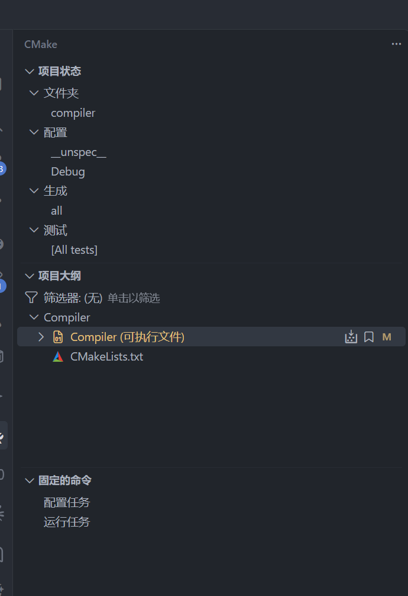
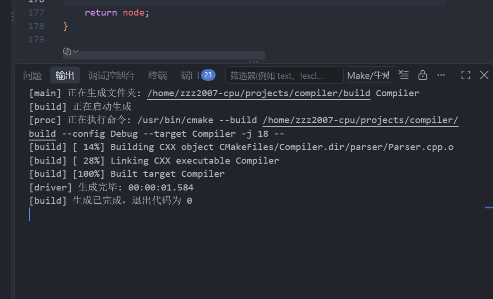

# 规划编译器下一阶段

- 会话时间：2026-10-03 14:51:49
- 会话编号：`01a10088-84f2-74f2-9adb-9e10663705b2`
- 导出范围：仅保留用户与助手可见消息，已排除系统提示、开发者指令、内部推理和工具调用。

## 1. 用户

时间：2026-10-03 14:51:57

# Context from my IDE setup:

## Active file: src/parser/Parser.cpp

## Open tabs:
- Parser.cpp: src/parser/Parser.cpp
- parser.txt: parser.txt
- testfile.txt: testfile.txt
- SyntaxNode.cpp: src/parser/SyntaxNode.cpp
- Parser.h: src/parser/Parser.h

## My request:
规划编译器下一阶段实现

---

## 2. 助手

时间：2026-10-03 14:52:02

我先查看当前语法分析器的实现、项目要求和已有测试，再按完成情况规划下一阶段。

---

## 3. 助手

时间：2026-10-03 14:52:13

当前已经有语法树和算术表达式解析，但语句只支持 `return`。下一阶段适合先补齐“声明变量、使用变量、赋值”这条链路；我再核对课程文法，确定具体顺序和验收样例。

---

## 4. 助手

时间：2026-10-03 14:52:18

我会使用 `pdf` 技能提取课程文法原文，重点核对 `printf` 和语法错误恢复要求。

---

## 5. 助手

时间：2026-10-03 14:52:43

**下一阶段建议：完成“变量声明 → 变量参与表达式 → 赋值语句”，继续补齐语法分析。**

我查看了当前代码和课程文法。现在已经具备语法树、`main`、`return`、整数与括号表达式，以及加减乘除模的解析；`AddExp`、`MulExp` 已经采用逐层构造左子树的方式。此次仅检查代码和已有输出，没有重新编译运行，也没有修改文件。

**1. 先补两个基础细节**

- [Parser.cpp:129](/home/zzz2007-cpu/projects/compiler/src/parser/Parser.cpp:129)：加减循环参考乘除循环使用 `check()`，避免输入提前结束时直接访问 `current()`。
- [SyntaxNode.cpp:4](/home/zzz2007-cpu/projects/compiler/src/parser/SyntaxNode.cpp:4)：每增加一种语法节点，同步补上名称映射，否则解析成功后，打印仍会抛出 `unknown syntax type`。`Decl`、`BType`、`BlockItem` 继续保留节点但不输出标签。

**2. 按下面的顺序实现**

| 步骤 | 要补的内容 | 验收目标 |
|---|---|---|
| ① 局部变量声明 | `Decl → VarDecl → BType、VarDef、InitVal`；让 `BlockItem` 区分声明和语句 | 能解析 `int a = 2;` |
| ② 变量读取 | 增加 `LVal`，接入 `PrimaryExp` | 能解析 `return a + 3;` |
| ③ 基本语句 | 赋值、表达式语句、空语句、嵌套块 | 能解析 `a = a + 1;`、`a + 1;`、`;` |
| ④ 完善声明和表达式 | 常量、`static`、字符、一维数组、初始化列表和字符串；单目运算、类型转换 | 能解析数组访问和 `return -a;` |
| ⑤ 函数 | 函数定义、形参、调用、实参；扩展 `CompUnit` | 能解析全局声明、普通函数和 `main` |
| ⑥ 控制语句 | 条件表达式各层、`if`、`while`、`switch`、`break`、`continue`、`printf` | 覆盖课程完整语句文法 |

这里的核心是：**声明负责描述“定义了什么”，`LVal` 负责描述“使用哪个变量或数组元素”，赋值语句把左值和右侧表达式连接起来。** 当前先把这些结构记录进树；名称是否定义、类型是否匹配，留给后续语义分析。

第三步有一个重点：`a = 1;` 和 `a + 1;` 都以标识符开头，不能看到 `IDENFR` 就认定是赋值。到数组阶段，还需要正确区分 `a[i] = 1;` 和 `a[i] + 1;`。

**3. 错误恢复随对应语法一起加入**

当前 `consume()` 遇到不匹配就抛异常。课程要求出错后继续分析，因此逐步加入：

- `i`：缺少 `;`。
- `j`：缺少 `)`。
- `k`：缺少 `]`。

恢复思路是：记录错误，将缺失符号视为已补上，保留当前实际 token，交给后续语法继续处理。报错位置通常取前一个已消费 token 的行号，具体按课程规则核对。最终将词法和语法错误统一按行号输出。

课程 PDF 的完整文法还包含 **`printf` 语句和字符串初始化**，实现时不要只参考实验 Markdown 的简化文法。

**现在先完成步骤①和②，目标样例是：**

```c
int main() {
    int a = 2;
    int b = a + 3;
    return b;
}
```

先从 [parseBlockItem()](/home/zzz2007-cpu/projects/compiler/src/parser/Parser.cpp:164) 入手：它目前无条件调用 `parseStmt()`，你的第一个小任务就是让它能根据当前 token 选择“声明”或“语句”，再逐层补齐普通 `int` 变量声明。

<oai-mem-citation>
<citation_entries>
MEMORY.md:120-122|note=[Follow staged parser guidance and hints-only learning preference]
</citation_entries>
<rollout_ids>
01a0fb8c-2fd5-7ce1-a156-9e997955778e
01a0f08c-aa3c-79f3-9985-555c780fa103
</rollout_ids>
</oai-mem-citation>

---

## 6. 用户

时间：2026-10-03 14:56:34

# Context from my IDE setup:

## Active file: src/parser/SyntaxNode.cpp

## Open tabs:
- SyntaxNode.cpp: src/parser/SyntaxNode.cpp
- Parser.cpp: src/parser/Parser.cpp
- parser.txt: parser.txt
- testfile.txt: testfile.txt
- Parser.h: src/parser/Parser.h

## My request:
整个编译器是不是非常非常的复杂

---

## 7. 助手

时间：2026-10-03 14:56:45

**完整的工业级编译器确实非常复杂，但你现在做的课程编译器，规模是可以一步步掌握的。** 看到文法里几十个名字，觉得庞大很正常；它们其实有很多重复的实现模式。

可以把整个过程理解成四次转换：

| 阶段 | 在做什么 | 例子 |
|---|---|---|
| 词法分析 | 把字符分成单词 | `a + 2` → 标识符、加号、整数 |
| 语法分析 | 判断这些单词组成什么结构 | 识别为加法表达式，构造语法树 |
| 语义分析 | 检查结构的含义是否合理 | `a` 定义了吗？类型能相加吗？ |
| 代码生成 | 把结构翻译成目标指令 | 取出 `a`，加上 `2`，保存结果 |

**你现在觉得难，主要是正在同时熟悉文法、递归和树。** 等这三个概念连起来，很多新增语法就会变成已有模式的组合：

- 文法里的先后顺序 → 按顺序调用解析函数。
- 可选部分 `[...]` → 判断一次。
- 重复部分 `{...}` → 循环处理。
- 多种选择 `A | B` → 根据 token 选择分支。

真正需要仔细思考的是少数关键问题，例如表达式优先级、相似语句如何区分、错误后怎样继续，以及后面的作用域和控制流翻译。

你已经写出了词法分析，又开始用树表示算术表达式，这就是实质性的进展。**现在不用在脑中装下整个编译器，只需要先让 `int a = 2; return a;` 这几行能被正确解析。** 每完成这样一个小程序，你掌握的编译器就扩大了一点。

---

## 8. 用户

时间：2026-10-03 14:57:25

# Context from my IDE setup:

## Active file: src/parser/SyntaxNode.cpp

## Open tabs:
- SyntaxNode.cpp: src/parser/SyntaxNode.cpp
- Parser.cpp: src/parser/Parser.cpp
- parser.txt: parser.txt
- testfile.txt: testfile.txt
- Parser.h: src/parser/Parser.h

## My request:
那么现在先实现局部变量声明

---

## 9. 助手

时间：2026-10-03 14:57:29

我先看一下你刚更新的代码，再按仓库“只给提示、由你实现”的要求，把局部变量声明拆成可以逐个完成的小步骤。

---

## 10. 助手

时间：2026-10-03 14:57:46

先实现一个小范围：**块内的普通 `int` 变量声明，支持可选初始化和逗号分隔。**

目标是解析：

```c
int main() {
    int a;
    int b = 2 + 3;
    int c = 4, d;
    return 0;
}
```

暂时用 `return 0;` 验收，因为读取变量还需要后面实现 `LVal`。

**先理解声明如何拆分。**

对于 `int a = 2, b;`：

```text
VarDecl
├── BType：int
├── VarDef：a = 2
├── 逗号
├── VarDef：b
└── 分号
```

**`VarDecl` 管整条声明，`VarDef` 管其中一个变量。** 所以类型和结尾分号由 `VarDecl` 处理，每个变量自己的名字和初值由 `VarDef` 处理。

本轮使用完整文法的这个子集：

```text
BlockItem → Decl | Stmt
Decl      → VarDecl
VarDecl   → BType VarDef { ',' VarDef } ';'
BType     → 'int'
VarDef    → Ident [ '=' InitVal ]
InitVal   → Exp
```

在 [Parser.h](/home/zzz2007-cpu/projects/compiler/src/parser/Parser.h) 中增加这五个解析函数的声明，返回类型都沿用 `SyntaxNode`：

| 函数 | 实现提示 |
|---|---|
| `parseBType()` | 创建 `BType` 节点，消费 `int` 并保存为子节点 |
| `parseInitVal()` | 创建 `InitVal` 节点，把已有 `parseExp()` 的结果接进去 |
| `parseVarDef()` | 先消费标识符；遇到 `=` 时，再消费它并解析初值 |
| `parseVarDecl()` | 先解析类型和第一个变量；用循环处理逗号及后续变量；最后消费分号 |
| `parseDecl()` | 创建 `Decl` 节点，本轮先只接入 `parseVarDecl()` |

然后修改 [Parser.cpp](/home/zzz2007-cpu/projects/compiler/src/parser/Parser.cpp) 中的 `parseBlockItem()`：

- 当前是 `INTTK`，走声明分支。
- 否则走现有语句分支。
- 判断只用 `check()`，让具体解析函数负责消费 token。

最后，在 [SyntaxNode.cpp](/home/zzz2007-cpu/projects/compiler/src/parser/SyntaxNode.cpp) 中补上 `VarDecl`、`VarDef`、`InitVal` 的名称映射。`Decl` 和 `BType` 已经被打印函数跳过，不需要输出标签。

**动手顺序：先写 `parseBType()` 和 `parseInitVal()`，再写 `parseVarDef()`。** 这三个函数分别对应“类型”“初值”“一个变量”，完成后再组合成整条声明。

<oai-mem-citation>
<citation_entries>
MEMORY.md:122-122|note=[Use small implementation steps and hints under repository learning rule]
</citation_entries>
<rollout_ids>
01a0fb8c-2fd5-7ce1-a156-9e997955778e
</rollout_ids>
</oai-mem-citation>

---

## 11. 用户

时间：2026-10-03 15:52:24

# Context from my IDE setup:

## Active file: src/parser/Parser.h

## Open tabs:
- Parser.h: src/parser/Parser.h
- SyntaxNode.h: src/parser/SyntaxNode.h
- SyntaxNode.cpp: src/parser/SyntaxNode.cpp
- Parser.cpp: src/parser/Parser.cpp
- parser.txt: parser.txt

## My request:
还是有点不明白逻辑，一个声明到底如何分，会分成几个语法节点

---

## 12. 助手

时间：2026-10-03 15:52:47

**一个声明不是固定分成几个节点，而是按文法逐层拆开。每个节点只负责其中一层结构。**

拿这条声明来说：

```c
int a = 2, b;
```

你可以先把它理解成：

```text
整条声明
├── 共同的类型：int
├── 第一个变量：a = 2
├── 分隔符：,
├── 第二个变量：b
└── 结束符：;
```

换成我们代码里的语法节点，就是：

```text
Decl                         声明的统一入口
└── VarDecl                  一整条变量声明
    ├── BType                类型
    │   └── Token：int
    ├── VarDef               第一个变量的定义
    │   ├── Token：a
    │   ├── Token：=
    │   └── InitVal          初始值
    │       └── Exp          表达式，内容是 2
    │           └── ……       已有的表达式解析层
    ├── Token：,
    ├── VarDef               第二个变量的定义
    │   └── Token：b
    └── Token：;
```

这里最关键的是区分三个概念：

| 节点 | 管什么 | 这个例子对应的内容 |
|---|---|---|
| `VarDecl` | 整条变量声明 | `int a = 2, b;` |
| `VarDef` | 一个变量的定义 | `a = 2` 或 `b` |
| `InitVal` | 一个变量的初值 | `2` |

所以，**一条 `VarDecl` 可以包含多个 `VarDef`，而每个 `VarDef` 可以有或没有 `InitVal`。**

为什么外面还包一层 `Decl`？因为声明以后有两种：

```text
Decl
├── 选择 ConstDecl：常量声明，如 const int a = 2;
└── 或选 VarDecl：变量声明，如 int a = 2;
```

这里表示二选一，一棵具体的 `Decl` 节点下面只放选中的那一种。

解析函数就沿着这棵树分工。对 `int a = 2, b;`，执行过程是：

1. `parseVarDecl()` 调用 `parseBType()`，它吃掉 `int`，返回类型节点。
2. 调用 `parseVarDef()`，它吃掉 `a`，发现有 `=`，继续调用初值解析，最后返回表示 `a = 2` 的节点。
3. 回到 `parseVarDecl()`，此时当前位置是逗号。它吃掉逗号，再调用一次 `parseVarDef()`。
4. 这次吃掉 `b`，后面没有 `=`，直接返回表示 `b` 的节点。
5. 回到 `parseVarDecl()`，吃掉分号，整条声明完成。

**每个函数返回时，既交回一个子树，也已经把 `pos` 推进到了自己负责内容的后面。** 父函数接着从这个位置继续解析。

你现在可以先只考虑最简单的 `int a;`：它需要 `Decl → VarDecl`，而 `VarDecl` 下面放 **`BType`、`VarDef`、分号 token**；此时完全没有 `InitVal` 节点。

---

## 13. 用户

时间：2026-10-03 15:59:13

# Context from my IDE setup:

## Active file: src/parser/Parser.cpp

## Active selection of the file:
SyntaxNode Parser::parseVarDecl()
{
    SyntaxNode node(SyntaxType::VarDecl);
    node.children.emplace_back(consume(TokenType::INTTK)); 
}

SyntaxNode Parser::parseBtype()
{
    return consume(TokenType::INTTK);

}
## Open tabs:
- Parser.cpp: src/parser/Parser.cpp
- Parser.h: src/parser/Parser.h
- SyntaxNode.h: src/parser/SyntaxNode.h
- SyntaxNode.cpp: src/parser/SyntaxNode.cpp
- parser.txt: parser.txt

## My request:
SyntaxNode Parser::parseVarDecl()
{
    SyntaxNode node(SyntaxType::VarDecl);
    node.children.emplace\_back(consume(TokenType::INTTK));&#x20;
}

SyntaxNode Parser::parseBtype()
{
    return consume(TokenType::INTTK);

}
这个该怎么写

---

## 14. 助手

时间：2026-10-03 15:59:21

你这里需要调整两点：

1. `int` 应由 `parseBtype()` 消费，`parseVarDecl()` 接收它返回的 **`BType` 节点**。
2. `consume()` 返回的是 `Token`，而 `parseBtype()` 应返回 `SyntaxNode`。你定义的构造函数是 `explicit`，这里不能隐式转换；而且直接返回 token 也少了 `BType` 这一层。

先集中写 `parseBtype()`，按照你已经熟悉的三个步骤：

```text
创建一个类型为 SyntaxType::BType 的节点
把 consume(TokenType::INTTK) 得到的 token 放进它的 children
返回这个节点
```

这样返回的结构就是：

```text
BType
└── int
```

然后，`parseVarDecl()` 里目前这一行：

```cpp
node.children.emplace_back(consume(TokenType::INTTK));
```

应改成调用你写好的函数：

```cpp
node.children.emplace_back(parseBtype());
```

之后依次补上：

```text
解析第一个 VarDef，加入 children
只要遇到逗号：
    消费逗号，加入 children
    再解析一个 VarDef，加入 children
消费分号，加入 children
返回 node
```

**同一个 `int` 只消费一次：父函数负责组织子节点，子函数负责吃掉自己对应的 token。**

另外，`parseBtype` 和 `parseBType` 是不同的名字，记得让 `Parser.h` 中的声明与这里保持一致。

---

## 15. 用户

时间：2026-10-03 16:04:26

# Context from my IDE setup:

## Active file: src/parser/Parser.cpp

## Active selection of the file:
SyntaxNode Parser::parseVarDecl()
{
    SyntaxNode node(SyntaxType::VarDecl);
    node.children.emplace_back(parseBtype());
    node.children.emplace_back(parseVarDef());
    while (!check(TokenType::SEMICN))
    {
        if (check(TokenType::COMMA))
        {
            node.children.emplace_back(consume(TokenType::COMMA));
            node.children.emplace_back(parseVarDef());
        }
    }
    node.children.emplace_back(consume(TokenType::SEMICN));
    return node;
}
## Open tabs:
- Parser.cpp: src/parser/Parser.cpp
- Token.h: src/common/Token.h
- Parser.h: src/parser/Parser.h
- SyntaxNode.h: src/parser/SyntaxNode.h
- SyntaxNode.cpp: src/parser/SyntaxNode.cpp

## My request:
SyntaxNode Parser::parseVarDecl()
{
    SyntaxNode node(SyntaxType::VarDecl);
    node.children.emplace\_back(parseBtype());
    node.children.emplace\_back(parseVarDef());
    while (!check(TokenType::SEMICN))
    {
        if (check(TokenType::COMMA))
        {
            node.children.emplace\_back(consume(TokenType::COMMA));
            node.children.emplace\_back(parseVarDef());
        }
    }
    node.children.emplace\_back(consume(TokenType::SEMICN));
    return node;
}
这是个递归，应该这样写吗，我怎么总感觉循环逻辑更清晰，但是如果循环应该写到上一层函数

---

## 16. 助手

时间：2026-10-03 16:04:38

**这里就应该用循环，而且循环放在 `parseVarDecl()` 这一层是对的。** 你这段代码本身没有直接递归：调用其他解析函数不等于递归，递归是直接或间接调用回自己。

对应文法：

```text
VarDecl → BType VarDef { ',' VarDef } ';'
```

其中 `{ ',' VarDef }` 表示“逗号加一个变量定义”重复零次或多次，正好对应循环。

不过，你当前的循环存在**卡死风险**：

```cpp
while (!check(TokenType::SEMICN))
```

如果当前 token 既不是分号，也不是逗号，比如漏写分号后遇到 `return`，循环体什么都不做，`pos` 不变，就会一直循环。

应该让循环条件直接对应文法里的重复部分：

```cpp
while (check(TokenType::COMMA))
{
    node.children.emplace_back(consume(TokenType::COMMA));
    node.children.emplace_back(parseVarDef());
}
```

离开循环后，再由已有的 `consume(SEMICN)` 检查分号。

**为什么不把循环放到上一层？因为两层处理的是不同的重复：**

```c
int a, b, c;
int d;
```

- `parseVarDecl()` 内的循环：处理同一条声明中的 `, b`、`, c`。
- `parseBlock()` 内的循环：处理块中的两条声明，以及其他语句。

递归下降并不意味着所有地方都用递归。**顺序结构按顺序调用，可选结构用判断，重复结构用循环，嵌套结构通过递归处理。**

---

## 17. 用户

时间：2026-10-03 16:06:31

# Context from my IDE setup:

## Active file: src/parser/Parser.cpp

## Open tabs:
- Parser.cpp: src/parser/Parser.cpp
- Parser.h: src/parser/Parser.h
- Token.h: src/common/Token.h
- SyntaxNode.h: src/parser/SyntaxNode.h
- SyntaxNode.cpp: src/parser/SyntaxNode.cpp

## My request:
变量名应该谁吸收？

---

## 18. 助手

时间：2026-10-03 16:06:37

**变量名由 `parseVarDef()` 消费。** 因为它负责“一个变量的定义”。

例如：

```c
int a = 2, b;
```

各部分的归属：

| 内容 | 谁消费 |
|---|---|
| `int` | `parseBtype()` |
| `a` | 第一次调用 `parseVarDef()` |
| `=` | 同一次 `parseVarDef()` |
| `2` | 经 `parseInitVal()` 调用表达式解析，最终由 `parseNumber()` 消费 |
| `,` | `parseVarDecl()` |
| `b` | 第二次调用 `parseVarDef()` |
| `;` | `parseVarDecl()` |

所以 `parseVarDef()` 创建节点之后，第一步就是：

```cpp
node.children.emplace_back(consume(TokenType::IDENFR));
```

`IDENFR` 是标识符的 token 类型，具体名字（例如 `a`、`b`）已经保存在 token 中。

接着判断有没有 `=`：有就消费它并解析初值，没有就直接返回这个 `VarDef` 节点。

---

## 19. 用户

时间：2026-10-03 16:07:26

# Context from my IDE setup:

## Active file: src/parser/Parser.cpp

## Open tabs:
- Parser.cpp: src/parser/Parser.cpp
- Parser.h: src/parser/Parser.h
- Token.h: src/common/Token.h
- SyntaxNode.h: src/parser/SyntaxNode.h
- SyntaxNode.cpp: src/parser/SyntaxNode.cpp

## My request:
为什么不能直接用Exp，然后在让Exp支持变量名？

---

## 20. 用户

时间：2026-10-03 16:08:24

# Context from my IDE setup:

## Active file: src/parser/Parser.cpp

## Open tabs:
- Parser.cpp: src/parser/Parser.cpp
- Parser.h: src/parser/Parser.h
- Token.h: src/common/Token.h
- SyntaxNode.h: src/parser/SyntaxNode.h
- SyntaxNode.cpp: src/parser/SyntaxNode.cpp

## My request:
为什么不能直接用Exp，然后在让Exp支持变量名？

---

## 21. 助手

时间：2026-10-03 16:08:49

**`Exp` 确实需要支持变量名，但“声明变量的位置”和“表达式中使用变量的位置”有不同的语法要求。**

看这个例子：

```c
int a = b + 2;
```

- 左边 `a`：正在定义的变量，文法要求这里必须是**一个标识符**。
- 右边 `b + 2`：初值表达式，可以是变量、数字或运算组合。

所以结构是：

```text
VarDef
├── Ident：a
├── =
└── InitVal
    └── Exp：b + 2
```

如果把左边也交给 `parseExp()`，它就可能接受：

```c
int a + b = 2;
```

因为 `a + b` 是合法表达式，但它不能作为声明中的变量名。**这里直接消费 `IDENFR`，就是在限制“这个位置只能放一个名字”。**

以后让 `Exp` 支持变量名，是通过这条调用链：

```text
Exp → AddExp → MulExp → UnaryExp → PrimaryExp → LVal → Ident
```

这样 `return a + 2;`、`int b = a;` 就能解析。

你可以记住：**同样是变量名，定义它时归 `VarDef`，在表达式中使用它时归 `LVal`。**

---

## 22. 用户

时间：2026-10-03 16:10:08

# Context from my IDE setup:

## Active file: src/parser/Parser.cpp

## Active selection of the file:
SyntaxNode Parser::parseVarDef()
{
    SyntaxNode node(SyntaxType::VarDef);
    node.children.emplace_back(consume(TokenType::IDENFR));
    node.children.emplace_back(consume(TokenType::ASSIGN));
    node.children.emplace_back(parseExp());
}
## Open tabs:
- Parser.cpp: src/parser/Parser.cpp
- Parser.h: src/parser/Parser.h
- Token.h: src/common/Token.h
- SyntaxNode.h: src/parser/SyntaxNode.h
- SyntaxNode.cpp: src/parser/SyntaxNode.cpp

## My request:
SyntaxNode Parser::parseVarDef()
{
    SyntaxNode node(SyntaxType::VarDef);
    node.children.emplace\_back(consume(TokenType::IDENFR));
    node.children.emplace\_back(consume(TokenType::ASSIGN));
    node.children.emplace\_back(parseExp());
}这个逻辑对吗

---

## 23. 助手

时间：2026-10-03 16:10:16

**开头消费变量名是对的，后面需要调整三点：**

1. **初始化是可选的。** `int a;` 也合法，所以只有 `check(TokenType::ASSIGN)` 成立时，才消费 `=` 并解析初值。
2. **初值应经过 `parseInitVal()`。** 当前它内部调用 `parseExp()`，但语法树需要保留 `InitVal` 这一层，以后还会支持初始化列表和字符串。
3. **末尾缺少 `return node;`。**

当前先处理普通变量，逻辑应是：

```text
创建 VarDef 节点
消费变量名，加入子节点
如果当前是 '='：
    消费 '='，加入子节点
    调用 parseInitVal()，加入子节点
返回 VarDef 节点
```

例如解析 `a = 2`，得到：

```text
VarDef
├── IDENFR：a
├── ASSIGN：=
└── InitVal
    └── Exp
        └── ……
```

**逗号和分号仍由外面的 `parseVarDecl()` 消费**，这个函数只负责一个变量。

---

## 24. 用户

时间：2026-10-03 16:10:30

# Context from my IDE setup:

## Active file: src/parser/Parser.cpp

## Active selection of the file:
SyntaxNode Parser::parseVarDef()
{
    SyntaxNode node(SyntaxType::VarDef);
    node.children.emplace_back(consume(TokenType::IDENFR));
    node.children.emplace_back(consume(TokenType::ASSIGN));
    node.children.emplace_back(parseExp());
}
## Open tabs:
- Parser.cpp: src/parser/Parser.cpp
- Parser.h: src/parser/Parser.h
- Token.h: src/common/Token.h
- SyntaxNode.h: src/parser/SyntaxNode.h
- SyntaxNode.cpp: src/parser/SyntaxNode.cpp

## My request:
initval到底是啥

---

## 25. 助手

时间：2026-10-03 16:10:41

**`InitVal` 是 Initial Value 的缩写，意思是“初始值”，就是声明变量时 `=` 后面的内容。**

```c
int a = 2;          // 初值是 2
int b = 2 + 3;      // 初值是 2 + 3
int c;              // 没有初值，不创建 InitVal 节点
```

你可能会疑惑：**初值已经是表达式了，为什么还要包一层？**

因为课程文法中，初值有三种形式：

```text
InitVal → Exp
        | '{' [ Exp { ',' Exp } ] '}'
        | StringConst
```

分别对应：

```c
int a = 2 + 3;          // 表达式
int arr[3] = {1, 2, 3}; // 初始化列表
char s[4] = "abc";      // 字符串
```

`Exp` 只是其中一种，所以用 `InitVal` 统一表示“这里是初值”，再在下面记录具体形式。

**你现在只实现第一种就够了。** `parseInitVal()` 暂时只做三件事：

1. 创建 `SyntaxType::InitVal` 节点。
2. 调用 `parseExp()`，把返回的表达式节点加入 `children`。
3. 返回这个 `InitVal` 节点。

它现在是一层简单包装；等支持数组初始化时，再往里面添加其他分支。

---

## 26. 用户

时间：2026-10-03 16:11:34

# Context from my IDE setup:

## Active file: src/parser/Parser.cpp

## Open tabs:
- Parser.cpp: src/parser/Parser.cpp
- Parser.h: src/parser/Parser.h
- Token.h: src/common/Token.h
- SyntaxNode.h: src/parser/SyntaxNode.h
- SyntaxNode.cpp: src/parser/SyntaxNode.cpp

## My request:
当前的可以了吗

---

## 27. 助手

时间：2026-10-03 16:11:37

我看一下你当前保存的实现，检查声明解析是否接通、还有没有遗漏。

---

## 28. 助手

时间：2026-10-03 16:11:55

**还差几处。`parseInitVal()` 已经写对了，但当前代码还不能通过编译。** 我做了编译语法检查，没有修改文件。

按这个顺序补：

1. **[Parser.h:37](/home/zzz2007-cpu/projects/compiler/src/parser/Parser.h:37) 少了分号。**

   应为 `SyntaxNode parseInitVal();`。

2. **三个函数缺少 `return node;`：**  
   `parseDecl()`、`parseBtype()`、`parseVarDef()`。编译器已经给出了对应警告。

3. **`parseVarDef()` 仍然强制要求初始化。**  
   消费变量名之后，先判断是不是 `ASSIGN`，只有是的时候才消费 `=` 并调用 `parseInitVal()`，否则 `int a;` 会失败。

4. **`parseVarDecl()` 的循环还没改。**  
   用 `while (check(TokenType::COMMA))`，直接在循环内消费逗号并解析下一个变量。当前写法遇到既非逗号也非分号的 token 会卡住。

5. **`parseBlockItem()` 还没有接入声明。**  
   它现在仍然无条件调用 `parseStmt()`。本轮先让它遇到 `INTTK` 时调用 `parseDecl()`，其他情况调用 `parseStmt()`。

6. **[SyntaxNode.cpp](/home/zzz2007-cpu/projects/compiler/src/parser/SyntaxNode.cpp) 补齐名称映射。**  
   增加 `VarDecl`、`VarDef`、`InitVal`，否则打印新节点时会抛异常。

改完后用这个样例检查，能同时覆盖无初值、有初值和多个变量：

```c
int main() {
    int a;
    int b = 2 + 3, c;
    return 0;
}
```

你当前 `testfile.txt` 只有算术表达式，还不能验证声明解析。

<oai-mem-citation>
<citation_entries>
MEMORY.md:122-122|note=[Keep review as implementation hints under repository learning rule]
</citation_entries>
<rollout_ids>
01a0fb8c-2fd5-7ce1-a156-9e997955778e
</rollout_ids>
</oai-mem-citation>

---

## 29. 用户

时间：2026-10-03 16:14:37

# Context from my IDE setup:

## Active file: src/parser/SyntaxNode.cpp

## Open tabs:
- SyntaxNode.cpp: src/parser/SyntaxNode.cpp
- Parser.cpp: src/parser/Parser.cpp
- Parser.h: src/parser/Parser.h
- Token.h: src/common/Token.h
- SyntaxNode.h: src/parser/SyntaxNode.h

## My request:
接下来还需要补齐哪些命名映射

---

## 30. 助手

时间：2026-10-03 16:14:39

我看一下当前的名称映射和语法节点枚举，确认还缺哪些。

---

## 31. 助手

时间：2026-10-03 16:14:47

按当前实现，[SyntaxNode.cpp](/home/zzz2007-cpu/projects/compiler/src/parser/SyntaxNode.cpp) 的 `SyntaxTypeToString()` **还需要补这三个映射**：

| 枚举 | 返回字符串 |
|---|---|
| `SyntaxType::VarDecl` | `"VarDecl"` |
| `SyntaxType::VarDef` | `"VarDef"` |
| `SyntaxType::InitVal` | `"InitVal"` |

照已有的 `case` 写法，在 `default` 前添加即可。**字符串不用带 `< >`**，打印函数会添加。

`Decl`、`BType`、`BlockItem` 已在打印函数中被跳过，当前不需要补映射。

以后实现新语法时，再同步添加对应名称，例如变量读取的 `LVal`、单目运算的 `UnaryOp`。

---

## 32. 用户

时间：2026-10-03 16:16:23

# Context from my IDE setup:

## Active file: testfile.txt

## Open tabs:
- testfile.txt: testfile.txt
- CMakeLists.txt: src/CMakeLists.txt
- SyntaxNode.cpp: src/parser/SyntaxNode.cpp
- Parser.cpp: src/parser/Parser.cpp
- Parser.h: src/parser/Parser.h

## My request:
这个插件能用吗



---

## 33. 助手

时间：2026-10-03 16:16:29

**能用，这是 VS Code 的 CMake Tools 面板，适合你现在的项目。** 截图里已经识别出了 `Compiler` 可执行目标和 `CMakeLists.txt`，但这不代表代码已经编译成功。

你可以这样操作：

1. 保存代码。
2. 按 `Ctrl+Shift+P`，执行 **`CMake: Build`** 编译。
3. 查看下方输出，确认是否成功；失败时看具体报错。

运行时要注意：你的程序通过相对路径读取 `testfile.txt`，**工作目录需要是项目根目录 `compiler`**。编译成功后，可以先在根目录的终端运行：

```bash
./build/Compiler
```

随后查看 `parser.txt`。插件主要帮你管理配置、编译和调试，不会自动判断语法分析结果是否正确。

---

## 34. 用户

时间：2026-10-03 16:16:40

# Context from my IDE setup:

## Active file: testfile.txt

## Open tabs:
- testfile.txt: testfile.txt
- CMakeLists.txt: src/CMakeLists.txt
- SyntaxNode.cpp: src/parser/SyntaxNode.cpp
- Parser.cpp: src/parser/Parser.cpp
- Parser.h: src/parser/Parser.h

## My request:
哪一个是运行main

---

## 35. 助手

时间：2026-10-03 16:16:45

**运行 `Compiler` 就是运行你的 `main()`**，不需要单独选择 `main.cpp`。

按 `Ctrl+Shift+P`，搜索并执行：

```text
CMake: Run Without Debugging
```

如果提示选择目标，就选 **Compiler**。

也可以在项目根目录的终端输入：

```bash
./build/Compiler
```

终端命令运行的是上次编译的程序，修改代码后记得先编译。

---

## 36. 用户

时间：2026-10-03 16:17:38

# Context from my IDE setup:

## Active file: testfile.txt

## Open tabs:
- testfile.txt: testfile.txt
- CMakeLists.txt: src/CMakeLists.txt
- SyntaxNode.cpp: src/parser/SyntaxNode.cpp
- Parser.cpp: src/parser/Parser.cpp
- Parser.h: src/parser/Parser.h

## My request:
(base) zzz2007-cpu\@zzz:\~/projects/compiler/build$ /home/zzz2007-cpu/projects/compiler/build/Compiler
无法打开源文件
(base) zzz2007-cpu\@zzz:\~/projects/compiler/build$

---

## 37. 助手

时间：2026-10-03 16:17:42

你现在位于 `build` 目录，程序会在这里找 `testfile.txt`，但文件实际在项目根目录。

切回根目录运行即可：

```bash
cd /home/zzz2007-cpu/projects/compiler && ./build/Compiler
```

**相对路径以终端当前工作目录为准，不以可执行文件的位置为准。**

---

## 38. 用户

时间：2026-10-03 16:17:53

# Context from my IDE setup:

## Active file: testfile.txt

## Open tabs:
- testfile.txt: testfile.txt
- CMakeLists.txt: src/CMakeLists.txt
- SyntaxNode.cpp: src/parser/SyntaxNode.cpp
- Parser.cpp: src/parser/Parser.cpp
- Parser.h: src/parser/Parser.h

## My request:
(base) zzz2007-cpu\@zzz:\~/projects/compiler/build$ cd /home/zzz2007-cpu/projects/compiler && ./build/Compiler
terminate called after throwing an instance of 'std::runtime\_error'
&#x20; what():  unexpected token
Aborted (core dumped)
(base) zzz2007-cpu\@zzz:\~/projects/compiler$

---

## 39. 助手

时间：2026-10-03 16:17:59

程序已经找到输入文件了，现在是解析时遇到了不符合预期的 token。我先对照当前测试文件和解析代码定位。

---

## 40. 助手

时间：2026-10-03 16:18:07

**原因找到了：`parseBlockItem()` 还没有把声明分流到 `parseDecl()`。**

在 [Parser.cpp:168](/home/zzz2007-cpu/projects/compiler/src/parser/Parser.cpp:168)，你现在无条件调用：

```cpp
node.children.emplace_back(parseStmt());
```

而测试文件块内第一行是：

```c
int a;
```

所以实际过程是：

```text
当前 token 是 int
→ parseBlockItem() 调用 parseStmt()
→ parseStmt() 要求消费 return
→ int 与 return 不匹配
→ 抛出 unexpected token
```

你新写的声明解析函数还没被调用到。

把 `parseBlockItem()` 中的分支逻辑补上：

- 当前是 `INTTK` → 调用 `parseDecl()`，把结果加入子节点。
- 否则 → 调用 `parseStmt()`，把结果加入子节点。

**这里只判断，不消费 `int`**，它会由后面的 `parseBtype()` 消费。

保存后，在根目录重新编译并运行：

```bash
cmake --build build && ./build/Compiler
```

<oai-mem-citation>
<citation_entries>
MEMORY.md:112-112|note=[Inspect saved source and identify concrete failure first]
</citation_entries>
<rollout_ids>
</rollout_ids>
</oai-mem-citation>

---

## 41. 用户

时间：2026-10-03 16:19:52

# Context from my IDE setup:

## Active file: extension-output-ms-vscode.cmake-tools-#1-CMake/生成

## Open tabs:
- Parser.cpp: src/parser/Parser.cpp
- testfile.txt: testfile.txt
- CMakeLists.txt: src/CMakeLists.txt
- SyntaxNode.cpp: src/parser/SyntaxNode.cpp
- Parser.h: src/parser/Parser.h

## My request:
这样算是运行完成了吗



---

## 42. 助手

时间：2026-10-03 16:19:57

**截图说明编译成功了，还没有运行程序。**

`Built target Compiler` 和“退出代码为 0”表示已经生成可执行文件。

接下来在终端运行：

```bash
cd /home/zzz2007-cpu/projects/compiler && ./build/Compiler
```

如果没有报错、终端重新出现命令提示符，就表示程序执行结束。你的结果写在 **`parser.txt`** 中，正常运行时终端可以没有输出；还需要检查文件内容是否正确。

---

## 43. 用户

时间：2026-10-03 16:21:13

# Context from my IDE setup:

## Active file: parser.txt

## Open tabs:
- parser.txt: parser.txt
- lexer.txt: lexer.txt
- Parser.cpp: src/parser/Parser.cpp
- testfile.txt: testfile.txt
- CMakeLists.txt: src/CMakeLists.txt

## My request:
好了，现在应该完成了，下一步我们实现什么

---

## 44. 助手

时间：2026-10-03 16:21:16

我先核对测试输入和语法输出，再确定下一步最合适补哪一块。

---

## 45. 助手

时间：2026-10-03 16:21:28

**当前这个样例的声明输出是正确的：无初值、有初值、逗号分隔多个变量都已经体现出来了。下一步实现“在表达式中使用变量”，也就是 `LVal`。**

目标样例：

```c
int main() {
    int a = 2;
    int b = a + 3;
    return b;
}
```

现在你的 `parsePrimaryExp()` 只区分“括号”和“数字”，遇到 `a` 会进入 `parseNumber()`，因此需要增加标识符分支。

调用关系变成：

```text
PrimaryExp
├── '(' Exp ')'
├── LVal          ← 本轮新增
└── Number
```

这次只做三个小改动：

1. **在 `Parser.h` 声明 `parseLVal()`。**  
   本轮先处理普通变量：创建 `LVal` 节点，消费一个 `IDENFR` 作为子节点，然后返回。数组下标以后再补。

2. **在 `parsePrimaryExp()` 增加判断。**  
   当前 token 是 `IDENFR` 时，调用 `parseLVal()`，把结果加入 `PrimaryExp` 的子节点。

3. **在 `SyntaxNode.cpp` 添加 `LVal` 名称映射。**

完成后，表达式里的 `a` 应输出为：

```text
IDENFR a
<LVal>
<PrimaryExp>
<UnaryExp>
<MulExp>
<AddExp>
<Exp>
```

**这里先负责识别“这是变量的使用”，不需要查询它的值。** 变量是否声明、类型是否正确，是后续语义分析的工作。

<oai-mem-citation>
<citation_entries>
MEMORY.md:122-122|note=[Continue with one small parser implementation step and hints]
</citation_entries>
<rollout_ids>
01a0fb8c-2fd5-7ce1-a156-9e997955778e
</rollout_ids>
</oai-mem-citation>

---

## 46. 用户

时间：2026-10-03 16:24:43

# Context from my IDE setup:

## Active file: parser.txt

## Open tabs:
- parser.txt: parser.txt
- lexer.txt: lexer.txt
- testfile.txt: testfile.txt
- Parser.cpp: src/parser/Parser.cpp
- Parser.h: src/parser/Parser.h

## My request:
好了，现在完成了，下一步做什么

---

## 47. 助手

时间：2026-10-03 16:24:46

我先核对你新增的 `LVal` 和当前输出，再接着安排下一步。

---

## 48. 助手

时间：2026-10-03 16:25:01

**当前 `LVal` 已经接通，保存的输出也正确体现了 `a + 3` 和 `return b`。下一步实现赋值语句。**

目标样例：

```c
int main() {
    int a = 2;
    a = a + 3;
    return a;
}
```

注意这两种结构的区别：

```text
int a = 2;     → VarDecl：声明变量，带初值
a = a + 3;     → Stmt：给已有变量赋值
```

赋值语句的文法是：

```text
Stmt → LVal '=' Exp ';'
```

所以它的树应是：

```text
Stmt
├── LVal：a
├── Token：=
├── Exp：a + 3
└── Token：;
```

**这次主要修改 `parseStmt()`。** 它现在一进入就消费 `return`，需要改成根据当前 token 选择分支：

- 遇到 `RETURNTK`：执行原有的返回语句逻辑。
- 遇到普通变量赋值的开头：依次解析 `LVal`、消费 `=`、解析 `Exp`、消费 `;`。
- 其他暂未支持的情况：明确报错，避免不消费 token 就返回。

本轮只支持普通变量赋值，可以用 **当前是 `IDENFR`，且下一个 token 是 `ASSIGN`** 来识别，向前看之前注意边界。以后加入数组赋值时再扩展判断。

这里直接复用 `parseLVal()` 和 `parseExp()`，**不经过 `VarDef` 或 `InitVal`**。也不需要新增语法类型或名称映射，外层仍然是已有的 `Stmt`。

<oai-mem-citation>
<citation_entries>
MEMORY.md:122-122|note=[Continue staged parser implementation with hints]
</citation_entries>
<rollout_ids>
01a0fb8c-2fd5-7ce1-a156-9e997955778e
</rollout_ids>
</oai-mem-citation>

---

## 49. 用户

时间：2026-10-03 16:27:36

# Context from my IDE setup:

## Active file: src/parser/Parser.cpp

## Open tabs:
- Parser.cpp: src/parser/Parser.cpp
- Parser.h: src/parser/Parser.h
- SyntaxNode.h: src/parser/SyntaxNode.h
- parser.txt: parser.txt
- lexer.txt: lexer.txt

## My request:
stmt为什么要包含return

---

## 50. 助手

时间：2026-10-03 16:27:45

**因为 `Stmt` 是 Statement 的缩写，意思是“语句”，`return` 就是一种语句。** `Stmt` 不是专门表示赋值的。

比如函数体中：

```c
int a = 2;     // 声明 → Decl
a = 3;         // 赋值语句 → Stmt
return a;      // 返回语句 → Stmt
```

因此，`parseStmt()` 的职责是：**判断当前是哪一种语句，再解析对应结构。**

```text
Stmt 可以选择：
├── 赋值语句：LVal '=' Exp ';'
├── 返回语句：'return' [Exp] ';'
├── 条件语句：if ...
├── 循环语句：while ...
└── 其他语句……
```

这是**多种形式选一种**，不是每个 `Stmt` 都必须包含 `return`。

你之前只实现了返回语句，所以 `parseStmt()` 一上来就消费 `return`。现在支持赋值后，就需要分支判断：

```text
遇到 return → 按返回语句解析
遇到赋值开头 → 按赋值语句解析
```

两种情况最终都返回一个 `Stmt` 节点，只是里面的子节点不同。

---

## 51. 用户

时间：2026-10-03 16:29:35

# Context from my IDE setup:

## Active file: src/parser/Parser.cpp

## Open tabs:
- Parser.cpp: src/parser/Parser.cpp
- Parser.h: src/parser/Parser.h
- SyntaxNode.h: src/parser/SyntaxNode.h
- testfile.txt: testfile.txt
- parser.txt: parser.txt

## My request:
为什么报错了

---

## 52. 助手

时间：2026-10-03 16:29:37

我先检查当前保存的代码，并用编译检查定位具体报错。

---

## 53. 助手

时间：2026-10-03 16:30:01

**当前保存的代码和测试文件能正常运行，我没有复现报错。** 我在临时目录重新编译并运行，退出码为 `0`，赋值语句 `a = a + 3;` 的输出也正常，未修改你的文件。

你可能运行了旧的可执行文件。先保存全部文件，再执行：

```bash
cd /home/zzz2007-cpu/projects/compiler && cmake --build build && ./build/Compiler
```

另外，[Parser.cpp:169](/home/zzz2007-cpu/projects/compiler/src/parser/Parser.cpp:169) 的“不是分号就解析表达式”应移到 **`return` 分支内部**。它表示 `return` 后的可选表达式；赋值分支已经解析过右侧表达式了。这不是当前样例报错的原因，但需要整理清楚。

如果重新编译后仍报错，把**最新完整报错**贴出来，才能区分是编译错误、运行异常，还是编辑器标红。

<oai-mem-citation>
<citation_entries>
MEMORY.md:112-112|note=[Inspect saved source and verify the concrete error before diagnosis]
</citation_entries>
<rollout_ids>
</rollout_ids>
</oai-mem-citation>

---

## 54. 用户

时间：2026-10-03 16:30:34

# Context from my IDE setup:

## Active file: parser.txt

## Open tabs:
- parser.txt: parser.txt
- testfile.txt: testfile.txt
- Parser.cpp: src/parser/Parser.cpp
- lexer.txt: lexer.txt
- Parser.h: src/parser/Parser.h

## My request:
好了，接下来实现什么

---

## 55. 助手

时间：2026-10-03 16:30:43

**下一步补齐“表达式语句”和“空语句”。** 这样 `parseStmt()` 就能处理下面几种基本情况：

```c
a = 3;      // 赋值语句，已实现
return a;   // 返回语句，已实现
a + 2;      // 表达式语句，本轮新增
;           // 空语句，本轮新增
```

后两种对应同一条文法：

```text
Stmt → [Exp] ';'
```

含义是：表达式可有可无，但分号必须有。

**这次最关键的是区分：以变量名开头，不一定就是赋值。**

```c
a = 3;      // a 后面是 =，走赋值分支
a + 2;      // a 后面是 +，走表达式分支
a;          // a 后面是 ;，也是表达式语句
```

先只考虑普通变量，`parseStmt()` 可以按这个顺序判断：

1. 当前是 `return`：处理返回语句及其可选表达式。
2. 当前是标识符，且下一个 token 是 `=`：处理赋值语句。
3. 当前是 `;`：直接消费，得到空语句。
4. 其余情况：调用 `parseExp()`，然后消费分号。

向前看下一个 token 时注意边界。以后支持数组赋值，再扩展第二项的判断。

验收样例：

```c
int main() {
    int a = 2;
    a = a + 3;
    a + 1;
    a;
    ;
    return a;
}
```

**不需要新增节点类型或名称映射。** 表达式语句的 `Stmt` 下放 `Exp` 和分号；空语句的 `Stmt` 下只有分号。

---

## 56. 用户

时间：2026-10-03 16:31:04

# Context from my IDE setup:

## Active file: parser.txt

## Open tabs:
- parser.txt: parser.txt
- testfile.txt: testfile.txt
- Parser.cpp: src/parser/Parser.cpp
- lexer.txt: lexer.txt
- Parser.h: src/parser/Parser.h

## My request:
```css
a + 2;      // a 后面是 +，走表达式分支
a;    
那这种东西到底是啥意义
```

---

## 57. 助手

时间：2026-10-03 16:31:12

**它们是“计算完表达式，再丢弃结果”的语句。** 语法合法，但你举的这两种通常没有实际作用。

假设 `a` 是普通整型变量，值为 `3`：

| 语句 | 做了什么 | 执行后 `a` |
|---|---|---|
| `a + 2;` | 算出 `5`，丢弃结果 | `3` |
| `a;` | 取出 `a` 的值，丢弃结果 | `3` |
| `a = a + 2;` | 算出 `5`，写回 `a` | `5` |

**表达式语句真正有用的地方，是表达式本身可以产生作用，例如函数调用：**

```c
put_int(a);
```

函数调用也是表达式。这里虽然不需要使用返回值，但执行函数会打印内容。

因此，文法统一允许：

```text
Stmt → [Exp] ';'
```

它既允许有实际作用的函数调用，也允许 `a + 2;` 这种结果被丢弃的计算。**语法分析器负责识别合法结构，不要求每条语句都“有用”。**

---

## 58. 用户

时间：2026-10-03 16:31:32

# Context from my IDE setup:

## Active file: parser.txt

## Open tabs:
- parser.txt: parser.txt
- testfile.txt: testfile.txt
- Parser.cpp: src/parser/Parser.cpp
- lexer.txt: lexer.txt
- Parser.h: src/parser/Parser.h

## My request:
那么我判断赋值是判断开头是不是标识符，怎么办

---

## 59. 助手

时间：2026-10-03 16:31:40

**把判断条件收紧：不仅当前是标识符，还要看下一个 token 是不是 `=`。**

你已经有 `lookAhead(1)`，它用于查看下一个 token，**不会消费它，也不会移动 `pos`**。

当前只支持普通变量，可以这样判断：

```cpp
check(TokenType::IDENFR)
    && pos + 1 < tokens.size()
    && lookAhead(1).type == TokenType::ASSIGN
```

三个条件分别确认：

1. 当前是变量名。
2. 后面还有 token，避免越界。
3. 下一个 token 是赋值号。

这样就能区分：

```text
a = 2;  → 标识符后是 '=' → 赋值分支
a + 2;  → 标识符后是 '+' → 表达式分支
a;      → 标识符后是 ';' → 表达式分支
```

**不满足赋值条件时，不要提前消费变量名**，直接交给 `parseExp()`，它会通过 `parseLVal()` 消费。

以后支持 `a[i] = 2;` 时，变量名后面是 `[`，届时再扩展这套判断。

---

## 60. 用户

时间：2026-10-03 16:34:23

# Context from my IDE setup:

## Active file: src/parser/Parser.cpp

## Open tabs:
- Parser.cpp: src/parser/Parser.cpp
- Parser.h: src/parser/Parser.h
- parser.txt: parser.txt
- testfile.txt: testfile.txt
- lexer.txt: lexer.txt

## My request:
好了，现在行了吗

---

## 61. 助手

时间：2026-10-03 16:34:25

我检查一下当前分支逻辑，再用赋值、表达式和空语句的样例验证。

---

## 62. 助手

时间：2026-10-03 16:34:54

**正确样例已经能跑通，但 `parseStmt()` 的分支还需要整理一处。**

我在临时目录编译验证了：赋值、`a + 1;`、`a;`、空语句 `;`、数字和括号开头的表达式都能运行。

问题是这段仍在所有分支外面：

```cpp
if (!check(TokenType::SEMICN))
{
    node.children.emplace_back(parseExp());
}
```

它会让已经解析完表达式的分支，**再额外接受一个表达式**。我测试了错误写法：

```c
a = 3 4;
```

当前程序也直接通过了，把 `3`、`4` 当作两个表达式接进同一个 `Stmt`。

把结构调整为：

```text
如果是 return：
    消费 return
    如果不是分号，解析返回表达式
否则，如果是赋值开头：
    解析 LVal
    消费 =
    解析 Exp
否则：
    如果不是分号，解析 Exp

统一消费分号
返回节点
```

这样**每个分支只解析自己需要的表达式**，也不再需要单独的“标识符开头的表达式”分支。

另外，赋值判断中在 `lookAhead(1)` 前补上 `pos + 1 < tokens.size()`，避免输入提前结束时向前看越界。此次没有修改你的文件。

<oai-mem-citation>
<citation_entries>
MEMORY.md:112-112|note=[Inspect saved source and verify concrete behavior before diagnosis]
</citation_entries>
<rollout_ids>
</rollout_ids>
</oai-mem-citation>

---

## 63. 用户

时间：2026-10-03 16:35:49

# Context from my IDE setup:

## Active file: src/parser/Parser.cpp

## Open tabs:
- Parser.cpp: src/parser/Parser.cpp
- Parser.h: src/parser/Parser.h
- parser.txt: parser.txt
- testfile.txt: testfile.txt
- lexer.txt: lexer.txt

## My request:
`pos + 1 < tokens.size()` &#x20;
这个应该在原函数里实现过了

---

## 64. 助手

时间：2026-10-03 16:35:57

**对，你的 `lookAhead()` 内部已经检查了边界，越界时会抛异常，所以不会直接访问到数组外面。** 我之前说“避免越界”不够准确。

两种写法的区别是：

- 直接调用 `lookAhead(1)`：没有下一个 token 时，**抛异常，终止解析**。
- 先判断 `pos + 1 < tokens.size()`：没有下一个 token 时，**条件为假，不进入赋值分支**。

所以外面的判断不是为了重复保证内存安全，而是控制“输入不足时如何处理”。

**目前只验证正确程序，可以沿用你的写法。** 后面实现缺少分号等错误恢复时，再统一考虑向前查看失败后的处理。

---

## 65. 用户

时间：2026-10-03 16:36:07

# Context from my IDE setup:

## Active file: src/parser/Parser.cpp

## Open tabs:
- Parser.cpp: src/parser/Parser.cpp
- Parser.h: src/parser/Parser.h
- parser.txt: parser.txt
- testfile.txt: testfile.txt
- lexer.txt: lexer.txt

## My request:
好了，接下来实现什么？

---

## 66. 助手

时间：2026-10-03 16:36:14

**下一步实现嵌套语句块，也就是让 `parseStmt()` 支持 `{ ... }`。** 这一步很小，因为你已经写好了 `parseBlock()`。

目标样例：

```c
int main() {
    int a = 2;
    {
        a = a + 3;
        {
            a = a + 1;
        }
    }
    return a;
}
```

对应文法：

```text
Stmt → Block
```

你只需要在 `parseStmt()` 中增加一个分支：

- 当前 token 是 `LBRACE`，调用 `parseBlock()`。
- 把返回的 `Block` 节点加入当前 `Stmt`。
- **直接返回这个 `Stmt`，不要执行末尾消费分号的逻辑。** 语句块以 `}` 结束，不要求后面有分号。

也不要提前消费 `{`，它由 `parseBlock()` 负责。

这里会形成真正的递归调用：

```text
parseStmt()
  → parseBlock()
    → parseBlockItem()
      → parseStmt()
        → ……
```

每遇到一层 `{ ... }`，就进入一层解析；遇到对应的 `}`，就返回上一层。

**不需要新增节点类型或名称映射。** 输出中，内部块结束时应先出现 `<Block>`，再出现包装它的 `<Stmt>`。

---

## 67. 用户

时间：2026-10-03 16:36:21

# Context from my IDE setup:

## Active file: src/parser/Parser.cpp

## Open tabs:
- Parser.cpp: src/parser/Parser.cpp
- Parser.h: src/parser/Parser.h
- parser.txt: parser.txt
- testfile.txt: testfile.txt
- lexer.txt: lexer.txt

## My request:
这些都是课程要求的吗

---

## 68. 助手

时间：2026-10-03 16:36:29

**是的，这几步都是课程语法分析要求中的内容。** 课程文法明确包含：

```text
Stmt → LVal '=' Exp ';'       // 赋值语句
     | [Exp] ';'             // 表达式语句、空语句
     | Block                // 嵌套语句块
     | 'return' [Exp] ';'    // 返回语句
     | ……                   // 条件、循环等
```

其中：

- `[Exp]` 表示表达式可省略，所以单独的 `;` 也要支持。
- `Stmt → Block` 表示语句可以是一个 `{ ... }` 块，所以需要支持嵌套块。

可以在仓库的 [实验二语法分析.md](/home/zzz2007-cpu/projects/compiler/docs/实验要求/实验二语法分析.md) 中找到这些规则。

**课程规定要支持哪些语法；我们现在的实现顺序，是为了让你每次只增加一小块功能。**

---

## 69. 用户

时间：2026-10-03 16:38:11

# Context from my IDE setup:

## Active file: src/parser/Parser.cpp

## Open tabs:
- Parser.cpp: src/parser/Parser.cpp
- Parser.h: src/parser/Parser.h
- parser.txt: parser.txt
- testfile.txt: testfile.txt
- lexer.txt: lexer.txt

## My request:
好了，接下来实现什么呢

---

## 70. 助手

时间：2026-10-03 16:38:21

**下一步补齐一元表达式，先支持正负号，例如 `-a`、`+2`、`-(a + 3)`。** 这会为后面的条件表达式打基础。

对应文法：

```text
UnaryExp → PrimaryExp | UnaryOp UnaryExp
UnaryOp  → '+' | '-' | '!'
```

关键在于：运算符后面仍然是 `UnaryExp`，因此可以递归解析 `--a`、`-+2`。

这次做三件事：

1. **新增 `parseUnaryOp()`**  
   创建 `UnaryOp` 节点，消费当前的 `+`、`-` 或 `!`，然后返回。

2. **修改 `parseUnaryExp()`**  
   - 当前是单目运算符：先解析 `UnaryOp`，再递归调用 `parseUnaryExp()`，依次加入子节点。
   - 否则：沿用现有的 `parsePrimaryExp()`。

3. **补上 `UnaryOp` 的名称映射。**

例如 `-a` 的结构是：

```text
UnaryExp
├── UnaryOp
│   └── -
└── UnaryExp
    └── PrimaryExp
        └── LVal
            └── a
```

用这个样例验收：

```c
int main() {
    int a = -2;
    int b = +3;
    a = -(a + b);
    return --a;
}
```

课程中没有自减运算符，这里的 `--a` 是两次取负。`!` 按课程文法只出现在条件表达式中，等实现条件时再测试。

---

## 71. 用户

时间：2026-10-03 17:03:29

# Context from my IDE setup:

## Active file: src/parser/Parser.cpp

## Open tabs:
- Parser.cpp: src/parser/Parser.cpp
- Parser.h: src/parser/Parser.h
- Token.h: src/common/Token.h
- SyntaxNode.cpp: src/parser/SyntaxNode.cpp
- SyntaxNode.h: src/parser/SyntaxNode.h

## My request:
现在应该可以了吧

---

## 72. 助手

时间：2026-10-03 17:03:33

我检查一下单目运算的实现，再用正负号、连续取负和括号表达式验证。

---

## 73. 助手

时间：2026-10-03 17:03:48

**还差三处，当前编译检查没有通过。**

1. **[Parser.h](/home/zzz2007-cpu/projects/compiler/src/parser/Parser.h) 缺少函数声明：**

   ```cpp
   SyntaxNode parseUnaryOp();
   ```

2. **[SyntaxNode.cpp](/home/zzz2007-cpu/projects/compiler/src/parser/SyntaxNode.cpp) 缺少 `UnaryOp` 的名称映射。**  
   补上它对应的 `"UnaryOp"`，否则打印时会报错。

3. **`parseUnaryExp()` 不能把所有运算符平铺到一个节点下。**

   你当前使用 `while`，把 `--a` 构造成：

   ```text
   UnaryExp
   ├── UnaryOp：-
   ├── UnaryOp：-
   └── PrimaryExp：a
   ```

   但文法是 `UnaryExp → UnaryOp UnaryExp`，要求逐层嵌套：

   ```text
   UnaryExp
   ├── UnaryOp：-
   └── UnaryExp
       ├── UnaryOp：-
       └── UnaryExp
           └── PrimaryExp：a
   ```

   因此这里改成 **`if / else`**：

   - 遇到单目运算符：解析一个 `UnaryOp`，再递归解析一个 `UnaryExp`。
   - 否则：解析 `PrimaryExp`。

   这不仅影响树的结构，也影响输出中 `<UnaryExp>` 的数量。

另外，你的表达式语句分支仍只接受标识符开头，因此单独的 `-a;`、`2 + 3;` 还不能解析；先用 `return --a;` 或 `int a = -2;` 验证本轮单目运算。

<oai-mem-citation>
<citation_entries>
MEMORY.md:112-112|note=[Inspect saved code and lead with verified compiler errors]
</citation_entries>
<rollout_ids>
</rollout_ids>
</oai-mem-citation>

---

## 74. 用户

时间：2026-10-03 17:05:21

# Context from my IDE setup:

## Active file: src/parser/Parser.cpp

## Open tabs:
- Parser.cpp: src/parser/Parser.cpp
- SyntaxNode.cpp: src/parser/SyntaxNode.cpp
- Parser.h: src/parser/Parser.h
- Token.h: src/common/Token.h
- SyntaxNode.h: src/parser/SyntaxNode.h

## My request:
现在可以了吗

---

## 75. 助手

时间：2026-10-03 17:05:24

我再检查修改后的代码，并验证单目运算的输出层次。

---

## 76. 助手

时间：2026-10-03 17:05:45

**还差一点：递归调用加对了，但少了 `else`，另外两个文件的补充还没体现在保存的内容里。**

1. **编译仍未通过**：[Parser.h](/home/zzz2007-cpu/projects/compiler/src/parser/Parser.h) 中缺少：
   ```cpp
   SyntaxNode parseUnaryOp();
   ```

2. **[SyntaxNode.cpp](/home/zzz2007-cpu/projects/compiler/src/parser/SyntaxNode.cpp) 仍缺少 `UnaryOp` 名称映射。**

3. **`parsePrimaryExp()` 必须放进 `else`。**

   现在的逻辑是：

   ```text
   如果遇到运算符：
       解析运算符
       递归解析操作数
   然后无论如何，再解析一个 PrimaryExp
   ```

   对 `return -2;`，递归已经吃掉了 `2`，返回后又试图把 `;` 当作基本表达式解析，就会报错。

   正确的分支关系是：

   ```text
   如果遇到运算符：
       解析 UnaryOp
       解析 UnaryExp
   否则：
       解析 PrimaryExp
   最后返回 node
   ```

如果头文件和映射已经在编辑器里改了，记得**保存全部文件**再编译。

<oai-mem-citation>
<citation_entries>
MEMORY.md:112-112|note=[Inspect saved code and verify compiler errors first]
</citation_entries>
<rollout_ids>
</rollout_ids>
</oai-mem-citation>

---

## 77. 用户

时间：2026-10-03 17:06:27

# Context from my IDE setup:

## Active file: src/parser/Parser.cpp

## Open tabs:
- Parser.cpp: src/parser/Parser.cpp
- Parser.h: src/parser/Parser.h
- SyntaxNode.cpp: src/parser/SyntaxNode.cpp
- Token.h: src/common/Token.h
- SyntaxNode.h: src/parser/SyntaxNode.h

## My request:
现在应该都改了吧

---

## 78. 助手

时间：2026-10-03 17:06:29

我再核对这三处修改，并重新编译测试单目表达式。

---

## 79. 助手

时间：2026-10-03 17:06:48

**还剩最后一处：`UnaryOp` 的名称映射。**

已确认：

- `Parser.h` 中的函数声明已补齐。
- `parseUnaryExp()` 的 `if / else` 和递归已改正确。
- 编译通过，但运行 `return -2;` 时，打印阶段报 `unknown syntax type`。

在 [SyntaxNode.cpp](/home/zzz2007-cpu/projects/compiler/src/parser/SyntaxNode.cpp) 的 `SyntaxTypeToString()` 中，`default` 前补上：

```cpp
case SyntaxType::UnaryOp:
    return "UnaryOp";
```

如果编辑器里已经写了，记得保存。当前磁盘上的文件还没有这一项。

<oai-mem-citation>
<citation_entries>
MEMORY.md:112-112|note=[Verify saved source and report the actual runtime failure]
</citation_entries>
<rollout_ids>
</rollout_ids>
</oai-mem-citation>

---

## 80. 用户

时间：2026-10-03 17:07:04

# Context from my IDE setup:

## Active file: src/parser/SyntaxNode.cpp

## Open tabs:
- SyntaxNode.cpp: src/parser/SyntaxNode.cpp
- Parser.cpp: src/parser/Parser.cpp
- Parser.h: src/parser/Parser.h
- Token.h: src/common/Token.h
- SyntaxNode.h: src/parser/SyntaxNode.h

## My request:
如何保存全部文件

---

## 81. 助手

时间：2026-10-03 17:07:07

在 VS Code 中，按顺序操作：

**先按 `Ctrl + K`，松开，再按 `S`**，即可保存全部文件。

也可以通过菜单：**文件 → 全部保存**。

`Ctrl + S` 只保存当前文件。

---

## 82. 用户

时间：2026-10-03 17:07:41

# Context from my IDE setup:

## Active file: testfile.txt

## Open tabs:
- testfile.txt: testfile.txt
- SyntaxNode.cpp: src/parser/SyntaxNode.cpp
- Parser.cpp: src/parser/Parser.cpp
- Parser.h: src/parser/Parser.h
- Token.h: src/common/Token.h

## My request:
现在应该可以了，接下来干什么

---

## 83. 助手

时间：2026-10-03 17:07:46

我先验证保存后的单目运算，再确定下一步。

---

## 84. 助手

时间：2026-10-03 17:08:08

**单目正负号这一步已经通过验证了。** 我重新编译并测试了 `-2`、`+2`、`--2`、`-(2+3)`，运行成功，`<UnaryExp>` 的层数也符合预期。

下一步先补齐一个之前留下的小缺口：**表达式语句不能只接受标识符开头。**

你当前 `parseStmt()` 仍然只有：

```cpp
else if (check(TokenType::IDENFR))
{
    node.children.emplace_back(parseExp());
}
```

所以 `a + 2;` 可以，但下面这些还不行：

```c
2 + 3;
-a;
(a + 2);
```

把分支顺序整理成：

```text
如果是 return：
    处理返回语句
否则，如果是赋值开头：
    处理赋值
否则，如果是左花括号：
    解析 Block，直接返回
否则：
    如果当前不是分号，解析 Exp

统一消费分号
返回节点
```

**最后的 `else` 负责 `[Exp] ';'`：有表达式就解析，没有就直接处理分号。**

用这个样例验收：

```c
int main() {
    int a = 2;
    2 + 3;
    -a;
    (a + 2);
    a;
    ;
    return a;
}
```

补齐后，我们再进入**条件表达式和 `if` 语句**。

<oai-mem-citation>
<citation_entries>
MEMORY.md:122-122|note=[Continue with a small verified parser step and implementation hints]
</citation_entries>
<rollout_ids>
01a0fb8c-2fd5-7ce1-a156-9e997955778e
</rollout_ids>
</oai-mem-citation>

---

## 85. 用户

时间：2026-10-03 17:09:08

# Context from my IDE setup:

## Active file: src/parser/Parser.cpp

## Open tabs:
- Parser.cpp: src/parser/Parser.cpp
- Parser.h: src/parser/Parser.h
- testfile.txt: testfile.txt
- SyntaxNode.cpp: src/parser/SyntaxNode.cpp
- Token.h: src/common/Token.h

## My request:
OK了，现在可以进入条件表达式和if了吧

---

## 86. 助手

时间：2026-10-03 17:09:11

我先确认表达式语句的分支已经补齐，再把条件表达式和 `if` 拆成下一步的小任务。

---

## 87. 助手

时间：2026-10-03 17:09:26

**可以开始了，不过先补一个小遗漏：你的最后一个 `else` 无条件调用 `parseExp()`，所以空语句 `;` 仍会失败。** 在这里加上“当前不是 `SEMICN` 才解析表达式”的判断即可。

接下来按**先条件表达式，再接入 `if`**的顺序实现。

条件表达式是在已有算术表达式外面，再增加四层优先级：

```text
Cond
└── LOrExp       ||
    └── LAndExp  &&
        └── EqExp    == !=
            └── RelExp   < > <= >=
                └── AddExp   已实现
```

越靠里面，优先级越高。例如：

```c
a + 1 < b && b != 0
```

先处理加法，再处理比较，最后处理逻辑与。

需要增加这些函数：

| 函数 | 先调用下一层 | 循环处理的运算符 |
|---|---|---|
| `parseRelExp()` | `parseAddExp()` | `< > <= >=` |
| `parseEqExp()` | `parseRelExp()` | `== !=` |
| `parseLAndExp()` | `parseEqExp()` | `&&` |
| `parseLOrExp()` | `parseLAndExp()` | `||` |
| `parseCond()` | `parseLOrExp()` | 无，只包装一层 |

**前四个可以参考你现有 `parseAddExp()` 的结构：先解析左边，再循环消费运算符和右边，每次创建新的父节点包住旧的左子树。** 同时补头文件声明和名称映射。

这些完成后，再给 `parseStmt()` 加入：

```text
'if' '(' Cond ')' Stmt ['else' Stmt]
```

对应执行顺序是：

1. 消费 `if` 和 `(`。
2. 解析 `Cond`，消费 `)`。
3. 调用 `parseStmt()` 解析条件成立时的语句。
4. 如果遇到 `else`，消费它，再解析一个 `Stmt`。
5. 返回当前节点，**不再统一消费分号**，分号由内部语句负责。

最终验收：

```c
int main() {
    int a = 2;
    if (a < 3 && a != 0) {
        a = a + 1;
    } else {
        a = 0;
    }
    return a;
}
```

**现在先写 `parseRelExp()` 就好：它基本就是把 `parseAddExp()` 中的下一层和运算符集合换掉。**

<oai-mem-citation>
<citation_entries>
MEMORY.md:122-122|note=[Keep implementation guidance staged and hints based]
</citation_entries>
<rollout_ids>
01a0fb8c-2fd5-7ce1-a156-9e997955778e
</rollout_ids>
</oai-mem-citation>

---

## 88. 用户

时间：2026-10-03 17:19:39

# Context from my IDE setup:

## Active file: src/parser/Parser.cpp

## Open tabs:
- Parser.cpp: src/parser/Parser.cpp
- Parser.h: src/parser/Parser.h
- testfile.txt: testfile.txt
- SyntaxNode.cpp: src/parser/SyntaxNode.cpp
- Token.h: src/common/Token.h

## My request:
cond如何写，如何判断是这种运算符

---

## 89. 助手

时间：2026-10-03 17:19:50

**`parseCond()` 本身不用判断运算符，它只负责调用 `parseLOrExp()`，再包一层 `Cond` 节点。**

和你之前的 `parseExp()` 一样，分三步：

```text
创建 Cond 节点
调用 parseLOrExp()，把返回值加入 children
返回 Cond 节点
```

**判断运算符的是下面各层函数。** 通过 `check(TokenType::...)` 检查当前 token：

| 解析函数 | 负责的符号 | Token 类型 |
|---|---|---|
| `parseRelExp()` | `<`、`>`、`<=`、`>=` | `LSS`、`GRE`、`LEQ`、`GEQ` |
| `parseEqExp()` | `==`、`!=` | `EQL`、`NEQ` |
| `parseLAndExp()` | `&&` | `AND` |
| `parseLOrExp()` | `||` | `OR` |

例如，`parseRelExp()` **先调用 `parseAddExp()` 解析左边**，然后判断：

```cpp
check(TokenType::LSS) || check(TokenType::GRE) ||
check(TokenType::LEQ) || check(TokenType::GEQ)
```

条件成立就消费运算符，再调用 `parseAddExp()` 解析右边，并按你已有的方式构造新父节点。

以 `a + 1 < b` 为例：

```text
parseAddExp() 先吃掉 a + 1
当前 token 变成 <
parseRelExp() 识别并吃掉 <
parseAddExp() 再吃掉 b
```

**不是一开始就猜整个条件用了什么运算符，而是先解析下一层，再看剩下的 token 是否属于自己这一层。** 即使没有 `||`，也照样经过 `LOrExp`；它解析完下一层后直接返回即可。

---

## 90. 用户

时间：2026-10-03 17:20:04

# Context from my IDE setup:

## Active file: src/parser/Parser.cpp

## Active selection of the file:
parseCond
## Open tabs:
- Parser.cpp: src/parser/Parser.cpp
- Parser.h: src/parser/Parser.h
- testfile.txt: testfile.txt
- SyntaxNode.cpp: src/parser/SyntaxNode.cpp
- Token.h: src/common/Token.h

## My request:
那parseCond怎么写

---

## 91. 助手

时间：2026-10-03 17:20:09

`parseCond()` 和你已有的 `parseExp()` 结构一样，只需替换两个地方：

- 节点类型：`SyntaxType::Exp` → `SyntaxType::Cond`
- 调用的函数：`parseAddExp()` → `parseLOrExp()`

也就是：

```text
创建 Cond 节点
把 parseLOrExp() 返回的子树加入 children
返回节点
```

它不消费任何具体 token，运算符和操作数由下面各层函数消费。

别忘了在 `Parser.h` 声明 `parseCond()`，并在名称映射里添加 `Cond`。

---

## 92. 用户

时间：2026-10-03 17:24:04

# Context from my IDE setup:

## Active file: src/parser/Parser.cpp

## Open tabs:
- Parser.cpp: src/parser/Parser.cpp
- Parser.h: src/parser/Parser.h
- SyntaxNode.cpp: src/parser/SyntaxNode.cpp
- testfile.txt: testfile.txt
- Token.h: src/common/Token.h

## My request:
那么Stmt直接调用cond就行了

---

## 93. 助手

时间：2026-10-03 17:24:10

**在 `parseStmt()` 的 `if` 分支里调用 `parseCond()`，但还要处理 `if` 的其他部分。**

对应文法：

```text
Stmt → 'if' '(' Cond ')' Stmt ['else' Stmt]
```

按顺序做：

1. 消费 `IFTK`。
2. 消费 `LPARENT`。
3. 调用 `parseCond()`。
4. 消费 `RPARENT`。
5. 调用 `parseStmt()`，解析条件成立时执行的语句。
6. 如果当前是 `ELSETK`，消费它，再调用一次 `parseStmt()`。
7. 返回当前 `Stmt` 节点。

每一步得到的 token 或节点，都按顺序加入 `children`。

**`parseCond()` 只负责括号里的条件，不负责外面的 `(`、`)`。** `if` 分支结束后直接返回，不要再执行末尾统一消费分号的逻辑。

---

## 94. 用户

时间：2026-10-03 17:24:35

# Context from my IDE setup:

## Active file: src/parser/Parser.cpp

## Open tabs:
- Parser.cpp: src/parser/Parser.cpp
- Parser.h: src/parser/Parser.h
- SyntaxNode.cpp: src/parser/SyntaxNode.cpp
- testfile.txt: testfile.txt
- Token.h: src/common/Token.h

## My request:
我的意思是既然cond包含exp，那么普通的表达式直接调用cond就行了

---

## 95. 助手

时间：2026-10-03 17:24:44

**从能识别的范围看，`Cond` 确实能解析普通算术表达式；但按课程文法，不能把所有 `Exp` 都替换成 `Cond`。**

先纠正一点：`Cond` 的调用链包含的是 **`AddExp`**，没有经过 `Exp`：

```text
Exp  → AddExp
Cond → LOrExp → LAndExp → EqExp → RelExp → AddExp
```

它们共用算术表达式这一部分，但允许的范围不同：

- `Exp`：允许加减乘除等算术表达式。
- `Cond`：在算术表达式基础上，还允许比较、相等判断和逻辑运算。

例如：

```c
int a = 1 < 2;
```

课程的普通初始化表达式不允许这样写。如果改用 `parseCond()`，它就会接受本不属于 `Exp` 的内容。

此外，**输出的语法节点也会改变**：普通表达式要求 `<Exp>`，调用条件解析会额外产生 `<RelExp>`、`<EqExp>`、`<LAndExp>`、`<LOrExp>`、`<Cond>`。

所以，**看当前位置的文法要求来选函数**：

```text
变量初值、赋值右侧、return 后面 → parseExp()
if、while 的条件             → parseCond()
```

即使条件只是 `if (a)`，也走 `parseCond()`；它的比较和逻辑运算部分都可以不出现。

---

## 96. 用户

时间：2026-10-03 17:27:06

# Context from my IDE setup:

## Active file: src/parser/Parser.cpp

## Open tabs:
- Parser.cpp: src/parser/Parser.cpp
- Parser.h: src/parser/Parser.h
- SyntaxNode.cpp: src/parser/SyntaxNode.cpp
- testfile.txt: testfile.txt
- Token.h: src/common/Token.h

## My request:
需不需要处理else if，循环处理呢

---

## 97. 助手

时间：2026-10-03 17:27:16

**需要支持 `else if`，但不需要专门用循环处理。递归调用 `parseStmt()` 就能完成。**

因为 `else` 后面要求的是一个 `Stmt`，而 `if` 本身就是一种 `Stmt`：

```c
if (a < 0)
    a = 0;
else if (a > 10)
    a = 10;
else
    a = a + 1;
```

结构相当于：

```text
第一个 if
├── 成立：a = 0;
└── else：第二个 if
          ├── 成立：a = 10;
          └── else：a = a + 1;
```

所以你只需要：

```text
如果遇到 else：
    消费 else
    调用 parseStmt()
```

这次 `parseStmt()` 看到 `if`，自然进入 `if` 分支，解析后面的整段。

**这里用一次 `if (check(ELSETK))`，不用 `while`。** 每个 `if` 最多有一个对应的 `else`；`else if` 链由嵌套的 `if` 形成。

这种递归方式也会自然让 `else` 匹配**最近的、尚未匹配 `else` 的 `if`**。

---

## 98. 用户

时间：2026-10-03 17:28:12

# Context from my IDE setup:

## Active file: src/parser/Parser.cpp

## Open tabs:
- Parser.cpp: src/parser/Parser.cpp
- Parser.h: src/parser/Parser.h
- SyntaxNode.cpp: src/parser/SyntaxNode.cpp
- testfile.txt: testfile.txt
- Token.h: src/common/Token.h

## My request:
那么一个单独的else呢 没有if

---

## 99. 助手

时间：2026-10-03 17:28:18

**单独的 `else` 不合法，它必须属于某个 `if`。**

```c
else a = 1;  // 不合法：前面没有对应的 if
```

所以 `parseStmt()` **不需要单独设置 `else` 分支**。只有在解析 `if` 时，解析完条件成立的语句后，才检查并消费可选的 `else`。

如果 `parseStmt()` 一开始就遇到 `ELSETK`，说明这里不符合语法，应报错，不能把它当作普通语句接受。

另外：

```c
if (a)
    ;
else
    a = 1;
```

这是合法的：`if` 后面的 `;` 是空语句，`else` 仍然有对应的 `if`。

---

## 100. 用户

时间：2026-10-03 17:28:33

# Context from my IDE setup:

## Active file: src/parser/Parser.cpp

## Open tabs:
- Parser.cpp: src/parser/Parser.cpp
- Parser.h: src/parser/Parser.h
- SyntaxNode.cpp: src/parser/SyntaxNode.cpp
- testfile.txt: testfile.txt
- Token.h: src/common/Token.h

## My request:
万一else{

}

---

## 101. 助手

时间：2026-10-03 17:28:39

**`else { ... }` 完全可以，因为 `{ ... }` 本身就是一种 `Stmt`。** 前提是它有对应的 `if`。

```c
if (a)
    a = 1;
else {
    a = 2;
    a = a + 1;
}
```

消费 `else` 后调用 `parseStmt()`，它会自动处理：

```text
parseStmt()
→ 发现当前是 {
→ 调用 parseBlock()
→ 解析块内内容，消费 }
→ 返回
```

空块 `else {}` 也一样：`parseBlock()` 消费 `{` 后立即遇到 `}`，不解析任何块内项，直接结束。

**所以 `else` 后面不用区分普通语句、`if` 或 `{}`，统一调用 `parseStmt()` 就行。**

---

## 102. 用户

时间：2026-10-03 17:28:53

# Context from my IDE setup:

## Active file: src/parser/Parser.cpp

## Open tabs:
- Parser.cpp: src/parser/Parser.cpp
- Parser.h: src/parser/Parser.h
- SyntaxNode.cpp: src/parser/SyntaxNode.cpp
- testfile.txt: testfile.txt
- Token.h: src/common/Token.h

## My request:
如何区分else if和else

---

## 103. 助手

时间：2026-10-03 17:28:58

**消费 `else` 后，看下一个 token 就能区分，但外层不需要自己判断，交给 `parseStmt()`。**

```c
else if (a) ...  // 消费 else 后，当前是 IFTK
else { ... }    // 消费 else 后，当前是 LBRACE
else a = 2;     // 消费 else 后，当前是 IDENFR
```

`parseStmt()` 已经根据这些 token 选择对应分支。

所以解析外层 `if` 时，只需要：

```text
如果当前是 else：
    消费 else
    调用 parseStmt()，把返回的节点加入 children
```

**`else if` 不是一个特殊组合，它就是 `else` 后面接了一条 `if` 语句。**

---

## 104. 用户

时间：2026-10-03 17:29:17

# Context from my IDE setup:

## Active file: src/parser/Parser.cpp

## Open tabs:
- Parser.cpp: src/parser/Parser.cpp
- Parser.h: src/parser/Parser.h
- SyntaxNode.cpp: src/parser/SyntaxNode.cpp
- testfile.txt: testfile.txt
- Token.h: src/common/Token.h

## My request:
那我直接消费else就行了不调用

---

## 105. 助手

时间：2026-10-03 17:29:23

**不行。消费 `else` 只会吃掉这一个关键字，后面的语句还没解析。**

例如：

```c
if (a)
    a = 1;
else
    a = 2;
```

执行 `consume(ELSETK)` 后，当前位置停在后面的 `a`。你还需要调用 `parseStmt()`，把 `a = 2;` 解析出来，作为这个 `if` 的子节点：

```text
Stmt：整个 if
├── if、(、Cond、)
├── Stmt：a = 1;
├── else
└── Stmt：a = 2;
```

如果直接返回，外面的块可能会把 `a = 2;` 当成一条独立语句，**语法树就丢失了“它属于 else 分支”的关系**。

所以两步都需要：**消费 `else`，再解析并加入它后面的 `Stmt`。**

---

## 106. 用户

时间：2026-10-03 17:30:17

# Context from my IDE setup:

## Active file: src/parser/Parser.cpp

## Open tabs:
- Parser.cpp: src/parser/Parser.cpp
- Parser.h: src/parser/Parser.h
- SyntaxNode.cpp: src/parser/SyntaxNode.cpp
- testfile.txt: testfile.txt
- Token.h: src/common/Token.h

## My request:
if还要自调用stmt吗，这难道不会自己往前走吗

---

## 107. 助手

时间：2026-10-03 17:30:25

**需要。`pos` 只记录“解析到哪里”，不会自己往前走。** 调用解析函数，最终执行 `consume()`，才会推进它。

例如：

```c
if (a) a = 1;
```

解析完 `if (a)` 后，当前位置是：

```text
if (a) ▶ a = 1;
```

这时调用 `parseStmt()`，是让它解析**后面这条 `a = 1;`**，不是重新解析刚才的 `if`。

具体过程：

```text
外层 parseStmt()：看到 if
    消费 if、(
    解析条件
    消费 )
    调用内层 parseStmt()：此时看到 a
        解析 a = 1;
        返回赋值语句节点
    把返回的节点加入外层 if 的 children
    检查有没有 else
    返回整个 if 节点
```

**同一个函数再次被调用，但 `pos` 已经变了，所以处理的是后面的内容。**

如果不调用，外层函数就没解析 `if` 的执行体，也没把它接到树上。即使之后 `parseBlock()` 继续处理，它也会把这条赋值当成和 `if` 并列的语句，结构就错了。

---

## 108. 用户

时间：2026-10-03 17:31:39

# Context from my IDE setup:

## Active file: src/parser/Parser.cpp

## Open tabs:
- Parser.cpp: src/parser/Parser.cpp
- Parser.h: src/parser/Parser.h
- SyntaxNode.cpp: src/parser/SyntaxNode.cpp
- testfile.txt: testfile.txt
- Token.h: src/common/Token.h

## My request:
现在这个可以吗

---

## 109. 助手

时间：2026-10-03 17:31:42

我先检查当前 `if` 分支和条件表达式的实现，看看调用关系和节点结构是否正确。

---

## 110. 助手

时间：2026-10-03 17:32:10

**还不行。编译通过了，但我测试普通 `if`、`if/else` 和嵌套块，都会报 `unexpected token`。** 主要改三处：

**1. `else` 的判断必须放在 `if` 分支内部。**

你现在写的是与 `if` 并列的：

```cpp
else if (check(TokenType::ELSETK))
```

这会把 `else` 当成独立语句。正确的组织方式是：

```text
进入 IFTK 分支：
    消费 if 和 (
    解析 Cond
    消费 )
    解析成立时的 Stmt
    如果当前是 else：
        消费 else
        解析不成立时的 Stmt
    返回 node
```

注意，里面检查 `else` 用的是一个**新的 `if` 判断**。

**2. `if` 分支和语句块分支都需要提前返回。**

你把块分支之前的 `return node;` 去掉了。现在这两个分支都会走到末尾：

```cpp
consume(TokenType::SEMICN)
```

但：

```c
if (1) return 0;
```

内部 `parseStmt()` 已消费了 `return 0;` 的分号，外层再要一个分号就报错了。`{ ... }` 后面同样不要求分号。

**3. 删除 `parseCond()` 中的 `while`。**

`||` 已经全部由 `parseLOrExp()` 处理。`parseCond()` 只需：

```text
创建 Cond 节点
加入 parseLOrExp() 返回的子树
返回节点
```

你写的 `RelExp`、`EqExp`、`LAndExp`、`LOrExp` 的分层和左折叠结构看起来正确，名称映射也补齐了。先集中修改以上三处。

<oai-mem-citation>
<citation_entries>
MEMORY.md:112-112|note=[Inspect saved implementation and reproduce concrete failures]
</citation_entries>
<rollout_ids>
</rollout_ids>
</oai-mem-citation>

---

## 111. 用户

时间：2026-10-03 17:32:27

# Context from my IDE setup:

## Active file: src/parser/Parser.cpp

## Open tabs:
- Parser.cpp: src/parser/Parser.cpp
- Parser.h: src/parser/Parser.h
- SyntaxNode.cpp: src/parser/SyntaxNode.cpp
- testfile.txt: testfile.txt
- Token.h: src/common/Token.h

## My request:
为什么啊，else为什么要成为if的子集

---

## 112. 助手

时间：2026-10-03 17:32:35

**因为 `else` 表示“这个 `if` 的条件不成立时做什么”，它属于同一条条件语句。**

例如：

```c
if (a > 0)
    a = 1;
else
    a = 2;
```

这一整段是一条 `Stmt`，里面有两个执行分支：

```text
Stmt：整条 if 语句
├── 条件：a > 0
├── 成立时：a = 1;
└── 不成立时：a = 2;
```

如果把 `else` 当成外面的独立语句，树就变成：

```text
Block
├── Stmt：if (a > 0) a = 1;
└── Stmt：else a = 2;
```

这样就没有记录第二条语句与前面条件的关联。

所以，**不是让 `else` 成为 `if` 关键字的子节点，而是让它和后面的语句一起，放进表示整条 `if` 的 `Stmt` 节点。**

这也解释了代码为什么要这样组织：

```text
发现 if：
    解析条件
    解析成立时的语句
    检查有没有 else
    有的话，继续解析不成立时的语句
    整条 if 才算完成
```

你外面的 `if / else if` 是在选择“当前要解析哪一种语句”；进入 `IFTK` 分支之后，里面再写一个 `if (check(ELSETK))`，是在检查“这条条件语句有没有可选的另一半”。

---

## 113. 用户

时间：2026-10-03 17:33:38

# Context from my IDE setup:

## Active file: src/parser/Parser.cpp

## Open tabs:
- Parser.cpp: src/parser/Parser.cpp
- Parser.h: src/parser/Parser.h
- SyntaxNode.cpp: src/parser/SyntaxNode.cpp
- testfile.txt: testfile.txt
- Token.h: src/common/Token.h

## My request:
那么{}如何解决

---

## 114. 助手

时间：2026-10-03 17:33:46

**`{}` 已经由 `parseStmt()` 的块分支解决，不需要在 `if` 或 `else` 里额外判断。**

例如：

```c
if (a) {
    a = 1;
} else {
    a = 2;
}
```

执行过程是：

```text
外层 parseStmt() 解析 if
    解析条件 a
    调用 parseStmt() 解析成立时的语句
        发现 {
        调用 parseBlock()，消费整段 { a = 1; }
        返回
    此时当前位置恰好是 else
    消费 else
    调用 parseStmt() 解析不成立时的语句
        发现 {
        调用 parseBlock()，消费整段 { a = 2; }
        返回
    返回整条 if
```

所以你只需保证块分支是：

```text
如果当前是左花括号：
    把 parseBlock() 的结果加入 children
    直接返回 node
```

**花括号由 `parseBlock()` 消费；块分支直接返回，避免走到末尾再要求一个分号。** 即使是空块 `{}`，也使用相同逻辑。

---

## 115. 用户

时间：2026-10-03 17:33:56

# Context from my IDE setup:

## Active file: src/parser/Parser.cpp

## Open tabs:
- Parser.cpp: src/parser/Parser.cpp
- Parser.h: src/parser/Parser.h
- SyntaxNode.cpp: src/parser/SyntaxNode.cpp
- testfile.txt: testfile.txt
- Token.h: src/common/Token.h

## My request:
那为什么不能把else放到stmt的分支

---

## 116. 助手

时间：2026-10-03 17:34:04

**因为 `parseStmt()` 的每个分支都应该解析“一条完整语句”，而 `else` 不能独立构成语句。**

你可能想的是：先解析完 `if`，下一次进入 `parseStmt()` 时再处理 `else`。问题是：**下一次调用不一定还处于这个 `if` 内部，关联就丢了。**

看嵌套情况：

```c
if (a)
    if (b)
        x = 1;
    else
        x = 2;
```

这里 `else` 应该属于里面的 `if (b)`。

递归解析时：

```text
外层 parseStmt()：处理 if (a)
    内层 parseStmt()：处理 if (b)
        解析 x = 1;
        看到 else，接着解析 x = 2;
        返回完整的内层 if
    返回完整的外层 if
```

**谁正在解析这个 `if`，谁就在返回前检查它有没有 `else`。** 这样自然保证 `else` 归属最近的未匹配 `if`。

单独设一个 `ELSETK` 分支，只能识别“这里出现了 else”，还得额外解决“它属于谁”。按课程文法把检查放进 `IFTK` 分支，就直接解决了这个问题。

---

## 117. 用户

时间：2026-10-03 17:36:42

# Context from my IDE setup:

## Active file: src/parser/Parser.cpp

## Open tabs:
- Parser.cpp: src/parser/Parser.cpp
- Parser.h: src/parser/Parser.h
- SyntaxNode.cpp: src/parser/SyntaxNode.cpp
- testfile.txt: testfile.txt
- Token.h: src/common/Token.h

## My request:
现在可以了吧

---

## 118. 助手

时间：2026-10-03 17:36:45

我检查最新保存的分支，并测试 `if/else`、空块和嵌套 `if`。

---

## 119. 助手

时间：2026-10-03 17:37:05

**可以了，这次 `if/else` 的结构改正确了。**

我重新编译并测试，以下情况都通过：

- 普通 `if`、`if/else`。
- `else if` 链。
- `{}` 空块。
- 嵌套 `if`，`else` 正确归属内层。
- 包含比较、`&&`、`||`、`!` 的条件。

测试在临时目录进行，没有覆盖你的文件。

下一步可以实现 **`while`**：结构与 `if` 很像，按顺序消费 `while`、`(`，解析 `Cond`，消费 `)`，再调用 `parseStmt()` 解析循环体，最后直接返回。它没有 `else` 分支，也不额外消费分号。

<oai-mem-citation>
<citation_entries>
MEMORY.md:112-112|note=[Verify saved implementation with concrete tests before confirming]
</citation_entries>
<rollout_ids>
</rollout_ids>
</oai-mem-citation>

---

## 120. 用户

时间：2026-10-03 17:40:34

# Context from my IDE setup:

## Active file: src/parser/Parser.cpp

## Open tabs:
- Parser.cpp: src/parser/Parser.cpp
- Parser.h: src/parser/Parser.h
- SyntaxNode.cpp: src/parser/SyntaxNode.cpp
- testfile.txt: testfile.txt
- Token.h: src/common/Token.h

## My request:
好了结束了，下面是不是要有for和switch呢

---

## 121. 助手

时间：2026-10-03 17:40:42

**按你这门课的文法，需要实现 `switch`，没有 `for`。** 循环使用 `while`。

建议先补两种简单语句：

```text
Stmt → 'break' ';'
     | 'continue' ';'
```

在 `parseStmt()` 中识别对应关键字并消费，再走末尾统一消费分号的逻辑。它们是否合法出现在当前位置，留到语义分析检查。

然后实现 `switch`：

```text
Stmt → 'switch' '(' Exp ')' '{' {CaseStmt} '}'

CaseStmt → 'case' Number ':' {Stmt}
         | 'default' ':' {Stmt}
```

这里有三个重点：

- `switch` 括号里调用 **`parseExp()`**，不是 `parseCond()`。
- 新增 `parseCaseStmt()`，每个分支内反复解析语句，直到遇到下一个 `case`、`default` 或 `}`。
- `switch` 消费结束的 `}` 后直接返回，不额外消费分号。

例如：

```c
switch (a) {
    case 1:
        a = 2;
        break;
    default:
        a = 0;
}
```

**先完成 `break`、`continue`，再写 `parseCaseStmt()`。** `CaseStmt` 也要补头文件声明和名称映射。

---

## 122. 用户

时间：2026-10-03 17:41:20

# Context from my IDE setup:

## Active file: src/parser/Parser.cpp

## Open tabs:
- Parser.cpp: src/parser/Parser.cpp
- Parser.h: src/parser/Parser.h
- SyntaxNode.cpp: src/parser/SyntaxNode.cpp
- testfile.txt: testfile.txt
- Token.h: src/common/Token.h

## My request:
啊啊啊距离完成语法还要多久啊

---

## 123. 助手

时间：2026-10-03 17:41:30

**已经过半了，但还有几块比较费功夫。** 按我们目前确认过的进度，你已经完成了表达式、普通变量声明、赋值、语句块和 `if`；如果刚写的 `while` 也通过测试，基本控制结构就更接近完整了。

剩下主要是：

- **语句补齐**：`break`、`continue`、`switch`、`printf`。
- **声明与表达式扩展**：常量、`char`、`static`、数组及初始化、类型转换。
- **函数相关**：定义、形参、调用、实参，以及全局声明。
- **错误处理和验收**：缺少 `;`、`)`、`]` 后继续解析，跑课程测试。

按你现在边理解边写的节奏，**建议预留几天，而不是再一两个小时**；具体时间主要取决于数组、函数和错误恢复的调试。

不过后面很多函数会复用你已经掌握的模式。你现在最难的“递归调用怎么推进、语法树怎么连接”已经走过一遍了。

**今天可以把目标收在：完成并验证 `while`、`break`、`continue`。** 做完就是一个明确的小阶段，不必今天把全部语法写完。

---

## 124. 用户

时间：2026-10-03 17:44:32

# Context from my IDE setup:

## Active file: src/parser/Parser.h

## Open tabs:
- Parser.h: src/parser/Parser.h
- Parser.cpp: src/parser/Parser.cpp
- SyntaxNode.cpp: src/parser/SyntaxNode.cpp
- testfile.txt: testfile.txt
- Token.h: src/common/Token.h

## My request:
我想知道到底stmt里的东西要封装起来还是要写到if里

---

## 125. 助手

时间：2026-10-03 17:44:41

**两种都可以。对你当前的代码，建议：简单语句直接写在 `parseStmt()` 的分支里，复杂语句再拆成函数。**

这里的“分支”是 C++ 的 `if / else if`，用来判断当前要解析哪种语句。

| 内容 | 建议放在哪里 |
|---|---|
| `return`、赋值、表达式、空语句 | 直接写在 `parseStmt()` 分支里 |
| `break`、`continue` | 直接消费关键字和分号 |
| `{ ... }` | 调用已有 `parseBlock()` |
| `if`、`while` | 目前可保留在分支里，变长后再拆 |
| `switch` 内的 `case/default` | 单独写 `parseCaseStmt()` |

**要区分“拆函数”和“建语法节点”：拆一个函数，不代表要增加一种节点。**

比如以后把 `if` 解析提取成 `parseIfStmt()`，它返回的仍然可以是 `SyntaxType::Stmt`，不需要新增 `IfStmt`，也不应多输出 `<IfStmt>`。

你现在先沿用：

```text
parseStmt()：判断语句种类
    简单情况 → 就地解析
    已有独立结构 → 调用对应函数
```

**不用现在为了封装重写已经能工作的代码。** 等 `parseStmt()` 太长、不方便查找时，再把完整分支搬进辅助函数即可。

---

## 126. 用户

时间：2026-10-03 17:45:57

# Context from my IDE setup:

## Active file: src/parser/Parser.h

## Open tabs:
- Parser.h: src/parser/Parser.h
- Parser.cpp: src/parser/Parser.cpp
- SyntaxNode.cpp: src/parser/SyntaxNode.cpp
- testfile.txt: testfile.txt
- Token.h: src/common/Token.h

## My request:
break和continue要放到哪里呢

---

## 127. 助手

时间：2026-10-03 17:46:04

**放在 `parseStmt()` 中，作为与 `return`、`if`、`while` 并列的分支，放在最后的表达式兜底分支之前。**

逻辑是：

```text
如果当前是 BREAKTK：
    消费 break，加入当前 Stmt 的 children
否则，如果当前是 CONTINUETK：
    消费 continue，加入当前 Stmt 的 children
```

然后走函数末尾已有的统一消费分号：

```cpp
node.children.emplace_back(consume(TokenType::SEMICN));
```

所以这两个分支**不要在消费关键字后直接返回**，也不要重复消费分号。

不需要把它们写进 `while` 内部：循环体会调用 `parseStmt()`，遇到 `break` 或 `continue` 时，自然进入对应分支。

是否位于合法位置，是后续语义分析检查的事；现在先完成语法结构。

---

## 128. 用户

时间：2026-10-03 17:47:52

# Context from my IDE setup:

## Active file: src/parser/Parser.cpp

## Open tabs:
- Parser.cpp: src/parser/Parser.cpp
- Parser.h: src/parser/Parser.h
- SyntaxNode.cpp: src/parser/SyntaxNode.cpp
- testfile.txt: testfile.txt
- Token.h: src/common/Token.h

## My request:
switch应该什么逻辑呢

---

## 129. 助手

时间：2026-10-03 17:48:03

**`switch` 分两层：外层解析整个 `switch`，内层 `parseCaseStmt()` 解析一个 `case` 或 `default` 分支。**

对应课程文法：

```text
Stmt → 'switch' '(' Exp ')' '{' {CaseStmt} '}'
CaseStmt → 'case' Number ':' {Stmt}
         | 'default' ':' {Stmt}
```

**外层写在 `parseStmt()` 的 `SWITCHTK` 分支中：**

```text
消费 switch
消费 (
解析 Exp
消费 )
消费 {
循环：只要当前是 case 或 default
    调用 parseCaseStmt()，加入子节点
消费 }
直接返回当前 Stmt 节点
```

注意括号里是 **`Exp`**；这里的 `{}` 由 `switch` 自己消费，不调用 `parseBlock()`，因为里面直接放的是 `CaseStmt`。

**`parseCaseStmt()` 负责一个标签以及它后面的语句：**

```text
创建 CaseStmt 节点

如果当前是 case：
    消费 case
    调用 parseNumber()
否则：
    消费 default

消费冒号

循环：未到输入末尾，且当前不是 case、default 或 }
    调用 parseStmt()，加入子节点

返回 CaseStmt 节点
```

例如：

```c
switch (a) {
    case 1:
        a = 2;
        break;
    default:
        a = 0;
}
```

形成：

```text
Stmt
├── switch、(、Exp、)、{
├── CaseStmt
│   ├── case、Number、:
│   ├── Stmt：a = 2;
│   └── Stmt：break;
├── CaseStmt
│   ├── default、:
│   └── Stmt：a = 0;
└── }
```

**不要把 `break` 当作解析一个分支的结束条件。** 它只是普通的 `Stmt`；一个 `CaseStmt` 在遇到下一个标签或 `}` 时结束，也可以没有任何语句。

最后补上 `parseCaseStmt()` 的头文件声明，以及 `CaseStmt` 的名称映射。

---

## 130. 用户

时间：2026-10-03 17:52:27

# Context from my IDE setup:

## Active file: src/parser/Parser.cpp

## Open tabs:
- Parser.cpp: src/parser/Parser.cpp
- Token.h: src/common/Token.h
- Parser.h: src/parser/Parser.h
- SyntaxNode.cpp: src/parser/SyntaxNode.cpp
- testfile.txt: testfile.txt

## My request:
```typescript
CaseStmt → 'case' Number ':' {Stmt}这个地方用number还是exp
```

---

## 131. 助手

时间：2026-10-03 17:52:32

这里用 **`parseNumber()`**，因为课程文法明确写的是：

```text
CaseStmt → 'case' Number ':' {Stmt}
Number → IntConst | CharConst
```

所以标签可以是：

```c
case 1:
case 'a':
```

不能用 `parseExp()` 扩大范围，例如 `case 1 + 2:` 不符合这条文法。

注意区分：**`switch (...)` 里面用 `Exp`，`case ... :` 里面用 `Number`。** 你的 `parseNumber()` 如果目前只支持 `INTCON`，还需要补上 `CHARCON`。

---

## 132. 用户

时间：2026-10-03 17:53:45

# Context from my IDE setup:

## Active file: src/parser/Parser.cpp

## Open tabs:
- Parser.cpp: src/parser/Parser.cpp
- Token.h: src/common/Token.h
- Parser.h: src/parser/Parser.h
- SyntaxNode.cpp: src/parser/SyntaxNode.cpp
- testfile.txt: testfile.txt

## My request:
switch的{应该直接处理还是再调用stmt

---

## 133. 助手

时间：2026-10-03 17:53:51

**`switch` 的这对 `{}` 直接在 `switch` 分支里消费，不调用 `parseStmt()`。**

因为这里花括号里面是 `{CaseStmt}`，不是普通块里的 `{BlockItem}`：

```text
消费 {
循环解析 parseCaseStmt()
消费 }
```

而每个 `case` **内部的语句**才调用 `parseStmt()`。

例如：

```c
switch (a) {       // switch 分支消费 {
    case 1:
        {         // case 内调用 parseStmt() → parseBlock()
            a = 2;
        }
        break;
}                 // switch 分支消费 }
```

**外层花括号属于 `switch` 的结构，内部独立的语句块才交给 `parseStmt()`。**

---

## 134. 用户

时间：2026-10-03 17:54:57

# Context from my IDE setup:

## Active file: src/parser/Parser.cpp

## Open tabs:
- Parser.cpp: src/parser/Parser.cpp
- Token.h: src/common/Token.h
- Parser.h: src/parser/Parser.h
- SyntaxNode.cpp: src/parser/SyntaxNode.cpp
- testfile.txt: testfile.txt

## My request:
课程要求Default了吗

---

## 135. 助手

时间：2026-10-03 17:55:00

**要求支持 `default`，但不是每个 `switch` 都必须有。**

课程文法是：

```text
CaseStmt → 'case' Number ':' {Stmt}
         | 'default' ':' {Stmt}
```

所以 `parseCaseStmt()` 要处理两种分支：

- `case`：消费关键字，再解析 `Number`。
- `default`：只消费关键字，**没有 `Number`**。

之后都消费 `:`，再解析后面的语句。

---

## 136. 用户

时间：2026-10-03 17:55:30

# Context from my IDE setup:

## Active file: src/parser/SyntaxType.h

## Open tabs:
- SyntaxType.h: src/parser/SyntaxType.h
- SyntaxNode.h: src/parser/SyntaxNode.h
- Parser.cpp: src/parser/Parser.cpp
- Token.h: src/common/Token.h
- Parser.h: src/parser/Parser.h

## My request:
我现在怎么没有这个关键字

---

## 137. 助手

时间：2026-10-03 17:55:33

我看一下 `TokenType` 和 `SyntaxType`，确认 `default` 定义在哪里。

---

## 138. 助手

时间：2026-10-03 17:55:39

**有的，你现在打开的是 `SyntaxType.h`，它存放语法节点类型，不是关键字。**

`default` 已经定义在 [Token.h:30](/home/zzz2007-cpu/projects/compiler/src/common/Token.h:30)：

```cpp
DEFAULTTK,  // default
```

解析时判断：

```cpp
check(TokenType::DEFAULTTK)
```

两者的区别是：

- **`TokenType::DEFAULTTK`**：表示 `default` 这个关键字。
- **`SyntaxType::CaseStmt`**：表示整个 `case` 或 `default` 分支。

所以不用新增 `SyntaxType::Default`，两种分支都创建 `CaseStmt` 节点。

---

## 139. 用户

时间：2026-10-03 17:57:22

# Context from my IDE setup:

## Active file: src/parser/Parser.cpp

## Open tabs:
- Parser.cpp: src/parser/Parser.cpp
- Token.h: src/common/Token.h
- SyntaxType.h: src/parser/SyntaxType.h
- SyntaxNode.h: src/parser/SyntaxNode.h
- Parser.h: src/parser/Parser.h

## My request:
那么如何同时处理case和default？

---

## 140. 助手

时间：2026-10-03 17:57:32

**在同一个 `parseCaseStmt()` 中，先区分标签，再共用后面的语句解析逻辑。**

两种形式只有开头不同：

```text
case    → case Number :
default → default :
```

函数的逻辑可以写成：

```text
创建 CaseStmt 节点

如果当前是 CASETK：
    消费 case，加入子节点
    调用 parseNumber()，加入子节点
否则：
    消费 DEFAULTTK，加入子节点

消费冒号 COLON，加入子节点

只要没有到末尾，且当前不是 case、default 或右花括号：
    调用 parseStmt()，加入子节点

返回节点
```

外面的 `switch` 分支则反复调用它：

```cpp
while (check(TokenType::CASETK) || check(TokenType::DEFAULTTK))
```

**一个 `parseCaseStmt()` 只解析一个分支。** 遇到下一个 `case` 或 `default` 就返回，让外层循环开始解析下一个分支。

例如 `case 1: default: break;` 中，第一个分支可以没有语句，第二个分支包含 `break;`。

---

## 141. 用户

时间：2026-10-03 17:59:44

# Context from my IDE setup:

## Active file: src/parser/Parser.cpp

## Open tabs:
- Parser.cpp: src/parser/Parser.cpp
- Token.h: src/common/Token.h
- SyntaxType.h: src/parser/SyntaxType.h
- SyntaxNode.h: src/parser/SyntaxNode.h
- Parser.h: src/parser/Parser.h

## My request:
&#x20;现在switch case可以了吧

---

## 142. 助手

时间：2026-10-03 17:59:49

我检查当前 `switch` 和 `parseCaseStmt()`，再用 `case`、`default` 和嵌套块验证。

---

## 143. 助手

时间：2026-10-03 18:00:13

**还没完成。编译能通过，但测试 `switch` 会报 `unexpected token`，主要有三处问题。**

**1. `switch` 的代码放错分支了。**

在 [Parser.cpp:287](/home/zzz2007-cpu/projects/compiler/src/parser/Parser.cpp:287)，`SWITCHTK` 分支只消费了 `switch`，就跳到末尾要求分号；此时实际是 `(`，所以报错。

你把后续括号、条件和 `case` 循环写进了下面的**普通表达式分支**。应搬回 `SWITCHTK` 分支，形成：

```text
消费 switch
消费 (
解析 Exp
消费 )
消费 {
循环解析 CaseStmt
消费 }
直接返回 node
```

下面的普通表达式分支恢复为只调用 `parseExp()`。

**2. `parseCaseStmt()` 只解析了一条语句。**

[Parser.cpp:323](/home/zzz2007-cpu/projects/compiler/src/parser/Parser.cpp:323) 的单次调用要改为循环，因为：

```c
case 1:
    a = 2;
    break;
```

这里有两条语句，也可能一条都没有。循环条件应是：

```text
未到输入末尾，并且当前不是 case、default 或 }
```

循环内部调用 `parseStmt()`。

**3. 缺少 `CaseStmt` 名称映射。**

在 [SyntaxNode.cpp](/home/zzz2007-cpu/projects/compiler/src/parser/SyntaxNode.cpp) 补上 `CaseStmt → "CaseStmt"`，否则解析成功后打印仍会报错。

另外，`parseNumber()` 目前仍只支持整数。先修好以上三处验证整数标签，再补 `CHARCON`，支持 `case 'a':`。

<oai-mem-citation>
<citation_entries>
MEMORY.md:112-112|note=[Inspect saved source and reproduce the concrete failure]
</citation_entries>
<rollout_ids>
</rollout_ids>
</oai-mem-citation>

---

## 144. 用户

时间：2026-10-03 18:02:08

# Context from my IDE setup:

## Active file: src/parser/SyntaxNode.cpp

## Open tabs:
- SyntaxNode.cpp: src/parser/SyntaxNode.cpp
- Parser.cpp: src/parser/Parser.cpp
- Token.h: src/common/Token.h
- SyntaxType.h: src/parser/SyntaxType.h
- SyntaxNode.h: src/parser/SyntaxNode.h

## My request:
现在可以了吧

---

## 145. 助手

时间：2026-10-03 18:02:12

我再检查修改后的分支，并测试多个 `case`、`default`、空分支和嵌套块。

---

## 146. 助手

时间：2026-10-03 18:02:33

**还差两个关键细节。名称映射已经补好了，编译通过，但 `switch` 测试仍报错。**

**1. `parseCaseStmt()` 的循环缺少右花括号终止条件。**

当前只检查了输入末尾、`case`、`default`，还要加：

```cpp
&& !check(TokenType::RBRACE)
```

否则最后一个分支遇到 `}` 时，会继续调用 `parseStmt()`，把 `}` 当作语句解析。

**2. `switch` 消费 `}` 后要立即返回。**

在这一行之后：

```cpp
node.children.emplace_back(consume(TokenType::RBRACE));
```

加上：

```cpp
return node;
```

否则会继续执行末尾统一消费分号，但 `switch (...) { ... }` 后面不要求分号。

**两者分工是：`parseCaseStmt()` 遇到 `}` 就停，外层 `switch` 消费它，然后返回。**

字符标签还需要 `parseNumber()` 支持 `CHARCON`；先完成上面两处，让整数 `case` 跑通。

<oai-mem-citation>
<citation_entries>
MEMORY.md:112-112|note=[Inspect saved source and verify current runtime failures]
</citation_entries>
<rollout_ids>
</rollout_ids>
</oai-mem-citation>

---

## 147. 用户

时间：2026-10-03 18:03:36

# Context from my IDE setup:

## Active file: src/parser/Parser.cpp

## Open tabs:
- Parser.cpp: src/parser/Parser.cpp
- SyntaxNode.cpp: src/parser/SyntaxNode.cpp
- Token.h: src/common/Token.h
- SyntaxType.h: src/parser/SyntaxType.h
- SyntaxNode.h: src/parser/SyntaxNode.h

## My request:
现在可以了吧，接下来做什么

---

## 148. 助手

时间：2026-10-03 18:03:39

我再验证修正后的 `switch`，通过后安排下一步。

---

## 149. 助手

时间：2026-10-03 18:04:00

**整数 `switch/case` 这次跑通了。** 我重新编译测试了多个分支、`default`、空分支、空 `switch`、嵌套块和嵌套 `switch`，都运行成功。

**下一步先补齐字符支持。** 当前 `case 'a':` 仍会失败，因为 `parseNumber()` 只接受 `INTCON`。

改三个位置：

1. **`parseNumber()`**  
   当前是 `INTCON` 就消费整数；否则要求并消费 `CHARCON`。两种都放进 `Number` 节点。

2. **`parseBtype()`**  
   支持消费 `INTTK` 或 `CHARTK`，让声明可以使用 `char`。

3. **`parseBlockItem()`**  
   判断声明开头时，同时识别 `INTTK` 和 `CHARTK`。

不需要新增语法节点或名称映射。

用这个样例验收：

```c
int main() {
    char c = 'a';
    switch (c) {
        case 'a':
            c = 'b';
            break;
        default:
            c = 'c';
    }
    return 0;
}
```

字符支持补齐后，再实现 **`printf` 语句**。

<oai-mem-citation>
<citation_entries>
MEMORY.md:122-122|note=[Continue with a small scoped implementation step]
</citation_entries>
<rollout_ids>
01a0fb8c-2fd5-7ce1-a156-9e997955778e
</rollout_ids>
</oai-mem-citation>

---

## 150. 用户

时间：2026-10-03 18:05:43

# Context from my IDE setup:

## Active file: src/parser/Parser.cpp

## Open tabs:
- Parser.cpp: src/parser/Parser.cpp
- Parser.h: src/parser/Parser.h
- SyntaxNode.cpp: src/parser/SyntaxNode.cpp
- Token.h: src/common/Token.h
- SyntaxType.h: src/parser/SyntaxType.h

## My request:
`parseNumber()`  和`parseBtype()`  啥区别

---

## 151. 助手

时间：2026-10-03 18:05:53

**`parseBtype()` 解析“类型”，`parseNumber()` 解析“具体的值”。**

例如：

```c
int a = 2;
char c = 'a';
```

| 内容 | 含义 | 谁解析 |
|---|---|---|
| `int` | 整数类型 | `parseBtype()` |
| `char` | 字符类型 | `parseBtype()` |
| `2` | 整数常量 | `parseNumber()` |
| `'a'` | 字符常量 | `parseNumber()` |

对应文法：

```text
BType  → 'int' | 'char'
Number → IntConst | CharConst
```

所以它们检查的 token 也不同：

- `parseBtype()`：`INTTK`、`CHARTK`，类型关键字。
- `parseNumber()`：`INTCON`、`CHARCON`，具体常量。

注意：**`char` 是类型关键字，`'a'` 才是字符常量；不带引号的 `a` 是变量名，由 `parseLVal()` 或 `parseVarDef()` 处理。**

---

## 152. 用户

时间：2026-10-03 18:06:46

# Context from my IDE setup:

## Active file: src/parser/Parser.cpp

## Open tabs:
- Parser.cpp: src/parser/Parser.cpp
- Parser.h: src/parser/Parser.h
- SyntaxNode.cpp: src/parser/SyntaxNode.cpp
- Token.h: src/common/Token.h
- SyntaxType.h: src/parser/SyntaxType.h

## My request:
现在可以了吧，后面是scanf和printf吗

---

## 153. 助手

时间：2026-10-03 18:06:51

我先验证字符声明和字符 `case`，再核对课程要求的输入输出形式。

---

## 154. 助手

时间：2026-10-03 18:07:10

**字符支持这次通过了。** 我重新编译并测试了 `char` 声明、字符赋值和 `case 'a':`，运行成功。

**下一步实现 `printf`，课程输入使用 `get_int()`、`get_char()` 等函数，不是 `scanf`。** 输入函数以后通过“函数调用表达式”统一解析。

`printf` 的文法是：

```text
Stmt → 'printf' '(' StringConst { ',' Exp } ')' ';'
```

在 `parseStmt()` 中增加 `PRINTFTK` 分支：

```text
消费 printf
消费 (
消费 STRCON
只要当前是逗号：
    消费逗号
    解析 Exp
消费 )
```

最后走已有的统一消费分号逻辑，**不用新增语法节点或名称映射**。

用这个样例验收：

```c
int main() {
    int a = 2;
    char c = 'x';
    printf("hello\n");
    printf("%d %c\n", a + 1, c);
    return 0;
}
```

现在只解析并保存结构，不需要真的打印，也暂不检查格式占位符与参数是否匹配。

<oai-mem-citation>
<citation_entries>
MEMORY.md:122-122|note=[Continue with a small parser implementation step and hints]
</citation_entries>
<rollout_ids>
01a0fb8c-2fd5-7ce1-a156-9e997955778e
</rollout_ids>
</oai-mem-citation>

---

## 155. 用户

时间：2026-10-03 18:08:31

# Context from my IDE setup:

## Active file: src/parser/Parser.cpp

## Open tabs:
- Parser.cpp: src/parser/Parser.cpp
- Parser.h: src/parser/Parser.h
- SyntaxNode.cpp: src/parser/SyntaxNode.cpp
- Token.h: src/common/Token.h
- SyntaxType.h: src/parser/SyntaxType.h

## My request:
需要考虑占位符等等吗

---

## 156. 助手

时间：2026-10-03 18:08:36

**现在语法分析阶段，不需要检查占位符和参数是否匹配。**

以这句为例：

```c
printf("%d %c\n", a, c);
```

当前只需要识别：

```text
printf → ( → STRCON → , → Exp → , → Exp → ) → ;
```

其中 `"%d %c\n"` 已由词法分析器作为一个完整的 `STRCON` 交给你，语法分析器直接消费并保存它。

后续**语义分析**再检查：

- 占位符数量是否与表达式数量一致。
- `%d`、`%c` 等是否与对应表达式的类型匹配。

所以现在先把字符串、逗号和参数表达式正确接进语法树即可。

---

## 157. 用户

时间：2026-10-03 18:10:41

# Context from my IDE setup:

## Active file: src/parser/Parser.cpp

## Open tabs:
- Parser.cpp: src/parser/Parser.cpp
- Parser.h: src/parser/Parser.h
- SyntaxNode.cpp: src/parser/SyntaxNode.cpp
- Token.h: src/common/Token.h
- SyntaxType.h: src/parser/SyntaxType.h

## My request:
现在应该可以了，后面就是输入是吗

---

## 158. 助手

时间：2026-10-03 18:10:47

我先检查 `printf` 的实现并跑两个样例，再说明输入函数该接在哪一层。

---

## 159. 助手

时间：2026-10-03 18:11:07

**`printf` 这次通过了：编译成功，无参数和多个参数的样例都运行正常。**

下一步可以支持输入，但实际要实现的是**函数调用表达式**。`get_int()`、`get_char()` 都按普通函数调用解析，不需要单独写“输入语句”分支。

例如：

```c
int a = get_int();
a = get_int();
```

右侧都是 `Exp`，最终通过 `UnaryExp` 解析函数调用：

```text
UnaryExp → Ident '(' [FuncRParams] ')'
FuncRParams → Exp { ',' Exp }
```

**先做最小一步：支持无参数调用。**

在 `parseUnaryExp()` 中，进入 `parsePrimaryExp()` 之前判断：

```text
当前是 IDENFR，并且下一个 token 是 LPARENT
```

符合时：

1. 消费函数名 `IDENFR`。
2. 消费 `(`。
3. 本轮先要求并消费 `)`。
4. 将这些 token 放进当前 `UnaryExp` 节点。

否则，才走原有的普通变量或基本表达式解析。这样能区分：

```text
a           → PrimaryExp → LVal
get_int()   → UnaryExp 的函数调用分支
```

验收样例：

```c
int main() {
    int a = get_int();
    char c = get_char();
    printf("%d %c\n", a, c);
    return 0;
}
```

**你的编译器现在只解析调用，不会真的等待键盘输入。** 无参数调用通过后，再加 `parseFuncRParams()` 支持带参数调用。

<oai-mem-citation>
<citation_entries>
MEMORY.md:122-122|note=[Introduce function calls as a small staged parser task]
</citation_entries>
<rollout_ids>
01a0fb8c-2fd5-7ce1-a156-9e997955778e
</rollout_ids>
</oai-mem-citation>

---

## 160. 用户

时间：2026-10-03 18:11:19

# Context from my IDE setup:

## Active file: src/parser/Parser.cpp

## Open tabs:
- Parser.cpp: src/parser/Parser.cpp
- Parser.h: src/parser/Parser.h
- SyntaxNode.cpp: src/parser/SyntaxNode.cpp
- Token.h: src/common/Token.h
- SyntaxType.h: src/parser/SyntaxType.h

## My request:
也就是下一步写函数？？

---

## 161. 助手

时间：2026-10-03 18:11:24

**对，下一步进入函数相关语法，先写“函数调用”，再写“函数定义”。**

两者区别是：

```c
get_int();        // 函数调用：使用一个函数

int add(int a, int b) {  // 函数定义：描述函数如何工作
    return a + b;
}
```

按这个顺序实现：

1. **无参数调用**：`get_int()`，在 `parseUnaryExp()` 增加分支。
2. **带参数调用**：`add(1, 2)`，增加 `parseFuncRParams()`。
3. **函数定义**：返回类型、函数名、形参和函数体，再接入 `parseCompUnit()`。

**现在先做第一步，不需要同时实现函数定义。**

---
