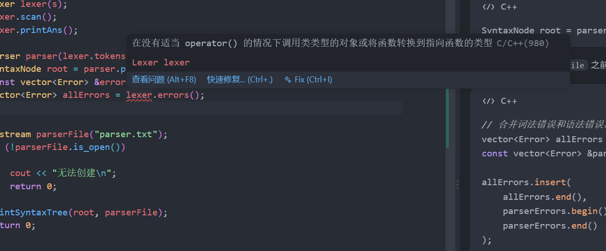

# 规划语法阶段下一步

- 会话时间：2026-10-04 14:44:19
- 会话编号：`01a105a8-021b-7690-86f5-458f98fde4ba`
- 导出范围：仅保留用户与助手可见消息，已排除系统提示、开发者指令、内部推理和工具调用。

## 1. 用户

时间：2026-10-04 14:44:42

# Context from my IDE setup:

## Active file: src/parser/Parser.cpp

## Open tabs:
- Parser.cpp: src/parser/Parser.cpp
- Parser.h: src/parser/Parser.h
- SyntaxNode.h: src/parser/SyntaxNode.h
- Token.h: src/common/Token.h
- SyntaxType.h: src/parser/SyntaxType.h

## My request:
现在请你开始检查现在语法阶段，规划下一阶段

---

## 2. 助手

时间：2026-10-04 14:44:47

我先检查当前语法分析的代码、完成情况和课程要求，再根据实际缺口规划下一阶段。

---

## 3. 助手

时间：2026-10-04 14:45:03

当前声明、函数、控制语句和表达式的主要解析代码都已写出，左结合表达式的建树方式也正确。最明显的缺口是错误恢复：缺少 `;`、`)`、`]` 时，目前会直接抛异常。我会使用 PDF 技能核对课程规则，并在临时目录构建、运行样例，检查实际输出。

---

## 4. 助手

时间：2026-10-04 14:46:03

**当前语法分析的正常路径已经基本成形；下一步应先补齐语法错误恢复，再进入语义分析。** 本次只检查和测试，没有修改源码。

我对照了课程文法 PDF 和实验二要求，并在临时目录重新构建、运行测试：

| 检查项 | 结果 |
|---|---|
| CMake 构建 | 通过 |
| 课程正确样例 | `parser.txt` 与预期逐行一致 |
| 当前样例及另外 6 组正常用例 | 均完成解析，覆盖声明、数组、函数、运算符、循环、switch 等 |
| 课程错误样例 | 异常退出，只输出 `4 a`，漏掉 `3 i` |
| 7 组缺少分隔符的用例 | 全部异常退出 |
| 单独的词法错误用例 | 正确输出 `a` |

正常用例中，只有课程样例做了完整输出比对，其他属于运行检查；这些结果还不能代表平台全部通过。

**已经做好的部分**

- `SyntaxNode` 保存终结符和非终结符，能够保留完整语法树供后续使用。
- 声明、函数、语句和各层表达式都有对应解析函数。
- [表达式解析](/home/zzz2007-cpu/projects/compiler/src/parser/Parser.cpp:178)通过循环不断把旧树放到新树左侧，正确保留左结合结构。
- 输出时跳过 `Decl`、`BType`、`BlockItem`，符合实验要求。
- 字符串初始化、显式类型转换、`printf`、`static` 都已处理。字符串初始化在 PDF 正文中有规定，应当保留。

**目前需要优先解决的三个问题**

1. **缺少 `i/j/k` 错误记录和恢复。**

   [consume()](/home/zzz2007-cpu/projects/compiler/src/parser/Parser.cpp:37)遇到不匹配直接抛异常，[Error.h](/home/zzz2007-cpu/projects/compiler/src/common/Error.h:3)也只有 `a`。

   对课程规定的缺少 `;`、`)`、`]`，应记录对应错误，行号取**上一个已消费 token 的行号**，保留当前 token，继续分析。比如：

   ```c
   int a = 1
   return 0;
   ```

   发现缺分号时，`return` 属于下一条语句，不能把它跳过去。

2. **只改 `consume()` 还不够，部分分支会提前走错。**

   - [return 分支](/home/zzz2007-cpu/projects/compiler/src/parser/Parser.cpp:294)：现在“不是分号就解析表达式”。`return` 后直接遇到 `}` 时，会误入表达式解析。
   - [函数调用](/home/zzz2007-cpu/projects/compiler/src/parser/Parser.cpp:133)和[函数定义](/home/zzz2007-cpu/projects/compiler/src/parser/Parser.cpp:687)：现在“不是右括号就解析参数”。无参数且缺少 `)` 时也会走错。
   - [findAssignment()](/home/zzz2007-cpu/projects/compiler/src/parser/Parser.cpp:459)：依赖配对成功的 `]` 判断数组赋值，`a[0 = 1;` 会被误判成表达式语句。

   所以需要根据“当前 token 能否开始表达式或形参”判断可选部分，并让赋值判断兼容缺少 `]` 的情况。

3. **错误输出尚未统一。**

   [main.cpp](/home/zzz2007-cpu/projects/compiler/src/main.cpp:23)在语法分析前调用 `lexer.printAns()`，此时 `error.txt` 只包含词法错误。下一步应在分析结束后合并词法、语法错误，按行号排序，再统一输出。

另外，`parseCompUnit()` 没有检查末尾是否还有 token；实测 `main` 后的多余声明会被静默忽略。这属于后续稳健性完善，优先级低于课程明确要求的错误恢复。

**下一阶段按这个顺序推进**

| 步骤 | 主要文件 | 完成标准 |
|---|---|---|
| ① 增加错误状态 | `common/Error.h`、`Parser.h` | 定义 `i/j/k`，Parser 能保存并提供错误列表 |
| ② 实现分隔符恢复 | `Parser.cpp` | 缺少符号时正确报错，后续语句仍能建树 |
| ③ 修正分支判断 | `Parser.cpp` | 无参调用、空 return、数组赋值的缺符号情况能够恢复 |
| ④ 统一输出并回归 | `main.cpp` | 课程错误样例输出 `3 i`、`4 a`；正确样例输出保持一致 |

**这四步完成后，再开始语义分析。** 语法分析负责判断“这是什么结构”，语义分析进一步判断“名字是否定义、类型是否匹配、使用是否合法”。

建议复用现有语法树，新增 `src/semantic/`：

- `Symbol.h`：记录名字、类型、常量属性、函数参数等信息。
- `SymbolTable.h/.cpp`：管理作用域，支持当前层查重、向外层查找。
- `SemanticAnalyzer.h/.cpp`：遍历语法树，收集语义错误。

语义阶段先实现**作用域和符号表 → 重定义 `b`、未定义 `c` → 修改常量 `h`**，之后再处理函数参数、表达式类型、返回语句和控制语句。

你现在最适合开始的一个小步骤是：**让缺少分号的程序记录一个 `i`，同时仍能解析完后面的 `return` 和整个函数。** 先把这条恢复链路跑通，再扩展到 `j/k`。
<oai-mem-citation>
<citation_entries>
MEMORY.md:94-109|note=[Used prior learning preferences and parser architecture context; verified current code and requirements]
</citation_entries>
<rollout_ids>
01a0fb8c-2fd5-7ce1-a156-9e997955778e
</rollout_ids>
</oai-mem-citation>

---

## 5. 用户

时间：2026-10-04 14:46:47

# Response annotations:
Each item contains text selected from an earlier Codex response and may include a user comment. Treat items as Annotation 1, Annotation 2, and so on in array order. Use every selection as context and address every comment. For every annotation you address, include its inline directive `:codex-annotation{index="N"}`, where N is its one-based array position (for example, `:codex-annotation{index="1"}`). Do not use unstructured annotation labels.
<response-annotations>
[{"text":"缺少 i/j/k 错误记录和恢复。consume() (line 37)遇到不匹配直接抛异常，Error.h (line 3)也只有 a。对课程规定的缺少 ;、)、]，应记录对应错误，行号取上一个已消费 token 的行号，保留当前 token，继续分析。比如：  C  int a = 1\nreturn 0;发现缺分号时，return 属于下一条语句，不能把它跳过去。","source":{"messageId":"msg_0cbe8614d1da6f86016ac1f619548087d18d84d63e0df79f45","startOffset":495,"endOffset":680}}]
</response-annotations>
# Context from my IDE setup:

## Open tabs:
- Parser.cpp: src/parser/Parser.cpp
- Parser.h: src/parser/Parser.h
- SyntaxNode.h: src/parser/SyntaxNode.h
- Token.h: src/common/Token.h
- SyntaxType.h: src/parser/SyntaxType.h

## My request:
这一部分如何修改呢？

---

## 6. 助手

时间：2026-10-04 14:46:49

我先核对 `consume()` 和错误结构的当前写法，再给你这一部分的具体修改位置和代码。

---

## 7. 助手

时间：2026-10-04 14:47:10

这一部分可以集中修改 `consume()`：**匹配成功就正常取走 token；缺少 `;`、`)`、`]` 时，记录错误并返回一个补出的 token，但不移动 `pos`。** 这样可以保持你现有的建树代码不变。:codex-annotation{index="1"}

按下面三处修改即可。

**1. 在 [Error.h](/home/zzz2007-cpu/projects/compiler/src/common/Error.h:3) 中扩展错误类型**

将原来的 `ErrorType` 替换为：

```cpp
enum class ErrorType : char
{
    IllegalSymbol = 'a',
    MissingSemicolon = 'i',
    MissingRightParenthesis = 'j',
    MissingRightBracket = 'k'
};
```

下面的 `Error` 结构体不用改。

**2. 在 [Parser.h](/home/zzz2007-cpu/projects/compiler/src/parser/Parser.h) 中保存错误**

先添加头文件：

```cpp
#include "common/Error.h"
```

在 `private:` 下增加：

```cpp
vector<Error> errors;
```

在 `public:` 下增加只读访问接口，方便之后由 `main()` 统一输出：

```cpp
const vector<Error> &getErrors() const
{
    return errors;
}
```

**3. 替换 [Parser.cpp 中的 consume()](/home/zzz2007-cpu/projects/compiler/src/parser/Parser.cpp:37)**

```cpp
Token Parser::consume(TokenType expected)
{
    // 正常匹配：取走当前 token，前进一位。
    if (check(expected))
    {
        return tokens[pos++];
    }

    ErrorType errorType;
    string spelling;

    // 只对课程规定的三种缺失符号进行恢复。
    switch (expected)
    {
    case TokenType::SEMICN:
        errorType = ErrorType::MissingSemicolon;
        spelling = ";";
        break;

    case TokenType::RPARENT:
        errorType = ErrorType::MissingRightParenthesis;
        spelling = ")";
        break;

    case TokenType::RBRACK:
        errorType = ErrorType::MissingRightBracket;
        spelling = "]";
        break;

    default:
        throw runtime_error("unexpected token");
    }

    // 报错位置是上一个已经消费的 token 所在行。
    // pos == 0 时用第 1 行兜底，避免访问 tokens[-1]。
    int errorLine = pos > 0 ? tokens[pos - 1].line : 1;
    errors.emplace_back(errorType, errorLine);

    // 返回补出的符号供语法树使用，但不消费当前输入。
    return Token(expected, spelling, errorLine);
}
```

这里最关键的是末尾**没有 `pos++`**。

例如：

```c
int main() {
    int a = 1
    return 0;
}
```

解析完 `1` 后，状态是：

```text
tokens[pos - 1] → 1       第 2 行
tokens[pos]     → return  第 3 行
```

此时调用 `consume(TokenType::SEMICN)`：

1. 当前是 `return`，不符合期望的 `;`。
2. 记录错误 `2 i`。
3. 返回一个补出的 `;`，让变量声明结束。
4. `pos` 不变，下一次分析语句时仍从 `return` 开始。

原来的调用可以保持不变：

```cpp
node.children.emplace_back(consume(TokenType::SEMICN));
```

它会把补出的分号放进语法树。这个 token 只用于恢复后的树结构，没有插入原始 `tokens` 数组。

完成这三处后，上面例子应能解析到结尾，`parser.getErrors()` 中应有一条 `2 i`。**此时错误还不会自动写进 `error.txt`**，下一步需要在 `main()` 合并词法和语法错误再输出。

另外，这一步只解决“已经走到 `consume()` 时如何恢复”；前面提到的无参调用、空 `return` 和数组赋值分支判断，还需要随后单独调整。
<oai-mem-citation>
<citation_entries>
MEMORY.md:97-97|note=[Kept guidance scoped to the requested parser change]
MEMORY.md:109-109|note=[Used parser recovery and error line conventions]
</citation_entries>
<rollout_ids>
01a0fb8c-2fd5-7ce1-a156-9e997955778e
</rollout_ids>
</oai-mem-citation>

---

## 8. 用户

时间：2026-10-04 14:52:53

# Context from my IDE setup:

## Active file: src/parser/Parser.cpp

## Open tabs:
- Parser.cpp: src/parser/Parser.cpp
- Parser.h: src/parser/Parser.h
- Error.h: src/common/Error.h
- SyntaxNode.h: src/parser/SyntaxNode.h
- Token.h: src/common/Token.h

## My request:
已经完成，接下来呢

---

## 9. 助手

时间：2026-10-04 14:52:58

我先检查你刚改的错误恢复代码，再确定下一步从哪里接上。

---

## 10. 助手

时间：2026-10-04 14:53:31

你这次的 `consume()` 修改正确：缺符号时记录错误，并且没有移动 `pos`。我重新构建并测试了缺分号的程序，已经能解析到 `<CompUnit>`，但 `error.txt` 还是空的。

**下一步：在 `main()` 中把词法错误和语法错误合并输出。**

原因是目前 `lexer.printAns()` 只输出 `lexer.errors`，Parser 保存的错误还没有写入文件。

在 [main.cpp](/home/zzz2007-cpu/projects/compiler/src/main.cpp) 中找到：

```cpp
SyntaxNode root = parser.parse();
```

在它后面、创建 `parserFile` 之前，插入：

```cpp
// 合并词法错误和语法错误。
vector<Error> allErrors = lexer.errors;
const vector<Error> &parserErrors = parser.getErrors();

allErrors.insert(
    allErrors.end(),
    parserErrors.begin(),
    parserErrors.end()
);

// 两个阶段分别收集错误，合并后需要按行号排序。
stable_sort(
    allErrors.begin(),
    allErrors.end(),
    [](const Error &a, const Error &b)
    {
        return a.line < b.line;
    }
);

// 覆盖之前仅包含词法错误的 error.txt。
ofstream errorFile("error.txt");
if (!errorFile.is_open())
{
    cout << "无法创建 error.txt\n";
    return 1;
}

for (const Error &error : allErrors)
{
    errorFile << error.line << ' '
              << static_cast<char>(error.type) << '\n';
}
```

暂时保留前面的 `lexer.printAns()`，这段代码会覆盖它写出的错误文件。后面再整理输出职责。

用下面的 `testfile.txt` 验证：

```c
int main() {
    int a = 1
    if (a & 1) {
        a = 2;
    }
    return 0;
}
```

预期 `error.txt`：

```text
2 i
3 a
```

这个例子同时验证三件事：**缺分号后继续解析、两阶段错误合并、按行号排序**。

这一步通过后，再处理“可选表达式和参数的判断”：例如 `return` 后遇到 `}` 时，应该报告缺分号，而不是尝试把 `}` 解析成表达式。
<oai-mem-citation>
<citation_entries>
MEMORY.md:96-97|note=[Followed staged learning guidance with one concrete next step]
</citation_entries>
<rollout_ids>
01a0fb8c-2fd5-7ce1-a156-9e997955778e
</rollout_ids>
</oai-mem-citation>

---

## 11. 用户

时间：2026-10-04 14:56:18

# Context from my IDE setup:

## Active file: src/main.cpp

## Open tabs:
- main.cpp: src/main.cpp
- Lexer.h: src/lexer/Lexer.h
- Lexer.cpp: src/lexer/Lexer.cpp
- error.txt: error.txt
- testfile.txt: testfile.txt

## My request:



---

## 12. 助手

时间：2026-10-04 14:56:21

红线指向 `lexer.errors()`；我核对一下 `Lexer` 中 `errors` 的声明。

---

## 13. 助手

时间：2026-10-04 14:56:26

把这一行的 `()` 去掉：

```cpp
vector<Error> allErrors = lexer.errors;
```

因为 `Lexer.h` 中定义的是**成员变量**：

```cpp
vector<Error> errors;
```

写成 `lexer.errors()` 就是在把这个 vector 当函数调用，所以报“没有适当的 `operator()`”。

两者区别是：

```cpp
lexer.errors          // 访问成员变量，不加括号
parser.getErrors()    // 调用成员函数，需要括号
```

另外，磁盘上的 `main.cpp` 还没有截图中的新增代码，修改后记得保存。

---

## 14. 用户

时间：2026-10-04 14:56:45

# Context from my IDE setup:

## Active file: src/main.cpp

## Open tabs:
- main.cpp: src/main.cpp
- Lexer.h: src/lexer/Lexer.h
- Lexer.cpp: src/lexer/Lexer.cpp
- error.txt: error.txt
- testfile.txt: testfile.txt

## My request:
不如直接把parser的errors也pubilc

---

## 15. 助手

时间：2026-10-04 14:56:49

可以，现阶段这样更直接，也和 `Lexer` 保持一致。

在 `Parser.h` 中，把：

```cpp
vector<Error> errors;
```

从 `private:` 移到 `public:`，然后删除 `getErrors()` 函数。

`main.cpp` 中就可以这样合并：

```cpp
vector<Error> allErrors = lexer.errors;

allErrors.insert(
    allErrors.end(),
    parser.errors.begin(),
    parser.errors.end()
);
```

后面的排序和输出代码不变。

区别只是：`public` 允许外部直接修改错误列表；原来的 getter 只允许外部读取。你目前这个小项目采用公开成员完全可以。

---

## 16. 用户

时间：2026-10-04 14:59:12

# Context from my IDE setup:

## Active file: src/main.cpp

## Open tabs:
- main.cpp: src/main.cpp
- Parser.h: src/parser/Parser.h
- Lexer.h: src/lexer/Lexer.h
- Lexer.cpp: src/lexer/Lexer.cpp
- error.txt: error.txt

## My request:
```lua
static_cast<char>(error.type)
这到底是啥
```

---

## 17. 助手

时间：2026-10-04 14:59:17

`static_cast<char>(error.type)` 就是：**把 `error.type` 显式转换成 `char` 字符类型。**

你定义的错误类型是：

```cpp
enum class ErrorType : char
{
    IllegalSymbol = 'a',
    MissingSemicolon = 'i',
    MissingRightParenthesis = 'j',
    MissingRightBracket = 'k'
};
```

虽然底层用字符存储，但 `error.type` 的类型仍然是 `ErrorType`，不是 `char`。`enum class` 不会自动转成字符，所以输出前需要手动转换：

```cpp
// 假设 error.type 是 ErrorType::MissingSemicolon
char code = static_cast<char>(error.type); // 得到字符 'i'
cout << code;                             // 输出 i
```

因此这行：

```cpp
errorFile << error.line << ' '
          << static_cast<char>(error.type) << '\n';
```

假设错误在第 2 行、缺少分号，就会输出：

```text
2 i
```

它和你之前写的 `(char)error.type` 在这里效果一样，`static_cast<char>(...)` 是 C++ 中更明确的转换写法。

---

## 18. 用户

时间：2026-10-04 14:59:32

# Context from my IDE setup:

## Active file: src/main.cpp

## Open tabs:
- main.cpp: src/main.cpp
- Parser.h: src/parser/Parser.h
- Lexer.h: src/lexer/Lexer.h
- Lexer.cpp: src/lexer/Lexer.cpp
- error.txt: error.txt

## My request:
不能（char）吗

---

## 19. 助手

时间：2026-10-04 14:59:37

可以，这里写 `(char)error.type` 效果一样：

```cpp
errorFile << error.line << ' '
          << (char)error.type << '\n';
```

注意代码里用英文半角括号 `()`。

---

## 20. 用户

时间：2026-10-04 15:00:15

# Context from my IDE setup:

## Active file: src/main.cpp

## Open tabs:
- main.cpp: src/main.cpp
- Parser.h: src/parser/Parser.h
- Lexer.h: src/lexer/Lexer.h
- Lexer.cpp: src/lexer/Lexer.cpp
- error.txt: error.txt

## My request:
好了errorfile有了，原来的那个输出呢

---

## 21. 助手

时间：2026-10-04 15:00:25

原来有两处输出，分别处理：

**1. `main.cpp` 中输出 `parser.txt` 的代码保留。**

正确程序输出语法树，有错误的程序输出错误。可以在写完错误后加：

```cpp
if (!allErrors.empty())
{
    return 0;
}
```

然后接原来的代码：

```cpp
ofstream parserFile("parser.txt");
if (!parserFile.is_open())
{
    cout << "无法创建\n";
    return 1;
}
printSyntaxTree(root, parserFile);
```

**2. `Lexer::printAns()` 中写 `error.txt` 的部分删掉。**

就是这一段：

```cpp
ofstream errorOut("error.txt");
for (Error error : errors)
{
    errorOut << error.line << ' ' << (char)error.type << '\n';
}
```

保留它输出 `lexer.txt` 的部分即可。这样，**错误由 `main()` 合并后统一输出**，不会重复写文件。

注意：出错时跳过语法树输出，磁盘上可能还留着上一次的 `parser.txt`，它不代表本次结果。

---

## 22. 用户

时间：2026-10-04 15:01:17

# Context from my IDE setup:

## Active file: src/main.cpp

## Open tabs:
- main.cpp: src/main.cpp
- Parser.h: src/parser/Parser.h
- Lexer.h: src/lexer/Lexer.h
- Lexer.cpp: src/lexer/Lexer.cpp
- error.txt: error.txt

## My request:
现在这个已经能通过语法分析了吗

---

## 23. 助手

时间：2026-10-04 15:01:20

我先检查你保存的最新代码，再跑课程样例和几组缺符号的用例，确认目前能通过哪些情况。

---

## 24. 助手

时间：2026-10-04 15:01:51

**课程的正确、错误样例现在都能通过，但语法分析还没完全完成。** 我刚用你保存的最新代码重新构建并测试：

| 测试 | 结果 |
|---|---|
| 课程正确样例 | `parser.txt` 与预期完全一致 |
| 课程错误样例 | 正确输出 `3 i`、`4 a` |
| `return 0` 缺分号 | 正确报 `i` |
| `main` 缺右括号 | 正确报 `j` |
| 数组定义缺 `]` | 正确报 `k` |
| 强制转换缺 `)` | 正确报 `j` |
| 空 `return` 缺分号 | **异常退出** |
| 无参调用缺 `)` | **异常退出** |
| 无参函数定义缺 `)` | **异常退出** |
| 数组赋值缺 `]` | **异常退出** |

剩下的问题是：**部分分支在到达 `consume()` 之前，就选错了解析路径。**

例如：

```c
void f() {
    return
}
int main() { return 0; }
```

[return 分支](/home/zzz2007-cpu/projects/compiler/src/parser/Parser.cpp:319)现在的判断是：

```cpp
if (!check(TokenType::SEMICN))
{
    node.children.emplace_back(parseExp());
}
```

遇到 `}`，因为它不是分号，就错误地调用了 `parseExp()`，还没走到分号恢复就崩溃了。

**下一步先增加 `isExpStart()`：判断当前 token 能否作为表达式的开头。** 然后用它判断 `return` 后是否存在表达式，以及函数调用是否存在实参。再处理函数形参判断和数组赋值判断。

目前已经打通“记录错误 → 继续解析 → 合并输出”，但上述四类失败用例修好前，还不能认为能完整通过语法分析评测。
<oai-mem-citation>
<citation_entries>
MEMORY.md:116-116|note=[Used fresh build and course tests to distinguish partial success from completion]
</citation_entries>
<rollout_ids>
01a0fb8c-2fd5-7ce1-a156-9e997955778e
</rollout_ids>
</oai-mem-citation>

---

## 25. 用户

时间：2026-10-04 15:02:28

# Context from my IDE setup:

## Active file: src/main.cpp

## Open tabs:
- main.cpp: src/main.cpp
- Parser.h: src/parser/Parser.h
- Lexer.h: src/lexer/Lexer.h
- Lexer.cpp: src/lexer/Lexer.cpp
- error.txt: error.txt

## My request:
空 `return` 缺分号**异常退出**无参调用缺 `)`**异常退出**无参函数定义缺 `)`**异常退出**数组赋值缺 `]`**异常退出** &#x20;
这四个都是因为什么

---

## 26. 助手

时间：2026-10-04 15:02:50

这四个问题的共同点是：**还没到补符号的 `consume()`，前面的分支判断就已经走错了。**

**1. 空 `return` 缺分号**

```c
return
}
```

你现在判断的是：

```cpp
if (!check(TokenType::SEMICN))
{
    node.children.emplace_back(parseExp());
}
```

当前 token 是 `}`，不是分号，于是调用 `parseExp()`。但 `}` 不能组成表达式，最终抛异常。

原因：**“不是分号”不等于“后面有表达式”。**

应该判断当前 token 能否作为表达式开头；不能的话，直接走 `consume(SEMICN)`，记录缺分号。

**2. 无参调用缺 `)`**

```c
f(;
```

函数调用中，你现在判断的是：

```cpp
if (!check(TokenType::RPARENT))
{
    node.children.emplace_back(parseFuncRParams());
}
```

当前 token 是 `;`，不是 `)`，于是认为存在实参，尝试把 `;` 解析成表达式，最终抛异常。

原因：**“不是右括号”不等于“存在实参”。**

这里也应该判断当前 token 能否开始表达式。不能的话，直接走 `consume(RPARENT)`，记录缺右括号；原来的 `;` 留给语句结尾处理。

**3. 无参函数定义缺 `)`**

```c
void f( {
    return;
}
```

函数定义中同样有：

```cpp
if (!check(TokenType::RPARENT))
{
    node.children.emplace_back(parseFuncFParams());
}
```

当前 token 是 `{`，不是 `)`，于是进入形参解析。但形参必须以 `int` 或 `char` 开头，`{` 不符合，因此抛异常。

原因：**“不是右括号”不等于“存在形参”。**

这里应该只在遇到 `INTTK` 或 `CHARTK` 时解析形参，否则交给 `consume(RPARENT)` 恢复。

**4. 数组赋值缺 `]`**

```c
a[0 = 1;
```

你的 `findAssignment()` 会先寻找匹配的 `]`，再检查后面是不是 `=`。

这里缺少 `]`，它就返回 `false`，把这条语句当成普通表达式语句。

随后发生的过程是：

```text
解析 a[0
→ 遇到 =，补出缺少的 ]，记录 k
→ 表达式结束，但当前 token 仍然是 =
→ 期望分号，又错误地记录 i
→ 下一轮从 = 开始解析语句
→ = 不能开始表达式，抛异常
```

原因：**赋值判断依赖完整的 `]`，缺符号时把赋值语句误判成了表达式语句。**

这里需要调整 `findAssignment()`，让它在下标缺少 `]`、但已经遇到赋值号 `=` 时，仍能识别赋值。

所以修改分成三处：

| 问题 | 应调整的判断 |
|---|---|
| 空 return、无参调用 | 当前 token **能否开始表达式** |
| 无参函数定义 | 当前 token **是否为 `int` 或 `char`** |
| 数组赋值 | 缺少 `]` 时，仍能识别后面的赋值号 |

你写的补符号逻辑可以继续保留，接下来要修的是这些**决定进入哪个解析函数的条件**。

---

## 27. 用户

时间：2026-10-04 15:03:07

# Context from my IDE setup:

## Active file: src/main.cpp

## Open tabs:
- main.cpp: src/main.cpp
- Parser.h: src/parser/Parser.h
- Lexer.h: src/lexer/Lexer.h
- Lexer.cpp: src/lexer/Lexer.cpp
- error.txt: error.txt

## My request:
那如何修改

---

## 28. 助手

时间：2026-10-04 15:03:11

我先核对这四处的当前代码，再给你对应的替换位置和代码。

---

## 29. 助手

时间：2026-10-04 15:04:12

按下面几处修改。我已经在临时副本中验证：这四种错误都能正确报错，课程正确样例输出也保持一致。**你的源码还没有被我修改。**

**1. 增加“能否开始表达式”的判断**

在 [Parser.h](/home/zzz2007-cpu/projects/compiler/src/parser/Parser.h) 的 `private:` 中增加声明：

```cpp
bool isExpStart() const;
```

在 [Parser.cpp](/home/zzz2007-cpu/projects/compiler/src/parser/Parser.cpp) 中增加实现：

```cpp
bool Parser::isExpStart() const
{
    return check(TokenType::IDENFR) ||  // a、f()
           check(TokenType::INTCON) ||  // 123
           check(TokenType::CHARCON) || // 'a'
           check(TokenType::LPARENT) || // (a + b)、(int)a
           check(TokenType::PLUS) ||    // +a
           check(TokenType::MINU) ||    // -a
           check(TokenType::NOT);       // !a，用于条件表达式
}
```

这个函数只检查当前 token，**不消费输入**。这里包含 `NOT` 是为了兼容共用的表达式解析入口，不代表普通 `Exp` 就允许使用 `!`。

**2. 修改 `parseStmt()` 中的 return 分支**

把：

```cpp
if (!check(TokenType::SEMICN))
{
    node.children.emplace_back(parseExp());
}
```

替换为：

```cpp
if (isExpStart())
{
    node.children.emplace_back(parseExp());
}
```

只改 `return` 分支里的这一处。

这样 `return` 后遇到 `}`，就不会强行解析表达式，而是继续执行函数末尾的 `consume(SEMICN)`，记录 `i`。

**3. 修改 `parseUnaryExp()` 中的函数调用分支**

找到调用 `parseFuncRParams()` 的位置，把：

```cpp
if (!check(TokenType::RPARENT))
{
    node.children.emplace_back(parseFuncRParams());
}
```

替换为：

```cpp
if (isExpStart())
{
    node.children.emplace_back(parseFuncRParams());
}
```

这样 `f(;` 遇到分号时，不解析实参，接下来的 `consume(RPARENT)` 会记录 `j`。

**4. 修改 `parseFuncDef()` 中的形参判断**

把：

```cpp
if (!check(TokenType::RPARENT))
{
    node.children.emplace_back(parseFuncFParams());
}
```

替换为：

```cpp
if (check(TokenType::INTTK) || check(TokenType::CHARTK))
{
    node.children.emplace_back(parseFuncFParams());
}
```

因为形参只能以 `int` 或 `char` 开头。遇到 `{`，就直接进入后面的右括号恢复。

**5. 修改 `findAssignment()` 的扫描循环**

找到：

```cpp
while (sum > 0 && pos + i < tokens.size())
{
    if (tokens[pos + i].type == TokenType::LBRACK)
```

在循环内、原来的 `if` 前面插入下面这段：

```cpp
TokenType type = tokens[pos + i].type;

// 下标表达式中不允许出现赋值号。
// 遇到 =，说明这是赋值语句，即使前面的 ] 缺失。
if (type == TokenType::ASSIGN)
{
    return true;
}

// 不要越过语句结尾或花括号，继续寻找赋值号。
if (type == TokenType::SEMICN ||
    type == TokenType::LBRACE ||
    type == TokenType::RBRACE)
{
    return false;
}
```

原来的中括号计数和循环后的判断保留。

对于：

```c
a[0 = 1;
```

修改后的处理顺序就是：

```text
findAssignment() 看到 =，判定为赋值
→ parseLVal() 解析 a[0，补出 ] 并记录 k
→ consume(ASSIGN) 正常消费 =
→ parseExp() 解析 1
→ consume(SEMICN) 正常消费 ;
```

完成这些修改后，可以用一个程序验证四种情况：

```c
void f( {
    return
}
int main() {
    int a[3];
    f(;
    a[0 = 1;
    return 0;
}
```

预期 `error.txt`：

```text
1 j
2 i
6 j
7 k
```
<oai-mem-citation>
<citation_entries>
MEMORY.md:96-97|note=[Kept changes scoped and explained each parser decision for staged learning]
</citation_entries>
<rollout_ids>
01a0fb8c-2fd5-7ce1-a156-9e997955778e
</rollout_ids>
</oai-mem-citation>

---

## 30. 用户

时间：2026-10-04 15:09:17

# Context from my IDE setup:

## Active file: src/parser/Parser.cpp

## Open tabs:
- Parser.cpp: src/parser/Parser.cpp
- Parser.h: src/parser/Parser.h
- main.cpp: src/main.cpp
- Lexer.h: src/lexer/Lexer.h
- Lexer.cpp: src/lexer/Lexer.cpp

## My request:
```rust
if (type == TokenType::SEMICN ||
    type == TokenType::LBRACE ||
    type == TokenType::RBRACE)
{
    return false;
}
为什么要这样搞
```

---

## 31. 助手

时间：2026-10-04 15:09:31

这是给 `findAssignment()` 设置**向后查找的停止位置**，避免缺少 `]` 时，一直查到后面的语句。

例如：

```c
a[0;       // 缺少 ]
b = 1;
```

`findAssignment()` 从 `a[` 开始寻找匹配的 `]`。如果没有停止条件，它会越过分号，看到下一句 `b = 1` 的 `=`，然后误以为 **`a[0` 是一条赋值语句**。

加上：

```cpp
if (type == TokenType::SEMICN ||
    type == TokenType::LBRACE ||
    type == TokenType::RBRACE)
{
    return false;
}
```

含义就是：

- 遇到 `;`：这条语句已经结束，不能再往下一句找。
- 遇到 `{` 或 `}`：到了语句块边界，也不能继续跨过去找。

这些符号都不可能出现在合法的数组下标表达式内部。

这里的 `return false` **只表示“没有判断为赋值语句”**，不会结束整个语法分析，也不会消费当前 token。之后仍会按表达式语句解析 `a[0`，由 `consume(RBRACK)` 报缺少 `]` 的错误。

---

## 32. 用户

时间：2026-10-04 15:10:46

# Context from my IDE setup:

## Active file: src/parser/Parser.cpp

## Open tabs:
- Parser.cpp: src/parser/Parser.cpp
- Parser.h: src/parser/Parser.h
- main.cpp: src/main.cpp
- Lexer.h: src/lexer/Lexer.h
- Lexer.cpp: src/lexer/Lexer.cpp

## My request:
好的，修改完毕，现在开始验证

---

## 33. 助手

时间：2026-10-04 15:10:50

我会重新构建你保存的代码，先验证课程样例和刚修复的四种错误，再检查其他缺符号情况及正常语法的回归结果。测试放在临时目录，不覆盖你当前的输入和输出文件。

---

## 34. 助手

时间：2026-10-04 15:11:44

找到一处替换位置错误：`parseStmt()` 中识别 `return` 的外层条件被改成了 `isExpStart()`，而需要修改的是它里面的条件。这导致连 `return 0;` 都无法解析。我会在临时副本里纠正这两行，继续验证其余修改。

---

## 35. 助手

时间：2026-10-04 15:12:16

**发现一处条件改错位置；在临时副本中纠正后，68 组本地测试全部通过。** 你的源码尚未修改。

问题在 [Parser.cpp:316](/home/zzz2007-cpu/projects/compiler/src/parser/Parser.cpp:316)，目前写成：

```cpp
if (isExpStart())
{
    node.children.emplace_back(consume(TokenType::RETURNTK));
    if (!check(TokenType::SEMICN))
```

应该改成：

```cpp
if (check(TokenType::RETURNTK))
{
    node.children.emplace_back(consume(TokenType::RETURNTK));
    if (isExpStart())
    {
        node.children.emplace_back(parseExp());
    }
}
```

**外层判断“是否为 return 语句”，内层判断“return 后是否有表达式”。** 现在写反了，导致普通的 `return 0;` 也会异常退出。

仅纠正这两处条件后，验证结果如下：

| 测试范围 | 结果 |
|---|---|
| 课程正确样例 | 输出逐行一致 |
| 课程错误样例 | 正确输出 `3 i`、`4 a` |
| 28 组缺符号用例及对应完整程序 | 全部通过；恢复后的树与完整程序一致 |
| 8 组正常语法回归 | 全部通过 |
| 四种错误组合、词法与语法错误混合 | 全部正确报错 |

测试记录在 [results.json](/tmp/compiler-parser-results-pn14gbb6/results.json)。改好上述条件后，这轮本地验证发现的问题就解决了；平台隐藏测试还需要提交确认。
<oai-mem-citation>
<citation_entries>
MEMORY.md:116-116|note=[Used fresh build and tests to distinguish local validation from platform acceptance]
</citation_entries>
<rollout_ids>
01a0fb8c-2fd5-7ce1-a156-9e997955778e
</rollout_ids>
</oai-mem-citation>

---

## 36. 用户

时间：2026-10-04 15:13:33

# Context from my IDE setup:

## Active file: src/parser/Parser.cpp

## Open tabs:
- Parser.cpp: src/parser/Parser.cpp
- Parser.h: src/parser/Parser.h
- main.cpp: src/main.cpp
- Lexer.h: src/lexer/Lexer.h
- Lexer.cpp: src/lexer/Lexer.cpp

## My request:
好的，现在已经修改完毕，请你全面测试，检查是否还有课程范围内的bug

---

## 37. 助手

时间：2026-10-04 15:13:42

我会先核对课程文法和错误处理范围，再对最新代码做覆盖测试，重点检查组合表达式、错误恢复和词法阶段对语法分析的影响。发现问题后会给出最小复现和对应位置。

---

## 38. 助手

时间：2026-10-04 15:14:10

最新代码已通过前面的 68 组回归测试。对照课程文档时发现一个此前没覆盖的地方：课程要求支持 `//` 和 `/* … */` 注释，但当前 Lexer 没有跳过注释的逻辑。我会验证它的实际影响，并增加表达式树的逐行比对和更多缺符号测试。

---

## 39. 助手

时间：2026-10-04 15:15:53

扩展测试中，260 组表达式/条件表达式的语法树逐行比对全部通过，39 组单处缺符号和 40 组多处错误恢复也通过。已确认的课程范围问题是注释处理：9 个含合法注释的用例异常退出。另有两类自动生成的用例会改变词法切分或造成语法歧义，已按课程约束排除，未计为代码问题。

---

## 40. 助手

时间：2026-10-04 15:16:55

**全面检查后，确认还有一个课程范围内的 bug：Lexer 没有处理注释。** 你刚修复的四类错误已经全部通过。

本轮重新构建并运行 **423 个测试实例：414 通过，9 失败**。

| 测试内容 | 结果 |
|---|---|
| 课程样例及前面的回归测试 | 68/68 |
| 表达式、条件表达式语法树逐行比对 | 260/260 |
| 综合程序及扩展缺符号、组合错误 | 80/80 |
| 补充词法联动检查 | 3/3 |
| 注释相关测试，含无注释对照 | 3/12 |

**失败原因**

课程文法 PDF 第 5—6 页明确支持 `//` 和 `/* … */`。但 [Lexer.cpp 的 scan()](/home/zzz2007-cpu/projects/compiler/src/lexer/Lexer.cpp:206)没有跳过注释，而是把 `/` 当成除号交给 Parser。

下面两个合法程序都会异常退出：

```c
int main() {
    // 注释
    return 0;
}
```

```c
int main() {
    /* 注释 */
    return 0;
}
```

注释放在程序开头、词法单元之间，或者跨多行，也复现了同一问题。

**下一步应补上 Lexer 的注释跳过逻辑**：单行注释跳到换行前；块注释跳到第一个 `*/`，同时更新其中的行号。

我在临时副本中只补了这项处理，**同一批 423 项全部通过**，确认了原因。工作区源码没有修改。

完整记录、失败用例和重跑脚本已保存到 [测试报告](/home/zzz2007-cpu/projects/compiler/output/parser-audit-2026-10-04/README.md)。除注释问题外，本轮未发现其他课程语法阶段范围内的 bug；平台隐藏测试尚未验证。
<oai-mem-citation>
<citation_entries>
MEMORY.md:105-109|note=[Used course authority and parser conventions to scope the audit]
MEMORY.md:116-116|note=[Distinguished current local verification from platform acceptance]
</citation_entries>
<rollout_ids>
01a0fb8c-2fd5-7ce1-a156-9e997955778e
</rollout_ids>
</oai-mem-citation>

---

## 41. 用户

时间：2026-10-04 15:17:24

# Context from my IDE setup:

## Active file: src/parser/Parser.cpp

## Open tabs:
- Parser.cpp: src/parser/Parser.cpp
- Parser.h: src/parser/Parser.h
- main.cpp: src/main.cpp
- Lexer.h: src/lexer/Lexer.h
- Lexer.cpp: src/lexer/Lexer.cpp

## My request:
好的，这个逻辑怎么搞呢

---

## 42. 助手

时间：2026-10-04 15:17:36

我先看一下当前 `scan()` 的结构，给你标出注释处理应该插入的位置。

---

## 43. 助手

时间：2026-10-04 15:18:05

注释由 **Lexer 直接跳过，不生成 token**，Parser 就不用处理它。

逻辑是看到 `/` 时，再看后一个字符：

- `//`：一直跳到换行前。
- `/*`：一直跳到第一个 `*/`，期间遇到换行就更新 `line`。
- 其他情况：继续按原逻辑识别除号 `/`。

在 [Lexer.cpp:216](/home/zzz2007-cpu/projects/compiler/src/lexer/Lexer.cpp:216) 的：

```cpp
char current = s[index];
```

**前面插入下面这段**，原有代码保留：

```cpp
if (s[index] == '/' && index + 1 < length)
{
    // 单行注释
    if (s[index + 1] == '/')
    {
        index += 2; // 跳过 //

        while (index < length && s[index] != '\n')
        {
            index++;
        }

        // 换行留给下一轮的 skipSpace() 处理。
        continue;
    }

    // 多行注释
    if (s[index + 1] == '*')
    {
        index += 2; // 跳过 /*

        while (index < length)
        {
            // 找到第一个 */，结束注释。
            if (s[index] == '*' &&
                index + 1 < length &&
                s[index + 1] == '/')
            {
                index += 2;
                break;
            }

            if (s[index] == '\n')
            {
                line++;
            }

            index++;
        }

        continue;
    }
}
```

这里要理解两个控制语句：

- `break`：退出**扫描块注释的内层循环**。
- `continue`：开始 `scan()` 外层循环的下一轮，避免把注释后的字符继续当作刚才的 `/` 处理。

**为什么单行注释不写 `line++`？**

因为它停在 `\n` 前，下一轮 `skipSpace()` 会消费换行并更新行号。块注释内部的换行不会经过 `skipSpace()`，所以必须自己计数。

字符串里的注释标记也不会被误删：

```c
printf("// 这只是字符串");
```

扫描到开头的 `"` 时，原来的 `getString()` 会一次取走整个字符串，里面的 `/` 不会再次进入注释判断。

修改后先用这个程序验证：

```c
int main() {
    // 单行注释
    int a = 6 / 2;
    /* 第一行
       第二行 */
    return a
}
```

预期 `error.txt`：

```text
6 i
```

它同时检查：两种注释能跳过、普通除号仍能识别、注释中的换行没有导致报错行号偏移。
<oai-mem-citation>
<citation_entries>
MEMORY.md:96-96|note=[Explained scanner state and one concrete implementation step]
MEMORY.md:107-107|note=[Ensured comment scanning advances or terminates]
</citation_entries>
<rollout_ids>
01a0fb8c-2fd5-7ce1-a156-9e997955778e
</rollout_ids>
</oai-mem-citation>

---

## 44. 用户

时间：2026-10-04 15:18:50

# Context from my IDE setup:

## Active file: src/lexer/Lexer.cpp

## Open tabs:
- Lexer.cpp: src/lexer/Lexer.cpp
- Parser.cpp: src/parser/Parser.cpp
- Parser.h: src/parser/Parser.h
- main.cpp: src/main.cpp
- Lexer.h: src/lexer/Lexer.h

## My request:
好的已经添加，现在再次检查，如果没有问题给我打包成课程要求提交的压缩包

---

## 45. 助手

时间：2026-10-04 15:18:55

我会重新构建并运行完整测试，再核对课程的提交格式；通过后只打包需要提交的源码，并从压缩包解压构建一次确认。

---

## 46. 助手

时间：2026-10-04 15:19:13

最新源码的 423 项测试全部通过，包括之前失败的注释用例。课程要求压缩包顶层包含 `CMakeLists.txt` 和 `config.json`；现有配置符合要求。我现在按这个结构打包，并验证解压后的代码。

---

## 47. 助手

时间：2026-10-04 15:19:33

已检查并打包：[下载语法分析实验代码.zip](/home/zzz2007-cpu/projects/compiler/output/语法分析实验代码.zip)

- 最新源码 **423 项本地测试全部通过**，注释问题已修复。
- 压缩包解压后重新构建，再跑同一批测试，全部通过。
- 顶层包含课程要求的 `CMakeLists.txt`、`config.json`，共 14 个文件，无构建产物或测试文件。

可以提交课程平台；隐藏测试结果以平台评测为准。
<oai-mem-citation>
<citation_entries>
MEMORY.md:107-107|note=[Used prior packaging verification practice; checked current course requirements]
</citation_entries>
<rollout_ids>
01a0ebf7-9b97-75f0-9b17-3c5ce662e84e
</rollout_ids>
</oai-mem-citation>

---
